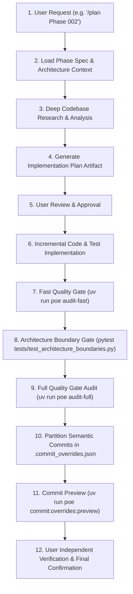

# PFETL Grand Refactor Runbook & Execution Governance

This skill governs the systematic, 50-phase architecture refactor of `personal-finance-etl` (v9.5.3 to v10.4.1+), transforming PFETL into a fully source-agnostic financial data engine while preserving PFETL-owned canonical Bronze, Silver, and Gold financial processing.

---

## 1. Core Architecture Authorities

Before implementing or planning any refactor phase, always consult:
1. `planning/grand-refactor/README.md`: Master phase roadmap, status table, milestones, and batch authorities.
2. `planning/grand-refactor/ARCHITECTURE.md`: Target data spine, configuration boundaries, stable identities (`DatasetId`, `SourceId`, `CapabilityId`), and migration discipline.
3. `planning/grand-refactor/phases/<phase_num>-*.md`: Specific outcome, inherited state, target state, files in scope, non-goals, and completion checklist for the active phase.
4. `AGENTS.md`: Seven-Layer Architecture boundary rules, prohibited imports, NumPy docstring standards, and quality gates.

---

## 2. Standard Phase Execution Workflow

Every phase must be executed with zero skipped gates:

---

## 3. Mandatory Invariants Across All 50 Phases

1. **Governing Product Invariant:**
   *Users configure their evidence and capabilities; PFETL owns the financial meaning.*
   - Financial methodology is never user-configurable.
   - Deterministic IDs (`PURCHASE`, `SALE`, `LOT`, `REALIZED`, `RECON_GROUP`, `TAX`) remain byte-stable.
2. **Seven-Layer Clean Boundaries:**
   - `contracts`: Pure, minimal cross-boundary types. Never import `domain`, `application`, `infrastructure`, or `presentation`.
   - `config`: User-authored validated configuration models.
   - `domain`: Pure financial logic and algorithms. Zero database, network, or UI imports.
   - `infrastructure`: Warehouse, SQLite control plane, and external providers.
   - `application`: Orchestration, pipelines, and planners.
   - `bootstrap`: Dependency injection and composition root.
   - `presentation`: UI and CLI only.
3. **Double-Commit Integrity:**
   - Commit DuckDB warehouse first, SQLite Control Plane second.
   - Any crash between commits enforces `RECOVERY_REQUIRED` semantics.
4. **Strict Typing Invariant (Zero-`Any` & Zero-`TYPE_CHECKING` Standard):**
   - Every class, function, parameter, return value, and data structure across all 50 phases must be strictly and concretely typed.
   - `Any` or untyped containers (`dict[Any, Any]`, `list[Any]`) are strictly forbidden. Use concrete types, TypeVars, generic protocols, or explicit type unions.
   - `from typing import TYPE_CHECKING` and `if TYPE_CHECKING:` blocks are **strictly forbidden** anywhere in the repository (`tests/test_phase12_constitutional_certification.py`).
   - Inline or deferred imports inside function, method, or class bodies are **strictly forbidden**. All imports must remain top-level.
   - All code must pass both Mypy (`disallow_untyped_defs = True`) and Pyright/Pylance without diagnostics.
5. **Full Quality Gate Audit Before Commit:**
   - At the conclusion of each phase or sub-phase prior to committing, execute `uv run poe audit-full`.
   - All 6 quality engines (Ruff Check, Ruff Format, Mypy Typecheck, Pyright Typecheck, Pylint Deep Analysis, Pytest Full Suite) must pass 100% green.

---

## 4. Semantic Commit Partitioning & Overrides Protocol

Never mix codebase implementation, tests, planning documentation, and agent skills into a single monolithic commit. Every phase must partition changes into discrete, semantic commit groups in `.commit_overrides.json`:

1. **Production Codebase:**
   - Format: `feat(<scope>): ...` or `refactor(<scope>): ...`
   - Scope: Target package (e.g. `contracts`, `config`, `domain`, `infrastructure`).
   - Files: Only production source files under `src/`.
2. **Test Suite:**
   - Format: `test(<scope>): ...`
   - Scope: Tested component or feature.
   - Files: Only test files under `tests/`.
3. **Planning & Roadmap Documentation:**
   - Format: `docs(refactor): ...`
   - Files: Files under `planning/grand-refactor/`.
4. **Agent Skills & Tooling:**
   - Format: `feat(skills): ...` or `chore(skills): ...`
   - Files: Files under `.agents/skills/`.

### Commit Header Rules
- Header line must be **strictly <= 72 characters**.
- Lowercase subject, no trailing punctuation.
- Preview all overrides before confirming: `uv run poe commit:overrides:preview`.
- **Never execute commits automatically.** Always allow the user to test independently and confirm before running `uv run poe commit:overrides`.
