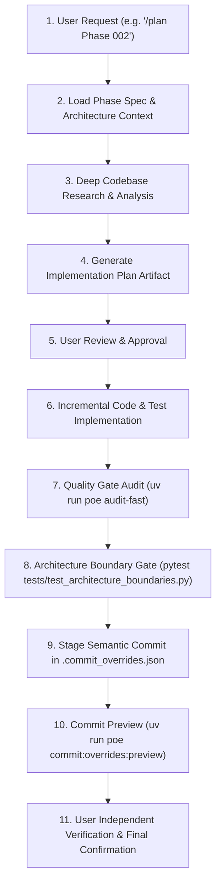

# PFETL Grand Refactor Runbook & Execution Governance

This skill governs the systematic, 50-phase architecture refactor of `personal-finance-etl` (v9.5.3 to v10.4.1+), transforming PFETL into a fully source-agnostic financial data engine while preserving PFETL-owned canonical Bronze, Silver, and Gold financial processing.

---

## 1. Core Architecture Authorities

Before implementing or planning any refactor phase, always consult:
1. `planning/grand-refactor/README.md`: Master phase roadmap, status table, milestones, and batch authorities.
2. `planning/grand-refactor/ARCHITECTURE.md`: Target data spine, configuration boundaries, stable identities (`DatasetId`, `SourceId`, `CapabilityId`), and migration discipline.
3. `planning/grand-refactor/phases/<phase_num>-*.md`: Specific outcome, inherited state, target state, files in scope, non-goals, and completion checklist for the active phase.
4. `AGENTS.md`: Seven-Layer Architecture boundary rules, prohibited imports, NumPy docstring standards, and fast quality gates.

---

## 2. Standard Phase Execution Workflow

Every phase must be executed with zero skipped gates:

---

## 3. Mandatory Invariants Across All 50 Phases

1. **Governing Product Invariant:**
   *Users configure their evidence and capabilities; PFETL owns the financial meaning.*
   - Financial methodology is never user-configurable.
   - Deterministic IDs (`PURCHASE`, `SALE`, `LOT`, `REALIZED`, `RECON_GROUP`, `TAX`) remain byte-stable.
2. **Seven-Layer Clean Boundaries:**
   - `contracts`: Pure, minimal cross-boundary types. Never import `domain`, `application`, `infrastructure`, or `presentation`.
   - `config`: User-authored validated configuration models.
   - `domain`: Pure financial logic and algorithms. Zero database, network, or UI imports.
   - `infrastructure`: Warehouse, SQLite control plane, and external providers.
   - `application`: Orchestration, pipelines, and planners.
   - `bootstrap`: Dependency injection and composition root.
   - `presentation`: UI and CLI only.
3. **Double-Commit Integrity:**
   - Commit DuckDB warehouse first, SQLite Control Plane second.
   - Any crash between commits enforces `RECOVERY_REQUIRED` semantics.

---

## 4. Commitlint & Commit Overrides Protocol

For every completed phase:
1. Formulate a semantic commit header: `<type>(<scope>): <subject>` strictly **<= 72 characters**.
2. Group all changed files into `.commit_overrides.json` at the repository root.
3. Preview the commit grouping via `uv run poe commit:overrides:preview`.
4. **Never execute the commit automatically.** Allow the user to run independent tests and confirm before executing `uv run poe commit:overrides`.
5. Mark the phase checkbox complete `[x]` in `planning/grand-refactor/README.md`.

