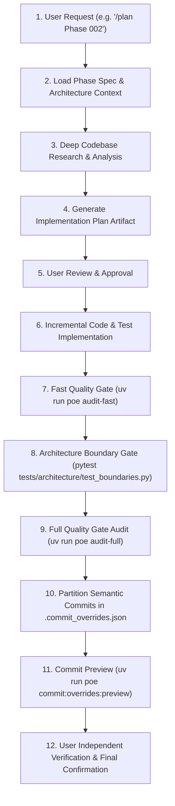

# PFETL Grand Refactor Runbook & Execution Governance

This skill governs the systematic, 50-phase architecture refactor of `personal-finance-etl` (v9.5.3 to v10.4.1+), transforming PFETL into a fully source-agnostic financial data engine while preserving PFETL-owned canonical Bronze, Silver, and Gold financial processing.

---

## 1. Core Architecture Authorities

Before implementing or planning any refactor phase, always consult:
1. `planning/grand-refactor/README.md`: Master phase roadmap, status table, milestones, and batch authorities.
2. `planning/grand-refactor/ARCHITECTURE.md`: Target data spine, configuration boundaries, stable identities (`DatasetId`, `SourceId`, `CapabilityId`), and migration discipline.
3. `planning/grand-refactor/phases/<phase_num>-*.md`: Specific outcome, inherited state, target state, files in scope, non-goals, and completion checklist for the active phase.
4. `AGENTS.md`: Seven-Layer Architecture boundary rules, prohibited imports, NumPy docstring standards, and quality gates.

---

## 2. Standard Phase Execution Workflow

Every phase must be executed with zero skipped gates:



---

## 3. Mandatory Invariants Across All 50 Phases

1. **Governing Product Invariant:**
   *Users configure their evidence and capabilities; PFETL owns the financial meaning.*
   - Financial methodology is never user-configurable.
   - Deterministic IDs (`PURCHASE`, `SALE`, `LOT`, `REALIZED`, `RECON_GROUP`, `TAX`) remain byte-stable.
2. **Seven-Layer Clean Boundaries:**
   - `contracts`: Pure, minimal cross-boundary types. Never import `domain`, `application`, `infrastructure`, or `presentation`.
   - `config`: User-authored validated configuration models.
   - `domain`: Pure financial logic and algorithms. Zero database, network, or UI imports.
   - `infrastructure`: Warehouse, SQLite control plane, and external providers.
   - `application`: Orchestration, pipelines, and planners.
   - `bootstrap`: Dependency injection and composition root.
   - `presentation`: UI and CLI only.
3. **Double-Commit Integrity:**
   - Commit DuckDB warehouse first, SQLite Control Plane second.
   - Any crash between commits enforces `RECOVERY_REQUIRED` semantics.
4. **Strict Typing Invariant (Zero-`Any` & Zero-`TYPE_CHECKING` Standard):**
   - Every class, function, parameter, return value, and data structure across all 50 phases must be strictly and concretely typed.
   - `Any` or untyped containers (`dict[Any, Any]`, `list[Any]`) are strictly forbidden. Use concrete types, TypeVars, generic protocols, or explicit type unions.
   - `from typing import TYPE_CHECKING` and `if TYPE_CHECKING:` blocks are **strictly forbidden** anywhere in the repository (`tests/test_phase12_constitutional_certification.py`).
   - Inline or deferred imports inside function, method, or class bodies are **strictly forbidden**. All imports must remain top-level.
   - All code must pass both Mypy (`disallow_untyped_defs = True`) and Pyright/Pylance without diagnostics.
5. **Full Quality Gate Audit Before Commit:**
   - At the conclusion of each phase or sub-phase prior to committing, execute `uv run poe audit-full`.
   - All 6 quality engines (Ruff Check, Ruff Format, Mypy Typecheck, Pyright Typecheck, Pylint Deep Analysis, Pytest Full Suite) must pass 100% green.

---

## 4. Semantic Commit Partitioning & Overrides Protocol

Never mix codebase implementation, tests, planning documentation, and agent skills into a single monolithic commit. Every phase must partition changes into discrete, semantic commit groups in `.commit_overrides.json`:

1. **Production Codebase:**
   - Format: `feat(<scope>): ...` or `refactor(<scope>): ...`
   - Scope: Target package or component (e.g. `contracts`, `config`, `domain`, `infrastructure`).
   - Files: Only production source files under `src/`.
   - Granularity: **Granular commits are required.** Do not force all production files into a single commit. When changes span distinct architectural layers, subsystems, or functional areas, partition them into multiple focused commits (e.g., `feat(contracts): ...` followed by `refactor(config): ...`).
2. **Test Suite:**
   - Format: `test(<scope>): ...`
   - Scope: Tested component, layer, or subsystem (e.g. `contracts`, `config`, `domain`, `architecture`).
   - Files: Only test files under `tests/`.
   - Granularity: **Granular test commits are required.** Separate test files by architectural layer or subsystem corresponding to their source changes rather than forcing all test additions into a single commit.
3. **Planning & Roadmap Documentation:**
   - Format: `docs(refactor): ...`
   - Scope: `refactor` or target milestone.
   - Files: Files under `planning/grand-refactor/`.
4. **Agent Skills & Developer Tooling:**
   - Format: **ALWAYS `chore(skills): ...`** (Never `feat` or `refactor`, because skills are developer and agent execution aids, not runtime production code or features).
   - Scope: `skills` or specific skill name.
   - Files: Files under `.agents/skills/`.

### Commit Header Rules
- Header line must be **strictly <= 72 characters**.
- Lowercase subject, no trailing punctuation.
- Preview all overrides before confirming: `uv run poe commit:overrides:preview`.
- **Never execute commits automatically.** Always allow the user to test independently and confirm before running `uv run poe commit:overrides`.

---

## 5. Enterprise Testing Suite Architecture & Governance

The `tests/` directory is an enterprise-grade architectural mirror of `src/personal_finance_etl/`. It is subject to the **exact same strict static typing, linting, and sandboxing standards as production code**.

### 5.1 Seven-Layer Test Tree Mirroring `src/`

```text
tests/
├── conftest.py                # Centralized typed fixture catalog & mock infrastructure
├── architecture/              # Boundary enforcement, AST dependency rules, legacy demolition
├── config/                    # Settings models, FinancialRules loading, TOML schema validation
├── contracts/                 # Cross-boundary primitives, DatasetId/SourceId, data transport
├── domain/                    # Pure financial calculation kernels (FIFO, FIRE, Tax, Wealth, Market)
├── infrastructure/            # DuckDB warehouse, SQLite Control Plane, Observability sinks, Providers
├── application/               # Pipeline orchestrators, data extraction, lifecycle coordinators
├── presentation/              # Desktop GUI components, CLI argument parsing, narrative sinks
└── fixtures/                  # Sanitized production rules (financial_rules.toml), config.toml, runners
```

- **Semantic Test File Naming:** Test filenames must directly describe the module or subsystem under test (e.g., `test_boundaries.py`, `test_financial_rules.py`, `test_forensic_pipeline.py`). **Legacy phase numbers in filenames (e.g., `test_phase12_*`) are permanently forbidden.**
- **Modern Module Docstrings:** Every test file must contain a NumPy-style module docstring detailing `Owns` and `Does not own` scopes without historical phase references.

### 5.2 Mandatory Consumption of Centralized Fixtures (`tests/conftest.py`)

Ad-hoc manual setup in test functions is strictly prohibited. Every test must consume shared, typed fixtures:

| Fixture Name | Type Signature | Purpose & Sandboxing Guarantee |
|---|---|---|
| `rules` | `FinancialRules` | Sanitized 442-line production ruleset (`tests/fixtures/financial_rules.toml`). Immutable per session. |
| `mock_rules` | `FinancialRules` | Function-isolated, mutable copy of `FinancialRules` for tax overrides. |
| `canonical_rules` | `FinancialRules` | Immutable session-scoped base rules model. |
| `isolated_settings` | `Settings` | Fully sandboxed `Settings` instance rooted in `tmp_path` (guarantees 100% disk isolation). |
| `isolated_duckdb_manager` | `DuckDBManager` | Function-isolated analytical warehouse instance connected to `tmp_path`. |
| `isolated_sqlite_manager` | `SQLiteManager` | Function-isolated operational Control Plane SQLite connection in `tmp_path`. |
| `isolated_control_plane` | `ControlPlane` | High-level Control Plane facade wired to `isolated_sqlite_manager`. |
| `status_queue` | `EventQueue` | Typed `queue.Queue[ObservabilityEvent \| None]` capturing pipeline status events. |
| `test_emitter` | `tuple[ObservabilityEmitter, MockRecordingSink]` | Dedicated forensic observability emitter with in-memory recording sink. |
| `isolated_container` | `ServiceContainer` | Fresh DI composition root pre-wired with isolated settings, storage, and rules. |
| `isolated_engine` | `PersonalFinanceEngine` | Fully composed high-level application facade. |
| `isolated_live_settings` | `Settings` | Live-test settings configured for local `G:` drive; marked `@pytest.mark.live_data`. |

### 5.3 Strict Typing, Zero Pragmas & Offline-First Discipline

1. **Explicit Function Typing:** Every test function must be strictly typed:
   ```python
   def test_feature_behavior(isolated_settings: Settings, rules: FinancialRules) -> None:
       ...
   ```
2. **Zero Suppression Pragmas:** `# pylint: skip-file` and `# flake8: noqa` are **strictly forbidden** anywhere in `tests/`.
3. **Zero `Any` Types:** Zero `Any` types across all test functions, parameters, and assertions.
4. **Zero `TYPE_CHECKING` Blocks:** Zero `from typing import TYPE_CHECKING` or `if TYPE_CHECKING:` conditional imports in tests.
5. **Offline-First Mandate:** All standard tests must run 100% offline without network access or local cloud mounts. Integration tests requiring live user data must be explicitly marked with `@pytest.mark.live_data` so they can be skipped during CI (`pytest -m "not live_data"`).
