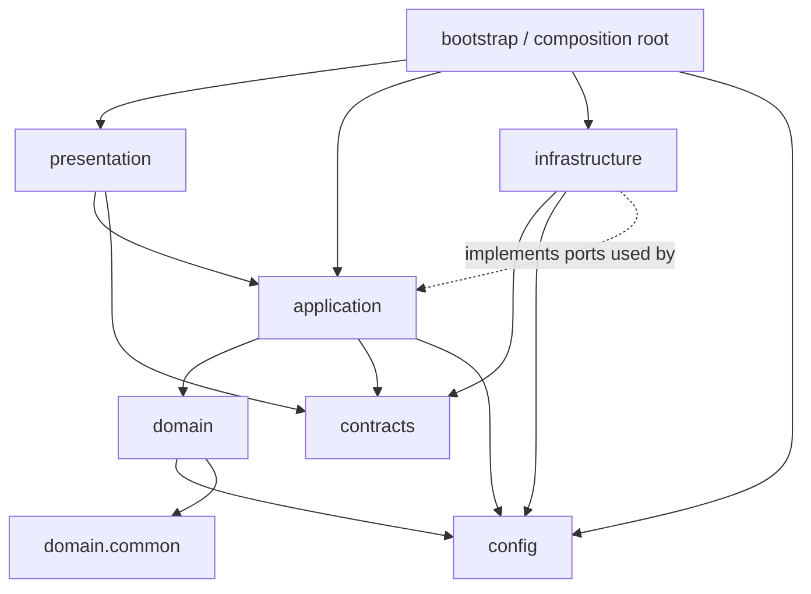
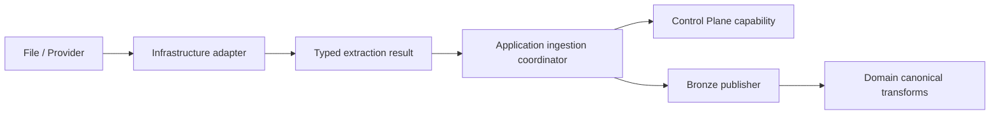

# Personal Finance ETL — Target Dependency Model

> **Behavioral baseline:** v8.3.1  
> **Companion:** `01-target-package-architecture.md`

## 1. Governing dependency graph



The dashed relationship means infrastructure satisfies capabilities required by application code; application code does not reverse-import concrete infrastructure merely because the implementation lives there.

## 2. Allowed dependency matrix

| From | May depend on | Must not depend on |
| --- | --- | --- |
| `domain` | own domain packages, `domain.common`, selected policy models from `config` | `application`, `infrastructure`, `presentation`, concrete storage/provider APIs |
| `application` | `domain`, `contracts`, `config`, capability protocols | concrete UI; uncontrolled concrete infrastructure imports |
| `infrastructure` | `contracts`, `config`, application/domain protocols and domain value types needed at adapters | `presentation`; ownership of financial interpretation |
| `presentation` | application public façade, presentation contracts | domain internals, repositories, database managers |
| `contracts` | stdlib + minimal typing/validation dependencies | domain engines, infrastructure, presentation |
| `config` | Pydantic/stdlib and narrowly shared primitives | application workflows, UI, storage implementations |
| `bootstrap` | everything needed to assemble the graph | financial calculations/business logic |

## 3. Cross-domain dependencies

Domain packages may consume another domain's **public contracts/results** when the financial model requires it, but MUST NOT reach into implementation internals.

Examples:

```text
Tax → investment realized-event contract          ALLOWED
Tax → investments.lots.fifo internals             FORBIDDEN
Wealth → investment portfolio summary contract    ALLOWED
FIRE → wealth/planning state contract              ALLOWED
Household → Tax implementation internals           FORBIDDEN
```

If cross-domain consumption becomes common, expose a deliberate public contract rather than deep-importing implementation modules.

## 4. Ports and adapters

Protocols are introduced only at meaningful boundaries.

Recommended capability families:

```text
RunStore / ArtifactStore
WarehousePublisher / WarehouseReader
MarketDataProvider
SnapshotStore / RecoveryStore
StatusSink / Logger capability
PreferenceStore
```

Exact protocols should be extracted from **consumer needs**, not copied from current concrete classes.

Bad:

```python
class IDatabaseEverything(Protocol): ...
```

Better:

```python
class RunStateStore(Protocol):
    def mark_committing(...) -> None: ...
    def mark_recovery_required(...) -> None: ...
```

only if that is the capability a use case actually needs.

## 5. Composition root

`bootstrap/container.py` owns concrete assembly:

```text
Settings / FinancialRules
        ↓
SQLite Control Plane repositories
DuckDB warehouse
external providers
recovery manager
application services
        ↓
PersonalFinanceEngine façade
        ↓
CLI / Desktop
```

No domain object should call `DuckDBManager()` or `SQLiteManager()` internally.

## 6. Application façade

`application.facade.PersonalFinanceEngine` remains the stable human-facing API.

It exposes use cases such as:

```text
run pipeline
snapshot
restore
configuration/rules validation
read documentation / operational commands where appropriate
```

It returns typed contracts. Presentation does not inspect internal exceptions/messages to infer state.

## 7. Ingestion boundary

Target flow:



Provider adapters acquire evidence. They should not own the entire Control Plane synchronization policy.

## 8. Warehouse boundary

DuckDB-specific code lives under `infrastructure.warehouse`.

```text
Domain/application output
        ↓
typed/registered publication request
        ↓
Warehouse publisher
        ↓
Bronze / Silver / Gold / Meta
```

Domain code does not know table DDL or DuckDB connection mechanics.

The registry remains the authority for physical publication contracts.

## 9. Control Plane boundary

The Control Plane remains historical operational authority.

Application uses narrow capabilities for:

- run lifecycle;
- artifact lifecycle;
- provider provenance;
- synchronization summaries;
- recovery/healing lineage;
- settings/rules snapshots;
- simulation provenance.

Repositories remain infrastructure implementations.

## 10. Error direction

Infrastructure exceptions are translated at the boundary when callers need architectural meaning.

```text
provider SDK error
    ↓
ProviderError / ExtractionBatchResult
    ↓
application policy
    ↓
run FailureDomain / status
```

Domain code does not catch SQLite/DuckDB-specific exceptions unless the domain itself owns that infrastructure, which it does not.

## 11. Cross-process boundary

Worker communication uses typed messages only:

```text
worker
  ↓
EngineStatus / typed worker result
  ↓
application façade
  ↓
presentation
```

Legacy tuple + message-text inference is retired.

## 12. Configuration dependency

`Settings` describes operational environment. `FinancialRules` describes financial policy.

Both are validated before use and remain distinct.

Domain code may consume narrow financial policy models. It SHOULD NOT receive the entire `Settings` object merely for convenience.

## 13. Forbidden patterns

The final architecture forbids:

```text
presentation → infrastructure repository
presentation → domain implementation internals
domain → DuckDB/SQLite manager
domain → provider SDK
infrastructure → UI
Tax → FIFO implementation internals
application → message-string parsing for machine state
stable contract → dict[str, Any]
```

## 14. Dependency enforcement

After migration, add an automated import-boundary check. The exact tool can be selected during implementation, but the architecture should be machine-enforceable rather than relying on memory.

At minimum, CI should fail if forbidden package-direction imports are introduced.

## 15. Final rule

> **Dependencies point toward financial meaning and application policy; concrete external mechanisms remain replaceable at the edge.**
