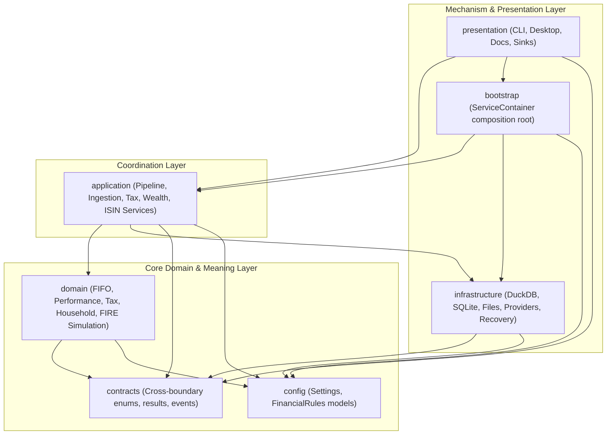

# AGENTS.md — Global Engineering Constitution & Agent Guidelines

> **Repository:** `personal-finance-etl` (v9.5.3+)  
> **Runtime:** Python `>=3.13` (managed via Astral `uv`)  
> **Governing Product Invariant:** *Users configure their evidence and capabilities; PFETL owns the financial meaning.*

---

## 1. Environment & Package Toolchain

This repository uses **Astral `uv`** for dependency resolution, virtual environment management, and execution orchestration. All Python commands and tools must be run through `uv`.

### Core Workflow Commands (via `poethepoet` / `poe_tasks.toml`)

| Purpose | Command | Notes |
|---|---|---|
| **Fast Quality Gate** | `uv run poe audit-fast` | Runs Ruff check, Ruff format check, and Mypy in <2s. Run frequently during development. |
| **Fast Gate with Auto-Fix** | `uv run poe audit-fast:fix` | Automatically fixes safe Ruff lint and format issues. |
| **Full Quality Gate** | `uv run poe audit` | Runs Ruff, Mypy, Pyright, Pylint, and Pytest. Mandatory before PRs and releases. |
| **Test Execution** | `uv run pytest` | Runs full test suite. Target individual tests: `uv run pytest tests/test_<name>.py`. |
| **Desktop App (Dev)** | `uv run poe dev` | Starts desktop GUI with hot-reloading via `tkreload main.py`. |
| **Production Binary** | `uv run poe build` | Compiles standalone production binary using PyInstaller (`main.spec`). |
| **Docs Local Server** | `uv run poe docs:serve` | Starts local MkDocs documentation server with hot reload. |
| **Docs Strict Build** | `uv run poe docs:build` | Builds static documentation site with strict link and syntax checks. |
| **Conventional Commits** | `uv run poe commit` | Automated Commitlint assistant adhering to Conventional Commits. |

---

## 2. Seven-Layer Architecture & Import Boundaries

The codebase enforces a strict **7-layer clean architectural boundary system** to prevent financial logic from leaking into storage or presentation mechanisms. These boundaries are verified programmatically via AST in `tests/test_architecture_boundaries.py`.



### Strict Forbidden Import Rules

Violating these rules breaks architectural tests:

| Package | Prohibited Imports | Reason |
|---|---|---|
| `contracts` | `domain`, `application`, `infrastructure`, `presentation` | Cross-boundary types must remain pure, minimal, and dependency-free. |
| `config` | `application`, `infrastructure`, `presentation`, `domain` | Configuration models (`Settings`, `FinancialRules`) describe inputs, not logic. |
| `domain` | `application`, `infrastructure`, `presentation`, `duckdb`, `sqlite3` | **Pure Financial Logic.** Domain must never touch storage, networking, or UI. Pure Python & Polars only. |
| `presentation` | `domain.investments.lots.fifo`, `infrastructure.warehouse.connection`, `infrastructure.control_plane.connection` | UI must remain thin; it communicates through `application.facade` (`PersonalFinanceEngine`), never directly via raw DB or FIFO kernels. |
| `bootstrap` | Direct user handling or pipeline execution loops | Composition root only; wires concrete implementations to application protocols. |

---

## 3. Data Architecture & Permanent Invariants

1. **Dual Storage Engines:**
   - **DuckDB** (`outputs/`): High-performance columnar analytical warehouse owning the **Medallion Architecture** (`bronze`, `silver`, `gold`, `meta`).
   - **SQLite** (`Raw_Documents.sqlite`): Operational Control Plane owning raw document storage, file hashes, run history, and forensic state.
2. **Transaction Commit Order:**
   - Always DuckDB first, SQLite second. Failure between commits triggers `RECOVERY_REQUIRED` semantics.
3. **Medallion Data Lifecycle:**
   - **Pre-Bronze**: Source-shaped raw tabular data.
   - **Bronze**: Canonical PFETL evidence. Users cannot define arbitrary Bronze/Silver/Gold schemas.
   - **Silver**: Reconstructed financial state (standardized trades, normalized cashflows).
   - **Gold**: Decision-ready analytical surfaces (FIFO lots, tax liabilities, net worth, FIRE projections).
   - **Meta**: Schema fingerprints, data lineage, and run manifest.
4. **Deterministic Identity:**
   - All IDs (`PURCHASE`, `SALE`, `LOT`, `REALIZED`, `RECON_GROUP`, `TAX`) are generated deterministically and must remain byte-stable for identical inputs.
5. **Observability:**
   - Centralized forensic logging uses `ObservabilityEmitter` fan-out to append-only JSONL traces (`outputs/logs/`) and presentation narrative sinks. Never use raw Python `logging` or print statements in core layers.

---

## 4. Coding & Docstring Standards

- **Python Version:** Strict Python 3.13 features (modern type unions `X | Y`, type alias statements, pattern matching).
- **Docstring Convention:** **NumPy Docstrings** are mandatory across all `src/` modules, classes, and public functions (`lint.pydocstyle.convention = "numpy"` enforced by Ruff rule `D` and `D417`).
- **Package Ownership Documentation:** Every `__init__.py` in top-level layers must have explicit `Owns` and `Does not own` sections in its module docstring.
- **Type Annotations:** Strict typing is enforced via Mypy (`disallow_untyped_defs = True`). Use Pydantic v2 for configuration and boundary validation; use frozen slotted `@dataclass` or `TypedDict` for internal value objects.
- **DataFrames:** Use **Polars** (`polars.DataFrame`, `polars.LazyFrame`) for all columnar transformations; avoid Pandas.

---

## 5. Agent Verification Checklist Before Completing Tasks

Before concluding any work, every AI agent must execute this verification sequence:

1. **Run Fast Quality Gate:**
   ```powershell
   uv run poe audit-fast
   ```
2. **Auto-Fix Formatting if Needed:**
   ```powershell
   uv run poe audit-fast:fix
   ```
3. **Verify Architectural Boundaries:**
   ```powershell
   uv run pytest tests/test_architecture_boundaries.py
   ```
4. **Run Target Tests:**
   ```powershell
   uv run pytest tests/<relevant_test_file>.py
   ```
5. Ensure no unexpected files were created in untracked or temporary locations.
