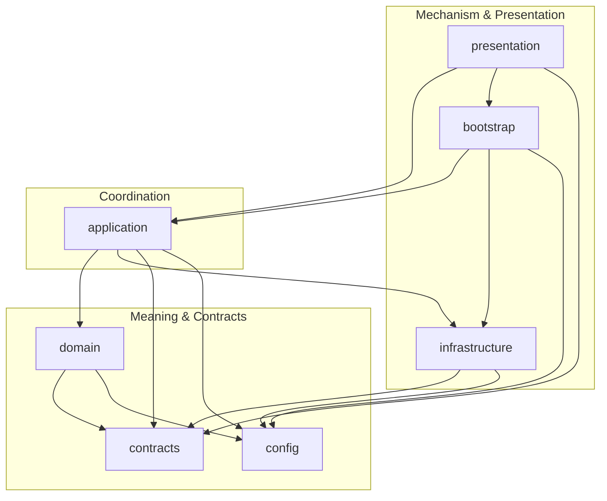

# AGENTS.md — Global Engineering Constitution & Agent Guidelines

> **Repository:** `personal-finance-etl`  
> **Current Grand Refactor baseline:** Phase 045 / v10.3.0 completed; Phases 046-060 planned  
> **Runtime:** Python `>=3.13` managed via Astral `uv`  
> **Governing product invariant:** *Users configure their evidence and capabilities; PFETL owns the financial meaning.*

---

## 1. Authority Order

For Grand Refactor work, consult authorities in this order:

1. `planning/grand-refactor/phases/<active-phase>.md` — exact inherited state, target state, non-goals and exit contract.
2. `planning/grand-refactor/ARCHITECTURE.md` — target ownership and permanent architectural invariants.
3. `planning/grand-refactor/README.md` — 60-phase roadmap, status, release sequence and program boundaries.
4. This file and any nested `AGENTS.md` — repository engineering rules.
5. The implementation itself — if code evidence contradicts the plan, stop and amend the owning phase/architecture before silently redesigning it.

v9.5.3 remains the historical regression oracle. A completed phase handoff becomes the immediate starting-state authority for the next phase.

---

## 2. Environment & Package Toolchain

Use **Astral `uv`** for Python/dependency execution and `poethepoet` tasks from `poe_tasks.toml`.

| Purpose | Command | Notes |
|---|---|---|
| Fast quality gate | `uv run poe audit:fast` | Ruff check/format + Mypy. Run frequently. |
| Fast gate with fixes | `uv run poe audit:fix` | Applies safe Ruff fixes/formatting. |
| Full quality gate | `uv run poe audit` or `uv run poe audit:full` | Ruff, Mypy, Pyright, Pylint and Pytest. |
| Tests | `uv run pytest` | Scope to relevant tests during implementation. |
| Desktop dev | `uv run poe dev` | Starts the CustomTkinter development app. |
| Production build | `uv run poe build` | PyInstaller build via `main.spec`. |
| Docs strict build | `uv run poe docs:build` | Strict MkDocs build. |
| Commit preview | `uv run poe commit:preview` or override preview | Use the `pfetl-conventional-commits` Skill for grouping/messages. |

Do not manually invent commit partitions inside phase specs. Phase files define semantic change boundaries; the conventional-commit Skill owns staging mechanics and Commitlint-compliant messages.

---

## 3. Seven-Layer Architecture & Import Boundaries

The repository enforces a strict seven-layer clean architecture through `tests/architecture/test_boundaries.py` and related architecture guards.



### Forbidden import rules

| Package | Prohibited imports | Reason |
|---|---|---|
| `contracts` | `domain`, `application`, `infrastructure`, `presentation` | Contracts must remain dependency-light and extraction-ready. |
| `config` | `application`, `infrastructure`, `presentation`, `domain` | Configuration describes validated inputs, not behavior. |
| `domain` | `application`, `infrastructure`, `presentation`, `duckdb`, `sqlite3` | Financial logic must remain pure of storage/network/UI topology. |
| `presentation` | raw warehouse/control-plane connections or deep financial kernels | UI/CLI communicate through application services/facade. |
| `bootstrap` | user interaction or pipeline execution loops | Composition root only. |

Do not weaken an architecture guard merely to make a refactor compile. Move ownership to the correct layer.

---

## 4. Data Architecture & Permanent Invariants

### 4.1 Storage and commit truth

- **DuckDB** owns analytical warehouse schemas: Pre-Bronze, Bronze, Silver, Gold and Meta.
- **SQLite Control Plane / Raw Store** owns exact received evidence, hashes, run history, replay/recovery and forensic state.
- Commit order remains **DuckDB first, SQLite second**. Failure between commits yields `RECOVERY_REQUIRED`.
- No third persistence truth may be introduced.

### 4.2 Identity boundaries

- `SourceId`: configured physical evidence container/provider identity.
- `SourceBindingId`: configured physical tabular stream identity. It is independent of path/filename and canonical DatasetId.
- `CanonicalRouteId`: stable route identity inside a binding.
- `DatasetId`: PFETL canonical financial evidence/state identity, never a vendor table/filename/source category.
- `CapabilityId`: financial execution capability identity.

Protected deterministic downstream IDs include `PURCHASE`, `SALE`, `LOT`, `REALIZED`, `RECON_LOT_GROUP`, `RECON_GROUP`, `RECON_EVENT` and `TAX`. Equivalent evidence/rules/capabilities must not change them.

### 4.3 Medallion semantics

- **Raw / Control Plane:** exact evidence and operational provenance.
- **Pre-Bronze:** source-shaped tabular evidence, keyed by `SourceBindingId` after Phase 048. Source-configured shape, Gate-1 validated.
- **Semantic interpretation:** bounded row-local translation of source encodings into PFETL canonical evidence meaning.
- **Bronze:** canonical PFETL financial evidence. Vendor/source discriminator semantics must not survive merely for Silver to decode them.
- **Silver:** canonical reconstructed financial state and PFETL-owned financial methodology.
- **Gold:** analytical/decision surfaces and strongest downstream public analytical contracts.
- **Meta:** plan/catalog/contract metadata, not an independent schema authority.

### 4.4 N:M source topology

The target architecture is N:M:

- one `SourceBindingId` may emit zero-to-many canonical routes/fragments;
- one canonical `DatasetId` may be produced from zero-to-many routes/providers/registered derived recipes;
- multi-source assembly must be explicit and deterministic;
- filesystem order, declaration order and worker completion order must not define identity or financial truth.

### 4.5 Semantic-configuration safety

Configuration may use bounded deterministic primitives such as mapping, constants and local predicates. It must not execute arbitrary Python, SQL, user Polars expressions, joins, aggregation, windows or financial formulas.

Unknown canonical-enum mappings fail by default. Silent semantic drift is forbidden.

### 4.6 Canonical production and satisfiability

- `CapabilityPlanner` / `ExecutionPlan` decide what financial work and canonical evidence are required.
- `CanonicalSatisfiabilityPlanner` proves how the current configuration can produce required canonical DatasetIds.
- `CanonicalProductionPlan` executes source/provider/registered-derived production.
- Gate 2 validates the final assembled canonical Bronze dataset, not merely source fragments.
- Canonical cross-dataset integrity is validated before Silver.
- Existing/stale Bronze may accelerate execution but never proves current configuration satisfiable.

### 4.7 Contract authority

By Phase 059, every Bronze/Silver/Gold DatasetId must have exactly one authoritative `DatasetContract` owning schema, logical types, nullability, grain, keys, references, capability ownership, schema version and fingerprint.

DuckDB DDL, Bronze Pandera Gate-2 schemas, capability-column indexes and machine-readable exports must be derived adapters, not duplicate authorities. Pre-Bronze remains dynamic and source-configured.

---

## 5. Financial Correctness Rule

For unchanged financial semantics:

```text
same evidence
+ same FinancialRules
+ same enabled capabilities
+ same market evidence
= same financial truth
```

Schema/vocabulary migrations may intentionally change representation, but unexplained paise-level financial differences or protected-ID changes stop the phase.

Do not change FIFO, realized-event, reconciliation, Tax, XIRR, Wealth, FIRE or other financial methodology merely to simplify architecture work.

---

## 6. Observability Invariant

Use the existing centralized `ObservabilityEmitter` architecture and downstream consumers. Never add a parallel logging/observability subsystem or raw `print`/Python logging in core layers.

Canonicalization may add bounded context such as `source_binding_id`, canonical route, DatasetId, producer kind, contract/production fingerprints and counts. Do not emit sensitive financial rows to explain mapping behavior.

Multiprocessing paths must preserve run and parent-operation correlation.

---

## 7. Coding & Documentation Standards

- Python 3.13 syntax and strict modern typing.
- NumPy docstrings for production modules/classes/public functions per repository lint configuration.
- Top-level package `__init__.py` files document `Owns` and `Does not own` boundaries.
- Pydantic v2 for user/boundary configuration contracts; frozen slotted dataclasses or explicit typed models for internal values where appropriate.
- Polars for columnar transformations; avoid Pandas unless separately justified.
- No `Any` as a convenience escape hatch where an explicit type can be modeled.
- No `TYPE_CHECKING` or inline/deferred imports where repository architecture guards prohibit them.

---

## 8. Grand Refactor Execution Discipline

- Implement only the active phase.
- Preserve the active phase's explicit non-goals.
- Every destructive migration follows **expand -> migrate -> prove -> contract**.
- Replacement must be proven before old ownership is deleted.
- Temporary compatibility paths require a named deletion owner.
- Phases 046-055 build/migrate the SourceBinding -> semantic route -> canonical production architecture.
- Phases 056-060 certify, harden and freeze that architecture. Certification phases must not invent a second design.
- A phase ends only when its unique exit checklist is green. Do not start the next phase from a red or half-migrated state.

---

## 9. Verification Before Completing Work

Use the active phase's own test matrix first, then apply relevant repository gates.

Typical minimum sequence:

```powershell
uv run poe audit:fast
uv run pytest tests/architecture/test_boundaries.py
uv run pytest <focused tests for the changed subsystem>
```

Run `uv run poe audit` / `uv run poe audit:full` when required by the phase/release boundary. Persistence/schema phases additionally require the recovery/backup/replay gates named in their phase files. Minor/certification releases require the appropriate real-data, financial-equivalence, JSONL-lineage and runtime checks.

Do not claim a runtime gate passed when the current environment cannot execute it; record the unverified gate explicitly.
