# Personal Finance ETL

**My local-first financial evidence, data engineering, quantitative analytics, tax-preparation, wealth, and decision-support platform.**

I built Personal Finance ETL because I wanted one answer to a deceptively difficult question: **where exactly do I stand financially, and can I prove how I got there?**

What started as a practical month-end ETL gradually became the system I use to reconcile household cash flow, reconstruct investment history, preserve source provenance, analyze portfolio performance, prepare tax evidence, model wealth, and stress-test FIRE scenarios. The codebase now sits at the intersection of finance, data engineering, Python/software architecture, BI, quantitative modelling, and reliability engineering.

[](https://pypi.org/project/personal-finance-etl/)


**Explore the project:** [Wiki Home](https://github.com/tks18/personal-finance-etl/wiki) · [Architecture Tour](https://github.com/tks18/personal-finance-etl/wiki/02-Architecture-Tour) · [Follow the Data](https://github.com/tks18/personal-finance-etl/wiki/03-Follow-the-Data) · [Investment Engine](https://github.com/tks18/personal-finance-etl/wiki/07-Investment-Engine) · [FIRE & Planning](https://github.com/tks18/personal-finance-etl/wiki/10-FIRE-and-Planning) · [Technical Docs](docs/README.md)

## The system at a glance

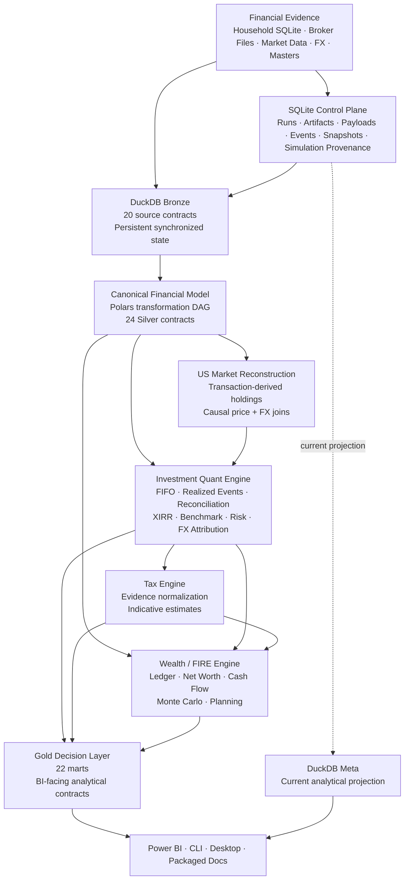

The architecture separates four kinds of truth on purpose:

| Kind of truth | What it means | Primary authority |
| --- | --- | --- |
| **Source evidence** | What external systems and files actually supplied | Source artifacts + Control Plane payload/history |
| **Canonical financial facts** | Normalized transactions, dimensions, market and reference facts | Silver contracts |
| **Reconstructed financial state** | Holdings, lots, realized events, reconciliation and valuations derived from evidence | Quant / reconstruction engines |
| **Operational provenance** | What ran, what changed, which configuration applied, what failed | SQLite Control Plane |

That separation is the spine of the project. A reconstructed holding is not magically broker-certified because a dataframe contains it. An indicative tax estimate is not a statutory return because it has two decimal places. And two local databases do not become distributed ACID because I call `BEGIN` twice. The implementation keeps those boundaries explicit.

## What this project demonstrates

I do not maintain separate demo repositories for every engineering discipline involved here. Personal Finance ETL is the place where those disciplines collide under one real workload.

| Discipline | Implementation evidence |
| --- | --- |
| **Data engineering** | Content-aware discovery, persistent Bronze, incremental synchronization, full analytical rebuilds, explicit grains and contract-driven publication |
| **Python engineering** | Pydantic models, repositories, facades, stateful domain objects, multiprocessing, Polars lazy execution, typed boundaries |
| **Software architecture** | Control Plane / analytical-plane separation, deterministic identities, explicit ownership, failure recovery, coordinated snapshots |
| **Finance & accounting** | Household ledger, transfers, opening balances, cash reconciliation, book/market/after-tax wealth, tax evidence |
| **Quant engineering** | FIFO lots, realized-event lineage, XIRR, benchmark shadow portfolios, drawdown, FX attribution, stochastic FIRE simulation |
| **BI / analytics engineering** | Canonical Silver state, multi-grain Gold marts, Power BI serving, metric semantics and non-additive aggregation rules |
| **Reliability engineering** | Run lifecycle, artifact events, stale-run recovery, Bronze healing, backup/restore validation, forensic execution logs |
| **Product engineering** | Shared backend facade, CLI, desktop UI, packaged offline documentation and configuration preferences |

I prefer this kind of evidence over a list saying I know "data engineering, finance, Python, architecture, BI." The repository can make the argument itself.

## Why I built it

The original problem was not "build a data platform." It was much less dramatic:

> **I wanted a trustworthy month-end view of my own finances.**

That immediately created harder questions.

```text
What happened?
      ↓
What does it mean financially?
      ↓
Can I reconcile it against independent evidence?
      ↓
What is the current economic state?
      ↓
What part is observed, reconstructed, estimated, or simulated?
      ↓
What decisions can I make from it?
```

A transaction table alone cannot answer that. A portfolio value without acquisition history cannot answer it. A return percentage with the wrong cash-flow grain definitely cannot answer it. A Monte Carlo model fed unreconciled state can produce very sophisticated nonsense, now with percentiles.

So the system grew gradually. I did not design a miniature financial platform on day one. I kept solving the next real limitation until the solution became one.

## The production workload shaped the architecture

This is not built around a five-file sample directory. My real environment contains a long-running population of household, broker, market, mapping and reference evidence, including daily broker snapshots that continue to accumulate.

The architectural response is simple:

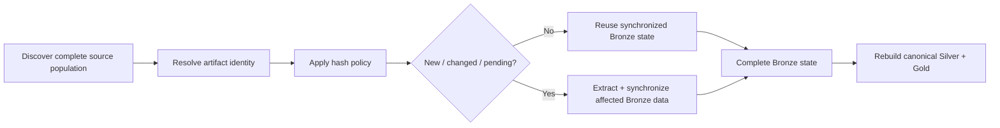

I intentionally optimize the expensive source boundary without making the analytical model incrementally fragile:

> **Process what changed. Preserve what did not. Rebuild what must remain financially coherent.**

Bronze is persistent and synchronization-aware. Silver and Gold are complete analytical publications from current Bronze state. That trade-off is one of the most important design decisions in the repository.

## 1 · SQLite Control Plane: operational truth has a home


The Control Plane is the historical operational authority for the application. It records run lifecycle, source artifact identity, retained payloads, artifact-run events, configuration snapshots, failures and stochastic simulation provenance.

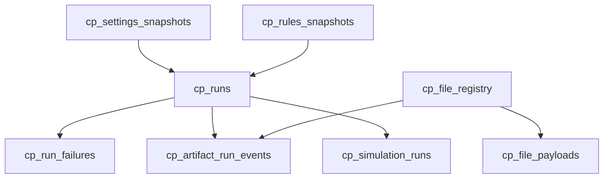

I deliberately keep this history in SQLite rather than asking DuckDB Meta to moonlight as a second Control Plane. DuckDB Meta is useful analytical context; historical operational provenance has a different lifecycle and deserves a different owner.

The current Control Plane has eight operational tables and repository/service boundaries around artifacts, runs and file synchronization. The ETL orchestrator consumes those abstractions instead of sprinkling direct SQLite mutations throughout the pipeline.

## 2 · Artifact lifecycle: path is not identity


A source artifact has several properties that are easy to conflate: identity, path, content hash, synchronization state and historical events. The Control Plane keeps them separate.

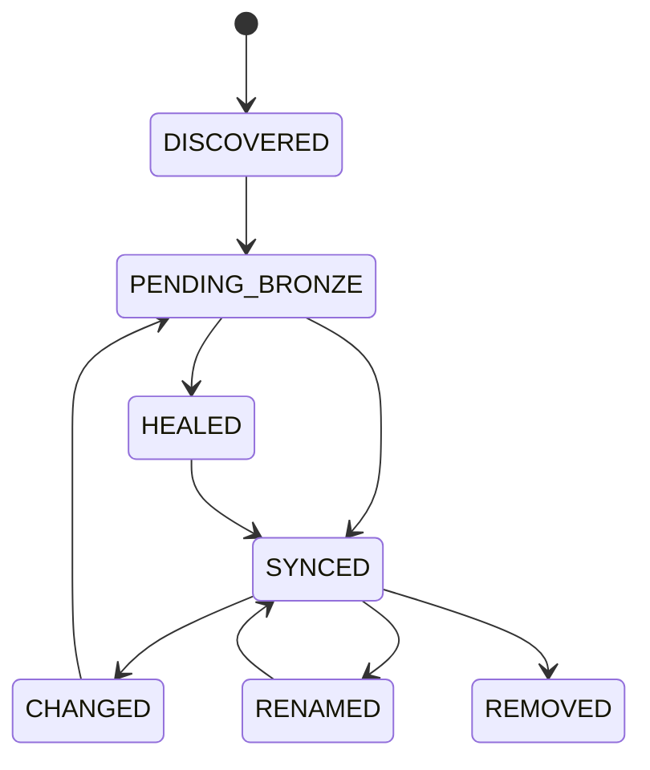

Artifact events preserve observed path/hash and previous/new synchronization state. Pure renames can migrate identity rather than masquerading as one deletion plus one unrelated new financial source. That sounds small until lineage matters.

The event vocabulary includes discovery, change, re-ingestion, rename, removal, healing and synchronization behavior, with virtual-artifact support where the source is logical rather than a normal external file.

## 3 · Bronze: incremental at the boundary, complete downstream


The Bronze registry contains **20 source contracts**. Some are full-replace reference/current-state inputs; others are incremental historical/event sources.

Bronze is intentionally different from Silver and Gold. It does not pretend every source has one centrally fixed DDL. Extracted frames determine physical source-shaped columns, while the registry defines extraction attribute, synchronization category, physical table and replacement behavior.

```text
source evidence
   ↓
Control Plane actionable set
   ↓
extract only what needs synchronization
   ↓
upsert / replace affected Bronze state
   ↓
read complete Bronze state
   ↓
canonical reconstruction
```

Incremental ingestion and incremental analytics are not the same thing. I use the first and deliberately avoid the second for Silver/Gold at this scale.

## 4 · Canonical Silver: source vocabulary stops here


Silver contains **24 canonical contracts** spanning household finance, currency, investments and tax evidence. This is where bank/broker/file-specific shapes stop being downstream interfaces.

Canonical facts include household income, expenses, transfers and opening balances; investment purchases and sales; market and benchmark observations; deterministic lot analytics; realized events; reconciliation events; and normalized tax events.

The contract registry gives each analytical dataset a stable identity:

```python
@dataclass
class DataContract:
    contract_id: str
    layer: str
    physical_table: str
    domain: str
    grain: str
    producer: str
    publication_order: int
```

Grain is first-class because a correct formula at the wrong grain is still a wrong financial answer.

## 5 · Gold: decision surfaces, not a trophy cabinet


Gold contains **22 registered marts**. They exist to support decisions and BI consumption, not to preserve every metric I have ever managed to calculate.

The current serving surface spans Tax, Wealth/Cashflow/Planning and investment presentation across multiple grains. Gold is rebuilt as a complete publication and validated against the registry before commit.

The pipeline checks both directions:

```text
produced analytical outputs ⊆ registered contracts
registered contracts ⊆ produced analytical outputs

therefore

produced = registered
```

A dataframe does not earn a warehouse table merely because it survived a function call. The producer and registry have to agree.

## 6 · Deterministic identity: financial facts survive rebuilds


Financial lineage depends on stable identities. `backend/utils/identity.py` implements canonical serialization rather than relying on row order, Python object identity or whatever hash happened to be convenient that afternoon.

The protocol normalizes nulls, booleans, dates, datetimes, decimals/numbers and Unicode strings, applies namespace-specific field ordering, serializes a versioned payload and hashes it with SHA-256.

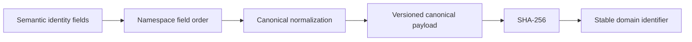

Namespaces cover purchases, sales, lots, realized events, reconciliation groups/events and tax events. Identity continuity is an architectural contract, not a cosmetic ID column.

## 7 · US market reconstruction: derived state with temporal causality


My US source environment does not provide the same reliable downloadable daily holdings evidence as the Indian investment sources, so the application reconstructs historical US holdings from transactions and market evidence.

That reconstruction is explicitly **derived financial state**, not independent broker observation.

The process builds a daily quantity/cost spine from buys and sells, joins historical prices backward in time, records the observation date and age, rejects stale observations beyond the configured implementation threshold, and applies historical FX with the same no-future-data rule.


No future market price gets to travel back in time because it would make yesterday's chart prettier.

## 8 · Canonical FIFO: acquisition lots are state, not aggregates


The canonical lot authority is `FIFOPortfolio` in the Quant Engine. This is separate from US historical holdings reconstruction.

Purchases create deterministic acquisition lots. Sales consume the oldest active inventory first. Partial disposals preserve residual lots; cross-lot sales produce multiple realized components.

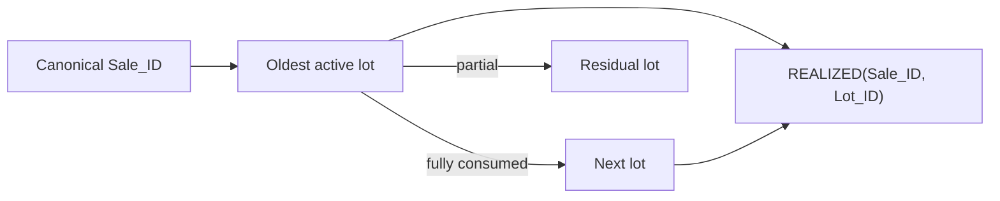

Realized-event lineage preserves the acquisition lot behind each disposal component, which is essential for holding-period classification, tax evidence and replay.

## 9 · Reconciliation: disagreement becomes evidence


Reconstructed investment state can disagree with externally observed broker state. The application does not silently overwrite the inconvenient number and move on.

Quantity reconciliation and cost-basis reconciliation are separate operations because matching units does not imply matching acquisition basis.

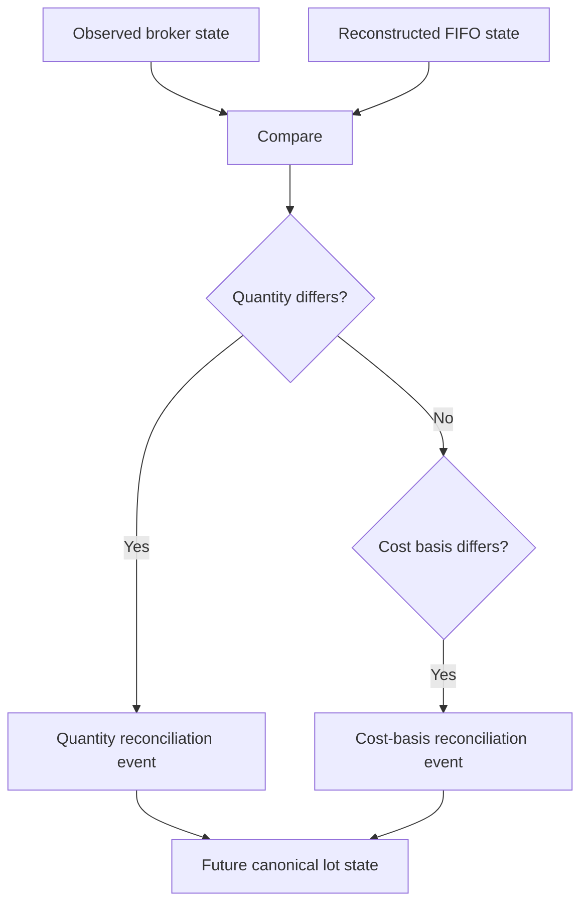

Reconciliation events and synthetic/adjusted lot state remain distinguishable from original transaction evidence. Correction is not proof of history; it is explicit provenance about where reconstruction needed help.

## 10 · Multi-currency analytics: asset return is not FX return


Foreign investments carry two economic stories at once: what the asset did in its local currency and what the reporting currency did to the translated result.

The model therefore preserves local acquisition basis, local market value, historical FX, reporting-currency basis/value, asset P&L and FX P&L rather than collapsing everything into one INR number.

```text
local asset economics
        +
translation / FX effect
        ↓
reporting-currency economics
```

That separation flows through realized and unrealized analytics, XIRR/CAGR views, reconciliation and benchmark interpretation.

## 11 · Returns: cash-flow construction matters more than the solver


PyXIRR solves irregular dated cash flows. The difficult engineering problem is constructing the correct cash-flow series at the correct grain.

The Quant layer preserves typed XIRR outcomes such as `VALID`, `INVALID_INPUT`, `UNDEFINED` and `NON_CONVERGENT` instead of converting failed calculations into a comforting `0%`.

```text
Portfolio XIRR ≠ average(Security XIRR)
Class XIRR     ≠ average(ISIN XIRR)
Group CAGR     ≠ average(component CAGR)
```

Non-additive metrics are recomputed from their underlying economic state. Percentages do not become additive just because Power BI can average them.

## 12 · Benchmark shadow portfolios: compare the same capital


Benchmark analysis follows actual capital deployment. Investment purchases create equivalent benchmark shadow exposure, and partial real disposals reduce shadow exposure proportionally.

The comparison therefore asks a useful counterfactual:

> **What would the same capital, deployed at the same time, have done in the configured benchmark?**

That is more meaningful than subtracting two unrelated point-to-point returns that happened to share a reporting date.

## 13 · Tax Engine: evidence first, liability engine no


The Tax Engine deliberately owns a narrow problem: normalize tax-relevant evidence from the household ledger and Quant realized events into canonical `f_Tax_Events`, then publish three Gold tax views.

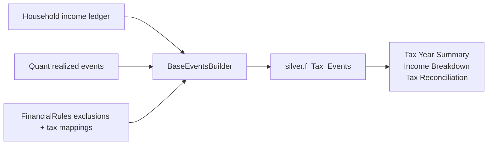

Investment-related ledger exclusions prevent the same gain from appearing once as household income and again as Quant realization.

The engine retains indicative estimates and evidence-quality states such as `CHECK_REQUIRED`, but it does **not** claim to implement every statutory set-off, carry-forward, deduction, exemption or final filing liability rule. Evidence quality and estimate availability are separate concepts.

## 14 · Household finance: book state, market state and cash state are different


Household finance is reconstructed from opening balances, income, expenses and transfers. Transfers remain distinct so internal movement does not manufacture income or expense.

The model keeps several concepts separate:

```text
cash income       ≠ total income
cash expense      ≠ total expense
book wealth       ≠ market wealth
market wealth     ≠ after-tax wealth
savings growth    ≠ organic market growth
```

Investment market state is injected into wealth after the household ledger has reconstructed book/cash state. That boundary is why the system can explain both "what moved through my accounts" and "what my assets are economically worth now."

## 15 · Cash-flow reconciliation: pretty categories are not enough


A categorized expense chart can look plausible and still fail to explain actual cash movement. The system therefore anchors cash flow to configured cash-pool balances.

```text
Opening Cash
+ Operating Activity
+ Investing Activity
+ Financing Activity
+ Internal Transfer Treatment
= Calculated Closing Cash

Actual Closing Cash - Calculated Closing Cash = Unreconciled Difference
```

A non-zero difference remains visible. Reconciliation is more valuable than cosmetic perfection.

## 16 · Wealth and FIRE: simulation is downstream of truth


FIRE modelling consumes connected household and investment state rather than a manually typed portfolio value.

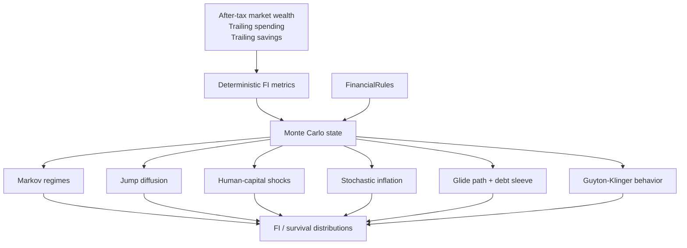

The model supports regime switching, fat-tail adjustments, jumps, inflation dynamics, human-capital shocks, glide paths, dynamic debt behavior, withdrawal guardrails and sequence-of-returns diagnostics.

These are scenario distributions under configured assumptions, not prophecies. Monte Carlo does not become clairvoyance because Numba made it fast.

## 17 · Simulation provenance: randomness gets an audit trail too


Stochastic execution is run-specific but replay-oriented. The engine derives simulation seed context from the run identity and records simulation provenance in the Control Plane.

`cp_simulation_runs` stores seed, iteration/horizon context, settings/rules snapshot IDs, input/model fingerprints, implementation version, status and result fingerprint.

That distinction matters:

```text
deterministic financial identity
        ≠
stochastic simulation replay
```

The first stabilizes canonical facts. The second records enough context to replay a stochastic run under a compatible implementation/runtime. Same hashing toolbox, different semantic contract.

## 18 · Transactions and recovery: coordinated, not magically distributed


The pipeline begins transactions in DuckDB and SQLite, but the commit order is DuckDB first and SQLite second. That creates a narrow cross-store failure window.

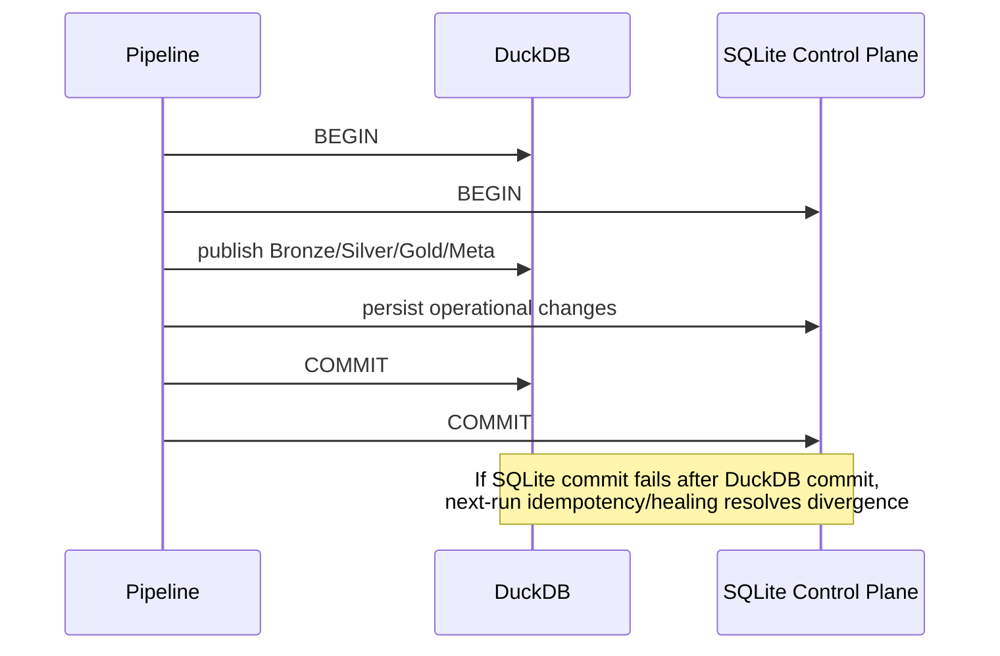

I describe that as coordinated recovery semantics, not distributed ACID. Reliability documentation should make guarantees smaller and clearer, not larger and fuzzier.

## 19 · Bronze healing: operational authority can challenge analytical state


Because SQLite and DuckDB are separate stores, the system includes explicit healing logic. The Control Plane can detect that an artifact marked synchronized no longer has the expected analytical representation and make it actionable again.

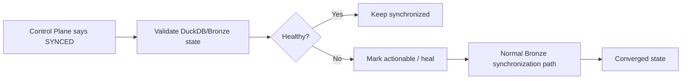

Recovery follows the normal pipeline rather than inventing a secret second ingestion mechanism.

## 20 · Snapshot and restore: SQLite + DuckDB are one recovery unit


`SystemBackupManager` treats the Control Plane and analytical warehouse as one logical application state.

Snapshot creation acquires the production lock, checkpoints DuckDB, uses SQLite's backup API, includes relevant DuckDB recovery state, writes a temporary ZIP, verifies CRC and atomically publishes the archive.

Restore validates archive members, rejects path traversal/nested/unexpected entries, validates extracted SQLite and DuckDB databases, preserves the current pair as recovery backups, installs the new pair and rolls back to the old pair if installation fails.

```text
all-new pair
or
all-old pair

never intentionally half-restored application state
```

Local-first does not have to mean "copy two live database files and hope for the best."

## 21 · Observability: failures need financial context


Run failures retain stage, ISIN/workload context, exception type, message, traceback and timestamps. Execution logging preserves broader run-scoped forensic context across processes.

That gives me two different answers:

```text
structured failure → what failed?
execution history   → what happened around it?
```

The project does not yet have a huge conventional automated test suite, so these runtime controls and forensic records matter. I document that honestly rather than promoting validation code into imaginary pytest coverage.

## 22 · Configuration is financial provenance


`Settings` controls physical execution topology: source paths, database locations, discovery and hash behavior. `FinancialRules` controls interpretation: classification, asset/investment semantics, tax mappings, portfolio policy and stochastic planning assumptions.

Runs snapshot both into the Control Plane. Simulation provenance fingerprints the relevant model/input/rule context separately.

Changing TOML can therefore mean very different things:

```text
change a path        → operational topology changes
change a category    → financial classification changes
change a tax rule    → tax evidence interpretation changes
change FIRE rules    → probability distribution changes
```

Configuration is not just preferences with square brackets.

## 23 · Contract-driven publication: schema is a promise


The Data Contract Registry links logical identity, layer, physical table, domain, grain, producer and publication order. Silver/Gold DDL provides the physical contract.

A safe schema change therefore considers more than SQL syntax:

```text
producer
+ grain
+ identity
+ DDL
+ registry
+ publication order
+ consumers
+ migration/rebuild behavior
```

"DDL executed successfully" is a spectacularly low bar for financial data engineering.

## 24 · Power BI: serving is a separate design problem


The Gold layer is intentionally decision-oriented and multi-grain. It serves wealth, cashflow, planning, tax and investment analytics without forcing Power BI to reconstruct core financial semantics from raw transactions.

That division of labor matters. BI should compose and visualize trusted metrics; it should not secretly become the place where FIFO, tax evidence or cash reconciliation is reimplemented in DAX because nobody wanted to define the backend contract.

## 25 · CLI and Desktop: two control surfaces, one engine


The public backend facade is `PersonalFinanceEngine`. CLI and Desktop route through it for configuration validation, pipeline execution and snapshot/restore behavior.

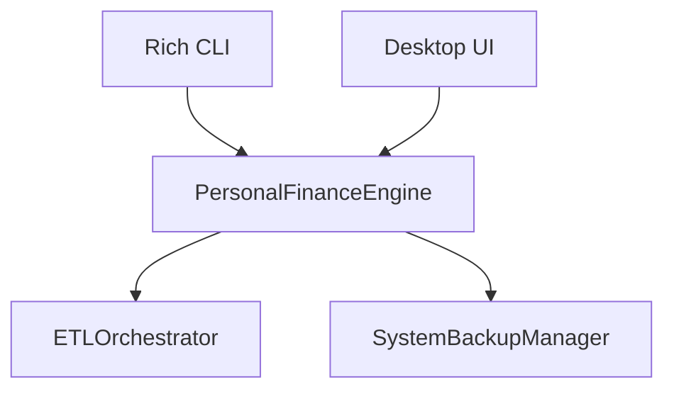

`shan-fin` defaults to the desktop surface, `shan-fin cli` enters terminal mode, and `shan-fin-gui` is a direct GUI entry point. The interfaces differ; the financial engine does not fork into two personalities.

## 26 · Documentation is part of the product


The same documentation tree is designed to work on GitHub and inside the packaged application. A manifest-driven catalog and renderer power CLI/Desktop navigation.

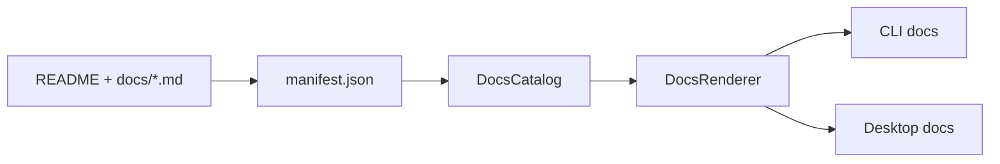

Yes, the documentation describing the architecture now has an architecture. At this point resistance would be performative. 😂

## Technology ownership

The stack is intentionally heterogeneous. I choose tools by responsibility rather than trying to make one library win every argument.

| Technology | Responsibility |
| --- | --- |
| **SQLite** | Historical Control Plane, artifacts/payloads, run/failure/event/config/simulation provenance |
| **DuckDB** | Persistent Bronze, canonical Silver, Gold serving and current Meta projection |
| **Polars** | Lazy/vectorized transformation DAG and analytical computation |
| **Pydantic** | Operational configuration and financial-policy contracts |
| **PyXIRR** | Irregular dated return solving |
| **NumPy / Numba** | Stochastic FIRE simulation |
| **multiprocessing** | Process isolation and parallel investment workloads |
| **Rich** | CLI experience |
| **CustomTkinter / pywebview** | Desktop surfaces and local documentation experience |
| **Power BI** | Decision-oriented analytical consumption |

The interesting question is not which tool is "best." It is which tool should own the state and workload in question.

## Warehouse contract inventory

The current registry-backed warehouse contains:

| Layer | Contracts | Character |
| --- | ---: | --- |
| **Bronze** | **20** | Persistent source-shaped synchronized state |
| **Silver** | **24** | Canonical financial facts, dimensions and reconstructed evidence |
| **Gold** | **22** | Decision-support and BI-facing marts |
| **Total** | **66** | Registered Bronze + analytical contracts |

DuckDB Meta is separate from those 66 contracts and currently projects six current-state metadata tables. The SQLite Control Plane separately owns eight operational tables.

For exact grains, schemas, producers and identities, see the [Reference documentation](docs/reference/README.md).

## Performance philosophy

I treat performance numbers as workload-specific evidence, not universal claims. The important architectural pattern is stable:

```text
discover broadly
→ synchronize narrowly
→ compute vectorized where possible
→ isolate stateful work where necessary
→ rebuild canonical analytics coherently
→ publish only decision-useful outputs
```

The codebase has gone through several performance-hardening cycles, including removing analytical machinery that no longer served a decision. One of the most useful optimization lessons from this project is still:

> **Removing computation with no decision value can be better than making unnecessary computation faster.**

When I publish runtime figures, I treat them as dated production observations tied to my own source environment, not promises about arbitrary hardware or datasets.

## What the system guarantees, and what it does not

I care a lot about this section because sophisticated systems become untrustworthy when documentation quietly upgrades implementation details into stronger guarantees.

### Strong guarantees implemented today

- deterministic canonical identities for defined namespaces and canonicalized fields;
- registry-enforced analytical publication;
- persistent Bronze synchronization state;
- complete Silver/Gold rebuild semantics;
- historical run and artifact-event provenance in SQLite;
- backward-only historical price/FX joins for US reconstruction;
- explicit investment reconciliation rather than hidden correction;
- Quant ownership of realized investment events;
- coordinated snapshot/restore of the SQLite + DuckDB pair;
- stochastic simulation provenance with seeds/fingerprints/context.

### Deliberate non-guarantees

- SQLite and DuckDB are **not** one distributed ACID database;
- reconstructed US holdings are **not** independent broker-certified daily holdings;
- indicative tax estimates are **not** final statutory tax liability;
- reconciliation does **not** transform reconstructed state into original source evidence;
- Control Plane event history does **not** automatically mean every historical external binary is retained forever;
- stochastic replay assumes compatible implementation/runtime behavior;
- Silver and Gold are **not** incrementally mutated analytical stores.

I would rather document a smaller guarantee accurately than a larger one poetically.

## Running the project

Personal Finance ETL requires **Python 3.13+** and a source/configuration environment compatible with the current adapters.

### Install from PyPI

```bash
pip install personal-finance-etl
```

### Launch the desktop application

```bash
shan-fin
```

or directly:

```bash
shan-fin-gui
```

### Use terminal mode

```bash
shan-fin cli
```

The CLI supports configuration/rules selection, automatic/headless execution, cron-oriented execution, packaged documentation, coordinated snapshots and restore operations.

### Development install

```bash
git clone https://github.com/tks18/personal-finance-etl.git
cd personal-finance-etl
pip install -e .
```

A successful installation is not the same as a runnable financial environment. You still need valid `Settings`, valid `FinancialRules`, required mapping/reference inputs and source structures compatible with the current adapters.

Start with:

- [Installation](docs/getting-started/installation.md)
- [Quick Start](docs/getting-started/quick-start.md)
- [CLI and Desktop](docs/getting-started/cli-and-desktop.md)
- [Configuration Reference](docs/configuration/configuration-reference.md)

## Is it plug-and-play for everyone?

**No, and I prefer saying that clearly.**

The architecture contains highly reusable machinery: Control Plane, evidence lifecycle, Bronze synchronization, deterministic identities, canonical modelling patterns, Quant state machines, contract publication, recovery, documentation runtime and application surfaces.

But another financial environment can still require adaptation of:

- bank/broker source contracts;
- statement layouts;
- mappings and reference masters;
- financial classifications;
- asset/instrument semantics;
- tax interpretation;
- reconciliation policy;
- planning assumptions.

This is a production vertical system that has become increasingly configurable. It is not a universal personal-finance framework pretending every bank and jurisdiction agreed on a schema while I was asleep.

## Explore the technical universe

The project deliberately has different knowledge surfaces.

| Surface | Job | Start here |
| --- | --- | --- |
| **README** | **SHOW** the system, engineering evidence and why it matters | You are here |
| **Wiki** | **TEACH** concepts and guided mental models | [GitHub Wiki](https://github.com/tks18/personal-finance-etl/wiki) |
| **`/docs`** | **SPECIFY** implementation, contracts, algorithms, invariants and trade-offs | [`/docs`](docs/README.md) |
| **Code** | **PROVE** the implementation | [`src/personal_finance_etl`](src/personal_finance_etl) |

### Choose your rabbit hole

| I want to understand... | Start here |
| --- | --- |
| Overall architecture | [System Architecture](docs/architecture/system-architecture.md) |
| End-to-end data movement | [Data Lifecycle](docs/architecture/data-lifecycle.md) |
| SQLite vs DuckDB ownership | [Warehouse Architecture](docs/architecture/warehouse-architecture.md) |
| Artifact events and synchronization | [Control Plane Artifact Lifecycle](docs/architecture/control-plane-artifact-lifecycle.md) |
| Deterministic IDs and replay | [Deterministic Identity and Replay](docs/architecture/deterministic-identity-and-replay.md) |
| Failure/recovery semantics | [Reliability and Recovery](docs/architecture/reliability-and-recovery.md) |
| Exact schemas/grains | [Reference](docs/reference/README.md) |
| Household finance | [Cashflow and Wealth](docs/finance/cashflow-and-wealth.md) |
| Investment evidence | [Investment Data Model](docs/finance/investment-data-model.md) |
| US reconstruction | [Investment Market Reconstruction](docs/finance/investment-market-reconstruction.md) |
| FIFO | [FIFO and Realized Events](docs/finance/fifo-and-realized-events.md) |
| Reconciliation | [Investment Reconciliation](docs/finance/investment-reconciliation.md) |
| Performance/risk | [Investment Performance and Risk](docs/finance/investment-performance-and-risk.md) |
| Multi-currency analytics | [Multi-Currency and FX](docs/finance/multi-currency-and-fx.md) |
| Tax evidence | [Tax Methodology](docs/finance/tax-methodology.md) |
| FIRE | [FIRE Methodology](docs/finance/fire-methodology.md) |
| Quantitative formulas | [Metrics and Methodology](docs/finance/metrics-and-methodology.md) |
| Configuration | [Configuration](docs/configuration/README.md) |
| Extending the system | [Developer Guide](docs/developer/README.md) |
| Project evolution | [Project](docs/about/project.md) |
| Current maturity plan | [Roadmap](docs/roadmap.md) |

## Engineering principles that survived the refactors

### Preserve evidence
Derived state can be rebuilt. Source evidence and provenance deserve their own durability boundary.

### Make authority explicit
Operational history, analytical state, reconstructed finance and presentation are different responsibilities.

### Respect grain
A metric without grain is an invitation to calculate the right formula over the wrong financial object.

### Reconcile against independent truth
Broker state and cash balances are valuable precisely because they can challenge reconstruction.

### Keep financial policy explicit
If a threshold changes financial meaning, it should not hide in a visualization expression.

### Use the right compute model
Polars is excellent for vectorized DAGs. FIFO is stateful. Monte Carlo is numerical. One abstraction does not need to win every argument.

### Compute richly, publish selectively
A metric earns Gold real estate because it supports a decision, not because it was difficult to calculate.

### Generalize from working behavior
I prefer extracting abstractions from a production vertical system over designing a universal framework before the variation exists.

### Make uncertainty visible
Missing/invalid XIRR, reconciliation gaps, stale prices, tax review states and stochastic distributions should remain visible rather than being rounded into fake certainty.

## The project journey

Personal Finance ETL is the clearest convergence of my finance and engineering paths.

I am a **Chartered Accountant** who moved through JavaScript, Vue, React, Python, analytics, BI and data engineering before increasingly focusing on software/data architecture and local intelligent systems. Finance did not disappear when engineering became more serious; it became the domain that forced the engineering to become more serious too.

Accounting instincts show up everywhere in this repository:

```text
evidence        → lineage
reconciliation  → data quality
classification  → semantic modelling
period/grain    → analytical contracts
audit trail     → provenance
controls        → invariants
financial state → decision-support serving
```

The longer story is in [About Me](docs/about/about-me.md) and [Project](docs/about/project.md).

## Roadmap: maturity over feature accumulation

The architecture is intentionally stable. The current roadmap is smaller than the system.

The priority is now to **prove, protect, document and selectively simplify** the behavior already used in production:

- executable QA around deterministic identities, FIFO, reconciliation and temporal causality;
- Tax evidence and household/wealth regression scenarios;
- stochastic replay/reproducibility checks;
- backup/restore and failure-injection coverage;
- contract/schema regression protection;
- configuration fixture modernization;
- static quality and maintainability;
- evidence-driven performance work;
- documentation and Wiki integration;
- only genuinely justified future financial capabilities.

Not every project needs a new engine every quarter. Sometimes maturity is the feature.

See the full [Roadmap](docs/roadmap.md).

## Data engineering patterns I care about

### 1. Source discovery is broad, but actionable ingestion is narrow and state-aware.

Source discovery is broad, but actionable ingestion is narrow and state-aware. This principle appears repeatedly across the codebase because it reduces ambiguity at boundaries and makes later auditing easier.

### 2. Persistent Bronze keeps synchronized history without forcing analytical mutation downstream.

Persistent Bronze keeps synchronized history without forcing analytical mutation downstream. This principle appears repeatedly across the codebase because it reduces ambiguity at boundaries and makes later auditing easier.

### 3. Canonical Silver removes source-specific vocabulary before domain engines consume data.

Canonical Silver removes source-specific vocabulary before domain engines consume data. This principle appears repeatedly across the codebase because it reduces ambiguity at boundaries and makes later auditing easier.

### 4. The registry makes grain, producer and publication order inspectable rather than tribal knowledge.

The registry makes grain, producer and publication order inspectable rather than tribal knowledge. This principle appears repeatedly across the codebase because it reduces ambiguity at boundaries and makes later auditing easier.

### 5. Full Silver/Gold rebuilds trade some compute for simpler correctness and reproducibility.

Full Silver/Gold rebuilds trade some compute for simpler correctness and reproducibility. This principle appears repeatedly across the codebase because it reduces ambiguity at boundaries and makes later auditing easier.

### 6. Control Plane history and DuckDB Meta intentionally have different retention/authority semantics.

Control Plane history and DuckDB Meta intentionally have different retention/authority semantics. This principle appears repeatedly across the codebase because it reduces ambiguity at boundaries and makes later auditing easier.

## Financial engineering patterns I care about

### 1. Transfers remain transfers instead of becoming fake income/expense.

Transfers remain transfers instead of becoming fake income/expense. This principle appears repeatedly across the codebase because it reduces ambiguity at boundaries and makes later auditing easier.

### 2. Book wealth, market wealth and after-tax wealth remain distinct states.

Book wealth, market wealth and after-tax wealth remain distinct states. This principle appears repeatedly across the codebase because it reduces ambiguity at boundaries and makes later auditing easier.

### 3. FIFO preserves acquisition-lot lineage through partial and multi-lot disposals.

FIFO preserves acquisition-lot lineage through partial and multi-lot disposals. This principle appears repeatedly across the codebase because it reduces ambiguity at boundaries and makes later auditing easier.

### 4. Reconciliation records correction provenance instead of rewriting inconvenient history.

Reconciliation records correction provenance instead of rewriting inconvenient history. This principle appears repeatedly across the codebase because it reduces ambiguity at boundaries and makes later auditing easier.

### 5. Foreign-asset analytics separate local asset economics from FX translation.

Foreign-asset analytics separate local asset economics from FX translation. This principle appears repeatedly across the codebase because it reduces ambiguity at boundaries and makes later auditing easier.

### 6. Tax consumes Quant realization evidence rather than independently rebuilding capital gains.

Tax consumes Quant realization evidence rather than independently rebuilding capital gains. This principle appears repeatedly across the codebase because it reduces ambiguity at boundaries and makes later auditing easier.

### 7. FIRE consumes reconciled current state rather than a manually typed wealth number.

FIRE consumes reconciled current state rather than a manually typed wealth number. This principle appears repeatedly across the codebase because it reduces ambiguity at boundaries and makes later auditing easier.

## Reliability patterns I care about

### 1. Runs have explicit lifecycle states and stale-run recovery.

Runs have explicit lifecycle states and stale-run recovery. This principle appears repeatedly across the codebase because it reduces ambiguity at boundaries and makes later auditing easier.

### 2. Artifact events retain history across changes, renames and synchronization transitions.

Artifact events retain history across changes, renames and synchronization transitions. This principle appears repeatedly across the codebase because it reduces ambiguity at boundaries and makes later auditing easier.

### 3. Cross-database divergence is acknowledged and healed rather than hidden behind stronger terminology.

Cross-database divergence is acknowledged and healed rather than hidden behind stronger terminology. This principle appears repeatedly across the codebase because it reduces ambiguity at boundaries and makes later auditing easier.

### 4. Snapshot/restore validates archives and databases before replacement.

Snapshot/restore validates archives and databases before replacement. This principle appears repeatedly across the codebase because it reduces ambiguity at boundaries and makes later auditing easier.

### 5. Failures retain financial workload context, not just exception text.

Failures retain financial workload context, not just exception text. This principle appears repeatedly across the codebase because it reduces ambiguity at boundaries and makes later auditing easier.

### 6. Runtime validation and automated regression coverage are documented as different things.

Runtime validation and automated regression coverage are documented as different things. This principle appears repeatedly across the codebase because it reduces ambiguity at boundaries and makes later auditing easier.

## Product patterns I care about

### 1. CLI and Desktop share one backend engine.

CLI and Desktop share one backend engine. This principle appears repeatedly across the codebase because it reduces ambiguity at boundaries and makes later auditing easier.

### 2. Documentation is packaged and navigable offline rather than treated as a website-only afterthought.

Documentation is packaged and navigable offline rather than treated as a website-only afterthought. This principle appears repeatedly across the codebase because it reduces ambiguity at boundaries and makes later auditing easier.

### 3. Configuration preferences are convenience state; Control Plane snapshots are provenance.

Configuration preferences are convenience state; Control Plane snapshots are provenance. This principle appears repeatedly across the codebase because it reduces ambiguity at boundaries and makes later auditing easier.

### 4. Power BI receives curated analytical contracts instead of raw implementation debris.

Power BI receives curated analytical contracts instead of raw implementation debris. This principle appears repeatedly across the codebase because it reduces ambiguity at boundaries and makes later auditing easier.

### 5. The system stays local-first because the data is personal and the workload does not require a cloud platform to feel important.

The system stays local-first because the data is personal and the workload does not require a cloud platform to feel important. This principle appears repeatedly across the codebase because it reduces ambiguity at boundaries and makes later auditing easier.


## A closer look at the contract map

The 66 registered contracts are not one homogeneous warehouse blob. They form a dependency surface that mirrors the financial model.

### Bronze source families

Bronze includes current-state SQLite/reference inputs alongside historical/event feeds. Representative families include household source tables, currency/reference data, opening balances, mutual-fund mappings and orders, Indian stock data, benchmark masters/history, currency history, US transactions and US market prices.

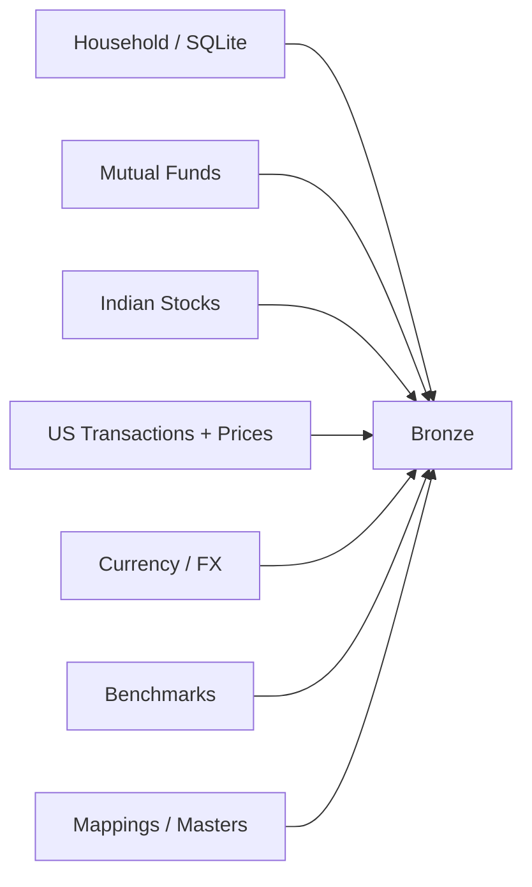

The important point is not the number 20 by itself. It is that each source family carries explicit synchronization semantics instead of inheriting one generic ingestion policy.

### Silver semantic families

Silver's 24 contracts form the canonical financial state consumed by domain engines and downstream presentation.

| Family | Examples of canonical meaning |
| --- | --- |
| **Common** | Calendar, currency, historical FX |
| **Household** | Income/expense classifications, asset classifications, income/expense/transfer/opening facts |
| **Investment reference** | Benchmark master, investment master, macro parameters |
| **Investment activity** | Market data, purchases, sales, benchmark observations |
| **Quant evidence** | Lot analytics, realized events, reconciliation events |
| **Tax evidence** | Canonical tax events |

This is where the architecture becomes much more than ETL. Silver contains not only normalized source facts but also canonical reconstructed evidence whose ownership is explicit.

### Gold decision families

Gold's 22 contracts are deliberately curated around questions rather than around source tables.

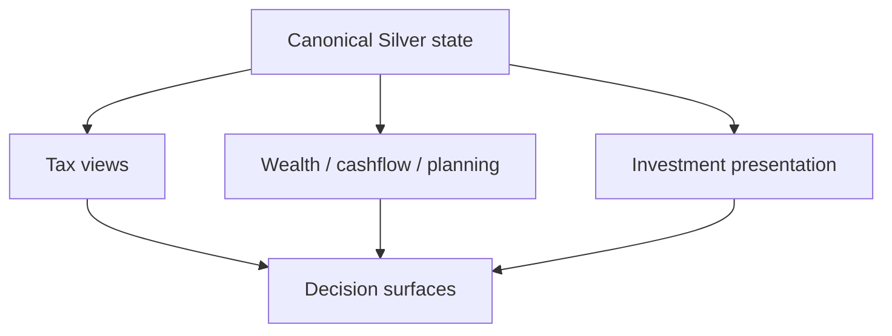

The Gold layer therefore acts as a serving contract. It is not where source cleanup or core financial reconstruction should suddenly appear because a dashboard deadline got exciting.


### Explore

**Wiki:** [Home](https://github.com/tks18/personal-finance-etl/wiki) · [Architecture Tour](https://github.com/tks18/personal-finance-etl/wiki/02-Architecture-Tour) · [Follow the Data](https://github.com/tks18/personal-finance-etl/wiki/03-Follow-the-Data) · [Evidence, Identity & Reconciliation](https://github.com/tks18/personal-finance-etl/wiki/05-Evidence-Identity-and-Reconciliation) · [Investment Engine](https://github.com/tks18/personal-finance-etl/wiki/07-Investment-Engine) · [Tax Evidence & Planning](https://github.com/tks18/personal-finance-etl/wiki/09-Tax-Evidence-and-Planning) · [FIRE & Planning](https://github.com/tks18/personal-finance-etl/wiki/10-FIRE-and-Planning)

**Technical reference:** [`/docs`](docs/README.md) · **Run it:** [Getting Started](docs/getting-started/README.md)

---

## End-to-end investment evidence lineage

The investment subsystem is where several of the project's architectural ideas meet at once: deterministic identity, reconstruction, reconciliation, tax interpretation, multi-currency accounting and BI publication.

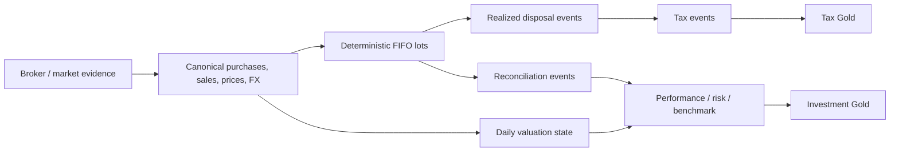

### Purchase evidence

A canonical purchase receives a deterministic `PURCHASE` identity derived from semantic fields rather than dataframe position. It can then create one or more lot states without losing the transaction that originated them.

### Sale evidence

A canonical sale receives a deterministic `SALE` identity. FIFO consumes active acquisition lots oldest-first, and every consumed sale/lot pair can produce a stable `REALIZED` event.

### Reconciliation evidence

Observed broker state can challenge reconstructed quantity or cost basis. Reconciliation has its own identities because a correction event should never be indistinguishable from a genuine buy or sell.

### Tax evidence

The Tax Engine consumes realized investment events rather than reconstructing gains again. This keeps economic realization authority in one place and tax normalization in another.

### Presentation

Gold aggregates the canonical evidence for decision use, but the deeper lineage remains available in Silver/Control Plane state. Presentation is the last step, not the source of truth.

---

## End-to-end household and wealth lineage

Household finance follows a different state model from investments, but the two converge in wealth analytics.

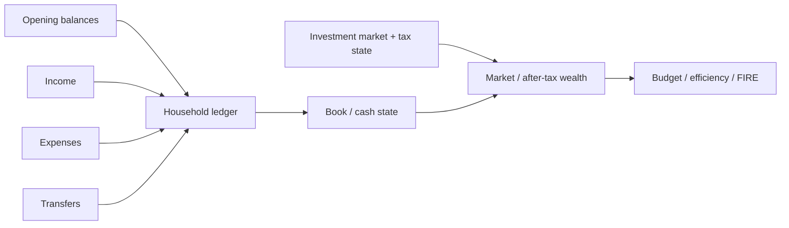

The separation is intentional. Household transactions explain account movement. Investment engines explain market-valued investment state. Wealth combines them only after each subsystem has done its own accounting correctly.

---

## Why the Control Plane matters more than a run log

Calling the SQLite layer a "run log" would undersell it badly. It is the system's operational memory.

It answers questions such as:

1. Which source artifacts exist now?
2. Which artifact identity existed at a previous path?
3. Which content changed?
4. Which artifacts still need Bronze synchronization?
5. Which run first/last observed an artifact?
6. Which configuration and financial rules governed a run?
7. What failed, at what stage, and with what traceback?
8. Which stochastic simulation belongs to which run/context?
9. Can analytical state be challenged and healed from operational authority?

That set of questions is why I stopped treating metadata as a handful of convenience tables inside DuckDB.

---

## Failure philosophy

The system generally prefers **visible failure over silent financial invention**.

| Situation | Preferred behavior |
| --- | --- |
| Historical US price too stale | Fail validation rather than quietly value with ancient data |
| FX missing/invalid | Fail the relevant financial path rather than invent a rate |
| XIRR undefined/non-convergent | Preserve typed invalid state rather than emit `0%` |
| Broker/reconstruction mismatch | Emit reconciliation evidence rather than hide the discrepancy |
| Tax evidence uncertain | Preserve review state rather than promote estimate to certainty |
| Registered analytical output missing | Fail publication |
| Unregistered analytical output produced | Fail publication |
| Restore archive malformed | Reject before touching production databases |
| Cross-store commit divergence | Heal on the next run through normal idempotent paths |

This is one of the less glamorous parts of financial software, which is exactly why it matters.

---

## What I intentionally removed or simplified

The codebase has also improved by deleting things.

Earlier versions carried a broader collection of portfolio/risk metrics and more diffuse metadata responsibilities. Over time I removed calculations that did not materially support my decisions, centralized operational authority in the Control Plane, simplified the Tax Engine into evidence preparation rather than pseudo-statutory calculation, and made the warehouse contracts more explicit.

That evolution reflects a principle I now trust quite a lot:

> **Complexity should have to keep re-earning its place.**

A sophisticated project is not improved by preserving every sophisticated thing it has ever contained.

---

## Where correctness comes from today

The repository's correctness model is layered.

### 1. Type and configuration contracts

Pydantic validates runtime and financial-policy structure. Some semantic cross-field expectations remain documented rather than automatically enforced, and the docs say so explicitly.

### 2. Runtime schema and registry gates

Publication validates registered outputs, expected schemas and layer contracts.

### 3. Domain invariants

Quant, Tax, FX and reconstruction code contain fail-closed checks around impossible or unsafe financial states.

### 4. Reconciliation

Independent broker/cash state can challenge reconstructed state.

### 5. Operational provenance

Failures, events, settings/rules snapshots and run context remain inspectable.

### 6. Automated QA

This is the area with the most room to mature. The current repository has a headless smoke path and extensive runtime validation/hardening logic, but not yet the broad conventional regression suite I ultimately want. The roadmap treats that gap honestly and prioritizes it.

---

## Why local-first remains deliberate

Personal financial evidence is unusually sensitive and the workload is comfortably handled on local hardware. That makes local-first more than an aesthetic preference.

```text
local files / databases
        ↓
local Control Plane
        ↓
local DuckDB warehouse
        ↓
local analytics / simulation
        ↓
local BI / CLI / Desktop
```

The project can still use public market/reference data where required, but the financial state itself does not need a cloud platform merely to look architecturally serious.

Local-first also simplifies one important mental model: the recovery unit is tangible. I can snapshot the application's authoritative SQLite + DuckDB state together, validate it, restore it, and reason about the boundary directly.

---

## How I think about the architecture now

If I had to compress the whole repository into four spines, they would be these:

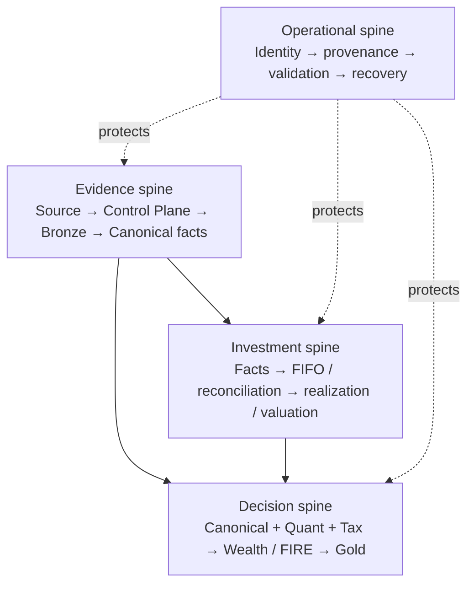

That is a much better description of the current system than "ETL pipeline," even though ETL is still at its core.

---

## A note on scope

Personal Finance ETL is intentionally not trying to become:

- a multi-tenant SaaS finance product;
- a brokerage execution platform;
- a universal tax filing engine;
- an institutional portfolio-risk platform;
- an ERP;
- a generic data framework that happens to ship with one finance example.

It is a deep local financial system built around my real workflow, with reusable architecture extracted where the variation actually exists.

That constraint is one reason the project can go unusually deep in the areas it does own.

---

## Documentation map

The rebuilt documentation now mirrors the actual architecture instead of the historical folder structure that grew around older versions.

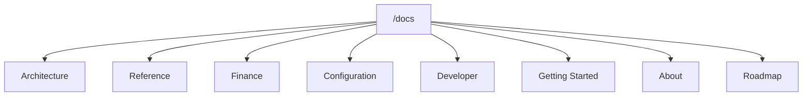

### Architecture

System topology, data lifecycle, warehouse ownership, data model, Control Plane artifact lifecycle, deterministic identity/replay, reliability/recovery, backup/restore and design decisions.

### Reference

Exact Bronze/Silver/Gold/Meta/Control Plane contracts, identity/grain contracts and terminology.

### Finance

Household model, investment evidence, market reconstruction, FIFO, reconciliation, performance/risk, FX, Tax, FIRE and quantitative methodology.

### Configuration

Operational Settings, FinancialRules and stochastic FIRE configuration.

### Developer

Development model, source onboarding, transformations, Gold marts, schema evolution and testing/validation.

### Getting Started

Installation, first successful run and CLI/Desktop operations.

### About + Roadmap

The project journey, my own engineering/finance path and the current maturity plan.

Open the full [documentation map](docs/README.md).

---

## Repository philosophy in one page

If I strip away the implementation details, these are the beliefs that keep showing up:

1. **Evidence before inference.** Preserve what actually arrived before deriving what it means.
2. **Identity before convenience.** Stable semantic IDs make rebuilds and lineage tractable.
3. **Reconciliation before confidence.** A model should be challenged by independent truth.
4. **Grain before metric.** The denominator is not the only thing that can be wrong.
5. **Policy before magic numbers.** Financial interpretation belongs in explicit rules.
6. **State ownership before shared mutable everything.** Every persistence layer needs a job.
7. **Failure visibility before pretty output.** Missing evidence should stay missing, not become zero.
8. **Rebuildability before clever incremental mutation.** Derived truth should be reproducible.
9. **Selective publication before metric hoarding.** Gold is for decisions.
10. **Scope discipline before platform cosplay.** Solve the real problem deeply.

Those principles were not written first and implemented later. Most of them were learned the expensive way and then made explicit.

---
## Final note

This started because I wanted a better month-end view of my own finances.

It now has:

```text
an SQLite Control Plane with historical operational provenance
20 persistent Bronze source contracts
24 canonical Silver contracts
22 Gold decision marts
a Polars transformation DAG
deterministic financial identities
US historical market reconstruction
canonical FIFO acquisition lots
realized disposal events
quantity and cost-basis reconciliation
multi-currency / FX attribution
cash-flow-aware XIRR and benchmark shadow portfolios
evidence-first tax preparation
household cash / wealth reconciliation
stochastic FIRE modelling with provenance
cross-database healing semantics
coordinated snapshot + restore
Power BI, CLI and desktop surfaces
and a documentation system large enough to require its own architecture map
```

Is that a lot of engineering for personal finance?

**Yes. Obviously.** 😂

But the sophistication was not the original goal. It accumulated because every time the system answered one financial question, the next question demanded stronger evidence, better state, clearer ownership or more honest uncertainty.

I use the system. I reconcile the state. I inspect the failures. I use the outputs to make real financial decisions.

That is the part I care about most.

---

## License

See [LICENSE](LICENSE) for usage terms.
