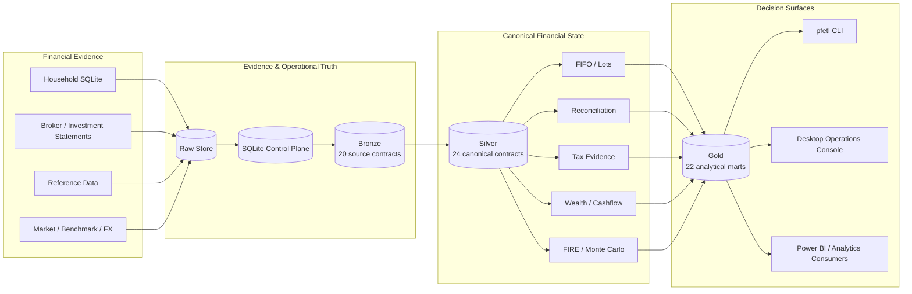
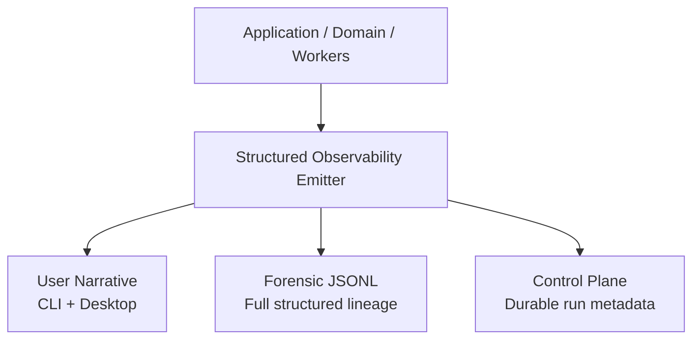

<p align="center">
  
</p>

# Personal Finance ETL

<p align="center">
  <strong>Local-first financial systems engineering for evidence, accounting, analytics, tax, and FIRE.</strong>
</p>

<p align="center">
  <em>From fragmented financial evidence to explainable financial state.</em>
</p>

<p align="center">
    <a href="https://pypi.org/project/personal-finance-etl/"></a>
    
    <a href="https://www.gnu.org/licenses/gpl-3.0"></a>
    
    
    
    
</p>

---

## Why I built this

Personal finance data is rarely difficult because there is too little of it. It is difficult because the evidence is fragmented, inconsistent, historical, provider-shaped, and often financially ambiguous.

I built **Personal Finance ETL (PFETL)** as my own local financial systems platform to solve that problem properly.

It ingests household records, broker statements, market prices, benchmark histories, FX evidence, tax inputs, and financial assumptions; preserves what was actually observed; reconstructs a canonical financial state; reconciles that state against reality; and publishes decision-ready analytical datasets.

The result is not just an ETL pipeline and not just a dashboard backend.

PFETL is the system that decides:

> **What evidence did I receive? What does it mean financially? What state follows from it? Can I reconcile that state? What decisions can I support from it?**

Everything runs locally. My financial data stays on my machine.

---

## The system in one view



PFETL deliberately separates four kinds of truth:

| Layer | Question |
|---|---|
| **Observed evidence** | What files, records, prices, mappings, and parameters did the system actually receive? |
| **Canonical financial state** | What do those observations mean in one consistent financial vocabulary? |
| **Reconstructed / reconciled state** | What economic state follows from the evidence, and where does it disagree with observation? |
| **Operational truth** | What happened during a run, what changed, what failed, and how can it be reconstructed later? |

Gold is a **decision surface**, not an independent source of truth.

---

## Financial capabilities

### Household finance

PFETL reconstructs household financial activity across accounts and asset groups, including:

- income, expense, and transfer classification;
- active vs passive income;
- core vs non-core expenses;
- operating, investing, and financing cashflow;
- opening balances and account-state reconstruction;
- savings and investment rates;
- income resilience metrics;
- real vs nominal expense growth;
- liquidity and runway measures;
- net-worth movement and attribution.

The system treats household finance as a ledger problem first and an analytics problem second.

---

### Investment accounting

The investment engine reconstructs positions from actual transaction evidence rather than relying only on broker snapshots.

It supports:

- deterministic purchase and sale identities;
- chronological FIFO lot matching;
- partial lot depletion;
- remaining cost-basis reconstruction;
- realized gain/loss events;
- open-lot analytics;
- broker quantity reconciliation;
- market valuation;
- portfolio weights and concentration;
- instrument/class/sector/industry/geography/country/currency views.

Lot-level state remains auditable back to the underlying evidence.

---

### Performance, benchmark, and FX attribution

PFETL separates investment performance into economically meaningful components.

It calculates and publishes measures including:

- invested value and current value;
- absolute return;
- CAGR;
- XIRR;
- after-tax XIRR;
- benchmark XIRR;
- active return and alpha;
- maximum drawdown;
- asset P&L;
- FX P&L;
- FX contribution;
- local-currency and base-currency valuation;
- portfolio concentration using Top-1 / Top-5 / Top-10, HHI, and effective holdings.

This makes a multi-currency portfolio explainable instead of collapsing everything into one final return number.

---

### Tax evidence

Tax is treated as a first-class financial domain, not a reporting afterthought.

PFETL derives:

- holding-period classification;
- realized tax events;
- STCG / LTCG treatment;
- tax heads and sub-heads;
- exemption-aware analytical treatment;
- tax-if-sold estimates for open lots;
- unrealized LTCG / STCG exposure;
- tax-loss harvesting signals;
- LTCG maturity ladders;
- financial-year tax summaries and reconciliation.

Tax outputs are analytical evidence and planning support, not a substitute for statutory filing.

---

### Wealth and FIRE

PFETL combines household and investment state into long-horizon financial planning.

Capabilities include:

- market and book net worth;
- net-worth change attribution;
- wealth composition;
- emergency-fund and liquidity coverage;
- safe-withdrawal-rate based FI targets;
- Coast FI and target-age analysis;
- required savings / investment rates;
- wealth velocity;
- deterministic FIRE projections;
- Monte Carlo simulation;
- percentile outcomes and success probabilities;
- configurable macro, return, inflation, and planning assumptions.

Financial methodology lives in **FinancialRules**, so changing an assumption does not require changing Python code.

---

## Data architecture

PFETL uses a local medallion-style analytical warehouse, but the layers are intentionally financial rather than generic.

### Bronze · 20 source-oriented contracts

Bronze preserves normalized source evidence with provenance.

Examples include:

- household categories, assets, currencies, and transactions;
- mutual-fund and equity statements;
- instrument and benchmark reference data;
- opening balances;
- FX rates;
- benchmark histories;
- US equity prices.

Bronze stays close to evidence.

### Silver · 24 canonical contracts

Silver represents canonical financial state.

It contains:

- calendar and financial-year dimensions;
- income / expense / asset / currency dimensions;
- canonical household transactions;
- opening balances;
- investment purchases, sales, market data, and benchmarks;
- lot analytics;
- realized events;
- reconciliation events;
- tax events.

Silver is where provider-shaped evidence becomes PFETL-shaped finance.

### Gold · 22 analytical marts

Gold publishes decision-oriented analytical surfaces for:

- tax;
- monthly finance;
- wealth;
- cashflow;
- budget variance;
- FIRE;
- portfolio summary;
- investment allocation and performance across multiple dimensions.

Gold is optimized for downstream consumption, including **Power BI** and the future **PFETL Analytics Studio**.

---

## Control Plane, provenance, and recovery

PFETL does not treat pipeline execution as a black box.

A dedicated SQLite Control Plane tracks operational truth including:

- run lifecycle and commit state;
- artifact discovery and synchronization;
- immutable source payload history;
- source change events;
- provider requests;
- failures;
- configuration snapshots;
- FinancialRules snapshots;
- simulation provenance;
- sync summaries;
- recovery state.

This lets a historical run answer not just *what did the pipeline produce?*, but also:

> **Which inputs, settings, financial rules, provider requests, and execution path produced it?**

---

## Observability

PFETL uses a single structured observability path with multiple downstream consumers.



Every event can carry structured context such as:

- run ID;
- stage and component;
- operation and parent operation;
- entity identity;
- duration;
- row counts;
- provider and attempt;
- cache state;
- worker / batch context;
- settings and rules fingerprints;
- structured exception information;
- remediation hints.

The forensic JSONL stream is designed so a run can be reconstructed end to end without reproducing the failure first.

Multiprocessing workers feed the same observability architecture through queue sinks rather than creating a second logging system.

---

## Desktop operations console

PFETL includes a local **CustomTkinter** desktop application focused on operating the financial engine, not replacing downstream analytics.

The UI provides four focused workspaces:

### ▶ Pipeline Run

- launch the full pipeline;
- live progress and execution narrative;
- responsive background execution;
- snapshot and restore;
- operation interlocking and truthful runtime status.

### ⚙ Configuration

Visual editors for both:

- **Settings** — operational/runtime configuration;
- **FinancialRules** — financial methodology and assumptions.

The editors are generated from typed Pydantic models, support recent profiles, preserve TOML structure/comments, validate before saving, and use atomic writes.

### 📋 Forensic Logs

- live execution narrative;
- historical JSONL trace selection;
- severity/stage/component/outcome filters;
- debounced full-text search;
- cached background parsing;
- paginated event inspection;
- structured context, error, lineage, and remediation detail.

### 🩺 System & Health

- pipeline/lock state;
- warehouse and Control Plane health;
- table-contract inventory;
- source/storage information;
- system metadata;
- actionable `doctor` diagnostics.

The Core UI deliberately stops at **configuration, execution, observability, diagnosis, and recovery**. Rich financial exploration belongs downstream.

---

## Configuration philosophy

PFETL separates two concepts that should not be mixed:

### Settings

Operational facts such as:

- source paths;
- database locations;
- observability retention;
- worker counts;
- DuckDB threads;
- provider retry behavior;
- market-data staleness and fetch windows.

### FinancialRules

Financial methodology such as:

- tax assumptions;
- expense analytics rules;
- income grouping;
- portfolio tolerances;
- FIRE assumptions;
- inflation and return assumptions;
- Monte Carlo parameters;
- target allocations;
- LTCG maturity windows.

The rule is simple:

> **If I may reasonably change the assumption without changing the algorithm, it belongs in configuration, not hardcoded Python.**

---

## Reliability model

PFETL is designed to fail visibly rather than silently.

Key safeguards include:

- deterministic identities;
- typed contracts;
- schema validation;
- explicit reconciliation events;
- Control Plane run states;
- immutable configuration/rules provenance;
- atomic warehouse publication;
- recovery detection;
- coordinated snapshots and restore;
- bounded observability payloads;
- structured error context;
- source-hash and artifact tracking.

The emphasis is not “never fail.”

It is:

> **Know exactly what happened, preserve the evidence, and recover without corrupting financial truth.**

---

## Testing philosophy

The test suite is intentionally small and financially meaningful.

Rather than preserving historical refactor-phase tests, PFETL now focuses on production-confidence tests with hand-checkable numerical fixtures.

Coverage includes:

- full pipeline execution from Control Plane through Gold;
- household ledger identities;
- income, expense, cashflow, and balance calculations;
- FIFO lot depletion and deterministic IDs;
- realized gains and remaining cost basis;
- tax classification;
- FX and benchmark attribution;
- wealth and FIRE outputs;
- deterministic simulation behavior;
- observability and operational integrity;
- Settings and FinancialRules editor round-trips;
- forensic-log and System UI behavior.

Example FIFO golden case:

```text
Buy 100 @ ₹100
Buy  50 @ ₹120
Sell 120 @ ₹150

FIFO result
├── First lot: 100 disposed
├── Second lot: 20 disposed
├── Remaining quantity: 30
└── Remaining basis: ₹3,600
```

The tests assert the actual money, quantities, identities, and classifications, not merely that classes or columns exist.

---

## Technology stack

| Area | Technology |
|---|---|
| Language | Python 3.13+ |
| Dataframes / compute | Polars |
| Analytical warehouse | DuckDB |
| Control Plane / Raw Store | SQLite |
| Validation / configuration | Pydantic |
| TOML preservation | tomlkit |
| Excel ingestion | fastexcel |
| XIRR | pyxirr |
| Numerical acceleration | Numba |
| Market evidence | yfinance |
| Desktop | CustomTkinter |
| Terminal UX | Rich |
| Concurrency | multiprocessing + worker queues |
| Packaging | Hatchling + PyInstaller |
| Quality | Ruff, Mypy, Pyright, Pylint, Pytest |

---

## Operator CLI

One executable owns the product surface:

```bash
# Launch the desktop application
pfetl

# Explicit GUI launch
pfetl --gui

# Run the complete pipeline
pfetl run --config config.toml --rules rules.toml

# Fully unattended execution
pfetl run --config config.toml --rules rules.toml --cron

# Operational status
pfetl status --config config.toml

# System and warehouse information
pfetl info --config config.toml

# Actionable health diagnostics
pfetl doctor --config config.toml --rules rules.toml

# Coordinated DuckDB + SQLite snapshot
pfetl snapshot --config config.toml

# Restore a previous snapshot
pfetl restore backup_archive.zip --config config.toml

# Version
pfetl --version
```

---

## Installation

PFETL targets **Python 3.13+**.

```bash
git clone https://github.com/tks18/personal-finance-etl.git
cd personal-finance-etl

# Recommended
uv sync

# Run
uv run pfetl
```

Or install from PyPI:

```bash
pip install personal-finance-etl
pfetl
```

PFETL is local-first. Source files, databases, logs, and generated analytical state remain on the local machine.

---

## Repository architecture

```text
src/personal_finance_etl/
├── application/       # orchestration and use cases
├── bootstrap/         # dependency assembly / composition
├── config/            # Settings + FinancialRules
├── contracts/         # typed cross-boundary contracts
├── domain/            # financial meaning and algorithms
├── infrastructure/    # stores, providers, observability, recovery
└── presentation/      # CLI + CustomTkinter operator surfaces
```

The structure is intentionally ownership-driven:

```text
application
→ what workflow runs?

bootstrap
→ how are concrete dependencies assembled?

config
→ what runtime and financial policy is valid?

contracts
→ what crosses boundaries?

domain
→ what does the finance mean?

infrastructure
→ how is persistence / I/O / recovery implemented?

presentation
→ how does a human operate and inspect the system?
```

---

## What this project demonstrates

PFETL sits at the intersection of several disciplines I work across.

### Finance & accounting

- household financial-state reconstruction;
- investment accounting and FIFO;
- realized / unrealized P&L;
- multi-currency attribution;
- benchmark analysis;
- tax evidence;
- wealth analytics;
- FIRE and financial planning.

### Data engineering

- ingestion from heterogeneous evidence;
- deterministic transformation DAGs;
- medallion-style warehouse design;
- typed data contracts;
- schema and grain ownership;
- DuckDB analytical modeling;
- SQLite operational metadata;
- source lineage and artifact tracking;
- incremental synchronization.

### Software engineering

- object-oriented design;
- SRP / SOLID-oriented boundaries;
- typed interfaces and Pydantic models;
- dependency composition;
- multiprocessing;
- deterministic identity design;
- recovery and snapshot semantics;
- structured observability;
- desktop and CLI product surfaces;
- packaging and release engineering.

### Analytics & quantitative engineering

- XIRR / CAGR;
- benchmark-relative performance;
- FX decomposition;
- concentration analytics;
- cashflow and wealth attribution;
- deterministic and stochastic FIRE modeling;
- Monte Carlo simulation;
- Power BI-ready analytical marts.

### Product engineering

- local-first privacy;
- operator-focused UX;
- configurable financial methodology;
- maintainable configuration editors;
- production-confidence golden tests;
- diagnostics designed for real failure investigation.

This project is where my background as a **Chartered Accountant** and my work in **analytics, data engineering, and software engineering** converge into one system.

> **Finance gives me the questions. Data gives me the structure. Software engineering lets me build the answers.**

Konjam over-ah poiduchu. Worth-u. 😂

---

## Design principles

PFETL has accumulated a lot of capability, but the final architecture is intentionally conservative.

1. **Financial correctness gets complexity.**
2. **Operational reliability gets complexity.**
3. **Anything that saves recurring manual work can earn complexity.**
4. **Extensibility by itself is not a product requirement.**
5. **Configuration owns assumptions; code owns algorithms.**
6. **Observed evidence is preserved before it is interpreted.**
7. **Reconciliation is better than silent agreement.**
8. **One operational event should feed every presentation, not several logging systems.**
9. **Derived state should be rebuildable.**
10. **Mature systems should become boring to operate.**

PFETL is now intentionally in that last stage.

---

## Downstream analytics

PFETL Core is the financial truth engine.

Today, Gold marts can be consumed directly from DuckDB by:

- Microsoft Power BI;
- Excel;
- Jupyter / Python;
- SQL clients;
- other read-only analytical consumers.

A separate **PFETL Analytics Studio** is planned as the rich exploration and reporting companion. It will consume PFETL's DuckDB warehouse, Control Plane, historical run evidence, Settings, and FinancialRules without duplicating the financial methodology inside Core.

The boundary is deliberate:

```text
PFETL Core
    → calculate and preserve financial truth

Analytics consumers
    → explore, visualize, compare, and report that truth
```

---

## Project maturity

PFETL is not optimized for arbitrary external source onboarding or multi-user SaaS deployment.

It is a deeply personalized financial system built primarily for my own financial workflow.

That constraint is intentional.

It lets the project optimize for:

- correctness over generic extensibility;
- explainability over black-box automation;
- local control over cloud dependence;
- maintainability over architecture for architecture's sake;
- real monthly usefulness over hypothetical product breadth.

The Core architecture is considered mature. Future changes should be driven by observed financial requirements, provider/source changes, actual bugs, or concrete operating friction rather than continuous redesign.

---

## Author

**Sudharshan TK (Shan)**  
**Chartered Accountant × Data & Software Engineer**

PFETL is the result of treating personal finance as both a financial-modeling problem and a software-engineering problem.

Built locally. Auditable end to end. Designed to explain the numbers, not just display them.

---

## License

Licensed under the **GNU General Public License v3.0 or later (GPL-3.0-or-later)**.
