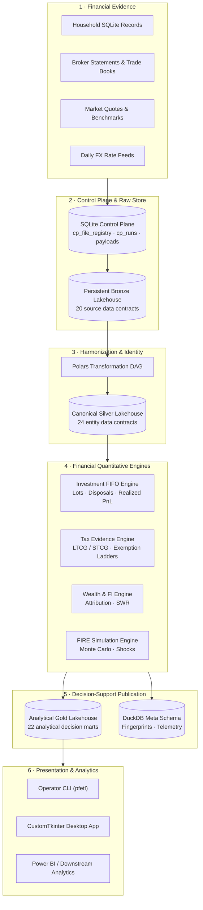

<p align="center">
  
</p>

# Personal Finance ETL

**Local-first financial data engineering & quantitative decision-support lakehouse platform.**

Preserve financial evidence &rarr; Canonicalize meaning &rarr; Reconstruct state &rarr; Reconcile against reality &rarr; Support decisions across Investments, Tax, Household, and FIRE.

<p align="center">
    <a href="https://pypi.org/project/personal-finance-etl/"></a>
    
    <a href="https://www.gnu.org/licenses/gpl-3.0"></a>
    
    
    
</p>

---

## Architecture

PFETL implements a durable, local-first Lakehouse architecture combining an ACID SQLite Control Plane with high-throughput DuckDB analytical query processing:



---

## Core Capabilities

| Financial Domain | Engineering Responsibility & Analytical Guarantee |
| :--- | :--- |
| **Household Ledger** | Multi-account ingestion, categorization DAG, transfer elimination, and exact cashflow identity verification ($\Delta\text{Cash} \equiv \text{Income} - \text{Expenses}$). |
| **Investment Accounting** | Multi-currency order matching, exact chronological lot depletion, corporate action adjustments, and realized gain/loss attribution. |
| **Valuation & Performance** | T+0 daily valuation, multi-asset class allocation, benchmark active returns (Nifty 50, S&P 500), currency conversion, and annual XIRR computation. |
| **Tax Evidence** | Holding period determination (equity, debt, international), Section 112A/111A classification, indexation grandfathering, and tax-loss harvesting ladders. |
| **Wealth & FIRE Analytics** | Net worth attribution ($\Delta \text{Net Worth} \equiv \text{Net Cashflow} + \text{Investment Return}$), safe withdrawal rates (SWR), and Monte Carlo simulation regimes. |
| **Operational Durability** | SQLite Control Plane provenance tracking, DuckDB ACID transactions, non-blocking JSONL forensic logs, and coordinated point-in-time snapshot/restore. |

---

## Installation & Setup

PFETL targets **Python 3.13+** on Windows, macOS, and Linux:

```bash
# Clone the repository
git clone https://github.com/tks18/personal-finance-etl.git
cd personal-finance-etl

# Option A: Install with uv (recommended)
uv sync

# Option B: Install with pip
python -m venv .venv
source .venv/bin/activate  # On Windows: .venv\Scripts\activate
pip install -e .
```

---

## Operator CLI (`pfetl`)

```bash
# Run the complete quantitative pipeline
pfetl run --config config.toml --rules rules.toml

# Execute actionable system diagnostics and environment health checks
pfetl doctor

# Launch the desktop graphical interface
pfetl gui

# Create an atomic, coordinated database snapshot archive
pfetl backup

# Restore databases from a snapshot archive
pfetl restore backup_archive.zip
```

---

## Desktop Application

The CustomTkinter desktop interface provides a local-first workspace organized into four unified tabs:

* **▶ Pipeline Run**: One-click pipeline execution, real-time progress bar, live narrative console, and instant database snapshot/restore actions.
* **⚙️ Configuration**: Visual interactive editors for `config.toml` (Settings) and `rules.toml` (Financial Rules), with in-place schema validation, type enforcement, and dynamic parameter lists.
* **📋 Forensic Logs**: Dual-pane diagnostic suite featuring real-time execution narrative, JSONL forensic trace selection, multi-dimensional filters (severity, stage, search), and deep execution context inspector.
* **🩺 System & Health**: Live operational status indicators, warehouse table contract counters, native directory launchers, and on-demand Doctor diagnostics runner.

---

## Lakehouse Data Contracts

PFETL publishes structured datasets across three distinct Medallion lakehouse layers:

* **Bronze (20 Tables)**: Raw, unmutated financial evidence preserved with cryptographic source file hashes, timestamps, and payload lineage.
* **Silver (24 Tables)**: Cleaned, type-coerced, and canonicalized financial entities published with deterministic UUID surrogate keys.
* **Gold (22 Marts)**: Reconciled analytical decision marts ready for financial planning, balance sheet reporting, and quantitative decision-support.

---

## Operational Reliability

* **Dual-Database Storage Model**: Fast analytical queries execute inside embedded DuckDB, while ACID transactional durability, file deduplication, and execution metadata reside in SQLite.
* **Atomic Two-Phase Commits**: DuckDB lakehouse tables are committed first, followed by SQLite run states, preventing partial disk states.
* **Non-Blocking Observability**: Structured JSONL forensic logging is decoupled from analytical execution via background queue sinks, protecting GUI responsiveness.
* **Self-Healing Recovery**: Stale or interrupted runs are automatically detected on startup and cleanly reconciled or rolled back.

---

## Testing & Quality Confidence

The test suite enforces mathematical correctness through deterministic, synthetic test fixtures with hand-checkable analytical assertions:

```bash
# Run the complete test suite
pytest -v

# Run linters and static type verification
ruff check src tests
mypy src tests
pyright src tests
pylint src/personal_finance_etl
```

---

## Downstream Analytics

PFETL serves as the authoritative, local-first analytical lakehouse producer. The published Gold marts in DuckDB can be queried directly via ODBC/JDBC from **Microsoft Power BI**, Excel, Jupyter Notebooks, or downstream analytical applications.

---

## License & Authorship

Authored by **Shan**. Distributed under the **GNU General Public License v3.0 (GPL-3.0)**.
