# Personal Finance ETL

**My local-first financial data engineering and quantitative decision-support platform for reconciled personal finance, investment analytics, tax evidence, FIRE simulation, and BI.**

I built Personal Finance ETL because I wanted one answer to a deceptively simple question:

> **Where exactly do I stand financially, and can I prove how I got there?**

The first version only needed to make month-end less annoying. Then the questions got harder.

A balance needed evidence. Evidence needed identity. Investment history needed reconstruction. Reconstruction needed reconciliation. Realized gains needed tax context. Wealth needed both household and market state. FIRE needed all of that to be trustworthy _before_ Monte Carlo was allowed anywhere near it.

So the project grew from ETL into the system I now use to **preserve financial evidence, reconstruct state, challenge that state against independent observations, and turn the result into decisions**.

[](https://pypi.org/project/personal-finance-etl/)
[](https://pepy.tech/projects/personal-finance-etl)

[](https://www.gnu.org/licenses/gpl-3.0)

[](https://app.codacy.com/gh/tks18/personal-finance-etl/dashboard?utm_source=gh&utm_medium=referral&utm_content=&utm_campaign=Badge_grade)
[](https://www.codefactor.io/repository/github/tks18/personal-finance-etl)
[](https://coderabbit.ai)


**Explore:** [Wiki](https://github.com/tks18/personal-finance-etl/wiki) · [Architecture Tour](https://github.com/tks18/personal-finance-etl/wiki/02-Architecture-Tour) · [Follow the Data](https://github.com/tks18/personal-finance-etl/wiki/03-Follow-the-Data) · [Investment Engine](https://github.com/tks18/personal-finance-etl/wiki/07-Investment-Engine) · [FIRE & Planning](https://github.com/tks18/personal-finance-etl/wiki/10-FIRE-and-Planning) · [Technical Docs](docs/README.md)

## 🧭 Table of contents

- [Personal Finance ETL](#personal-finance-etl)
  - [🧭 Table of contents](#-table-of-contents)
  - [The whole project in one thought](#the-whole-project-in-one-thought)
  - [It started as a month-end problem](#it-started-as-a-month-end-problem)
- [Act I · From evidence to a financial system](#act-i--from-evidence-to-a-financial-system)
  - [The architecture that emerged](#the-architecture-that-emerged)
  - [One run, end to end](#one-run-end-to-end)
  - [Operational memory: the SQLite Control Plane](#operational-memory-the-sqlite-control-plane)
    - [Path is not identity](#path-is-not-identity)
  - [The warehouse: 66 contracts, three different jobs](#the-warehouse-66-contracts-three-different-jobs)
    - [Bronze remembers synchronized source state](#bronze-remembers-synchronized-source-state)
    - [Silver is where source vocabulary stops](#silver-is-where-source-vocabulary-stops)
    - [Gold serves decisions](#gold-serves-decisions)
- [Act II · From canonical facts to financial truth](#act-ii--from-canonical-facts-to-financial-truth)
  - [Investment evidence becomes state](#investment-evidence-becomes-state)
  - [FIFO: where transactions become acquisition history](#fifo-where-transactions-become-acquisition-history)
  - [Reconciliation: disagreement becomes evidence](#reconciliation-disagreement-becomes-evidence)
  - [Performance: the denominator is not the hard part](#performance-the-denominator-is-not-the-hard-part)
    - [XIRR](#xirr)
    - [Benchmark shadow portfolios](#benchmark-shadow-portfolios)
    - [Multi-currency attribution](#multi-currency-attribution)
  - [Tax: consume realization, do not reinvent it](#tax-consume-realization-do-not-reinvent-it)
  - [Household finance: movement first, wealth second](#household-finance-movement-first-wealth-second)
    - [Cash-flow reconciliation](#cash-flow-reconciliation)
- [Act III · From current truth to uncertain futures](#act-iii--from-current-truth-to-uncertain-futures)
  - [FIRE: Monte Carlo earns its inputs](#fire-monte-carlo-earns-its-inputs)
    - [Regimes](#regimes)
    - [Human-capital risk](#human-capital-risk)
    - [Adaptive withdrawals](#adaptive-withdrawals)
    - [Provenance](#provenance)
  - [Gold and Power BI: serve the answer, do not reconstruct it again](#gold-and-power-bi-serve-the-answer-do-not-reconstruct-it-again)
- [Act IV · When reality attacks the pipeline](#act-iv--when-reality-attacks-the-pipeline)
  - [Reliability is part of the financial model](#reliability-is-part-of-the-financial-model)
    - [Bronze healing](#bronze-healing)
    - [Stale runs](#stale-runs)
    - [Worker failures](#worker-failures)
    - [Snapshot and restore](#snapshot-and-restore)
  - [The product surface: one backend, several ways in](#the-product-surface-one-backend-several-ways-in)
    - [Install](#install)
    - [Desktop](#desktop)
    - [Terminal](#terminal)
- [Act V · Evidence that this is not a five-row demo](#act-v--evidence-that-this-is-not-a-five-row-demo)
  - [Production shape](#production-shape)
  - [The stack, by responsibility](#the-stack-by-responsibility)
  - [What I trust, and what I deliberately do not claim](#what-i-trust-and-what-i-deliberately-do-not-claim)
    - [The system does provide](#the-system-does-provide)
    - [It deliberately does not claim](#it-deliberately-does-not-claim)
  - [Is it portable?](#is-it-portable)
- [Act VI · Why the project looks like this](#act-vi--why-the-project-looks-like-this)
  - [Engineering decisions that survived the refactors](#engineering-decisions-that-survived-the-refactors)
    - [Preserve evidence before inference](#preserve-evidence-before-inference)
    - [Give every truth an owner](#give-every-truth-an-owner)
    - [Respect grain before calculating](#respect-grain-before-calculating)
    - [Reconcile against independent observations](#reconcile-against-independent-observations)
    - [Keep policy explicit](#keep-policy-explicit)
    - [Use the compute model that fits the problem](#use-the-compute-model-that-fits-the-problem)
    - [Compute richly, publish selectively](#compute-richly-publish-selectively)
    - [Let complexity keep re-earning its place](#let-complexity-keep-re-earning-its-place)
  - [How the project evolved](#how-the-project-evolved)
- [Go deeper without making this README even more feral](#go-deeper-without-making-this-readme-even-more-feral)
  - [Learn the system](#learn-the-system)
  - [Inspect the implementation](#inspect-the-implementation)
- [Final note](#final-note)
  - [License](#license)

---

## The whole project in one thought

Personal Finance ETL is built around a loop:

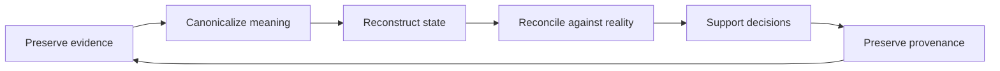

That loop is more important than any individual library in the stack.

A broker file can tell me what it observed. Transactions can reconstruct what should exist. Reconciliation can record where those truths disagree. Quant can turn acquisition history into realized economics. Tax can consume those economics without rebuilding them. Wealth can combine household and investment state. FIRE can then model uncertainty from a state that has actually earned the right to be simulated.

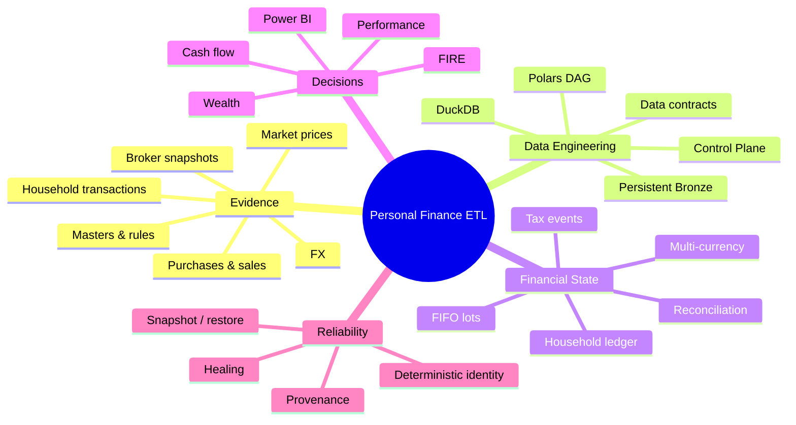

The rest of the README follows that loop rather than listing subsystems alphabetically.

---

## It started as a month-end problem

I did not begin with a plan to build an SQLite Control Plane, a 66-contract warehouse, deterministic lot identities and a stochastic retirement engine. That would have been an alarming hobby roadmap. 😂

I started with fragmented evidence:

```text
household transactions
broker files
mutual-fund data
Indian equity snapshots
US transactions
market prices
benchmarks
FX
mapping/reference masters
```

The first useful question was **what happened?**

Then came **what does it mean financially?**

Then **does the reconstructed state agree with independent evidence?**

Then **what is realized, unrealized, taxable, liquid, investable, or merely transferred between my own accounts?**

And eventually:

> **Given the state I have now, what decisions can I make without pretending uncertainty disappeared?**

That progression shaped the architecture far more than a framework choice ever did.

The immediate consequence is that source files cannot simply fall into a warehouse and emerge as truth. The system needs to remember what arrived, what changed, what was reconstructed, and what can be independently challenged.

That is where the architecture begins.

---

# Act I · From evidence to a financial system

## The architecture that emerged

The current system has four cooperating spines:

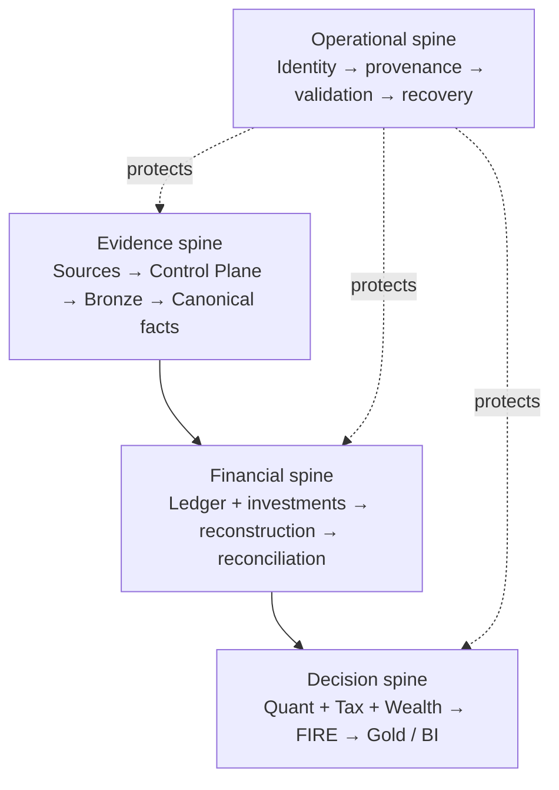

And physically:

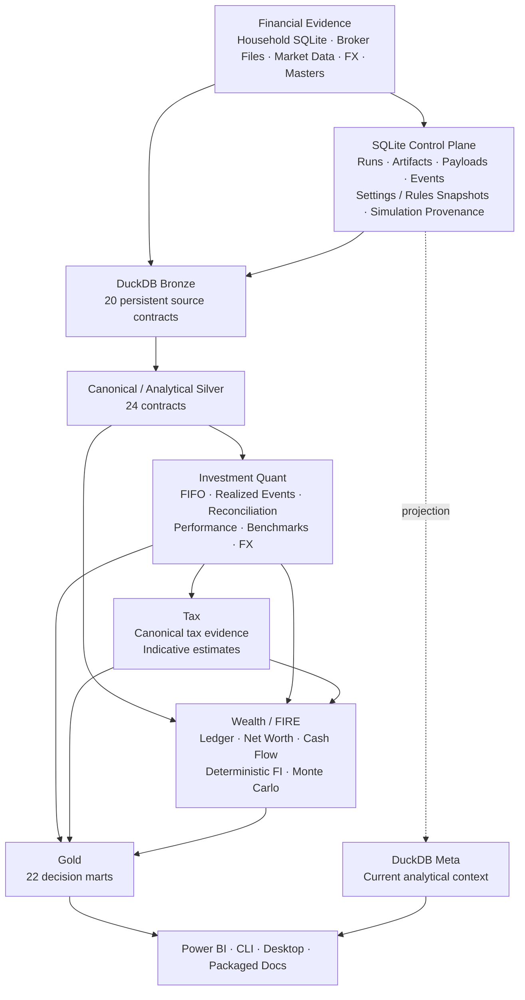

The databases have different jobs because the questions are different.

**SQLite asks:** what happened operationally?

**DuckDB asks:** what is the current analytical state?

That distinction matters enough to deserve its own lifecycle.

---

## One run, end to end

A normal run is not “read files → write tables.” It is closer to a controlled evidence synchronization followed by a deterministic analytical rebuild.

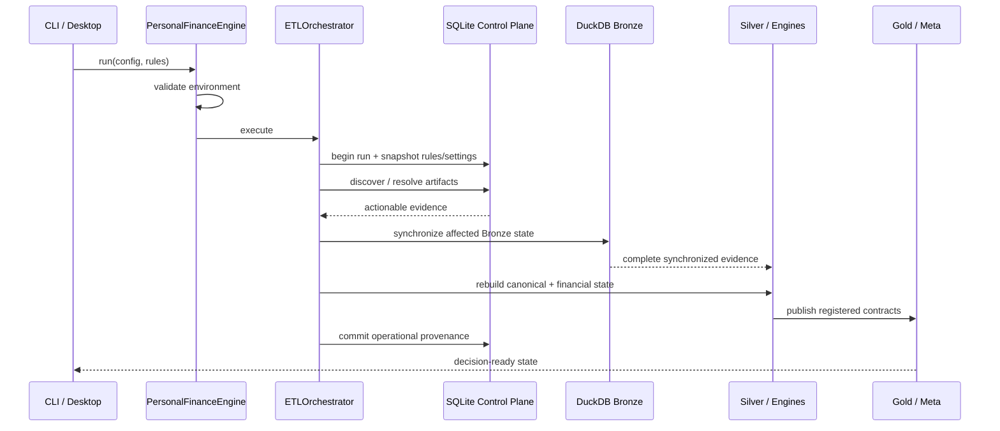

The architectural bet is deliberate:

> **Incrementalize the expensive evidence boundary. Rebuild the derived financial model coherently.**

I do not incrementally mutate every downstream analytical dependency simply because “incremental” sounds sophisticated. At this workload, persistent Bronze plus full Silver/Gold reconstruction is easier to reason about, easier to reproduce, and harder to corrupt subtly.

But this raises another question: if Bronze can be reused across runs, how does the system know _what_ changed?

That is the Control Plane's job.

---

## Operational memory: the SQLite Control Plane

The Control Plane is not a fancy run log. It is the historical operational authority.

It remembers:

- runs and lifecycle state;
- artifact identities;
- observed paths and hashes;
- source payload relationships;
- artifact-run events;
- settings and FinancialRules snapshots;
- failures and execution context;
- simulation provenance.

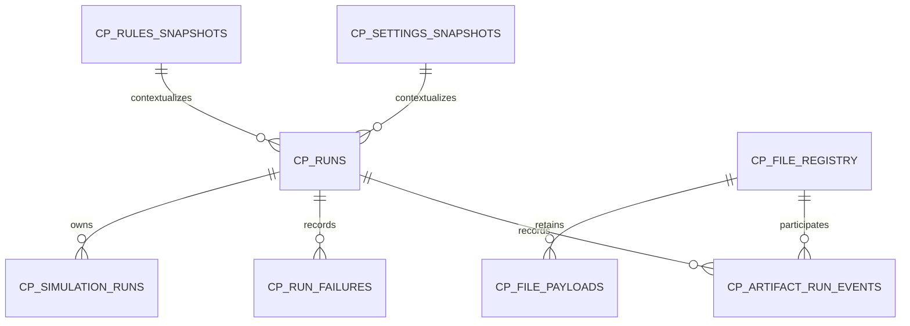

This is why DuckDB Meta stays intentionally smaller. Meta exposes **current analytical context**. The Control Plane preserves **historical operational causality**.

DuckDB is very good at analytical scans. It does not need a side hustle as an artifact historian. 😭

### Path is not identity

A source can move without becoming new evidence. Content can change without identity disappearing. A logical external fetch can exist without a normal source file at all.

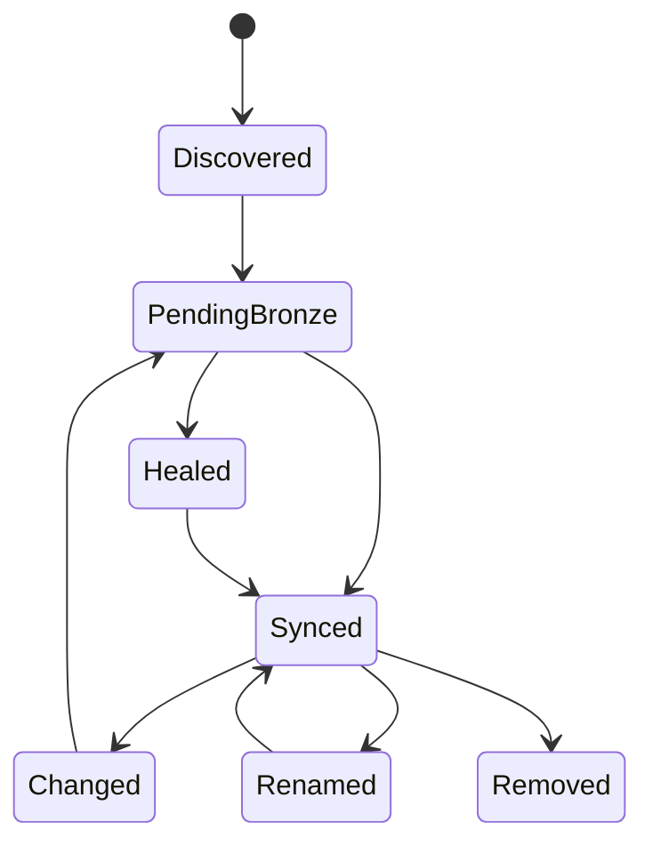

That lifecycle is what lets the system distinguish a rename from a deletion-plus-new-file fiction, and normal synchronization from recovery-driven healing.

Once evidence has a durable operational identity, it can enter the analytical warehouse without losing its history.

---

## The warehouse: 66 contracts, three different jobs

The documented registry baseline defines:

| Layer      | Contracts | Responsibility                                                  |
| ---------- | --------: | --------------------------------------------------------------- |
| **Bronze** |    **20** | Persistent synchronized source-shaped state                     |
| **Silver** |    **24** | Canonical financial facts and reconstructed analytical evidence |
| **Gold**   |    **22** | Decision-facing marts                                           |
| **Total**  |    **66** | Registered data contracts                                       |

DuckDB Meta sits alongside those contracts as current analytical context.

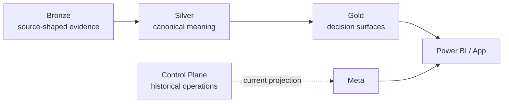

### Bronze remembers synchronized source state

Bronze is intentionally source-shaped. Different source families have different synchronization semantics, so the registry does not pretend one ingestion policy fits everything.

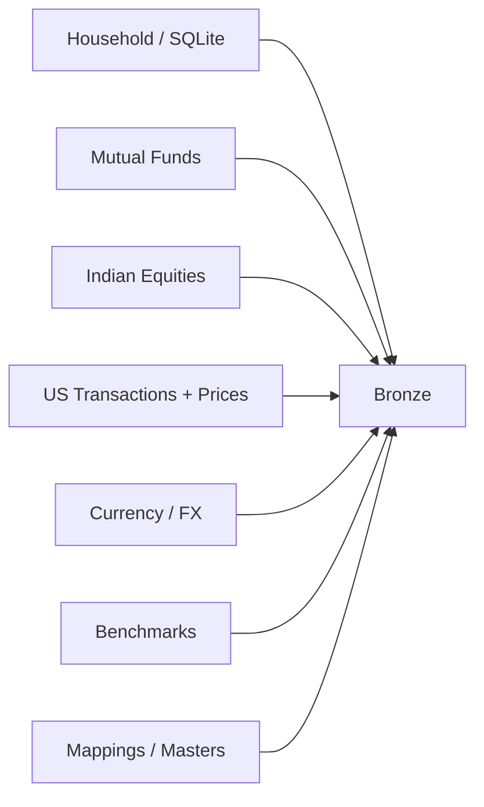

### Silver is where source vocabulary stops

Silver turns broker/file-specific shapes into financial contracts: household facts, investment activity, market/reference state, reconstructed Quant evidence and canonical Tax events.

The registry makes the grain explicit:

```python
@dataclass
class DataContract:
    contract_id: str
    layer: str
    physical_table: str
    domain: str
    grain: str
    producer: str
    publication_order: int
```

A correct formula at the wrong grain is still wrong. The schema therefore carries financial meaning, not just database types.

### Gold serves decisions

Gold is curated. It is not a museum of every metric the codebase has ever managed to calculate.

The publication contract is intentionally two-sided:

```text
produced analytical outputs
        =
registered analytical contracts
```

An unregistered output fails. A registered-but-missing output fails.

A dataframe does not earn warehouse real estate merely because it survived a function call.

At this point the data is canonical enough for financial engines to operate on it. That is where the project stops being “just ETL.”

---

# Act II · From canonical facts to financial truth

## Investment evidence becomes state

The investment model starts with canonical purchases, sales, market observations, benchmark observations, FX and instrument/reference state.

But a transaction list is not yet a portfolio.

For US investments, there is an extra wrinkle: my source environment does not provide the same reliable downloadable daily holdings evidence as the Indian sources. The application therefore reconstructs historical US market state from transactions.

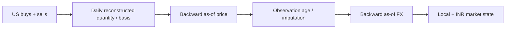

Historical joins are backward-only. Future prices and FX rates are not allowed to travel back in time because yesterday's chart would look nicer.

And this reconstructed market state is still **derived state**. It is not magically broker-certified because a dataframe contains it.

For acquisition-lot accounting, the Quant Engine owns a separate, stateful truth.

---

## FIFO: where transactions become acquisition history

`FIFOPortfolio` reconstructs active acquisition inventory.

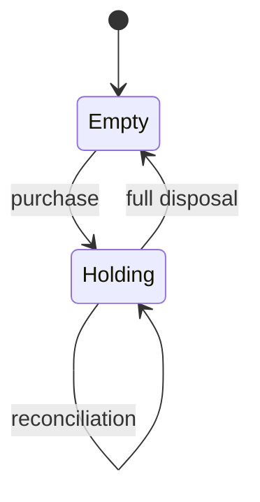

Purchases create deterministic lots. Sales consume the oldest active inventory first.

One sale can consume several lots:

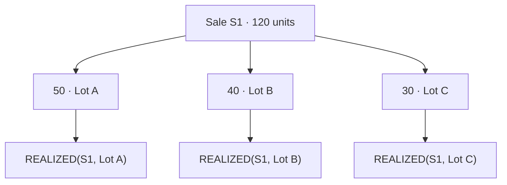

That decomposition matters because each acquisition component can have a different:

- purchase date;
- holding period;
- local basis;
- FX basis;
- realized gain/loss;
- tax classification.

Stable identity is what makes those relationships survive rebuilds.

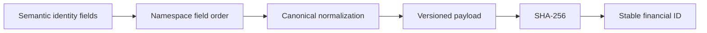

The project uses deterministic namespaces for purchases, sales, lots, realized events, reconciliation groups/events and tax events.

But deterministic reconstruction is still reconstruction. The next question is the accounting question that refuses to go away:

> **Does the reconstructed state agree with what the broker says exists?**

---

## Reconciliation: disagreement becomes evidence

The system treats observed broker state as an independent challenge to reconstruction.

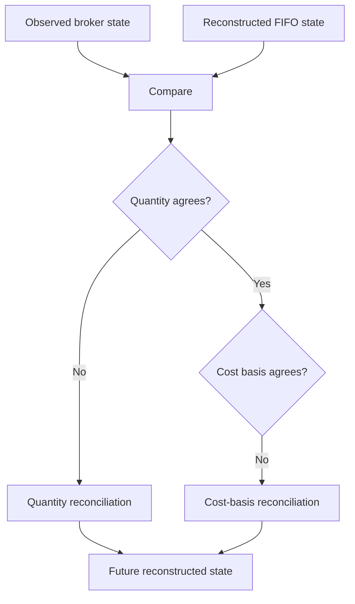

Quantity and basis are deliberately separate. Matching units do not imply matching acquisition economics.

A quantity correction can introduce reconciliation-origin lot state. A cost-basis correction can adjust basis without pretending a purchase or sale occurred. Both remain distinguishable from original transaction evidence.

That distinction is one of the project's most important financial boundaries:

> **Correction is not proof of history.**

Reconciliation tells the system how to move forward without rewriting inconvenient evidence behind it.

Once quantity and basis are trustworthy enough to carry forward, performance can finally be interpreted properly.

---

## Performance: the denominator is not the hard part

Returns are easy to calculate badly.

The difficult part is constructing the correct economic cash flows at the correct grain.

### XIRR

PyXIRR solves the dated cash flows. The Quant Engine constructs them.

```text
Portfolio XIRR
    = solve(portfolio cash flows + terminal value)

not

average(ISIN XIRR)
```

The same rule applies to classes and groups.

And when XIRR cannot be meaningfully computed, the result stays explicit:

```text
VALID
INVALID_INPUT
UNDEFINED
NON_CONVERGENT
```

A failed calculation does not become `0%` merely because dashboards enjoy tidy numbers.

### Benchmark shadow portfolios

Every real capital deployment can create equivalent benchmark exposure.

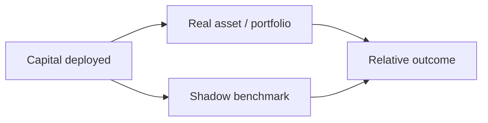

That means the benchmark comparison respects _when_ money entered the portfolio rather than comparing unrelated point-to-point percentages.

### Multi-currency attribution

Foreign assets add another layer:

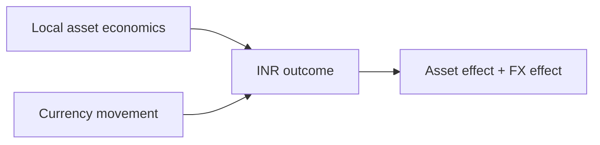

The system preserves local acquisition basis, local value, historical FX and INR economics so currency movement does not disappear into an unexplained portfolio return.

And once a disposal is realized with lot lineage, holding period and gain/loss, another subsystem finally has enough trustworthy evidence to do its job.

Tax comes next by design.

---

## Tax: consume realization, do not reinvent it

The Tax Engine is intentionally evidence-first.

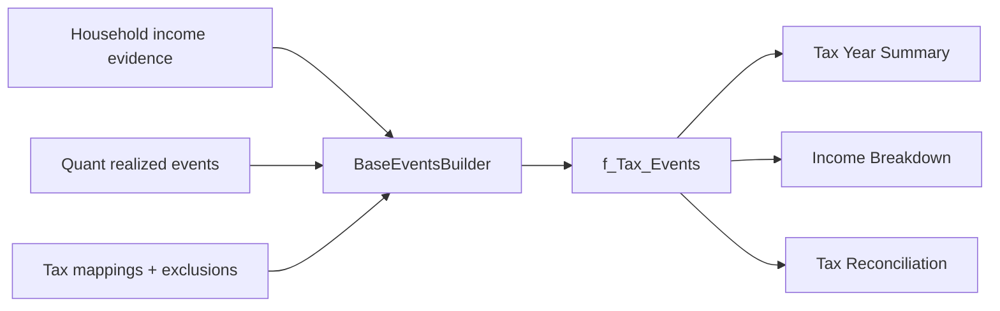

Quant owns investment realization because FIFO determines the basis that was actually consumed.

Tax consumes that evidence.

It does **not** independently rebuild capital gains, because two engines calculating the same realized event would not be redundancy. It would be two competing truths wearing matching shirts. 😭

FinancialRules also exclude investment-related ledger STCG/LTCG categories where Quant already owns the realization, preventing the same economic gain from entering the tax universe twice.

The outputs are useful for preparation and planning, but the boundary remains explicit:

- indicative estimates are not final statutory liability;
- `CHECK_REQUIRED` can coexist with an estimate;
- evidence quality and financial amount are different dimensions.

Tax closes one side of the financial picture. The other side is household state: cash, income, expenses, transfers, assets and liabilities.

---

## Household finance: movement first, wealth second

Household finance begins with opening balances and ledger evidence.

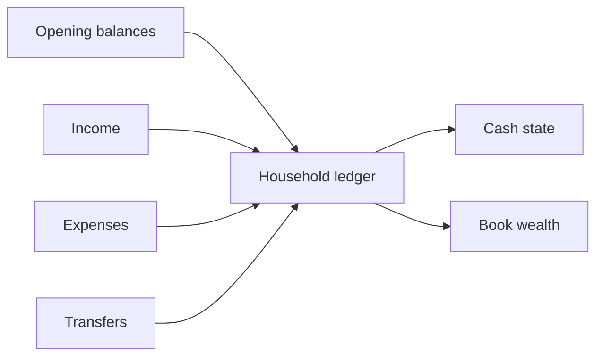

Transfers remain transfers. Moving ₹10,000 between two accounts I own does not create income on one side and expense on the other.

The model then distinguishes:

```text
cash income       ≠ total income
cash expense      ≠ total expense
book wealth       ≠ market wealth
market wealth     ≠ after-tax wealth
savings growth    ≠ organic asset growth
```

Investment state joins household state only after each subsystem has done its own accounting.

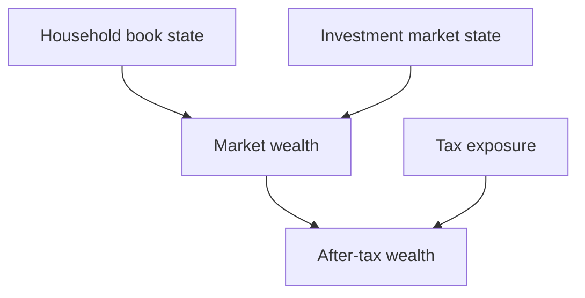

### Cash-flow reconciliation

A categorized ledger is not enough. Calculated cash movement can be challenged by observed closing cash:

```text
Opening cash
+ operating movement
+ investing movement
+ financing movement
= calculated closing cash

observed closing cash
- calculated closing cash
= reconciliation residual
```

That residual is evidence. It is not a rounding error to hide because the dashboard looked nicer before the subtraction.

With household and investment state finally connected, the system has a defensible current financial state.

Now, and only now, future planning becomes interesting.

---

# Act III · From current truth to uncertain futures

## FIRE: Monte Carlo earns its inputs

FIRE starts with deterministic planning state:

- current wealth;
- after-tax investment state;
- trailing savings;
- spending;
- FI target;
- coverage;
- assumptions.

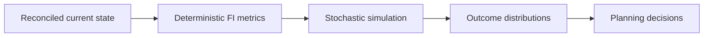

The stochastic layer then adds uncertainty deliberately rather than hiding it behind one average return.

```mermaid
flowchart TB
    REG["Markov market regimes"] --> PATH["Monthly path"]
    JUMP["Jump diffusion"] --> PATH
    INF["Dynamic inflation"] --> PATH
    JOB["Human-capital shocks"] --> PATH
    GLIDE["Glide path"] --> PATH
    DEBT["Debt sleeve"] --> PATH
    GK["Guyton-Klinger withdrawals"] --> PATH
    PATH --> OUT["FI + retirement outcomes"]
```

### Regimes

```mermaid
stateDiagram-v2
    Bull --> Bull
    Bull --> Bear
    Bull --> Stagnation
    Bear --> Bull
    Bear --> Bear
    Bear --> Stagnation
    Stagnation --> Bull
    Stagnation --> Bear
    Stagnation --> Stagnation
```

The transition matrix is an assumption, not a prophecy.

### Human-capital risk

A working household is exposed to more than market returns. Employment shocks can interrupt savings, which means human capital belongs in the model too.

### Adaptive withdrawals

Retirement spending can respond to portfolio conditions rather than following one perfectly rigid inflation-adjusted path regardless of reality.

### Provenance

Simulation runs retain seeds and fingerprints tied to the run/context. The goal is replay-oriented provenance under compatible implementation, not mystical bit-identical immortality across every future runtime.

Monte Carlo does not become clairvoyance because Numba made it fast.

It remains a distribution of outcomes conditioned on current state and assumptions.

The value is not certainty. The value is seeing how fragile or resilient the plan is under many plausible paths.

Those decisions still need somewhere clean to land.

---

## Gold and Power BI: serve the answer, do not reconstruct it again

Gold contains 22 decision marts spanning investments, Tax, wealth, cash flow and planning.

```mermaid
flowchart TB
    Q["Quant"] --> G["Gold"]
    T["Tax"] --> G
    W["Wealth / FIRE"] --> G
    G --> PBI["Power BI"]
    G --> APP["CLI / Desktop"]
```

Power BI receives curated financial state.

It does not need to discover FIFO accounting through DAX at 2 AM.

That boundary matters because presentation is the easiest place for a second semantic model to sneak in. Gold keeps the business/financial meaning upstream and gives BI a stable serving contract.

The same backend state also feeds the CLI and Desktop application, which share `PersonalFinanceEngine` rather than implementing parallel financial logic.

At this point the happy path is complete.

Financial software, unfortunately, does not get to live only on the happy path.

---

# Act IV · When reality attacks the pipeline

## Reliability is part of the financial model

The application coordinates SQLite operational state and DuckDB analytical state.

Each database has local transaction semantics. Together, they are **coordinated, not distributed ACID**.

```mermaid
sequenceDiagram
    participant O as Orchestrator
    participant D as DuckDB
    participant S as SQLite
    O->>D: BEGIN
    O->>S: BEGIN
    O->>D: analytical work
    O->>S: provenance work
    O->>D: COMMIT
    O->>S: COMMIT
    Note over D,S: split-commit window is acknowledged
```

If DuckDB commits and SQLite subsequently fails, the system cannot time-travel DuckDB backward through wishful logging. The recovery model relies on deterministic rebuilds, idempotency and Bronze healing to converge again.

### Bronze healing

```mermaid
flowchart LR
    CP["Control Plane says SYNCED"] --> CHECK["Validate DuckDB state"]
    CHECK -->|healthy| KEEP["Keep synchronized state"]
    CHECK -->|missing / inconsistent| RESET["Reset to pending"]
    RESET --> REPLAY["Normal synchronization path"]
```

### Stale runs

Interrupted runs are recovered so `STARTED`, `RUNNING` or `COMMITTING` history does not remain ambiguous forever.

### Worker failures

Parallel investment workloads propagate failures back to orchestration rather than publishing a portfolio that quietly forgot one instrument.

### Snapshot and restore

SQLite and DuckDB form one logical recovery unit.

```mermaid
flowchart TD
    SNAP["Snapshot request"] --> LOCK["Acquire production lock"]
    LOCK --> CK["DuckDB checkpoint + SQLite backup"]
    CK --> ARC["Validate + publish archive"]
    ARC --> REST["Restore staging"]
    REST --> VALID["Validate archive + databases"]
    VALID --> SWAP["Install pair"]
    SWAP -->|failure| ROLL["Restore previous pair"]
```

Restore distrusts the archive before it distrusts production.

Recovery tooling handles some of the most sensitive files in the application, so “it's just a ZIP” is not a security model. 😂

Once the system can explain both success and failure, it becomes something I can actually operate rather than merely admire.

---

## The product surface: one backend, several ways in

```mermaid
flowchart LR
    CMD["shan-fin"] --> GUI["Desktop default"]
    CMD --> CLI["cli"]
    GUI --> API["PersonalFinanceEngine"]
    CLI --> API
    API --> RUN["Pipeline"]
    API --> SNAP["Snapshot / Restore"]
    API --> DOC["Packaged Docs"]
```

### Install

```bash
pip install personal-finance-etl
```

### Desktop

```bash
shan-fin
```

or:

```bash
shan-fin-gui
```

### Terminal

```bash
shan-fin cli
```

CLI options cover configuration/rules selection, unattended execution, cron-oriented operation, documentation, snapshots and restore.

A successful package installation is not automatically a runnable financial environment. The application still needs valid Settings, FinancialRules, reference inputs and compatible source structures.

Start here:

- [Installation](docs/getting-started/installation.md)
- [Quick Start](docs/getting-started/quick-start.md)
- [CLI & Desktop](docs/getting-started/cli-and-desktop.md)
- [Configuration](docs/configuration/README.md)

---

# Act V · Evidence that this is not a five-row demo

## Production shape

The current registered warehouse contains:

```mermaid
pie showData
    title Registered Data Contracts
    "Bronze" : 20
    "Silver" : 24
    "Gold" : 22
```

| Surface              | Current shape                           |
| -------------------- | --------------------------------------- |
| Bronze               | **20** registered source contracts      |
| Silver               | **24** canonical / analytical contracts |
| Gold                 | **22** decision marts                   |
| Registered warehouse | **66** contracts                        |
| Control Plane        | historical operational state            |
| DuckDB Meta          | current analytical context              |

In one documented production baseline, my workload had grown beyond **1,600 source artifacts** and roughly **147 investment-instrument workloads**. In that environment, fresh ingestion plus complete analytical reconstruction was observed around **40–45 seconds**; a warm-cache run was observed around **23.95 seconds**, publishing roughly **449k Silver + Gold rows**.

Those are workload-specific observations, not benchmark promises.

The more important performance pattern is architectural:

```mermaid
flowchart LR
    DISC["Discover broadly"] --> SYNC["Synchronize narrowly"]
    SYNC --> VEC["Vectorize where possible"]
    VEC --> STATE["Isolate stateful work"]
    STATE --> REBUILD["Rebuild canonical analytics"]
    REBUILD --> PUB["Publish selectively"]
```

One of the most useful optimizations in the project was simply deleting analytical machinery that no longer supported a decision.

Sometimes the fastest calculation is the one I stopped pretending I needed.

---

## The stack, by responsibility

| Responsibility              | Technology                  |
| --------------------------- | --------------------------- |
| Vectorized transformation   | **Polars**                  |
| Analytical warehouse        | **DuckDB**                  |
| Operational provenance      | **SQLite**                  |
| Configuration / contracts   | **Pydantic**                |
| Irregular cash-flow returns | **PyXIRR**                  |
| Numerical simulation        | **NumPy / Numba**           |
| BI                          | **Power BI**                |
| Desktop                     | **CustomTkinter / Tkinter** |
| Packaging                   | **Hatchling / PyPI**        |
| Interfaces                  | **CLI + Desktop**           |

The point is not the logo collection. Each tool owns a workload it is actually good at.

Polars does not need to pretend FIFO is vectorized. SQLite does not need to become the analytical warehouse. DuckDB does not need to remember every historical artifact event. Power BI does not need to become the financial engine.

One abstraction does not need to win every argument.

---

## What I trust, and what I deliberately do not claim

Sophisticated systems become suspicious when the README quietly upgrades implementation details into heroic guarantees.

### The system does provide

- deterministic identities for defined financial namespaces;
- historical run/artifact provenance;
- persistent Bronze synchronization state;
- complete analytical rebuild semantics;
- registry-governed publication;
- backward-only historical market/FX joins in US reconstruction;
- explicit FIFO realization and reconciliation;
- Quant ownership of realized investment economics;
- coordinated SQLite + DuckDB snapshot/restore;
- stochastic simulation provenance.

### It deliberately does not claim

- SQLite + DuckDB form one distributed ACID database;
- reconstructed US holdings are independent broker-certified daily holdings;
- indicative tax estimates are final statutory tax liability;
- reconciliation turns derived state into original source evidence;
- every historical external binary is retained forever;
- Monte Carlo predicts the future;
- every bank, broker or jurisdiction is plug-and-play.

I would rather document a smaller guarantee accurately than a larger one poetically.

---

## Is it portable?

The architecture is reusable. The financial environment is not magically universal.

A new environment can require adaptation of:

- bank/broker source contracts;
- statement layouts;
- mappings and masters;
- financial classifications;
- instrument semantics;
- tax interpretation;
- reconciliation policy;
- planning assumptions.

That is intentional.

Personal Finance ETL is a deep production vertical system that has become increasingly configurable. It is not a generic personal-finance framework pretending every financial institution agreed on a schema while I was asleep.

---

# Act VI · Why the project looks like this

## Engineering decisions that survived the refactors

The principles below are not slogans I wrote first and implemented later. Most were learned because the opposite eventually hurt.

### Preserve evidence before inference

Derived state can be rebuilt. Evidence and provenance deserve stronger durability.

### Give every truth an owner

Operational history, canonical facts, reconstructed finance, stochastic scenarios and presentation are different things.

### Respect grain before calculating

A mathematically correct metric over the wrong economic object is still wrong.

### Reconcile against independent observations

A model becomes more useful when something outside the model is allowed to disagree with it.

### Keep policy explicit

Financial thresholds and classifications belong in FinancialRules, not hidden inside visualization expressions or random functions.

### Use the compute model that fits the problem

```mermaid
flowchart LR
    POL["Polars<br/>vectorized transforms"] --> SYS["One system"]
    PY["Stateful Python<br/>FIFO / reconciliation"] --> SYS
    NUM["NumPy / Numba<br/>simulation"] --> SYS
    SQL["DuckDB<br/>analytical serving"] --> SYS
    UI["CLI / Desktop<br/>orchestration surfaces"] --> SYS
```

Trying to make one abstraction solve every workload usually produces a very elegant abstraction and several awkward workloads.

### Compute richly, publish selectively

Gold is for decisions, not metric hoarding.

### Let complexity keep re-earning its place

The project has removed risk metrics, metadata duplication and other machinery when the decision value no longer justified the maintenance cost.

Architecture should accumulate evidence, not barnacles.

---

## How the project evolved

```mermaid
timeline
    title From month-end automation to financial evidence system
    Personal scripts : consolidate scattered finance data
    Repeatable ETL : automate ingestion and transformation
    Warehouse : canonical analytics and Power BI serving
    Control Plane : durable run and artifact provenance
    Quant : FIFO, XIRR, benchmarks, reconciliation
    Multi-currency : historical FX and attribution
    Tax : evidence-first tax preparation
    Wealth & FIRE : connected current state and stochastic planning
    Reliability : healing, snapshots, restore, replay context
    Maturity : documentation, domain hardening, QA
```

I did not wake up and decide that personal finance needed deterministic identity serialization.

The sophistication accumulated because each answer exposed the next missing piece.

That is also why the current direction is deliberately calmer. The feature surface is mature enough that the highest-value work is increasingly about **hardening financial semantics, protecting invariants, improving recovery, and simplifying where complexity no longer earns its rent**.

Not every project needs a new engine every quarter. Sometimes maturity is the feature.

---

# Go deeper without making this README even more feral

The repository now has two deeper knowledge layers.

### Learn the system

The [GitHub Wiki](https://github.com/tks18/personal-finance-etl/wiki) teaches the mental model:

- [Why This Exists](https://github.com/tks18/personal-finance-etl/wiki/01-Why-This-Exists)
- [Architecture Tour](https://github.com/tks18/personal-finance-etl/wiki/02-Architecture-Tour)
- [Follow the Data](https://github.com/tks18/personal-finance-etl/wiki/03-Follow-the-Data)
- [Evidence, Identity & Reconciliation](https://github.com/tks18/personal-finance-etl/wiki/05-Evidence-Identity-and-Reconciliation)
- [Investment Engine](https://github.com/tks18/personal-finance-etl/wiki/07-Investment-Engine)
- [Tax Evidence & Planning](https://github.com/tks18/personal-finance-etl/wiki/09-Tax-Evidence-and-Planning)
- [FIRE & Planning](https://github.com/tks18/personal-finance-etl/wiki/10-FIRE-and-Planning)
- [Reliability & Recovery](https://github.com/tks18/personal-finance-etl/wiki/12-Reliability-and-Recovery)

### Inspect the implementation

[`/docs`](docs/README.md) is the technical specification:

| Question                           | Specification                                                               |
| ---------------------------------- | --------------------------------------------------------------------------- |
| How is the system structured?      | [System Architecture](docs/architecture/system-architecture.md)             |
| How does evidence move?            | [Data Lifecycle](docs/architecture/data-lifecycle.md)                       |
| What does the Control Plane own?   | [Artifact Lifecycle](docs/architecture/control-plane-artifact-lifecycle.md) |
| How do deterministic IDs work?     | [Identity & Replay](docs/architecture/deterministic-identity-and-replay.md) |
| What are the exact schemas?        | [Reference](docs/reference/README.md)                                       |
| How does investment evidence work? | [Investment Data Model](docs/finance/investment-data-model.md)              |
| How does FIFO work?                | [FIFO & Realized Events](docs/finance/fifo-and-realized-events.md)          |
| How does reconciliation work?      | [Investment Reconciliation](docs/finance/investment-reconciliation.md)      |
| How are returns/risk computed?     | [Performance & Risk](docs/finance/investment-performance-and-risk.md)       |
| How does FX attribution work?      | [Multi-Currency & FX](docs/finance/multi-currency-and-fx.md)                |
| How is Tax modeled?                | [Tax Methodology](docs/finance/tax-methodology.md)                          |
| How does FIRE work?                | [FIRE Methodology](docs/finance/fire-methodology.md)                        |
| How do I extend it?                | [Developer Guide](docs/developer/README.md)                                 |

The README can finally stop here without attempting to become a fourth documentation system. 😂

---

# Final note

This still began with one question:

> **Where exactly do I stand financially?**

The current answer happens to involve:

```text
an SQLite Control Plane
20 Bronze contracts
24 Silver contracts
22 Gold marts
a Polars transformation DAG
deterministic financial identities
historical US market reconstruction
FIFO acquisition lots
realized disposal events
broker reconciliation
multi-currency attribution
cash-flow-aware XIRR
benchmark shadow portfolios
tax-preparation evidence
household cash and wealth reconciliation
stochastic FIRE modelling
cross-database healing
coordinated snapshot / restore
Power BI
CLI + Desktop
and enough documentation to require its own navigation architecture
```

Is that a lot for personal finance?

**Absolutely. 😂**

But complexity was never the target.

The target was a system I could ask increasingly difficult financial questions without losing track of **what I know, how I know it, what I reconstructed, what disagreed, and where uncertainty begins**.

I use the outputs. I reconcile the state. I inspect the failures. I make decisions from it.

That is why the project exists.

---

## License

See [LICENSE](LICENSE) for usage terms.
