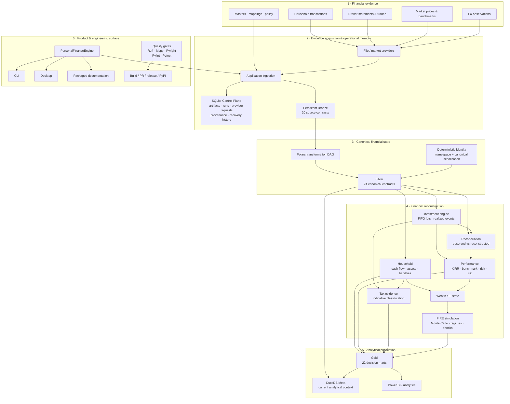

<p align="center">
  <a href="https://tks18.github.io/personal-finance-etl/">
    
  </a>
</p>

# Personal Finance ETL

**My local-first personal financial systems platform for reconciled personal finance, investment accounting, tax evidence, wealth analytics, FIRE planning, and BI.**

I built this because I wanted one answer to a deceptively simple question:

> **Where exactly do I stand financially, and can I prove how I got there?**

The first version only needed to make month-end less annoying. Then the questions got harder.

A balance needed evidence. Evidence needed identity. Investment history needed reconstruction. Reconstruction needed reconciliation. Realized gains needed Tax context. Wealth needed both household and market state. FIRE needed all of that to be trustworthy _before_ Monte Carlo was allowed anywhere near it.

So the project grew from ETL into the system I now use to **preserve financial evidence, reconstruct state, challenge that state against independent observations, and turn the result into decisions**.

<p align="center">
    <a href="https://pypi.org/project/personal-finance-etl/">
        
    </a>
    <a href="https://tks18.github.io/personal-finance-etl/">
        
    </a>
    <a href="https://personal-finance-etl.readthedocs.io/">
        
    </a>
    <a href="https://pepy.tech/projects/personal-finance-etl"></a>
    
    <a href="https://www.gnu.org/licenses/gpl-3.0"></a>
</p>

<p align="center">
    <a href="https://app.codacy.com/gh/tks18/personal-finance-etl/dashboard?utm_source=gh&amp;utm_medium=referral&amp;utm_content=&amp;utm_campaign=Badge_grade"></a>
    <a href="https://www.codefactor.io/repository/github/tks18/personal-finance-etl"></a>
    <a href="https://coderabbit.ai"></a>
    <a href="https://deepwiki.com/tks18/personal-finance-etl"></a>
</p>

<p align="center">
    
    
    
</p>

<p align="center">
  <strong>Explore:</strong>
  <a href="https://tks18.github.io/personal-finance-etl/">Documentation</a> ·
  <a href="https://personal-finance-etl.readthedocs.io/">ReadTheDocs</a> ·
  <a href="https://github.com/tks18/personal-finance-etl/wiki">Wiki</a> ·
  <a href="docs/README.md">Local Docs</a> ·
  <a href="docs/architecture/README.md">Architecture</a> ·
  <a href="docs/finance/README.md">Finance</a> ·
  <a href="docs/developer/README.md">Developer</a> ·
  <a href="docs/reference/README.md">Reference</a>
</p>

---

## The whole project in one thought

Personal Finance ETL is built around one loop:

> **preserve evidence → canonicalize meaning → reconstruct state → reconcile against reality → support decisions → preserve provenance**

That loop matters more than any individual library in the stack.

A broker file can tell me what it observed. Transactions can reconstruct what should exist. Reconciliation can record where those truths disagree. Quant can turn acquisition history into realized economics. Tax can consume those economics without rebuilding them. Wealth can combine household and investment state. FIRE can then model uncertainty from a state that has actually earned the right to be simulated.



This is not a generic framework pretending every bank, broker, Tax system, and household agreed on a schema while I was asleep. It is a deep vertical system built around my real financial environment, with increasingly explicit contracts around the parts that are reusable.

---

## What the system actually proves

### 1. Data engineering, but with evidence semantics

The pipeline is not just `read_csv → clean → dashboard`.

The system separates **source evidence**, **canonical financial facts**, **reconstructed state**, **analytical presentation**, and **operational history** because they answer different questions.

| Layer             | What it owns                                                                                |
| ----------------- | ------------------------------------------------------------------------------------------- |
| **Control Plane** | historical operational truth, run lifecycle, artifacts, provider requests, recovery context |
| **Bronze**        | synchronized source-shaped evidence                                                         |
| **Silver**        | canonical financial facts and dimensions                                                    |
| **Gold**          | decision-ready analytical marts                                                             |
| **Meta**          | current analytical context                                                                  |

Current registered analytical shape:

| Surface       | Contracts / tables |
| ------------- | -----------------: |
| Bronze        |             **20** |
| Silver        |             **24** |
| Gold          |             **22** |
| Meta          |              **6** |
| Control Plane |             **10** |

The important bit is not the count. It is the ownership.

SQLite remembers what happened operationally. DuckDB serves current analytical state. Neither database is forced to cosplay as the other one.

**Go deeper:** [Data Lifecycle](docs/architecture/data-lifecycle.md) · [Warehouse Architecture](docs/architecture/warehouse-architecture.md) · [Control Plane Lifecycle](docs/architecture/control-plane-artifact-lifecycle.md)

---

### 2. Investment evidence becomes financial state

Investment analytics starts with messy evidence:

- purchases and sales;
- broker snapshots;
- market prices;
- benchmarks;
- FX;
- instrument masters;
- geography-specific source behavior.

The engine turns that into explicit state:

```text
trade evidence
→ canonical purchases / sales
→ acquisition lots
→ realized disposal events
→ observed-vs-reconstructed reconciliation
→ performance / benchmark / FX attribution
```

#### FIFO is lineage, not just cost basis

The lot engine reconstructs acquisition history chronologically and carries that lineage into realized events.

That matters because a disposal is not merely:

```text
sale proceeds - some cost number
```

It is linked back to the actual consumed acquisition lots, holding periods, local/base currency basis, benchmark shadow state, and later Tax evidence.

#### Reconciliation is first-class evidence

A deterministic reconstruction can still disagree with an independent broker observation.

The system does not “fix” that by rewriting one side until everything looks emotionally stable.

It preserves the observation, preserves the reconstructed state, classifies the discrepancy, and emits explicit reconciliation evidence.

That gives future FIFO, performance, Tax, and audit logic a traceable explanation for why state changed.

**Go deeper:** [Investment Data Model](docs/finance/investment-data-model.md) · [FIFO & Realized Events](docs/finance/fifo-and-realized-events.md) · [Investment Reconciliation](docs/finance/investment-reconciliation.md)

---

### 3. Performance is allowed to say “I do not know”

The project calculates and interprets:

- XIRR;
- CAGR;
- benchmark-relative performance;
- drawdown/risk metrics;
- net-injection aware performance;
- local-currency returns;
- reporting-currency returns;
- FX attribution.

But a metric is only useful if its **validity state** is preserved.

`0.0` is not a universal substitute for:

```text
undefined
not computable
missing evidence
invalid evidence
non-convergent
not applicable
```

Portfolio XIRR is recomputed from portfolio cash flows. It is not a weighted average of instrument XIRRs, because mathematics has already suffered enough.

For foreign assets, missing FX also does **not** silently become `1.0`.

**Go deeper:** [Performance & Risk](docs/finance/investment-performance-and-risk.md) · [Multi-Currency & FX](docs/finance/multi-currency-and-fx.md) · [Metrics & Methodology](docs/finance/metrics-and-methodology.md)

---

### 4. Tax consumes financial truth, it does not rebuild it

Tax logic consumes canonical household evidence and realized investment events rather than creating its own parallel investment engine.

That boundary is deliberate:

```text
investment reconstruction
    owns lots and realized economics

Tax
    classifies Tax-relevant evidence
    applies configurable policy
    produces indicative summaries / review state
```

The system distinguishes **Tax evidence** from **statutory Tax liability**.

Some outcomes are intentionally marked for review when the evidence does not justify a stronger claim.

I would rather have a `CHECK_REQUIRED` state than a very confident lie with two decimal places.

**Go deeper:** [Tax Methodology](docs/finance/tax-methodology.md) · [Financial Rules](docs/configuration/financial-rules-reference.md)

---

### 5. Household finance and investments meet at wealth, not upstream

Household finance has its own semantics:

- income;
- expenses;
- transfers;
- assets;
- liabilities;
- liquidity;
- cash flow;
- budgets;
- net worth.

Investment state has different evidence and reconstruction rules.

The system lets those domains remain distinct until they need to answer shared questions about wealth and planning.

That keeps “money moved between my accounts” from becoming income and keeps “my investment changed market value” from becoming household cash flow.

This sounds obvious until a data model accidentally disagrees.

**Go deeper:** [Financial Model](docs/finance/financial-model.md) · [Cash Flow & Wealth](docs/finance/cashflow-and-wealth.md)

---

### 6. FIRE earns the right to be stochastic

The planning engine does not begin with Monte Carlo.

First it establishes deterministic current-state inputs such as:

- investable wealth;
- current spending;
- FI target;
- coverage ratios;
- runway / Coast-style metrics;
- configured return, inflation, withdrawal, and horizon policy.

Only then does the stochastic layer model future uncertainty through mechanisms including:

- Monte Carlo paths;
- regime transitions;
- inflation processes;
- human-capital shocks;
- glide paths;
- jump behavior;
- adaptive withdrawal rules.

Simulation inputs, model configuration, and outputs are fingerprinted for provenance.

A sophisticated model can widen the questions I ask. It cannot abolish uncertainty with enough NumPy.

**Go deeper:** [FIRE Methodology](docs/finance/fire-methodology.md) · [FIRE & Simulation Reference](docs/configuration/fire-and-simulation-reference.md)

---

## Reliability is part of the financial model

A number is not trustworthy merely because the formula is correct.

I also need to know:

- which source evidence produced it;
- whether ingestion was complete;
- which configuration/rules were active;
- whether analytical publication completed;
- whether SQLite and DuckDB agreed at the end of the run;
- whether restored state was validated;
- whether a later run repaired or superseded something.

That is why reliability is built into the architecture rather than parked in a `logging.py` file and wished good luck.

### Deterministic identity

Identity uses centralized canonical serialization with namespace-specific field ordering and normalization.

That keeps replay, joins, lineage, realized-event continuity, and reconstruction stable across full analytical rebuilds.

### Cross-store failure is represented truthfully

SQLite Control Plane and DuckDB warehouse operations are coordinated, but they are **not** described as one magical distributed ACID transaction.

Commit state and recovery semantics distinguish clean rollback from partial/split outcomes that require repair.

### Snapshot / restore distrusts the archive first

Backup and restore coordinate SQLite and DuckDB, stage validation before install, and retain rollback paths around replacement.

“It's just a ZIP” is not a recovery architecture. 😂

**Go deeper:** [Identity & Replay](docs/architecture/deterministic-identity-and-replay.md) · [Reliability & Recovery](docs/architecture/reliability-and-recovery.md) · [Backup & Restore](docs/architecture/backup-and-restore.md)

---

## Software architecture that has to survive real finance

The current package model separates seven responsibilities:

```text
application      use cases and orchestration
bootstrap        concrete dependency assembly
config           validated settings and financial policy
contracts        cross-boundary result/status vocabulary
domain           financial meaning, algorithms, invariants
infrastructure   persistence, providers, files, recovery
presentation     CLI, Desktop, docs UI
```

That boundary model is backed by architecture tests, explicit package APIs, typed contracts, and a single composition root.

The system intentionally mixes styles:

- **classes** for state, lifecycle, policy, dependencies, and coordinated side effects;
- **functions / Polars expressions** for deterministic transformations;
- **Protocols** for capability boundaries;
- **dataclasses / TypedDict / Pydantic / enums** where each shape actually earns its mechanism.

I am not trying to win OOP bingo. I am trying to make the ownership legible.

**Go deeper:** [System Architecture](docs/architecture/system-architecture.md) · [Application & Dependency Architecture](docs/architecture/application-and-dependency-architecture.md) · [Engineering Standards](docs/developer/engineering-standards.md)

---

## Performance without pretending every problem is vectorizable

The compute model follows the workload.

| Workload                        | Primary model                      |
| ------------------------------- | ---------------------------------- |
| canonical table transformations | **Polars LazyFrame**               |
| analytical persistence / SQL    | **DuckDB**                         |
| operational provenance          | **SQLite**                         |
| irregular cash-flow returns     | **PyXIRR**                         |
| numerical simulation            | **NumPy / Numba**                  |
| stateful lot reconstruction     | **Python objects / ordered state** |

The codebase contains hundreds of lazy-frame interactions, but `.collect()` is not treated as a moral failure.

Materialization is allowed where a boundary earns it:

```text
publication
stateful algorithms
third-party APIs
scalar extraction
process boundaries
validation diagnostics
```

FIFO is stateful because acquisition history is stateful. Pretending otherwise would mostly create a more complicated bug.

In one documented production workload with more than **1,600 source artifacts** and roughly **147 investment-instrument workloads**, fresh ingestion plus complete analytical reconstruction was observed around **40–45 seconds**, while a warm-cache run was observed around **24 seconds**, publishing roughly **449k Silver + Gold rows**.

Those are workload-specific observations, not benchmark promises.

**Go deeper:** [Developer Guide](docs/developer/development-guide.md) · [Testing & Validation](docs/developer/testing-and-validation.md)

---

## The engineering loop is part of the product

The repository does not stop at “the code works on my machine.”

The developer/release system includes:

- Poe task orchestration;
- Ruff linting and formatting;
- Mypy;
- Pyright;
- Pylint;
- Pytest;
- tracked Git hooks;
- structured audit exports;
- Conventional Commit automation;
- PR creation/certification;
- GitHub release automation;
- PyInstaller desktop builds;
- `uv` package builds and PyPI publishing.

The tight loop is intentionally different from the release loop:

```text
edit
→ focused tests
→ fast gate
→ commit
→ full gate
→ PR certification
→ merge
→ build / release / publish
```

Release infrastructure powered by memory is a particularly brave architectural choice, so I automated the boring parts instead.

**Go deeper:** [Tooling, Quality & Release Engineering](docs/developer/tooling-quality-and-release-engineering.md)

---

## Product surface

The financial engine is exposed through one application-facing API and multiple presentation surfaces.

### Install

```bash
pip install personal-finance-etl
```

### Desktop

```bash
shan-fin
```

or:

```bash
shan-fin-gui
```

### Terminal

```bash
shan-fin cli
```

The package also ships the technical documentation so the same knowledge base is available from the application surfaces.

A successful installation is not automatically a runnable financial environment. The application still needs valid settings, financial rules, reference inputs, and compatible source evidence.

Start with:

- [Installation](docs/getting-started/installation.md)
- [Quick Start](docs/getting-started/quick-start.md)
- [CLI & Desktop](docs/getting-started/cli-and-desktop.md)
- [Configuration](docs/configuration/README.md)

---

## Current production shape

The project is large enough that architectural discipline is not hypothetical.

| Surface                   | Current repository shape |
| ------------------------- | -----------------------: |
| Production Python modules |                  **204** |
| Production Python LOC     |                 **~41k** |
| Bronze contracts          |                   **20** |
| Silver contracts          |                   **24** |
| Gold contracts            |                   **22** |
| Meta tables               |                    **6** |
| Control Plane tables      |                   **10** |
| Canonical technical docs  |                   **55** |

The counts are useful context, not trophies.

A 41k-line codebase can still be badly designed. The interesting question is whether another engineer can answer:

```text
who owns this behavior?
what is the grain?
where does identity come from?
what can fail?
what becomes durable?
what proves this output?
```

That is the standard I care about.

---

## The stack, by responsibility

| Responsibility              | Technology                              |
| --------------------------- | --------------------------------------- |
| Vectorized transformation   | **Polars**                              |
| Analytical warehouse        | **DuckDB**                              |
| Operational provenance      | **SQLite**                              |
| Configuration / validation  | **Pydantic**                            |
| Irregular cash-flow returns | **PyXIRR**                              |
| Numerical simulation        | **NumPy / Numba**                       |
| Market data                 | **yfinance + provider adapters**        |
| BI                          | **Power BI**                            |
| Desktop                     | **CustomTkinter / Tkinter / pywebview** |
| CLI                         | **Rich + application façade**           |
| Build / package             | **Hatchling · uv · PyInstaller**        |

The point is not the logo collection.

Each tool owns a workload it is actually good at.

Polars does not need to pretend FIFO is vectorized. SQLite does not need to become the analytical warehouse. DuckDB does not need to remember every historical artifact event. Power BI does not need to become the financial engine.

One abstraction does not need to win every argument.

---

## What I trust, and what I deliberately do not claim

Sophisticated systems become suspicious when a README quietly upgrades implementation details into heroic guarantees.

### The system does provide

- deterministic identities for defined financial namespaces;
- historical run and artifact provenance;
- persistent Bronze synchronization state;
- explicit source completeness/failure states;
- full analytical rebuild semantics;
- registry-governed publication;
- backward-looking temporal joins in historical market reconstruction;
- explicit FIFO realization and reconciliation;
- multi-currency acquisition/valuation/performance semantics;
- Quant ownership of realized investment economics;
- Tax evidence and indicative classification;
- deterministic FI state plus stochastic FIRE modelling;
- coordinated SQLite + DuckDB snapshot/restore;
- configuration and simulation provenance;
- architecture and quality-gate enforcement.

### It deliberately does not claim

- SQLite + DuckDB form one distributed ACID database;
- reconstructed holdings are independent broker-certified daily holdings where that evidence does not exist;
- reconciliation converts derived state into original source evidence;
- indicative Tax estimates are final statutory liability;
- every historical external binary is retained forever;
- Monte Carlo predicts the future;
- every bank, broker, jurisdiction, or statement layout is plug-and-play.

I would rather document a smaller guarantee accurately than a larger one poetically.

---

## How to explore the project

The repository now has four intentionally different knowledge surfaces.

| Surface         | Job                                           | Start here                                                                                                                        |
| --------------- | --------------------------------------------- | --------------------------------------------------------------------------------------------------------------------------------- |
| **README**      | **SHOW** the project quickly                  | you are here                                                                                                                      |
| **Docs Portal** | **INTERACT** with visual search & guides      | [Live Docs (Pages)](https://tks18.github.io/personal-finance-etl/) · [ReadTheDocs](https://personal-finance-etl.readthedocs.io/) |
| **Wiki**        | **TEACH** the mental model                    | [GitHub Wiki](https://github.com/tks18/personal-finance-etl/wiki)                                                                 |
| **`/docs`**     | **SPECIFY** implementation and finance deeply | [Technical Docs](docs/README.md)                                                                                                  |
| **Code**        | **PROVE** the behavior                        | `src/personal_finance_etl/`                                                                                                       |

If all four say exactly the same thing at exactly the same depth, I have successfully maintained four copies of one document. That would be impressive in the least useful possible way. 😄

### I want the architecture

- [System Architecture](docs/architecture/system-architecture.md)
- [Application & Dependency Architecture](docs/architecture/application-and-dependency-architecture.md)
- [Data Lifecycle](docs/architecture/data-lifecycle.md)
- [Reliability & Recovery](docs/architecture/reliability-and-recovery.md)

### I want the finance

- [Financial Model](docs/finance/financial-model.md)
- [Investment Data Model](docs/finance/investment-data-model.md)
- [FIFO & Realized Events](docs/finance/fifo-and-realized-events.md)
- [Tax Methodology](docs/finance/tax-methodology.md)
- [FIRE Methodology](docs/finance/fire-methodology.md)

### I need exact contracts

- [Reference](docs/reference/README.md)
- [Silver Data Contracts](docs/reference/silver-data-contracts.md)
- [Gold Data Contracts](docs/reference/gold-data-contracts.md)
- [Identity & Grain Contracts](docs/reference/identity-and-grain-contracts.md)

### I want to change the system

- [Developer Guide](docs/developer/README.md)
- [Engineering Standards](docs/developer/engineering-standards.md)
- [Adding Data Sources](docs/developer/adding-data-sources.md)
- [Schema Evolution](docs/developer/data-contract-and-schema-evolution.md)
- [Testing & Validation](docs/developer/testing-and-validation.md)

### I want the project story

- [Project](docs/about/project.md)
- [About Me](docs/about/about-me.md)
- [Roadmap](docs/roadmap.md)

---

## Why I keep building it this way

The principles below were mostly learned because their opposites eventually hurt.

### Preserve evidence before inference

Raw observations should survive long enough to challenge derived state later.

### Give every truth an owner

Operational history, canonical facts, reconstruction, analytical presentation, and policy are different authorities.

### Respect grain before calculating

A metric with the wrong grain can be perfectly calculated and still be wrong.

### Reconcile against independent observations

Agreement is stronger when it is tested, not assumed.

### Keep policy explicit

Tax thresholds, FIRE assumptions, mappings, and classification rules should be visible and fingerprintable.

### Use the compute model that fits the problem

Lazy vectorization is excellent. Stateful reconstruction is also real. Numerical kernels are allowed to be numerical kernels.

### Compute richly, publish selectively

The internal model can remain deep without making every intermediate state a public mart.

### Let complexity keep re-earning its place

I have removed calculations, abstractions, and metrics when they stopped supporting a decision.

Sometimes the fastest function is the one I deleted.

---

## Final note

This project began as a personal month-end automation problem.

It became the place where my finance background, data engineering, software architecture, quantitative modelling, reliability thinking, and product engineering finally stopped being separate tracks.

The result is not a generic finance framework and not a toy ETL demo.

It is the financial system I wanted to exist for my own data: **local, explainable, reconstructable, challengeable, and useful enough to make decisions from.**

And yes, apparently the reasonable response to “I should clean up my monthly finance files” was to build a Control Plane, deterministic lot engine, recovery model, Tax evidence layer, Monte Carlo planner, release pipeline, and a 53-page engineering knowledge base.

The scope may have escalated slightly. 😂

---

## License

Released under the [GNU General Public License v3.0 or later](LICENSE).
