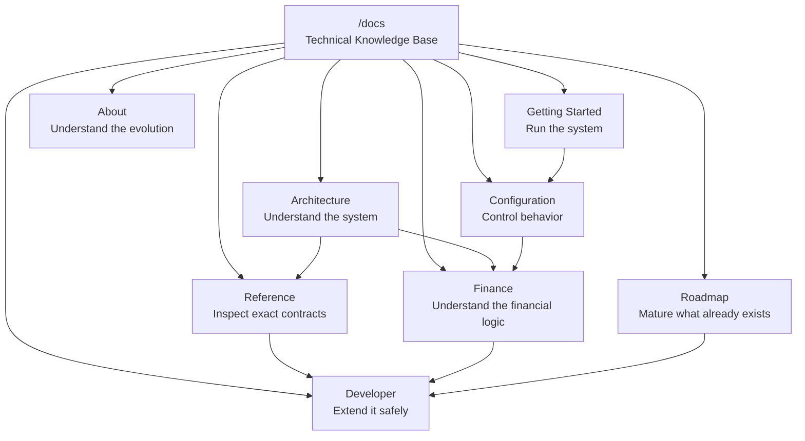
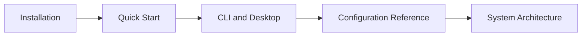
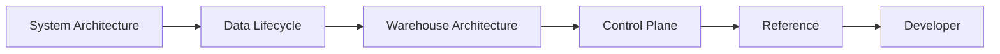
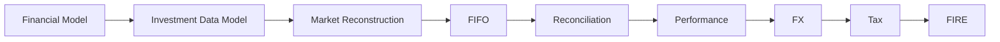
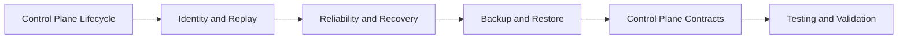
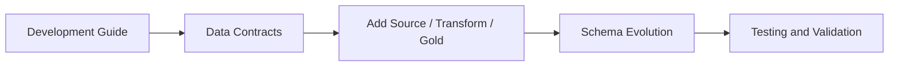
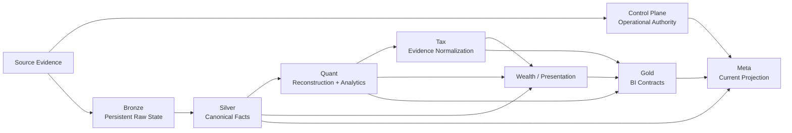
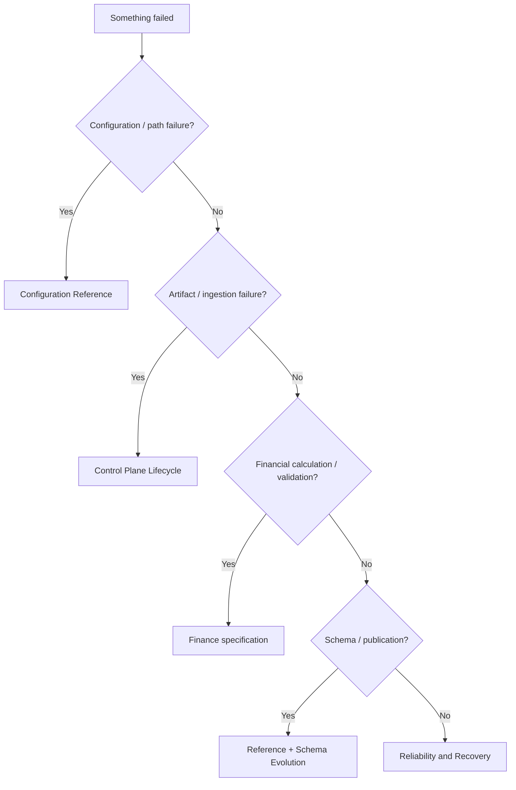

# Personal Finance ETL — Technical Documentation

Personal Finance ETL is a local-first financial evidence, reconstruction, analytics, and planning system. It ingests household and investment evidence, preserves operational provenance in a SQLite Control Plane, synchronizes persistent Bronze state, rebuilds contract-governed Silver and Gold publications in DuckDB, reconstructs investment state through deterministic Quant logic, normalizes tax-relevant evidence, and produces wealth and FIRE analytics.

That is a lot of territory for something that started life as personal-finance automation. The documentation is intentionally structured so nobody has to understand all of it before breakfast.

This `/docs` tree is the canonical **technical specification layer**. It explains the implementation deeply enough to reason about ownership, data grain, deterministic identity, algorithms, financial semantics, invariants, failure behavior, recovery, configuration, and safe extension.

## Documentation contract

The repository uses four documentation surfaces with deliberately different jobs:

| Surface | Role | Best for |
| --- | --- | --- |
| Root README | **SHOW** | Fast project orientation, capabilities, evidence, and navigation |
| GitHub Wiki | **TEACH** | Guided concepts, mental models, and learning journeys |
| `/docs` | **SPECIFY** | Implementation-grounded architecture, contracts, algorithms, invariants, and trade-offs |
| Source code | **PROVE** | The implementation authority when prose and code ever disagree |

The same concept may appear on more than one surface, but not at the same depth or for the same purpose. If a Wiki page and a `/docs` specification become interchangeable, one of them has wandered into the wrong neighborhood.

## The documentation universe

The seven folders are documentation domains. [`roadmap.md`](roadmap.md) sits at the `/docs` root because it describes maturity work across the entire system rather than belonging to one domain.

## Choose your depth

| I want to... | Start here | Then go deeper |
| --- | --- | --- |
| Install and run the application | [Getting Started](getting-started/README.md) | [Configuration Reference](configuration/configuration-reference.md) |
| Understand the whole system | [System Architecture](architecture/system-architecture.md) | [Data Lifecycle](architecture/data-lifecycle.md) |
| Understand where state lives | [Warehouse Architecture](architecture/warehouse-architecture.md) | [Reference](reference/README.md) |
| Understand the financial model | [Financial Model](finance/financial-model.md) | [Finance](finance/README.md) |
| Understand investment evidence | [Investment Data Model](finance/investment-data-model.md) | [Market Reconstruction](finance/investment-market-reconstruction.md) |
| Audit FIFO and disposals | [FIFO and Realized Events](finance/fifo-and-realized-events.md) | [Investment Reconciliation](finance/investment-reconciliation.md) |
| Understand investment returns | [Investment Performance and Risk](finance/investment-performance-and-risk.md) | [Metrics and Methodology](finance/metrics-and-methodology.md) |
| Understand multi-currency behavior | [Multi-Currency and FX](finance/multi-currency-and-fx.md) | [Investment Performance and Risk](finance/investment-performance-and-risk.md) |
| Understand tax outputs | [Tax Methodology](finance/tax-methodology.md) | [Silver](reference/silver-data-contracts.md) and [Gold](reference/gold-data-contracts.md) contracts |
| Understand FIRE | [FIRE Methodology](finance/fire-methodology.md) | [FIRE and Simulation Reference](configuration/fire-and-simulation-reference.md) |
| Audit source history and provenance | [Control Plane Artifact Lifecycle](architecture/control-plane-artifact-lifecycle.md) | [Control Plane Data Contracts](reference/control-plane-data-contracts.md) |
| Understand deterministic IDs | [Deterministic Identity and Replay](architecture/deterministic-identity-and-replay.md) | [Identity and Grain Contracts](reference/identity-and-grain-contracts.md) |
| Understand failure and recovery | [Reliability and Recovery](architecture/reliability-and-recovery.md) | [Backup and Restore](architecture/backup-and-restore.md) |
| Add a new source | [Adding Data Sources](developer/adding-data-sources.md) | [Bronze Data Contracts](reference/bronze-data-contracts.md) |
| Add or change a transformation | [Adding Transformations](developer/adding-transformations.md) | [Data Contract and Schema Evolution](developer/data-contract-and-schema-evolution.md) |
| Add a Gold output | [Adding Gold Marts](developer/adding-gold-marts.md) | [Gold Data Contracts](reference/gold-data-contracts.md) |
| Understand current QA maturity | [Testing and Validation](developer/testing-and-validation.md) | [Roadmap](roadmap.md) |
| Understand how the project got here | [Project](about/project.md) | [About Me](about/about-me.md) |

## Reading paths

### New user

Start with [Installation](getting-started/installation.md), then [Quick Start](getting-started/quick-start.md). Once the first run works, [CLI and Desktop](getting-started/cli-and-desktop.md) explains the operational surfaces. Configuration and Architecture can wait until the system is alive and producing databases. Canonical identity serialization is not a prerequisite for pressing Run.

### Data engineer / software architect

Begin with [System Architecture](architecture/system-architecture.md), follow the run through [Data Lifecycle](architecture/data-lifecycle.md), then inspect persistence ownership in [Warehouse Architecture](architecture/warehouse-architecture.md). The Control Plane, contract registry, physical schemas, and extension guides follow naturally from there.

### Finance / Quant reader

This path separates evidence from reconstruction and reconstruction from interpretation. That distinction matters. Reconstructed US holdings are not broker observations, FIFO realized events are not Tax Engine inventions, and stochastic FIRE outputs are not historical facts with confidence intervals glued on afterward.

### Reliability / audit reader

This path explains how the system preserves artifact continuity, run provenance, deterministic identities, cross-database recovery semantics, snapshots, restore validation, and the current boundary between runtime validation and automated regression coverage.

### Contributor

A feature is not complete merely because a Python function returns a DataFrame and looks satisfied with itself. The Developer specifications cover the rest of the contract: grain, identity, producer, registry, DDL, publication, consumers, validation, and financial reconciliation.

# Documentation catalog

## Architecture

[Architecture](architecture/README.md) owns system topology, execution, persistence, identity, reliability, recovery, and the design decisions that connect them.

- [System Architecture](architecture/system-architecture.md) — major components, dependency direction, application boundaries, execution ownership, and the complete system topology.
- [Data Lifecycle](architecture/data-lifecycle.md) — source discovery through Bronze, canonical transformation, Quant, Tax, Wealth, publication, Meta, commit, and failure paths.
- [Warehouse Architecture](architecture/warehouse-architecture.md) — SQLite Control Plane versus DuckDB, Bronze persistence, rebuilt Silver/Gold publications, Meta projections, and transaction boundaries.
- [Data Model](architecture/data-model.md) — logical relationships among household finance, currency, investments, tax, wealth, and presentation state.
- [Control Plane Artifact Lifecycle](architecture/control-plane-artifact-lifecycle.md) — artifact identity, discovery, payload retention, change, rename, removal, synchronization, healing, virtual artifacts, and run-event history.
- [Deterministic Identity and Replay](architecture/deterministic-identity-and-replay.md) — canonical serialization, identity namespaces, financial IDs, fingerprints, simulation provenance, and deterministic versus stochastic replay.
- [Reliability and Recovery](architecture/reliability-and-recovery.md) — transactions, savepoints, rollback, stale runs, cross-database divergence, Bronze healing, locking, and failure provenance.
- [Backup and Restore](architecture/backup-and-restore.md) — coordinated SQLite/DuckDB snapshots, checkpointing, archive validation, pair replacement, rollback, and restore safety.
- [Design Decisions](architecture/design-decisions.md) — the trade-offs behind local-first operation, SQLite + DuckDB, rebuilt analytical layers, explicit reconciliation, evidence-first tax, deterministic identity, and related choices.

## Finance

[Finance](finance/README.md) owns financial meaning: what the system considers evidence, how state is reconstructed, how returns and tax evidence are derived, and how present state becomes planning analytics.

- [Financial Model](finance/financial-model.md) — the hierarchy of observed, canonical, reconstructed, reconciled, estimated, and simulated financial state.
- [Cashflow and Wealth](finance/cashflow-and-wealth.md) — income, expenses, transfers, opening balances, ledger construction, book-state, market-state injection, net worth, savings, liquidity, and wealth analytics.
- [Investment Data Model](finance/investment-data-model.md) — canonical purchases, sales, instruments, market observations, benchmarks, currency evidence, and deterministic transaction identity.
- [Investment Market Reconstruction](finance/investment-market-reconstruction.md) — transaction-derived US historical holdings, backward price/FX causality, observation age, imputation, valuation, and the boundary with canonical FIFO.
- [FIFO and Realized Events](finance/fifo-and-realized-events.md) — acquisition lots, ordered disposal matching, partial and multi-lot sales, holding-period classification, realized-event identity, benchmark shadow state, and disposal lineage.
- [Investment Reconciliation](finance/investment-reconciliation.md) — quantity and cost-basis mismatches, reconciliation identities, synthetic/adjusted lot state, provenance, and consequences for future FIFO processing.
- [Investment Performance and Risk](finance/investment-performance-and-risk.md) — realized/unrealized performance, XIRR, CAGR, benchmark comparison, drawdown, tax exposure, aggregation, and typed failure states.
- [Multi-Currency and FX](finance/multi-currency-and-fx.md) — local versus reporting-currency values, acquisition/snapshot FX, temporal causality, asset-versus-FX attribution, and multi-currency reconciliation.
- [Tax Methodology](finance/tax-methodology.md) — household and Quant tax evidence, investment exclusions, deterministic TaxEvents, indicative estimates, quality flags, Gold tax outputs, and statutory non-guarantees.
- [FIRE Methodology](finance/fire-methodology.md) — deterministic FI metrics and stochastic planning through market regimes, jumps, inflation, human-capital shocks, glide paths, debt drawdown, withdrawal rules, and simulation provenance.
- [Metrics and Methodology](finance/metrics-and-methodology.md) — the quantitative dictionary for XIRR, CAGR, drawdown, savings, liquidity, FI coverage, tax metrics, aggregation, rolling windows, and null/zero/NaN semantics.

## Reference

[Reference](reference/README.md) answers the exact-contract questions. Architecture explains why a layer exists; Reference tells you precisely what is in it.

- [Bronze Data Contracts](reference/bronze-data-contracts.md) — all Bronze registry contracts, source attributes, synchronization categories, replacement semantics, provenance columns, and dynamic-schema behavior.
- [Silver Data Contracts](reference/silver-data-contracts.md) — canonical Silver registry metadata, physical DDL, grain, producers, and schema definitions.
- [Gold Data Contracts](reference/gold-data-contracts.md) — BI-facing Gold contracts, physical DDL, grain, producers, and presentation schemas.
- [Meta Data Contracts](reference/meta-data-contracts.md) — current DuckDB Meta projections for registry, row counts, settings, rules, contracts, and simulation context.
- [Control Plane Data Contracts](reference/control-plane-data-contracts.md) — the SQLite operational schema for runs, failures, snapshots, artifacts, payloads, artifact events, and simulation provenance.
- [Identity and Grain Contracts](reference/identity-and-grain-contracts.md) — authoritative mapping of table grain, deterministic identity, producer ownership, and identity namespaces.
- [Glossary](reference/glossary.md) — shared vocabulary for evidence, reconstruction, reconciliation, publication, provenance, financial metrics, and operational state.

## Configuration

[Configuration](configuration/README.md) explains how execution topology and financial interpretation are controlled.

- [Configuration Reference](configuration/configuration-reference.md) — runtime Settings, source and target paths, hashing, discovery, validation, preferences, snapshots, and operational consequences.
- [Financial Rules Reference](configuration/financial-rules-reference.md) — household classification, assets, investments, tax rules, macro assumptions, portfolio behavior, budgets, mappings, and downstream consumers.
- [FIRE and Simulation Reference](configuration/fire-and-simulation-reference.md) — deterministic FIRE assumptions and the complete stochastic parameter tree, including Markov regimes, jumps, shocks, glide paths, debt, withdrawals, inflation, validation, and provenance.

## Developer

[Developer](developer/README.md) describes how to modify the system without violating contracts that other layers depend on.

- [Development Guide](developer/development-guide.md) — development environment, dependency direction, extension boundaries, implementation workflow, and completion discipline.
- [Adding Data Sources](developer/adding-data-sources.md) — discovery, source attributes, extraction, Bronze synchronization, canonicalization, historical behavior, retirement, and privacy considerations.
- [Adding Transformations](developer/adding-transformations.md) — transformation ownership, grain, identity, Polars/stateful execution, joins, temporal causality, nulls, currencies, ordering, and financial equivalence.
- [Adding Gold Marts](developer/adding-gold-marts.md) — Gold builder design, BI grain, non-additive metrics, DDL, registry, publication, Meta integration, compatibility, and deprecation.
- [Data Contract and Schema Evolution](developer/data-contract-and-schema-evolution.md) — safe changes to schemas, registry contracts, grain, identity, nullability, Control Plane structures, Meta, fingerprints, and migration behavior.
- [Testing and Validation](developer/testing-and-validation.md) — current runtime validation, headless smoke coverage, QA specifications, test taxonomy, known automation gaps, and the highest-value regression targets.

## Getting Started

[Getting Started](getting-started/README.md) is the shortest path from a fresh environment to a successful run.

- [Installation](getting-started/installation.md) — environment requirements, installation, package entry points, directory prerequisites, and initial verification.
- [Quick Start](getting-started/quick-start.md) — configuration/rules setup, validation, first execution, generated databases, run expectations, and first-run troubleshooting.
- [CLI and Desktop](getting-started/cli-and-desktop.md) — actual launch modes, CLI options, Desktop behavior, asynchronous execution, preferences, integrated docs, snapshots, restores, and interface-specific failure handling.

## About

[About](about/README.md) explains the project as an engineering journey rather than another architecture specification.

- [Project](about/project.md) — how repeated real-world limitations drove the progression from personal automation into a provenance-aware financial platform.
- [About Me](about/about-me.md) — the finance and engineering progression behind the project and how accounting, analytics, data engineering, and software architecture converged in the implementation.

## Roadmap

[Roadmap](roadmap.md) describes the current maturity phase: documentation completion, executable QA, financial regression protection, reliability testing, maintainability, evidence-driven performance work, and deliberately constrained future scope.

The roadmap is intentionally smaller than the system. Feature accumulation is no longer the objective; proving and protecting what already exists is.

# Architectural authority map

The documentation becomes much easier to navigate once ownership is explicit.

| Question | Authority |
| --- | --- |
| What happened to a source artifact? | SQLite Control Plane |
| What raw analytical state persists across runs? | Bronze |
| What are the canonical household/investment facts? | Silver/core transformations |
| Who owns acquisition lots and realized investment events? | Quant Engine |
| Who owns investment reconciliation? | Quant Engine |
| Who normalizes tax-relevant evidence? | Tax Engine |
| Who builds wealth and FIRE presentation state? | Wealth Presentation Engine |
| What is the BI-facing serving layer? | Gold |
| Where is current analytical metadata projected? | DuckDB Meta |
| Where is historical operational provenance retained? | SQLite Control Plane |
| What wins when documentation disagrees with behavior? | Source code |

This map is intentionally compact. The full topology belongs in [System Architecture](architecture/system-architecture.md), because putting the whole architecture into the navigation page would rather defeat the point of having architecture documentation.

# How to use the specifications

## When you need exact schemas

Go to [Reference](reference/README.md). The layer-specific contract pages are the physical authority for table names, columns, grains, and producers.

## When you need implementation reasoning

Go to [Architecture](architecture/README.md). It explains ownership, lifecycle, persistence, identity, recovery, and trade-offs.

## When you need financial meaning

Go to [Finance](finance/README.md). It distinguishes observed evidence from reconstructed state, realized from unrealized values, local currency from reporting currency, tax evidence from statutory liability, and historical facts from stochastic planning.

## When you need to change behavior

Use [Configuration](configuration/README.md) if the behavior is intentionally configurable. Use [Developer](developer/README.md) if code or contracts must change.

Configuration is part of provenance. Editing TOML is not merely changing preferences when the field affects classification, tax interpretation, portfolio semantics, or stochastic assumptions.

## When something fails

Start with the operational surface that failed, then follow the ownership boundary:

The goal is to debug by **authority**, not by whichever file happened to emit the last log line.

# Documentation principles

The technical knowledge base follows a few durable rules:

1. **Implementation first.** Production source is the authority.
2. **Preserve financial semantics.** Observed, reconstructed, reconciled, estimated, and simulated values are not interchangeable.
3. **State the grain.** A table without a clear grain is a future reconciliation meeting waiting to happen.
4. **State the identity.** Deterministic IDs are part of the financial contract, not decorative hashes.
5. **Show failure behavior.** Happy-path architecture is only half an architecture.
6. **Separate guarantees from recovery strategies.** Coordinated SQLite/DuckDB recovery is not distributed ACID.
7. **Prefer evidence over adjectives.** Code excerpts, contracts, formulas, diagrams, and invariants do the explaining.
8. **Use diagrams when topology matters.** Mermaid is here to reduce cognitive load, not to decorate headings.
9. **Cross-link instead of duplicating.** Deep concepts should have one primary owner.
10. **Keep some character.** Technical documentation can have a pulse without sacrificing precision.

# Where to go next

If this is the first visit, start with [Getting Started](getting-started/README.md).

If the application already runs and the goal is to understand what is under the hood, go directly to [System Architecture](architecture/system-architecture.md).

If the interesting part is the financial engineering, begin with [Financial Model](finance/financial-model.md) and follow the Finance reading path into reconstruction, Quant, Tax, and FIRE.

If a table name, column, grain, or contract is the question, skip the scenic route and open [Reference](reference/README.md).

And if the question is how this became this elaborate for a personal-finance system, [Project](about/project.md) has the archaeology. The short answer is that every time the system encountered a new class of ambiguity, the architecture acquired a more explicit contract. Eventually the “personal finance script” needed its own documentation architecture. At that point, resistance was mostly ceremonial.
