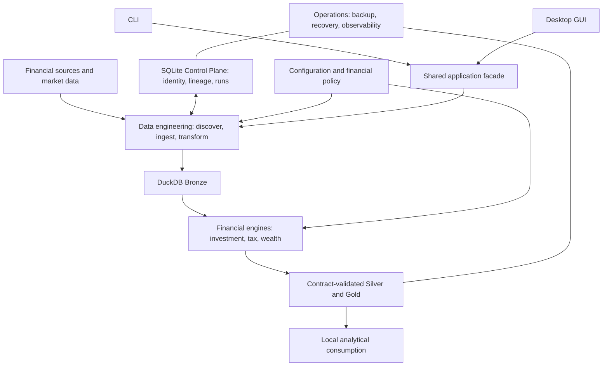
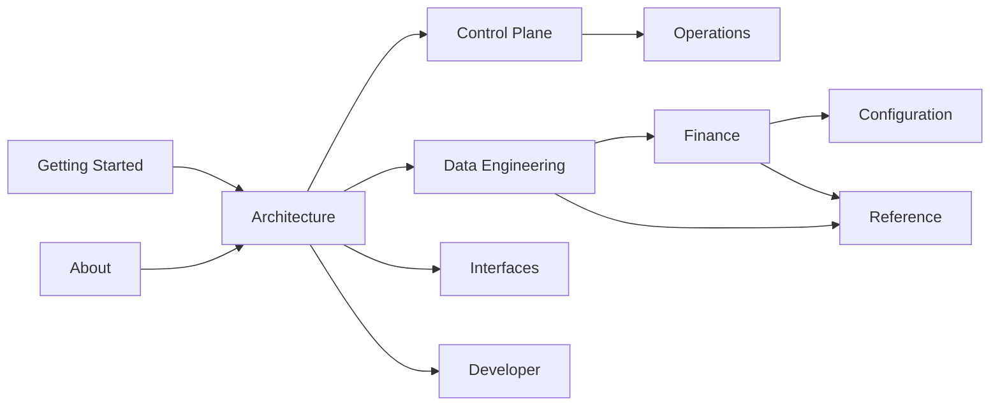

# Personal Finance ETL | Technical Documentation

I use this documentation as the **canonical technical specification** of my local-first personal finance data platform. I explain not just *what* the application produces, but how I designed its boundaries, how data and financial state move through it, which contracts constrain those movements, and where the implementation deliberately trades complexity for traceability.

**README = SHOW · Wiki = TEACH · `/docs` = SPECIFY · Code = PROVE.**

This is the deep implementation layer. For a faster showcase, see the [repository README](../README.md). For a conceptual learning path, visit the [GitHub Wiki](https://github.com/tks18/personal-finance-etl/wiki).

## The system at a glance

The diagram is a navigation model, not a claim that every component communicates directly or shares one transaction. The detailed execution, producer dependencies and database boundaries live in their respective specifications.

## Choose a route

| I want to understand... | Start here |
| --- | --- |
| The whole system and why I split responsibilities | [Architecture](architecture/README.md) |
| How source artifacts are identified, retained and healed | [Control Plane](control-plane/README.md) |
| How source files become Bronze, Silver and Gold | [Data Engineering](data-engineering/README.md) |
| How financial positions, gains, tax and FIRE are calculated | [Financial Engineering](finance/README.md) |
| Which settings and financial rules control execution | [Configuration](configuration/README.md) |
| The exact schemas, contracts, fields and identities | [Technical Reference](reference/README.md) |
| How CLI, desktop and the shared backend interact | [Interfaces](interfaces/README.md) |
| What happens on failure, backup and recovery | [Operations](operations/README.md) |
| How I extend and verify the application | [Developer](developer/README.md) |
| How to install and run it | [Getting Started](getting-started/README.md) |
| Why I built it and where it is going | [About](about/README.md) |

## How the documentation is organized

Each domain has a focused responsibility. I use **architecture** for global boundaries, **control-plane** for operational state, **data-engineering** for movement and publication, **finance** for algorithms and mathematics, and **reference** for exact physical contracts. Related pages cross-link rather than reprinting the same specification.

## Complete documentation directory

The following is the human-readable directory index. The application's navigable catalog is generated from `manifest.json`, which I reconcile separately after the documentation tree is finalized.

### [Architecture](architecture/README.md)

The system-wide design, dependency boundaries, execution lifecycle and analytical architecture.

- [Overview](architecture/README.md)
- [Data Lifecycle](architecture/data-lifecycle.md)
- [Data Model](architecture/data-model.md)
- [Dependency Architecture](architecture/dependency-architecture.md)
- [Design Decisions](architecture/design-decisions.md)
- [Execution Lifecycle](architecture/execution-lifecycle.md)
- [Reliability And Recovery](architecture/reliability-and-recovery.md)
- [System Architecture](architecture/system-architecture.md)
- [Warehouse Architecture](architecture/warehouse-architecture.md)

### [Control Plane](control-plane/README.md)

Operational authority, artifact identities, retained payloads, synchronization, healing and run provenance.

- [Overview](control-plane/README.md)
- [Artifact Identity And Lineage](control-plane/artifact-identity-and-lineage.md)
- [Artifact Lifecycle](control-plane/artifact-lifecycle.md)
- [Configuration Provenance](control-plane/configuration-provenance.md)
- [Control Plane Architecture](control-plane/control-plane-architecture.md)
- [Run Lifecycle](control-plane/run-lifecycle.md)
- [Simulation Provenance](control-plane/simulation-provenance.md)
- [Synchronization And Healing](control-plane/synchronization-and-healing.md)

### [Data Engineering](data-engineering/README.md)

Source discovery, Bronze ingestion, transformations, market data and analytical publication.

- [Overview](data-engineering/README.md)
- [Artifact Ingestion](data-engineering/artifact-ingestion.md)
- [Bronze Processing](data-engineering/bronze-processing.md)
- [Data Quality And Validation](data-engineering/data-quality-and-validation.md)
- [Market Data And Benchmarks](data-engineering/market-data-and-benchmarks.md)
- [Silver Gold Publication](data-engineering/silver-gold-publication.md)
- [Source Discovery](data-engineering/source-discovery.md)
- [Transformation Pipeline](data-engineering/transformation-pipeline.md)

### [Financial Engineering](finance/README.md)

Canonical financial facts, FIFO, reconciliation, FX, benchmark attribution, tax, wealth and FIRE.

- [Overview](finance/README.md)
- [Benchmark Attribution](finance/benchmark-attribution.md)
- [Cashflow And Wealth](finance/cashflow-and-wealth.md)
- [Fifo And Lot Accounting](finance/fifo-and-lot-accounting.md)
- [Financial Model](finance/financial-model.md)
- [Fire Methodology](finance/fire-methodology.md)
- [Fire Simulation And Reproducibility](finance/fire-simulation-and-reproducibility.md)
- [Fx Methodology](finance/fx-methodology.md)
- [Investment Analytics](finance/investment-analytics.md)
- [Metrics And Methodology](finance/metrics-and-methodology.md)
- [Reconciliation And Cost Basis](finance/reconciliation-and-cost-basis.md)
- [Tax Event Provenance](finance/tax-event-provenance.md)
- [Tax Methodology](finance/tax-methodology.md)

### [Configuration](configuration/README.md)

Runtime settings, financial policy, validation, defaults, configuration snapshots and reproducibility.

- [Overview](configuration/README.md)
- [Configuration Architecture](configuration/configuration-architecture.md)
- [Configuration Snapshots](configuration/configuration-snapshots.md)
- [Financial Rules](configuration/financial-rules.md)
- [Fire Configuration](configuration/fire-configuration.md)
- [Validation And Defaults](configuration/validation-and-defaults.md)

### [Technical Reference](reference/README.md)

Exact Bronze/Silver/Gold/Meta contracts, Control Plane schemas, identity rules and application interfaces.

- [Overview](reference/README.md)
- [Api And Cli Reference](reference/api-and-cli-reference.md)
- [Bronze Data Contracts](reference/bronze-data-contracts.md)
- [Configuration Schema Reference](reference/configuration-schema-reference.md)
- [Control Plane Schema](reference/control-plane-schema.md)
- [Glossary](reference/glossary.md)
- [Gold Data Contracts](reference/gold-data-contracts.md)
- [Identity Contracts](reference/identity-contracts.md)
- [Meta Data Contracts](reference/meta-data-contracts.md)
- [Silver Data Contracts](reference/silver-data-contracts.md)

### [Application Interfaces](interfaces/README.md)

Application facade, CLI, desktop GUI, multiprocessing, progress and the documentation renderer.

- [Overview](interfaces/README.md)
- [Application Facade](interfaces/application-facade.md)
- [Cli Architecture](interfaces/cli-architecture.md)
- [Desktop Gui Architecture](interfaces/desktop-gui-architecture.md)
- [Documentation Renderer](interfaces/documentation-renderer.md)
- [Multiprocessing And Progress](interfaces/multiprocessing-and-progress.md)

### [Operations & Reliability](operations/README.md)

Transactions, failure boundaries, backups, recovery, observability and performance.

- [Overview](operations/README.md)
- [Backup And Restore](operations/backup-and-restore.md)
- [Failure Scenarios](operations/failure-scenarios.md)
- [Observability And Run History](operations/observability-and-run-history.md)
- [Performance And Benchmarking](operations/performance-and-benchmarking.md)
- [Reliability And Recovery](operations/reliability-and-recovery.md)
- [Transaction Boundaries](operations/transaction-boundaries.md)

### [Developer Guide](developer/README.md)

Engineering workflows, extension seams, testing strategy, debugging and maintenance.

- [Overview](developer/README.md)
- [Adding Asset Pipelines](developer/adding-asset-pipelines.md)
- [Adding Data Sources](developer/adding-data-sources.md)
- [Adding Gold Marts](developer/adding-gold-marts.md)
- [Debugging And Observability](developer/debugging-and-observability.md)
- [Development Guide](developer/development-guide.md)
- [Extension Contracts](developer/extension-contracts.md)
- [Testing And Regression](developer/testing-and-regression.md)

### [Getting Started](getting-started/README.md)

Installation, initial setup, running the pipeline and the daily operating workflow.

- [Overview](getting-started/README.md)
- [Configuration](getting-started/configuration.md)
- [Daily Workflow](getting-started/daily-workflow.md)
- [Installation](getting-started/installation.md)
- [Running The Pipeline](getting-started/running-the-pipeline.md)

### [About & Roadmap](about/README.md)

Project purpose, personal engineering journey, development history and roadmap.

- [Overview](about/README.md)
- [About Me](about/about-me.md)
- [Project](about/project.md)
- [Roadmap](about/roadmap.md)

## Implementation-oriented reading paths

| Discipline | Suggested sequence |
| --- | --- |
| Data engineering | [System architecture](architecture/system-architecture.md) → [Source discovery](data-engineering/source-discovery.md) → [Bronze processing](data-engineering/bronze-processing.md) → [Silver/Gold publication](data-engineering/silver-gold-publication.md) → [Data contracts](reference/README.md) |
| Financial engineering | [Financial model](finance/financial-model.md) → [FIFO](finance/fifo-and-lot-accounting.md) → [FX](finance/fx-methodology.md) → [Tax](finance/tax-methodology.md) → [FIRE](finance/fire-methodology.md) |
| Software architecture | [Dependency architecture](architecture/dependency-architecture.md) → [Control Plane](control-plane/control-plane-architecture.md) → [Facade](interfaces/application-facade.md) → [Extension contracts](developer/extension-contracts.md) |
| Operational reliability | [Execution lifecycle](architecture/execution-lifecycle.md) → [Transaction boundaries](operations/transaction-boundaries.md) → [Failure scenarios](operations/failure-scenarios.md) → [Backup and restore](operations/backup-and-restore.md) |
| Analytics and BI | [Data model](architecture/data-model.md) → [Silver contracts](reference/silver-data-contracts.md) → [Gold contracts](reference/gold-data-contracts.md) → [Warehouse architecture](architecture/warehouse-architecture.md) |

## How I keep specifications trustworthy

I ground technical claims in implementation modules, schemas, financial formulas and real execution paths. I keep code excerpts short so they explain an invariant or a boundary without duplicating entire modules. I use Mermaid where relationships, state transitions or execution order are easier to understand visually. I distinguish modeled estimates from accounting facts and state precisely where cross-database consistency depends on reconciliation rather than global atomicity.

For the executable truth, follow the source locations cited in each domain. For operating procedures, start with [Getting Started](getting-started/README.md); for historical context, use [About](about/README.md).

[← Repository README](../README.md) · [GitHub Wiki →](https://github.com/tks18/personal-finance-etl/wiki)
