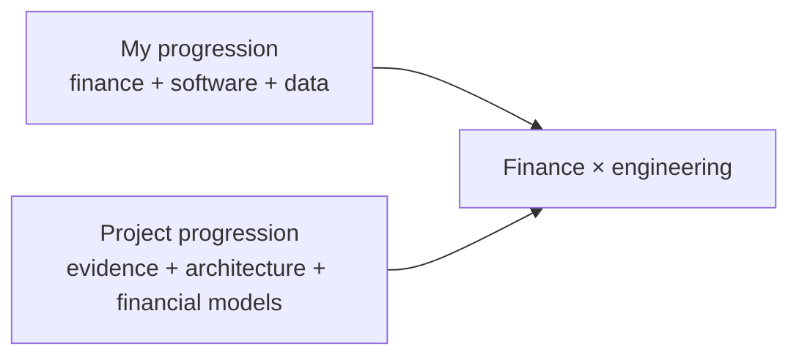

# About

The technical documentation explains **how** Personal Finance ETL works.

This section explains **why it exists, how it became this kind of system, and what the project says about the way I approach finance and engineering**.

That distinction matters.

A project history should not become a second architecture manual, and an “about me” page should not become a résumé written in Markdown with unusually high Mermaid density.

## Two stories, one project



Start with whichever question is more interesting.

### Who built this, and why this combination of skills?

Read [About Me](about-me.md).

### How did the project itself evolve?

Read [Project](project.md).

## This section is not implementation authority

Canonical technical truth still lives in:

```text
/docs
    deep technical specification

code
    implementation authority

Wiki
    guided conceptual teaching
```

The About section may explain motivation and evolution, but it should not be used to infer current schema counts, lifecycle states, or financial formulas.

Those belong in the technical reference.

## The project in one sentence

Personal Finance ETL is my local-first personal financial systems platform for turning fragmented personal financial evidence into **reconciled, explainable, reproducible analytical state**.

The interesting word is not “ETL.”

It is **reconciled**.

The system became much more than file ingestion because personal finance is full of situations where multiple sources can be individually plausible and collectively inconsistent.

That is where the project’s real engineering identity emerged.

## The through-line

Across both pages, one idea keeps recurring:

> **I care about evidence, boundaries, and explainability more than cleverness for its own sake.**

That shows up in:

- Control Plane history instead of opaque file mutation;
- canonical grains instead of ambiguous tables;
- FIFO lots instead of aggregate cost guesses;
- reconciliation events instead of silently forcing agreement;
- local/base currency separation instead of flattening FX away;
- Tax evidence instead of pretending to be statutory filing software;
- stochastic FIRE models that preserve assumptions instead of presenting one future as fact;
- typed failure states instead of reading meaning from log strings;
- documentation as a maintained engineering surface.

## A note on tone

This project is serious about financial correctness, but the documentation does not need to sound like it was written by a committee trapped in a beige conference room.

The personality is intentional.

The rule is simple:

> **The joke can decorate the explanation. It cannot replace the explanation.**

## Where the About story hands off

The About pages end at the present system.

The next question is:

> **If the architecture is stable and capability is no longer the bottleneck, what kinds of future changes are actually worth making?**

That is the role of the [Roadmap](../roadmap.md).

## Related specifications

- [System Architecture](../architecture/system-architecture.md)
- [Financial Model](../finance/financial-model.md)
- [Roadmap](../roadmap.md)
