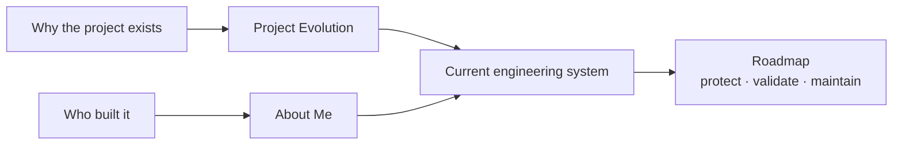

# About Personal Finance ETL

The About section explains the part of Personal Finance ETL that source code cannot express by itself: **why the project exists, how it evolved, and what kind of engineering journey produced it**.

The technical documentation deliberately speaks in a system-centered voice. This section is different. `project.md` and `about-me.md` use first person where ownership, motivation, and professional progression are the subject.




## Prefer the guided story?

The Wiki opens with **[Why This Exists](https://github.com/tks18/personal-finance-etl/wiki/01-Why-This-Exists)** and closes with **[Project Journey & What's Next](https://github.com/tks18/personal-finance-etl/wiki/16-Project-Journey-and-Whats-Next)**. Those pages teach the project's evolution as a narrative; the About documents here preserve the deeper project and creator context.

## Start here

| Document | Question it answers |
|---|---|
| [Project](project.md) | How did a personal finance workflow grow into the current financial data platform? |
| [About Me](about-me.md) | What finance and engineering path shaped the way the system is built? |
| [Roadmap](../roadmap.md) | What remains worth doing now that feature development is intentionally quiet? |

## This section is not the technical specification

The About pages intentionally avoid reproducing the implementation manuals.

For implementation detail, use:

```text
Architecture   → how the system is constructed
Reference      → exact physical contracts
Finance        → financial semantics and algorithms
Configuration  → runtime and policy controls
Developer      → safe extension workflows
Getting Started→ how to install and operate it
```

The About section instead provides the narrative context that connects those pieces.

## The project in one sentence

Personal Finance ETL began as a way to understand and close personal finances reliably and gradually became a **local-first financial evidence, reconstruction, analytics, tax-preparation, and planning system** because each solved problem exposed the next missing layer.

That evolution matters. The current architecture was not created to imitate an enterprise platform at home. It accumulated because real financial workflows kept asking harder questions.


## A note on tone

The technical docs are deliberately rigorous, but the repository is still a personal engineering project rather than a compliance manual that accidentally learned Markdown.

A little character is allowed.

The rule is simple:

> **The joke may help explain the engineering. It may not replace the engineering.**

## Related specifications

- [System Architecture](../architecture/system-architecture.md)
- [Financial Model](../finance/financial-model.md)
- [Development Guide](../developer/development-guide.md)
- [Roadmap](../roadmap.md)
