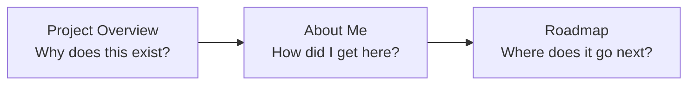
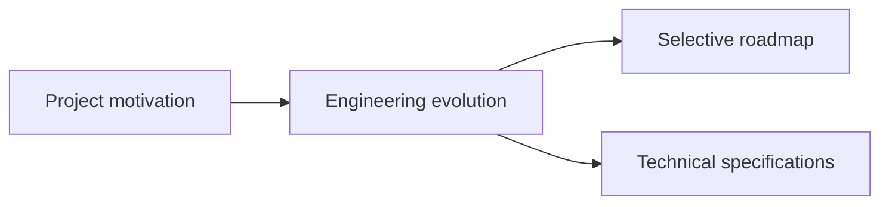

# About

This section explains the context around the code.

## Three different stories

| Guide | Question |
| --- | --- |
| [Project Overview](project.md) | Why did a personal-finance workflow become a full financial platform? |
| [About Me](about-me.md) | How did web development, Python, data engineering, BI and Chartered Accountancy converge into work like this? |
| [Roadmap](roadmap.md) | Which engineering and financial-domain improvements are worth pursuing next? |

These pages are intentionally more narrative than the technical documentation. I use them to explain the motivations, decisions and evolution behind the implementation.

They still follow the same evidence rule: technical claims are grounded in projects and production implementation rather than portfolio adjectives.

## The project in one sentence

> **A real financial workload became the place where my finance, data engineering, BI, Python and software-architecture paths converged.**

[← Documentation Home](../README.md)

## How I separate the stories

I keep this section deliberately personal. The [project overview](project.md) explains *why* I built the platform and what my operating workload taught me. [About Me](about-me.md) describes the skills and professional path behind the work. The [roadmap](roadmap.md) records directions and maturity goals, not promises that a future feature already exists.

I keep exact table definitions in [reference](../reference/README.md) and operational guarantees in [operations](../operations/README.md), rather than duplicating those contracts in the project narrative.
