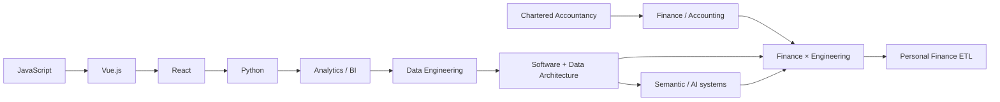
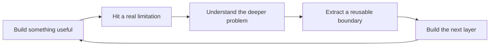
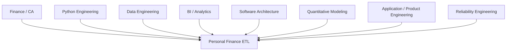

# About Me

I am a **Chartered Accountant who builds data-intensive software systems**.

That description is much cleaner than the path that produced it.

I did not begin with a plan to combine accounting, finance, frontend development, Python, analytics, data engineering, BI, quantitative modeling, and software architecture. I kept following problems that became more interesting as the layers underneath them became visible.

Personal Finance ETL is where most of those paths eventually converged.



The path was not linear, which is probably why the projects I build do not all belong to one neat category.

---

## 1. Finance came with a different way of asking questions

Chartered Accountancy trained me to think in terms such as:

```text
What happened?
What evidence supports it?
Does it reconcile?
What is the economic substance?
Which assumption changes the answer?
What belongs in this period?
What is the decision consequence?
```

Those questions map surprisingly well onto good data engineering.

| Finance instinct | Engineering analogue |
|---|---|
| evidence | source lineage |
| reconciliation | data-quality control |
| classification | semantic modeling |
| accounting period | temporal grain |
| audit trail | provenance |
| control | invariant / validation |
| financial statement | serving contract |
| estimate / provision | explicit model assumption |

That overlap became more obvious the deeper I went into engineering.

---

## 2. I started on the application side

My early technical progression went through JavaScript, Vue.js, and React.

That phase taught me to think about:

- state;
- components;
- interfaces;
- user interaction;
- separation of concerns;
- application structure.

The questions I enjoyed most gradually moved away from rendering interfaces and toward the data underneath them.

Instead of:

> How should this component update?

I increasingly wanted to know:

> Where did this data come from, what does it mean, how should it transform, and how can the result remain trustworthy after the system changes?

Python became the bridge into that world.

---

## 3. Python changed the center of gravity

Python pulled my work toward:

```text
automation
analytics
Power BI
Excel integration
data engineering
databases
software architecture
quantitative modeling
local AI / semantic systems
```

The recurring pattern was not “learn another library.”

It was closer to:



That loop appears across a lot of my projects.

---

## 4. Excel and BI were never enemies to escape

A lot of engineering conversations frame Excel as something a developer eventually graduates from.

My experience has been different.

Excel, Power Query, Power BI, Python, SQL, and databases frequently coexist in real analytical workflows. The useful question is not which tool wins. It is where each tool belongs.

That perspective shaped projects around:

- Excel/Python integration;
- Power Query handling;
- Power BI to SQL workflows;
- reusable transformation utilities;
- local analytical tooling.

It also shaped Personal Finance ETL.

Power BI remains a presentation/decision surface because it is good at that job. Python and embedded databases handle the parts where stronger transformation, state, provenance, and financial logic are needed.

The interface should fit the workflow, not somebody's technology purity test.

---

## 5. Data engineering became the recurring core

Over time, more of my work centered on the same set of questions:

```text
How should raw evidence enter a system?
How should transformation contracts be expressed?
Where should state live?
How should identities remain stable?
How should failures be observable?
How should a consumer know the grain?
How can the system be rebuilt without losing meaning?
```

Those questions show up in projects across PyQuery HQ, Power BI/SQL tooling, Excel/Python integrations, local semantic systems, and Personal Finance ETL.

The domain changes. The engineering instincts repeat.

---

## 6. Finance and engineering stopped feeling like separate tracks

At some point, “finance background” and “technical background” stopped being two columns on a profile and started behaving like one problem-solving system.

A few examples make that clearer.

### Reconciliation

Accounting made me uncomfortable with totals that are merely plausible.

That instinct became explicit controls such as:

```text
reconstructed investment quantity
vs
observed broker quantity
```

and household book-state versus independently observable financial state.

### Evidence

Financial work cares about source support.

That instinct became:

```text
artifact identity
content hashes
retained source payloads
run provenance
configuration snapshots
financial event lineage
```

### Grain

Finance is full of calculations that are numerically valid and economically wrong when aggregated incorrectly.

For example:

```text
Portfolio XIRR ≠ average(ISIN XIRR)
```

That is both a finance lesson and a data-modeling lesson.

### Estimates

Finance distinguishes fact from estimate.

The software therefore distinguishes observed, reconstructed, reconciled, realized, unrealized, estimated, and simulated state instead of pouring all of them into one “Amount” column and hoping context survives.

---

## 7. Personal Finance ETL is the convergence project

Different repositories show different parts of how I think.

Personal Finance ETL is unusual because many of those parts exist in one system.



The implementation carries the evidence.

### Data engineering

```text
SQLite Control Plane
artifact hashing and lifecycle
persistent Bronze synchronization
contract-driven Silver / Gold publication
schema and grain contracts
Meta projection
```

### Python / software engineering

```text
Pydantic configuration models
repositories and application façade
stateful FIFO engine
multiprocessing execution
Polars DAGs
Numba simulation kernels
backup / restore protocols
```

### Finance

```text
household ledger
income / expense / transfer semantics
book wealth and market wealth
investment cost basis
holding periods
realized and unrealized gains
tax-preparation evidence
```

### Quantitative work

```text
FIFO lots
broker reconciliation
benchmark shadow state
XIRR and after-tax XIRR
drawdown
FX attribution
Monte Carlo FIRE
market regimes
human-capital shocks
```

### Product / interface engineering

```text
CLI
desktop application
Power BI serving
offline documentation runtime
```

I would rather let those systems demonstrate the skill set than stack adjectives above them.

---

## 8. The project was not designed as portfolio theater

Personal Finance ETL exists because I use it.

It supports real workflows around:

```text
month-end financial closure
cashflow analysis
investment review
portfolio reconciliation
tax preparation support
wealth tracking
FIRE planning
```

That matters because real usage changes engineering behavior.

A demo can tolerate a surprising amount of ambiguity if the screenshot looks good.

A financial system used for month-end cannot.

The project kept becoming more sophisticated because I kept encountering cases where the answer needed to be more explainable, reproducible, or recoverable.

That is a healthier source of architecture than adding patterns because a diagram has empty space.

---

## 9. I care about boundaries more than labels

Some of the design decisions I value most are distinctions rather than features.

```text
Control Plane authority
vs
DuckDB analytical projection

historical market reconstruction
vs
canonical FIFO

realized investment evidence
vs
tax interpretation

local-currency return
vs
FX translation effect

deterministic reconstruction
vs
stochastic simulation

runtime validation
vs
automated regression coverage
```

Good boundaries make a system easier to reason about.

They also make documentation much harder to fake, which is useful.

---

## 10. I prefer local-first when local is enough

I like systems that can deliver substantial capability without introducing infrastructure obligations the workload does not need.

For Personal Finance ETL, local-first fits because:

- the data is sensitive;
- the workload fits comfortably on a workstation;
- embedded databases are sufficient;
- Power BI consumes local analytical state well;
- backup/restore can remain explicit;
- there is no multi-user service requirement to justify cloud complexity.

Local-first is not an ideology.

It is a workload decision.

If the workload changes, the architecture can change. Until then, a Kubernetes cluster would mostly give my personal finances a very expensive place to sit. 😄

---

## 11. I prefer real variation before abstraction

One engineering preference has become stronger over time:

> **Do not generalize a behavior before seeing the variation that needs generalizing.**

Personal Finance ETL already has reusable architecture, but it also contains assumptions specific to my sources, jurisdiction, and financial environment.

I prefer that honesty over declaring the system universally configurable because enough interfaces exist.

When a second real environment produces a genuinely different source format, tax behavior, asset class, or reconciliation rule, that variation becomes evidence for the next abstraction.

Until then, abstraction for sport is still sport.

---

## 12. Configuration for policy, code for behavior

Another recurring preference is keeping financial policy explicit.

Values such as classifications, tax mappings, portfolio assumptions, and FIRE parameters belong in typed configuration when they represent policy or assumptions.

Behavioral algorithms belong in code.

That separation makes it easier to answer:

```text
Did the result change because the algorithm changed?
or
Did the result change because the financial assumption changed?
```

That is a small architectural distinction with a large audit benefit.

---

## 13. Financial truth outranks architectural elegance

I enjoy architecture, but the project has one useful veto rule:

> **If a refactor makes the class diagram prettier but changes the financial answer without an explainable reason, the refactor failed.**

The behavioral baseline matters.

That is why production hardening repeatedly involved output reconciliation alongside structural change.

Architecture is a means of making the system easier to trust and change. It is not the product by itself.

---

## 14. Documentation became part of how I engineer

The documentation work around Personal Finance ETL changed how I think about technical writing.

Trying to explain a system deeply exposes places where ownership is fuzzy, contracts are implicit, or terminology is doing too much work.

The documentation rubric that emerged is simple:

```text
README = SHOW
Wiki   = TEACH
/docs  = SPECIFY
Code   = PROVE
```

That separation is useful beyond this repository.

It prevents the README from becoming a textbook, prevents the Wiki from becoming duplicated API documentation, and forces deep technical claims to remain close to implementation evidence.

---

## 15. I like building the tooling around the engine

Once an engine becomes useful, I usually start asking how it should be operated.

That has led to interfaces such as:

```text
Excel integrations
Power BI models
CLI tools
desktop applications
documentation runtimes
```

The answer is not always another web application.

Sometimes a CLI is the best interface. Sometimes a local desktop window is. Sometimes Excel is exactly where the user already works.

Product engineering includes choosing not to build the fashionable interface when a simpler one fits better.

---

## 16. AI is downstream of trustworthy data

My broader technical progression has also moved into semantic and AI-oriented systems.

But Personal Finance ETL reinforces a rule I care about:


The order matters.

A conversational interface over ambiguous financial state is still ambiguous financial state. It is simply more eloquent about it.

---

## 17. What I am building toward

Across my work, the systems I find most interesting increasingly share a few properties:

```text
local-first where appropriate
configuration-led
semantically explicit
contract-driven
reusable without abstraction theater
inspectable
friendly to BI / operational workflows
AI-ready only after the data model is trustworthy
```

For Personal Finance ETL specifically, the current phase is not about adding another major engine.

It is about making the existing system:

- better documented;
- more thoroughly tested;
- easier to maintain;
- safer to extend;
- clearer about its guarantees and limitations.

That is maturity work, and I increasingly appreciate how much harder it is than adding another feature.

---

## 18. Why this project is important in my portfolio

Personal Finance ETL is the closest thing I have to a convergence point across my professional and technical progression.

It is simultaneously:

```text
a financial system
a data pipeline
an analytical warehouse
a Python application
a BI backend
a quantitative simulator
an operational provenance system
a recovery-aware local product
```

But its reason for existing is still straightforward:

> **I wanted a financial system I could trust and actually use.**

The sophistication arrived gradually because trust kept demanding more explicit engineering.

That is probably the part of the project I value most.

---

## 19. Explore the evidence

The About page is intentionally narrative. The implementation evidence lives elsewhere:

- [System Architecture](../architecture/system-architecture.md)
- [Data Lifecycle](../architecture/data-lifecycle.md)
- [Financial Model](../finance/financial-model.md)
- [Investment Data Model](../finance/investment-data-model.md)
- [FIFO and Realized Events](../finance/fifo-and-realized-events.md)
- [FIRE Methodology](../finance/fire-methodology.md)
- [Development Guide](../developer/development-guide.md)

## Related specifications

- [Project](project.md)
- [Roadmap](../roadmap.md)
- [System Architecture](../architecture/system-architecture.md)
- [Financial Model](../finance/financial-model.md)
- [Development Guide](../developer/development-guide.md)
