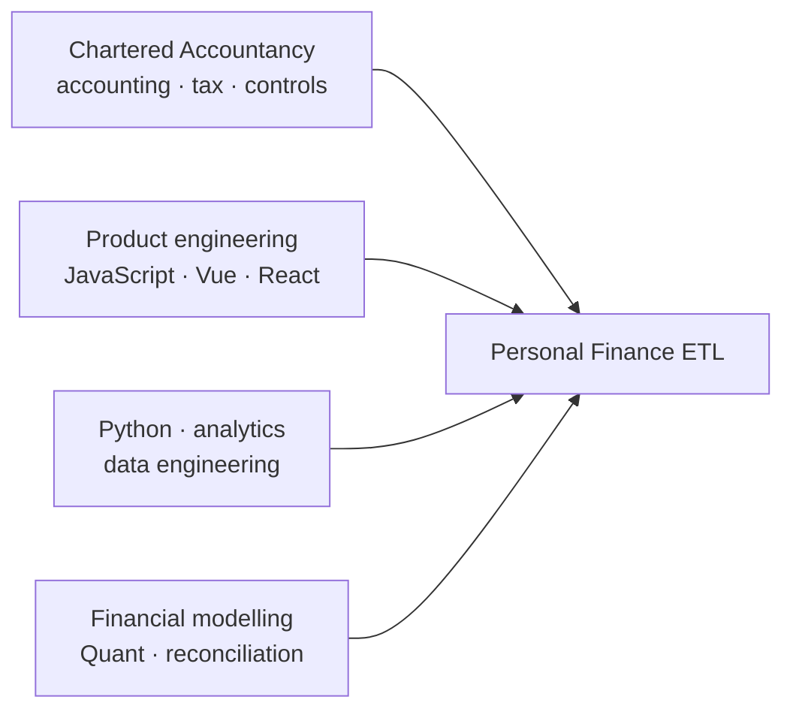
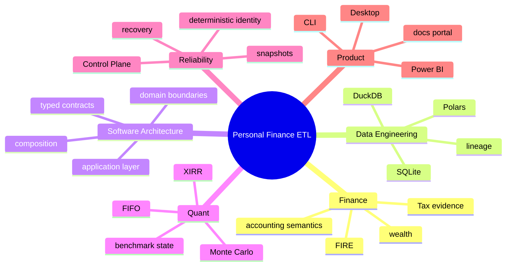

# About Me

I did not arrive at this project through one clean career lane.

That is probably why the project does not fit neatly into one either.

My background sits at the intersection of **Chartered Accountancy, software engineering, data engineering, analytics, and quantitative finance**. Personal Finance ETL is where those threads stopped behaving like separate interests and became one engineering system.



## Finance taught me to ask for evidence

My finance background changed the kinds of questions I ask when I look at data.

I rarely stop at:

> What is the number?

I tend to continue with:

```text
Where did it come from?
What period does it represent?
What is the accounting / economic grain?
Can I reconcile it independently?
What assumption turns evidence into estimate?
What would make this value invalid?
```

Those questions became architectural requirements in the project.

The Control Plane exists because evidence has history.

Reconciliation exists because reconstruction is not automatically truth.

TaxEvents exist because financial events need classification before they can support Tax analysis.

FIRE modelling keeps deterministic state separate from stochastic future paths because forecasts and facts deserve different epistemic labels.

## I started by building products

My early technical progression moved through JavaScript, Vue, React, and application development.

That taught me how software feels from the user side:

- interfaces matter;
- state management matters;
- packaging matters;
- workflows matter;
- a technically correct engine can still be painful to operate.

That product instinct still shows up in Personal Finance ETL through the CLI, Desktop application, preferences, integrated documentation, backup/restore workflows, and the application façade that keeps those interfaces away from financial internals.

## Python moved the center of gravity

Python made the bridge between finance, automation, analytics, and engineering much shorter.

The useful progression was not simply “learn Python.”

It was:

```text
scripts
    ↓
data transformation
    ↓
reusable pipelines
    ↓
financial domain models
    ↓
reliability / provenance
    ↓
architecture
```

The project grew with that progression.

I stopped thinking about data processing as a chain of transformations and started thinking about **state, authority, contracts, and replay**.

## Excel and BI were never enemies to escape

My finance background means Excel and Power BI are real working tools, not technologies to performatively outgrow.

The better question is:

> Which layer should do which job?

In this project:

```text
Python / Polars
    financial transformation and reconstruction

SQLite / DuckDB
    durable operational + analytical state

Power BI
    semantic presentation and interactive analysis

Excel
    practical human workflows where appropriate
```

That division lets each tool stay good at what it is good at.

Trying to prove software-engineering purity by rebuilding every useful spreadsheet interaction in Python would be a deeply expensive personality trait.

## Data engineering became the recurring core

Across my projects, the repeated challenge is turning messy, heterogeneous inputs into stable, explainable outputs.

Personal Finance ETL takes that unusually far because the data is financially meaningful and personally real.

That forced me to care about:

- source identity;
- lineage;
- incremental ingestion;
- Bronze persistence;
- canonical Silver state;
- Gold publication;
- schema registries;
- lazy execution;
- reproducibility;
- observability;
- recovery.

The data platform is not scaffolding around the finance model. It is what makes the finance model trustworthy enough to use repeatedly.

## Finance and engineering stopped feeling separate

The most interesting parts of the project happen where finance creates a software problem.

Examples:

### FIFO lots

A disposal is not just a negative quantity. It consumes acquisition history under ordered rules and produces realized economic events.

### Reconciliation

A broker snapshot can disagree with reconstructed history. The right answer is not to hide the disagreement; it is to model it.

### Multi-currency investing

Local asset return and reporting-currency outcome are related but different. FX cannot be treated as decoration.

### Tax

The system can classify Tax-relevant evidence and produce indicative estimates without pretending it has become statutory filing software.

### FIRE

Current wealth is evidence. A future path is a model. Monte Carlo can widen the distribution of possible outcomes; it cannot abolish uncertainty with enough NumPy.

Those are finance questions that become architecture, data-model, and reliability questions once they enter software.

## Personal Finance ETL is the convergence project

This repository is the project where the different parts of my background are all necessary at once.



That breadth is not a checklist I designed for a portfolio.

It is what the problem demanded over time.

## I care about boundaries more than labels

I like clean architecture, but I care more about whether the boundary protects meaning.

A few examples:

```text
domain
    owns finance meaning

application
    owns sequencing

infrastructure
    owns concrete mechanisms

contracts
    carry stable cross-boundary vocabulary

presentation
    controls the product surface
```

The point is not that every project needs these exact folders.

The point is that responsibilities should be visible enough that a future change has somewhere correct to go.

## Local-first is a deliberate choice

The project is local-first because its actual constraints favor local execution:

- sensitive personal financial data;
- local source files;
- DuckDB / SQLite;
- Power BI adjacency;
- no need for multi-tenant cloud infrastructure;
- reproducible desktop workflows.

That is not an ideological claim that cloud systems are bad.

It is an architectural claim that **infrastructure should match the problem**.

## I prefer real variation before abstraction

I do not like abstraction as decoration.

A pattern becomes valuable when multiple real cases prove it exists.

That preference shows up in the codebase through:

- selective Protocols;
- typed boundary contracts;
- domain-specific dataclasses;
- functional Polars transforms where state is unnecessary;
- classes where lifecycle/state/invariants are real;
- explicit exceptions for numerical kernels and declarative catalogs.

A six-line function does not need a strategy factory because it looked lonely.

## Configuration owns policy; code owns behavior

The project deliberately separates configurable financial policy from implementation mechanics.

That lets me change:

- thresholds;
- Tax assumptions;
- FIRE parameters;
- portfolio policy;

without turning the codebase into a forest of one-off branches.

But configuration is not an excuse to make every behavior dynamic.

Some invariants belong in code because they define the system itself.

## Financial truth outranks architectural elegance

If a clean-looking abstraction makes the financial semantics harder to explain, I prefer the financial semantics.

Examples include:

- preserving observed vs reconstructed values separately;
- keeping reconciliation events explicit;
- carrying local and base currency independently;
- retaining uncertainty states;
- keeping stateful FIFO logic stateful instead of forcing it into vectorized shape.

Architecture serves the model. The model does not exist to make the package tree prettier.

## Documentation became part of how I engineer

At some point the documentation stopped being “write this after coding.”

Deep documentation exposed:

- stale assumptions;
- hidden contracts;
- unclear ownership;
- implementation drift;
- weak names;
- missing failure semantics.

That feedback loop is why the documentation is intentionally code-backed and diagram-rich.

The docs are not merely proof that the project is polished. They are one of the tools I use to understand whether the design is actually coherent.

## I like building the tooling around the engine

The repository now includes its own developer and release workflow:

```text
Ruff
Mypy
Pyright
Pylint
Pytest
Poe tasks
Git hooks
structured audits
PR automation
GitHub release tooling
PyPI publishing
PyInstaller packaging
```

That layer matters because sophisticated code is not enough if every release depends on remembering twelve manual steps.

Release infrastructure powered by memory is a particularly brave architectural choice.

## AI is downstream of trustworthy data

I am interested in semantic systems and local AI, but I do not see AI as a substitute for trustworthy financial state.

The order I prefer is:

```text
reliable evidence
    ↓
canonical semantics
    ↓
reconciled financial state
    ↓
well-defined metrics
    ↓
semantic / AI interfaces
```

An LLM connected to ambiguous financial data simply becomes a much faster way to sound confident about ambiguity.

## What I am building toward

The project is now mature enough that the next phase is less about architectural reinvention and more about:

- stronger regression coverage;
- continued documentation quality;
- finance-domain refinement when evidence warrants it;
- selective portability only when real variation appears;
- semantic/AI capabilities downstream of stable contracts.

That is intentionally less dramatic than another grand rewrite.

Maturity is allowed to look boring. Boring systems are often the ones people actually trust.

## Why this project matters to me

Personal Finance ETL is important because it compresses years of learning into one system I genuinely use.

It reflects a progression from:

```text
finance questions
→ analytical workflows
→ automation
→ data engineering
→ software architecture
→ financial reconstruction
→ reliability
```

The repository is therefore not interesting to me because it contains many technologies.

It is interesting because those technologies have a reason to be there.

## Explore the evidence

For implementation proof, follow the technical documentation:

- [System Architecture](../architecture/system-architecture.md)
- [Financial Model](../finance/financial-model.md)
- [Investment Data Model](../finance/investment-data-model.md)
- [Investment Performance and Risk](../finance/investment-performance-and-risk.md)
- [Tax Methodology](../finance/tax-methodology.md)
- [FIRE Methodology](../finance/fire-methodology.md)
- [Engineering Standards](../developer/engineering-standards.md)

For the project’s own evolution, continue with [Project](project.md).
