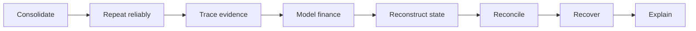
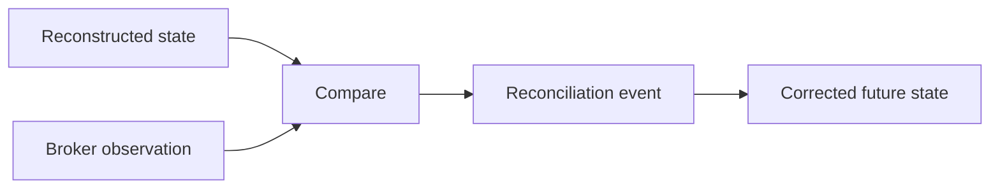
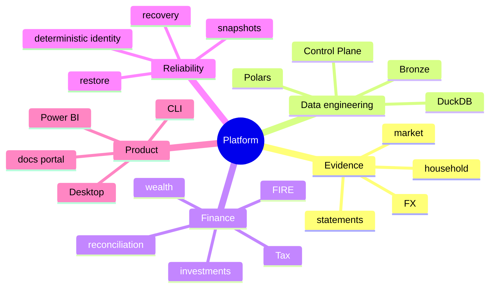

# Project

Personal Finance ETL did not begin as an architecture exercise.

It began with a much less glamorous problem:

> **My financial data was useful, but scattered.**

The project became interesting because solving that problem repeatedly kept exposing a deeper one.

The history is therefore best understood as a sequence of **questions that the previous design could no longer answer cleanly**.



## The original problem was fragmentation

Household transactions, broker evidence, investment statements, market observations, configuration files, and BI outputs lived in different shapes.

The first useful objective was simple:

```text
collect
clean
combine
analyze
```

That already created value.

But once the workflow became repeatable, manually stitching together one-off scripts became the next bottleneck.

## Repeatability changed the problem

A one-time analysis can tolerate assumptions that a recurring system cannot.

Once the pipeline needed to run month after month, the questions changed:

```text
Have I processed this file before?
Did the source change?
What happened during the last run?
Which output came from which evidence?
Can I rebuild safely?
```

That is where the project stopped being “a set of transformations” and became a data platform.

## The Control Plane arrived because files have history

Files are not just paths.

They can be:

- new;
- modified;
- renamed;
- removed;
- reappearing;
- missing their retained payload;
- associated with different runs.

The SQLite Control Plane emerged to retain that operational history separately from the analytical warehouse.

That decision eventually became one of the project’s strongest architectural boundaries:

```text
Control Plane
    historical operational authority

DuckDB
    analytical state
```

## Incremental ingestion, complete analytical rebuild

The project deliberately separates incremental evidence synchronization from analytical reconstruction.

Persistent Bronze avoids pretending every run discovered the world for the first time.

But downstream analytical state can still be rebuilt from canonical evidence when that is the safer correctness model.

This trade-off is practical for a local financial platform:

```text
incremental where source history benefits
rebuild where deterministic correctness benefits
```

## Financial modelling became more important than ETL

Once the ingestion architecture stabilized, the difficult questions became financial.

What is the difference between:

- activity and state?
- cost basis and market value?
- observed holdings and reconstructed holdings?
- realized and unrealized return?
- local-currency and INR outcome?
- Tax evidence and Tax liability?
- current wealth and future modeled wealth?

The project’s center of gravity moved from moving data to **preserving financial meaning**.

## Investments forced deterministic reconstruction

Investment analytics exposed the limits of aggregate thinking.

A sale is not simply:

```text
sale proceeds - average cost
```

The system needed:

- ordered acquisition lots;
- partial lot consumption;
- realized disposal events;
- holding periods;
- benchmark shadow state;
- deterministic identity;
- future reconciliation compatibility.

That is why the investment engine became one of the deepest domains in the codebase.

## Reconciliation changed the meaning of “correct”

This was an important conceptual shift.

A deterministic reconstruction can still disagree with an independent broker observation.

That does not automatically mean either side should be overwritten.

The system instead models the disagreement:



The project became more honest when it stopped treating disagreement as an embarrassment to be hidden.

## Deterministic identity became infrastructure

Once events/lots/reconciliations needed to survive replay, identity could no longer be ad hoc.

Canonical normalization, ordered fields, namespace-specific identity, and deterministic serialization became shared infrastructure.

That decision now supports:

- replay continuity;
- deduplication;
- stable joins;
- financial lineage;
- regression testing.

## Multi-currency investing added another dimension

Foreign assets made it impossible to treat one numeric “value” as sufficient.

The system began carrying distinct concepts such as:

```text
local acquisition basis
local market value
reporting/base value
FX rate
FX contribution
```

That distinction matters because an asset can perform well locally while producing a different outcome after currency translation.

Flattening the two stories would make the model simpler and the finance worse.

## Tax became an evidence pipeline

The Tax subsystem deliberately stops short of claiming statutory filing authority.

Its role is to:

- normalize Tax-relevant events;
- classify them under configured policy;
- produce indicative estimates;
- surface review-required cases;
- reconcile information into analytical presentation.

That boundary is stronger than pretending one application can infer every legal nuance from incomplete personal evidence.

## Wealth connected the domains

Household cash flow, assets/liabilities, investment state, and Tax consequences eventually converge into wealth.

That made net worth and after-tax wealth useful cross-domain outputs rather than isolated calculations.

The project now treats wealth as a state derived from multiple evidence systems, not just “sum assets, subtract liabilities, ship chart.”

## FIRE turned current state into future distributions

FIRE introduced a fundamentally different kind of output.

Current financial state is evidence-backed.

A simulated future is modeled.

The architecture therefore preserves assumptions, seeds, model fingerprints, inputs, and outputs separately.

That makes stochastic analysis reproducible without pretending the future itself is deterministic.

## Interfaces followed the workflow

The CLI came from operational convenience.

The Desktop came from product usability.

Integrated docs came from repeatedly needing technical context while operating the application.

The important architectural move was keeping all of them over one application façade rather than letting each surface accumulate its own financial logic.

## Recovery became part of the application contract

Once the system owned two databases and real operational history, backup/restore could not remain a manual file-copy suggestion.

The application now models:

- coordinated snapshots;
- validation;
- staged restore;
- rollback;
- active database state;
- typed outcomes.

Reliability became a user-visible feature rather than an infrastructure afterthought.

## Documentation became an engineering feedback loop

Deep documentation exposed inconsistencies that code review alone did not always reveal.

Writing down:

```text
who owns this?
what is the grain?
what happens on failure?
what is actually atomic?
what is observed vs reconstructed?
```

forced the architecture to become more explicit.

That is why the current documentation is designed as part of the system, not a marketing appendix.

## What the project is today

Today the repository is best described as a **local-first financial data engineering and quantitative decision-support platform**.

It combines:



The word “ETL” remains in the name because ingestion/transformation are foundational, but the system now solves much broader problems.

## Why local-first remains the right fit

The current problem does not require a distributed cloud architecture.

It benefits from:

- privacy;
- predictable local files;
- low operational overhead;
- fast embedded databases;
- direct Power BI access;
- reproducible single-user workflows.

This is not a claim that local-first is universally superior.

It is a claim that architecture should earn its complexity.

## Portability is a boundary, not a slogan

The codebase is configurable enough to support variation, but it is still grounded in real source families and real financial workflows.

I prefer adding portability when genuine new variation appears rather than generalizing every interface in anticipation of hypothetical users.

That keeps the system understandable.

## What the repository should demonstrate

The project should demonstrate skills indirectly through engineering evidence.

A reader should be able to infer competence in:

- Python architecture;
- data engineering;
- financial modelling;
- quantitative methods;
- database design;
- reliability;
- testing;
- developer tooling;
- product engineering;
- technical documentation.

The documentation should never need to shout those claims. The implementation should make them obvious.

## Project principles

A few principles now describe the system better than any feature list.

### Preserve evidence

Do not destroy the distinction between observation and interpretation.

### Make grain explicit

Rows need semantic meaning, not merely columns.

### Reconcile disagreement

Independent evidence can conflict. Model the conflict.

### Keep policy separate from mechanics

Configuration may change assumptions; code retains invariant behavior.

### Prefer deterministic replay where possible

Rebuild should converge to the same result under the same evidence/policy.

### Model uncertainty honestly

Tax review states and FIRE distributions should preserve uncertainty rather than decorate it away.

### Automate repeated engineering work

Quality gates, hooks, PR/release tooling, snapshots, and docs integration reduce dependence on memory.

### Document what the code proves

Documentation cannot outrank implementation.

## Why the project matters to me

The repository matters because it is not a toy dataset.

It grew around financial questions I actually wanted answered and operational workflows I actually use.

That pressure made the engineering better.

It forced decisions about:

- correctness;
- auditability;
- failure;
- recovery;
- financial semantics;
- maintainability.

Those are much more interesting than adding technologies for decoration.

## The current phase

The architecture is stable enough that the project no longer needs rapid structural reinvention.

The highest-value work now is:

```text
stronger regression evidence
continued documentation quality
observed performance work
targeted financial refinements
selective new features when evidence justifies them
```

That changes what a roadmap should look like.

The next phase is not “add everything.”

It is **protect what is now worth protecting**.

That is where [Roadmap](../roadmap.md) continues.

## Related specifications

- [System Architecture](../architecture/system-architecture.md)
- [Financial Model](../finance/financial-model.md)
- [Reliability and Recovery](../architecture/reliability-and-recovery.md)
- [Engineering Standards](../developer/engineering-standards.md)
