# Project

Personal Finance ETL began with a practical problem, not an architecture diagram.

I wanted to answer a deceptively ordinary question:

> **Can I reconstruct my financial state well enough to trust it at month-end, understand what changed, and use that state for investment and long-term planning decisions?**

A spreadsheet can answer parts of that question. A broker portal can answer other parts. A bank statement can show cash movement. Market data can show prices. None of those sources, by themselves, provide one reconciled financial model with stable history, investment cost basis, tax evidence, wealth analytics, and forward-looking planning.

The project grew because each useful answer exposed the next missing layer.

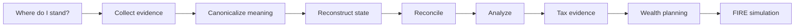

There was no master plan to build a miniature financial data platform. That would make for a tidier origin story, but it would not be true.

The architecture emerged from repeated contact with real financial data.

---

## 1. The original problem: useful data was scattered

Personal finance evidence arrived through different systems and formats:

```text
household transaction database
broker transaction exports
broker holdings / market snapshots
mutual-fund data
Indian equity data
US equity transactions
benchmark history
FX history
mapping files
opening balances
financial rules
```

The first engineering problem was therefore ordinary ETL:

```text
extract → normalize → combine → report
```

That was useful, but usefulness raised the standard.

Once a report starts influencing month-end closure or investment decisions, “the numbers look about right” stops being an acceptable data-quality strategy.

---

## 2. Repeatability changed the problem

A one-off transformation can tolerate assumptions living in notebooks, file names, or memory.

A recurring financial close cannot.

The system gradually needed explicit answers to questions such as:

- Which source files were already processed?
- Did a file change without changing its name?
- Did a source disappear or get renamed?
- Which configuration and financial rules produced this run?
- Can raw evidence be separated from analytical state?
- Can derived outputs be rebuilt instead of manually repaired?

Those questions pushed the project from scripts toward an application architecture.

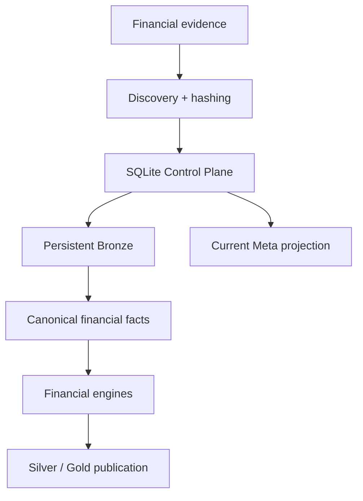

The important shift was conceptual:

> **Derived analytical state should be rebuildable. Operational history and source evidence need stronger durability.**

That principle now runs through the entire system.

---

## 3. The Control Plane arrived because files have history

As the source environment grew, a file was no longer just a path on disk.

It had an identity, content, synchronization state, first-seen time, last-seen time, and event history.

The SQLite Control Plane now owns that operational history.

It records run lifecycle, configuration/rule snapshots, artifact registry state, retained payloads, artifact-run events, failures, and simulation provenance.

DuckDB remains the analytical engine.

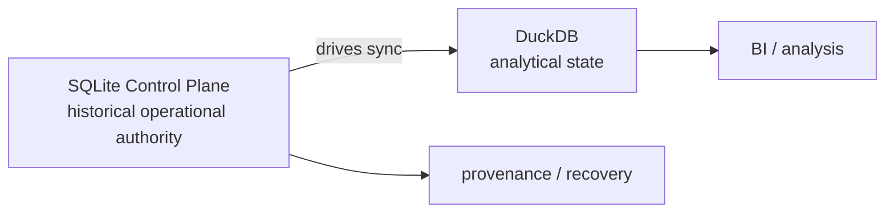

That split was not added because “two databases” sounds more architectural.

SQLite and DuckDB have different jobs, and forcing one engine to perform both jobs made the ownership model worse.

DuckDB is very good at analytical scans. It does not need a side hustle as an artifact historian.

---

## 4. Incremental ingestion, complete analytical rebuild

One of the most useful design decisions is the separation between **persistent incremental Bronze** and **rebuilt analytical publication**.

Bronze synchronizes source evidence according to contract semantics. Silver and Gold are rebuilt from the complete canonical state.


That trade-off is deliberately boring.

The workload is small enough that full analytical reconstruction is affordable, and the design avoids a large class of incremental-state bugs downstream.

Sometimes the sophisticated choice is refusing sophistication that the workload has not earned.

---

## 5. Financial modeling became more important than ETL

Once ingestion became reliable, the harder questions moved into financial semantics.

A transaction is evidence of an event. It is not automatically a complete representation of financial state.

The project had to distinguish:

```text
observed evidence
canonical facts
reconstructed state
reconciled state
estimated values
realized values
unrealized values
presentation metrics
```

That distinction became especially important for investments.

---

## 6. Investments forced deterministic reconstruction

Broker data is excellent evidence, but different brokers expose different historical views.

The system therefore separates two responsibilities that are easy to confuse:

1. **historical market-state reconstruction**, particularly for US holdings; and
2. **canonical FIFO acquisition-lot reconstruction** in the Quant Engine.

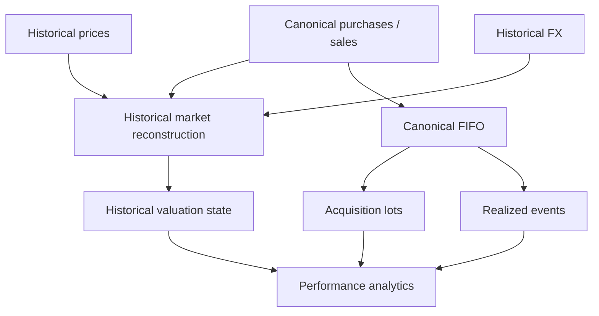

Historical US holdings are reconstructed state, not broker-certified daily holdings.

FIFO lots are a different reconstruction with a different purpose: acquisition basis, disposal lineage, holding period, realized gains, and tax-relevant evidence.

Keeping those responsibilities separate made the financial model much clearer.

---

## 7. Reconciliation changed the meaning of “correct”

A model can be internally consistent and still disagree with external evidence.

That is why reconciliation became a first-class concept.

For investments, the system can compare reconstructed quantity and basis with observed state. Quantity differences and cost-basis differences are treated separately.

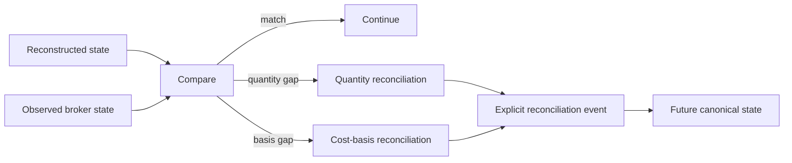

The principle is simple:

> **A mismatch is information. Do not erase it merely because a clean dashboard would prefer fewer questions.**

That principle is as much accounting instinct as software design.

---

## 8. Deterministic identity became infrastructure

As reconstructed state became richer, row identity could no longer depend on incidental order or database-generated keys.

The application now uses canonical identity serialization and namespace-specific deterministic identifiers for financial events such as:

```text
PURCHASE
SALE
LOT
REALIZED
RECON_GROUP
RECON_EVENT
RECON_LOT_GROUP
TAX
```

This gives rebuilds stable lineage across transactions, lots, disposals, reconciliation, and tax evidence.

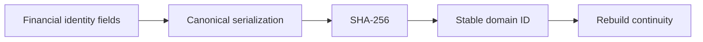

Deterministic IDs are not glamorous. Neither are primary keys until they fail. Then suddenly everyone develops strong opinions.

---

## 9. Multi-currency investing added another dimension

US investments introduced more than currency conversion.

The model needed to preserve both local-currency economics and reporting-currency economics:

```text
local acquisition basis
local market value
historical FX
INR acquisition basis
INR market value
asset P&L
FX P&L
combined reporting-currency return
```

Historical valuation also needed temporal causality. Future prices and FX observations cannot leak backward into earlier portfolio state.

That requirement led to explicit observation dates, backward-only joins, staleness gates, and separate FX attribution.

The result is not merely “USD × exchange rate.” The model can explain whether a reporting-currency gain came from the asset, the currency, or both.

---

## 10. Tax became an evidence pipeline, not a tax calculator

Tax was another place where scope discipline mattered.

The application has enough information to construct tax-relevant events and indicative estimates. It does not have a reason to impersonate an entire statutory tax-return engine.

The Tax Engine therefore consumes two canonical evidence streams:

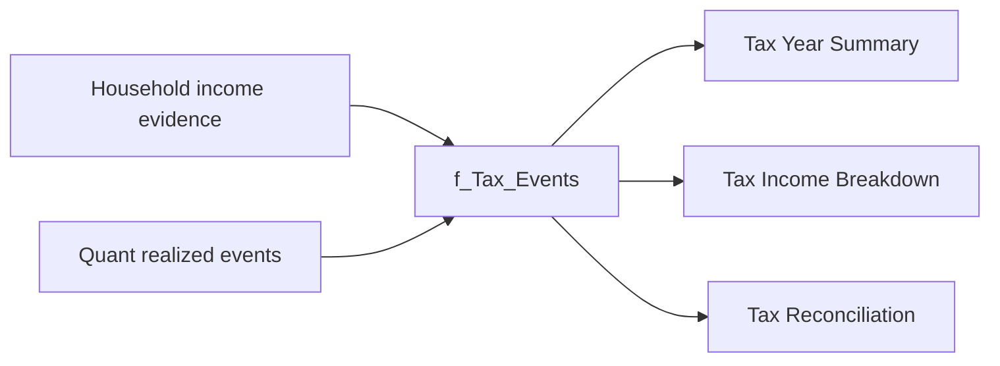

Investment exclusions prevent the same economic event from being counted once through household income and again through Quant realized evidence.

The result is useful for preparation and analysis while keeping the boundary honest:

> **Indicative tax evidence is not final statutory liability.**

That sentence saves a surprising amount of architectural nonsense.

---

## 11. Wealth analytics connected the domains

Household finance and investment analytics meet in the wealth layer.

The household ledger reconstructs book-state and cashflow. Investment analytics provides market-valued state. Wealth builders combine them without pretending those sources have the same semantics.

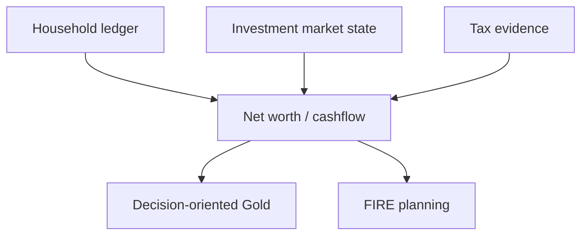

That separation matters because “cash moved through an account” and “this asset is worth X today” are different statements.

---

## 12. FIRE turned current state into a probability distribution

Once current wealth, savings, spending, portfolio state, and financial rules were available, long-term planning became a natural downstream problem.

The FIRE engine evolved beyond a constant-return spreadsheet model. It now models interacting assumptions including:

```text
capital-market assumptions
Markov market regimes
fat-tail volatility
jump events
inflation dynamics
human-capital shocks
glide paths
debt allocation
withdrawal guardrails
sequence-of-returns risk
```

The stochastic layer is deliberately downstream of reconciled financial state.

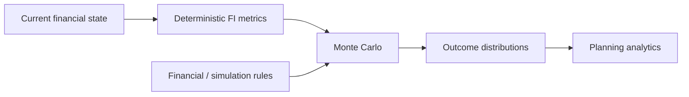

There is little value in building a beautiful probability distribution on top of ambiguous current-state data.

Garbage in, Monte Carlo out is still garbage. It just has percentiles now.

---

## 13. Interfaces followed the workflow

The project did not converge on one fashionable interface.

It has:

```text
CLI
Desktop application
Power BI serving layer
offline documentation runtime
```

Both CLI and Desktop route through the same backend application façade.

That is a recurring preference in my work: build the engine once, then expose the interaction surface that fits the workflow.

Not every useful local tool needs to become a SaaS dashboard with an authentication screen and a monthly infrastructure bill.

---

## 14. Recovery became part of the application contract

Once SQLite and DuckDB together represented application state, backup could not mean “copy whichever database file is convenient.”

Snapshot and restore now coordinate the pair, including locking, DuckDB checkpointing, SQLite's backup API, archive validation, staged replacement, and rollback.

The broader lesson is that recovery is part of data architecture.

If a system cannot explain how state is restored after failure, its happy-path diagram is only half an architecture.

---

## 15. Documentation became an engineering feedback loop

One of the stranger but more useful parts of the project's evolution is that documentation repeatedly exposed architectural weaknesses.

Trying to explain ownership, lineage, failure behavior, and financial semantics forced unclear boundaries into the open.

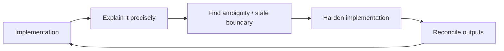

That loop is one reason the documentation is intentionally deep now.

Documentation is not an appendix to the project. It is one of the tools used to understand whether the architecture actually makes sense.

---

## 16. What the project is today

The simplest accurate description is no longer “ETL pipeline.”

Personal Finance ETL is a **local-first financial evidence, reconstruction, analytics, and planning system** built around:

- an SQLite operational Control Plane;
- a contract-governed DuckDB warehouse;
- persistent Bronze synchronization;
- rebuilt Silver and Gold analytical publication;
- deterministic financial identities;
- household cashflow and wealth modeling;
- multi-geography investment evidence;
- historical market reconstruction;
- FIFO acquisition lots and realized events;
- explicit investment reconciliation;
- multi-currency performance and FX attribution;
- evidence-first tax preparation;
- deterministic and stochastic FIRE planning;
- coordinated backup and restore;
- CLI, desktop, BI, and offline documentation surfaces.

That sounds excessive for “personal finance” until the word **personal** is remembered.

The data may belong to one person. The financial questions are still real.

---

## 17. Why local-first remains the right fit

The application processes financially sensitive data and operates comfortably on a local workstation.

The core stack therefore remains intentionally local:

```text
Python
Polars
SQLite
DuckDB
NumPy / Numba
Power BI
```

This keeps privacy, operating cost, recovery, and deployment complexity aligned with the actual workload.

Cloud infrastructure is not a maturity badge.

It is infrastructure. It should arrive when a requirement asks for it.

---

## 18. Portability is a boundary, not a marketing claim

The architecture contains reusable seams, but the current system remains optimized for my financial environment.

Reusable parts include:

```text
Control Plane
Bronze lifecycle
contract registry
canonical publication
financial-rule models
Quant architecture
wealth / FIRE engines
application façade
documentation runtime
```

Environment-specific assumptions still exist around:

```text
source formats
broker semantics
mappings
asset behavior
jurisdiction
reconciliation policy
```

The preferred evolution path is therefore:

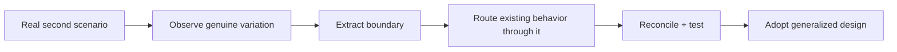

Generalize from working behavior, not imagined universality.

---

## 19. What the repository should demonstrate

I do not want the repository to repeatedly announce that it demonstrates finance, Python, data engineering, quantitative modeling, reliability, or architecture.

The implementation should make those conclusions inspectable.

That is why the technical documentation emphasizes:

- real production code;
- physical contracts and grains;
- deterministic identity;
- formulas and algorithms;
- state transitions;
- failure and recovery paths;
- financial methodology;
- explicit limitations;
- design trade-offs.

The work should carry the claim.

---

## 20. Project principles

### Preserve evidence

Derived analytical state can be rebuilt. Source and operational evidence deserve stronger durability boundaries.

### Respect grain

A mathematically correct calculation at the wrong grain can still be financially wrong.

### Reconcile against independent truth

A model becomes more trustworthy when something outside the model can challenge it.

### Keep policy explicit

Financial assumptions belong in inspectable rules, not hidden presentation literals.

### Separate authority

Historical market reconstruction, canonical FIFO, Tax, Control Plane, and presentation each own different truths.

### Use the compute model that fits

Polars, stateful Python, multiprocessing, DuckDB, SQLite, and Numba solve different classes of problems.

### Prefer explicit failure to plausible fiction

Missing XIRR evidence, stale prices, invalid FX, or reconciliation gaps should remain visible rather than being massaged into friendly numbers.

### Generalize from reality

Abstraction should follow observed variation.

---

## 21. Why the project matters to me

This system is not a portfolio application invented after deciding which technologies would look impressive together.

I use it for real financial work:

```text
month-end closure
cashflow analysis
investment review
portfolio reconciliation
tax preparation support
wealth tracking
FIRE planning
```

That creates a useful engineering constraint:

> **The architecture has to survive contact with my own financial truth.**

A broken demo is embarrassing.

A broken month-end close is immediate product feedback.

That feedback loop is probably the main reason the project kept getting better.

---

## 22. The current phase

The project is intentionally no longer in feature-sprint mode.

The current priority is maturity:

```text
document deeply
validate behavior
expand executable QA
protect financial invariants
observe performance
simplify where justified
change only when real scenarios demand it
```

The system has enough capability.

The next challenge is making that capability easier to understand, safer to change, and harder to regress.

That is a much healthier problem to have.

## Related specifications

- [System Architecture](../architecture/system-architecture.md)
- [Data Lifecycle](../architecture/data-lifecycle.md)
- [Financial Model](../finance/financial-model.md)
- [FIFO and Realized Events](../finance/fifo-and-realized-events.md)
- [Tax Methodology](../finance/tax-methodology.md)
- [FIRE Methodology](../finance/fire-methodology.md)
- [Roadmap](../roadmap.md)
