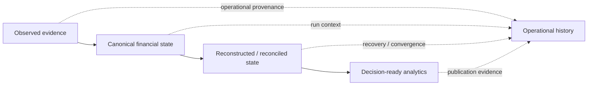
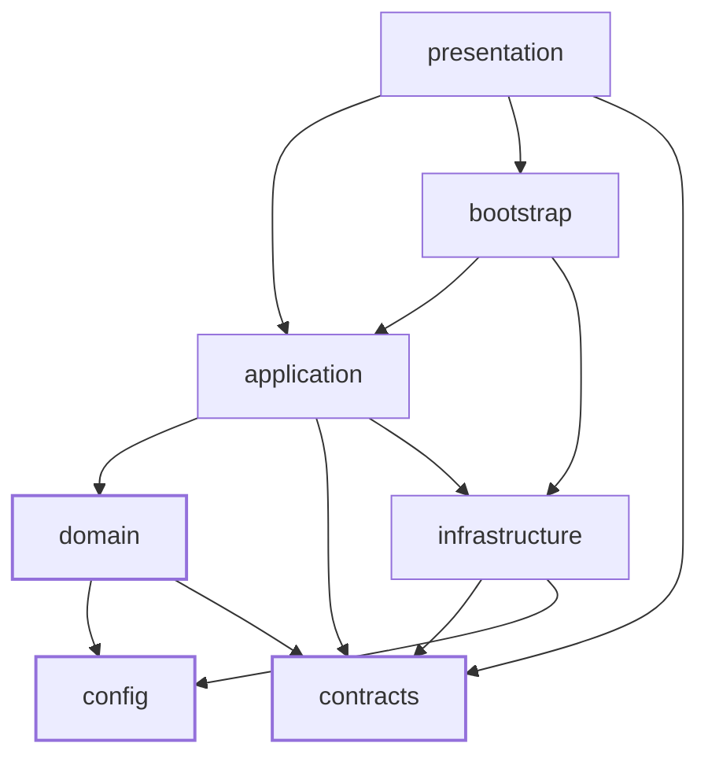
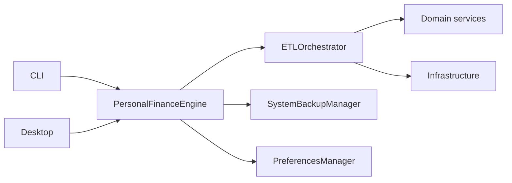
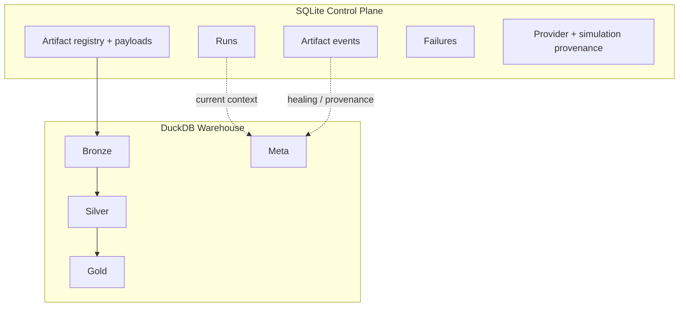
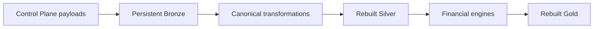
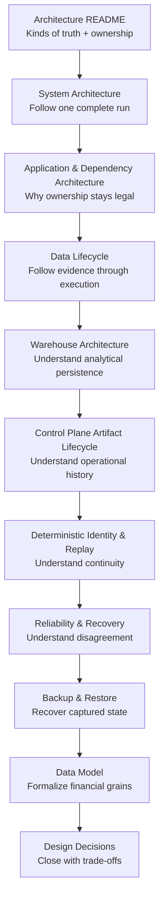

<div class="pf-overview-intro">
  <div class="pf-overview-eyebrow">SYSTEM</div>
  <h1>Architecture</h1>
  <p>Runtime authority, data lifecycle, operational truth and reliability across Personal Finance ETL.</p>
</div>

<div class="pf-overview-routes">
  <a class="pf-overview-card" href="system-architecture/"><strong>System Architecture</strong><span>Runtime authority and package ownership. →</span></a>
  <a class="pf-overview-card" href="data-lifecycle/"><strong>Data Lifecycle</strong><span>How evidence moves through the system. →</span></a>
  <a class="pf-overview-card" href="control-plane-artifact-lifecycle/"><strong>Control Plane</strong><span>Operational truth and artifact history. →</span></a>
  <a class="pf-overview-card" href="reliability-and-recovery/"><strong>Reliability</strong><span>Failure, recovery and convergence semantics. →</span></a>
</div>

Personal Finance ETL is not one database with a collection of scripts around it. It is a local financial system that has to keep several kinds of truth separate long enough to make them useful.

A broker statement tells me what was observed. A canonical transaction model tells me what that observation means. A reconstructed lot book tells me what follows from those transactions. A run ledger tells me how the system got there. A BI table tells me what I want to analyze.

Those are related, but they are not interchangeable.

This architecture exists to preserve that distinction.



The rest of this section explains how the codebase enforces that separation, how a run moves through it, and what happens when reality refuses to be atomic.

## The architecture starts with four different kinds of truth

The easiest way to misunderstand this system is to treat every persisted value as equally authoritative.

It is not.

| Truth | Question it answers | Primary owner |
|---|---|---|
| **Observed evidence** | What bytes or external values did the system actually receive? | Control Plane payloads + Bronze |
| **Canonical financial truth** | What does that evidence mean in the application's vocabulary? | Domain transforms + Silver |
| **Reconstructed / reconciled truth** | What economic state follows from the evidence, and where does it disagree with observation? | Investment, Tax, wealth, FIRE domains |
| **Operational truth** | What happened during execution, synchronization, failure, recovery, and replay? | SQLite Control Plane |

Gold is intentionally not another source of truth. Gold is a decision surface built from canonical and reconstructed state.

That distinction is small on paper and enormous in practice.

A missing broker row should not silently become a financial assumption. A reconciliation adjustment should not overwrite the evidence that made it necessary. A failed SQLite commit after a successful DuckDB commit should not be reported as a generic rollback. A stochastic FIRE result should not be confused with deterministic investment reconstruction.

The architecture gives each of those facts a home.

## Seven packages own seven different questions

The production package is organized by responsibility rather than by technical convenience.

```text
personal_finance_etl/
├── application/      # Which use case runs, and in what order?
├── bootstrap/        # How are concrete dependencies assembled?
├── config/           # What runtime settings and financial policy are valid?
├── contracts/        # What typed messages cross architectural boundaries?
├── domain/           # What does the finance mean?
├── infrastructure/   # How are files, stores, providers, recovery, and logs implemented?
└── presentation/     # How does a human invoke and inspect the application?
```

The package docstrings make those ownership rules explicit. For example, the application package says what it owns and, equally importantly, what it refuses to own:

```python
# src/personal_finance_etl/application/__init__.py
"""Application orchestration, use cases, and public façade.

Owns
----
- Use cases and workflow orchestration.
- Execution lifecycle coordination.
- Ingestion coordination between providers and Bronze persistence.
- Post-ISIN portfolio aggregation and performance coordination.
- High-level application façade for CLI and Desktop presentation.

Does not own
-------------
- Financial algorithms and mathematical formulas (owned by domain).
- Concrete storage, DuckDB, SQLite, or provider mechanics (owned by infrastructure).
- Human-facing rendering, CLI argument parsing, or Desktop UI (owned by presentation).
"""
```

That pattern is repeated across the target packages and is tested as architecture, not left as documentation etiquette.

## Ownership is more important than layering vocabulary

The package names look familiar, but the design is not trying to perform clean-architecture cosplay.

The useful rule is simpler:

> Put a responsibility where its meaning is stable, and make dependencies point toward that meaning rather than toward the mechanism that happens to implement it today.

That produces a dependency shape like this:



The exact legal import rules are narrower than this conceptual graph and are enforced by AST-based architecture tests. The important direction is that financial meaning does not depend on DuckDB, SQLite, presentation widgets, or orchestration timing.

## The composition root is deliberately boring

Concrete wiring is centralized in `bootstrap/container.py`.

That file is not a service locator scattered through the runtime. It is the place where configured infrastructure and application objects are assembled.

```python
# src/personal_finance_etl/bootstrap/container.py
class ServiceContainer:
    """Composition Root responsible for resolving and instantiating application dependencies."""

    def create_orchestrator(
        self,
        config_path: str | None = None,
        rules_path: str | None = None,
        status_queue: ILogger | None = None,
        settings: Settings | None = None,
    ) -> ETLOrchestrator:
        cfg = settings or self.create_settings(config_path)
        rules = self.create_rules(rules_path)
        active_queue: ILogger = status_queue or cast(ILogger, _NullLoggerQueue())
        return ETLOrchestrator(cfg, active_queue, rules)

    def create_engine(self) -> PersonalFinanceEngine:
        return PersonalFinanceEngine(container=self)
```

That boringness is useful. Presentation code does not need to know how a Control Plane, backup manager, DuckDB connection, rules model, or orchestrator is constructed. Tests can substitute the seam. Runtime wiring stays visible in one place.

## The façade is the human-facing application boundary

Both CLI and Desktop presentation surfaces should enter through application use cases rather than reaching directly into persistence or finance internals.

`PersonalFinanceEngine` provides that boundary for configuration history, validation, pipeline execution, and coordinated database snapshot/restore.



This keeps a presentation redesign from becoming a financial-engine rewrite.

## Cross-boundary contracts are selective

`contracts/` is not a universal home for every type.

That would merely move coupling into a different folder.

Instead, the package owns messages whose meaning genuinely crosses an architectural or process boundary:

- `ObservabilityEvent` and execution results;
- extraction outcomes and completeness errors;
- `CommitState` and `FailureDomain`;
- logging protocols;
- snapshot and restore result types.

Domain-native concepts remain with their domain. A `TaxLot`, realized event, reconciliation event, wealth model, or FIRE model does not become an architectural contract merely because several functions use it.

That distinction keeps `contracts/` small enough to mean something.

## Two databases exist because there are two persistence jobs

The system deliberately uses SQLite and DuckDB for different jobs.



SQLite owns historical operational truth because its job is lifecycle, provenance, raw payload retention, and run recovery.

DuckDB owns analytical state because its job is columnar transformation, publication, querying, and BI consumption.

`meta.*` in DuckDB is a projection of current analytical context. It does not compete with the Control Plane for historical authority.

## Bronze is the convergence boundary

Persistent Bronze is the hinge between operational evidence and rebuildable analytics.

The Control Plane can tell me that a file changed, disappeared, was renamed, or needs healing. Bronze gives the analytical side a synchronized persistent representation of those payloads. Silver and Gold can then be rebuilt from complete Bronze state.

This is why the architecture does not try to make every analytical table incrementally mutable forever.



Incremental synchronization is used where it reduces repeated evidence work. Full replacement is used where deterministic rebuilding is simpler and safer.

## Financial domains are allowed to have different compute models

A household transaction transform and a Monte Carlo simulation are both financial computation, but forcing them through one abstraction would make both worse.

The codebase therefore uses several compute styles deliberately:

| Workload | Primary style |
|---|---|
| tabular canonical transforms | Polars expressions / `LazyFrame` DAGs |
| stateful FIFO and reconciliation | typed Python domain models and services |
| portfolio aggregation | Polars + application coordination |
| deterministic FIRE projection | Polars / deterministic domain functions |
| stochastic FIRE simulation | NumPy + Numba kernel |
| publication/query | DuckDB |

The architecture standardizes **ownership, contracts, identity, and publication**, not every internal algorithm.

## Materialization is an architectural boundary

Lazy execution is useful only if materialization happens intentionally.

The warehouse writers document terminal publication as a materialization boundary:

```python
# src/personal_finance_etl/infrastructure/warehouse/silver.py
if isinstance(df, pl.LazyFrame):
    # Materialization Boundary: PUBLICATION_BOUNDARY
    # Terminal execution of lazy transformation graph for DuckDB Silver table insertion
    df = df.collect()
```

Gold does the same and logs the optimized physical plan before collection.

The objective is not “never call `collect()`.” The objective is to know **why** execution becomes eager at each boundary.

## Reliability begins where atomicity ends

The hardest operational edge is the coordinated commit across two different databases.

There is no distributed transaction manager pretending SQLite and DuckDB share one ACID transaction.

The application tracks the truth explicitly:

```text
NOT_STARTED
    ↓
STARTED
    ↓
DUCKDB_COMMITTED
    ├── SQLite commit succeeds → FULLY_COMMITTED
    └── SQLite commit fails    → RECOVERY_REQUIRED
```

That state is represented by `CommitState`, persisted in the Control Plane, and used during future convergence.

The important architectural guarantee is therefore not “failure cannot create divergence.”

It is:

> divergence is represented explicitly, previous uncertainty is preserved, and a later successful run can converge the system without rewriting history.

## Public APIs are intentional boundaries

The top-level packages expose small public surfaces through `__all__` where a stable entry point is useful:

```python
# src/personal_finance_etl/contracts/__init__.py
__all__ = [
    "CommitState",
    "EngineDataTransport",
    "EngineExecutionResult",
    "EngineStage",
    "ObservabilityEvent",
    "ExtractionBatchResult",
    "FailureDomain",
    "RestoreResult",
    "SnapshotResult",
    "classify_failure_domain",
]
```

Internal implementation remains importable Python, but documented public surfaces make ownership visible and reduce accidental coupling.

## Architecture rules are executable

The codebase includes AST-based tests that reject forbidden import arrows and verify the target package structure.

```python
# tests/test_architecture_boundaries.py
FORBIDDEN_IMPORTS = {
    "contracts": [
        "personal_finance_etl.domain",
        "personal_finance_etl.application",
        "personal_finance_etl.infrastructure",
        "personal_finance_etl.presentation",
    ],
    "domain": [
        "personal_finance_etl.application",
        "personal_finance_etl.infrastructure",
        "personal_finance_etl.presentation",
        "duckdb",
        "sqlite3",
    ],
}
```

The same suite checks that the expected package tree exists and that ownership docstrings are present.

Documentation explains the rule. Tests make regression noisy.

## Read this section as one connected argument

The architecture pages are ordered deliberately.



### Start with the runtime

Read [System Architecture](system-architecture.md) if you want to see the whole application execute before studying individual boundaries.

Then read [Application & Dependency Architecture](application-and-dependency-architecture.md) to understand why the seven packages depend on one another the way they do.

### Follow the data and state

Use [Data Lifecycle](data-lifecycle.md) for the run sequence, then [Warehouse Architecture](warehouse-architecture.md) and [Control Plane Artifact Lifecycle](control-plane-artifact-lifecycle.md) for the two persistence models.

### Follow identity and failure

Use [Deterministic Identity & Replay](deterministic-identity-and-replay.md) for stable economic identity, then [Reliability & Recovery](reliability-and-recovery.md) and [Backup & Restore](backup-and-restore.md) for convergence and captured-state recovery.

### Follow the financial model

Use [Data Model](data-model.md) for grains and domain relationships, then continue into the [Finance specifications](../finance/README.md) for methodology.

### Understand why it looks this way

Finish with [Design Decisions](design-decisions.md). It records the tensions behind the architecture, including the alternatives deliberately not chosen.

## What this section does not try to be

These pages do not replace:

- the [Reference specifications](../reference/README.md) for exact physical contracts;
- the [Finance specifications](../finance/README.md) for formula and methodology depth;
- the [Developer guide](../developer/README.md) for extension workflows;
- the source code and tests as implementation authority.

The architecture section sits between mental model and source detail. Its job is to make the system legible enough that the deeper specifications and code have somewhere coherent to land.
