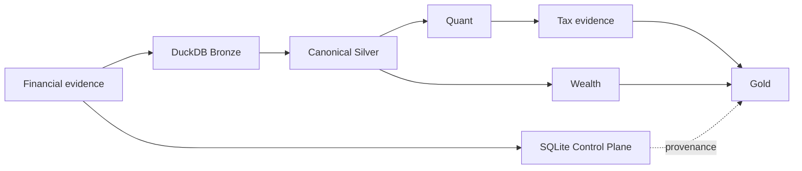

# Architecture

I use this section to specify how the application runs, how it preserves operational evidence, how financial analytics are rebuilt, and what recovery and reproducibility actually guarantee. Start with the system topology, then follow the lifecycle into the storage, identity and reliability contracts.

## Read in this order

1. [System architecture](system-architecture.md): execution boundaries, orchestration and engines.
2. [Data lifecycle](data-lifecycle.md): source discovery, Bronze synchronization and publication.
3. [Warehouse architecture](warehouse-architecture.md): SQLite/DuckDB ownership and registered contracts.
4. [Data model](data-model.md): financial grains, identities and authority.
5. [Control Plane artifact lifecycle](control-plane-artifact-lifecycle.md): registry, events, payloads and savepoints.
6. [Deterministic identity and replay](deterministic-identity-and-replay.md): canonical IDs and stochastic reproducibility.
7. [Reliability and recovery](reliability-and-recovery.md): transaction and failure boundaries.
8. [Backup and restore](backup-and-restore.md): coordinated snapshots and restoration.
9. [Design decisions](design-decisions.md): trade-offs and extension boundaries.

## Architecture at a glance

The root [technical documentation index](../README.md) and [reference catalog](../reference/README.md) provide broader navigation and physical table contracts. The application release number is intentionally absent from these technical pages; the Changelog owns release history.
