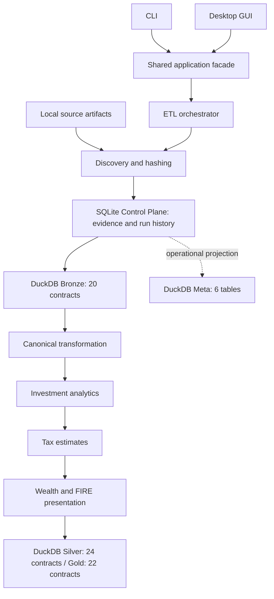

# Architecture

I designed Personal Finance ETL as a local-first financial data platform with a **SQLite operational Control Plane**, a **DuckDB analytical warehouse**, a contract registry, financial engines, and shared CLI/desktop entry points. This section describes the *global topology and architectural decisions*. Detailed mechanics belong to their dedicated domains.

## Platform topology

The arrows show major dependencies, not an exhaustive table-level lineage. Some engines also consume upstream facts directly.

## Physical surface at v8.1.1

| Store / layer | Registered surface | Authority |
| --- | ---: | --- |
| SQLite Control Plane | 8 physical tables | Operational history, artifacts, provenance |
| DuckDB Bronze | 20 contracts (12 full-replace, 8 file-incremental) | Analytical ingestion state |
| DuckDB Silver | 24 contracts | Canonical analytical data |
| DuckDB Gold | 22 contracts | Presentation and BI datasets |
| DuckDB Meta | 6 tables | Convenient analytical projections of operational context |

These figures are derived from `backend/load/registry.py` and the physical schema definitions in `backend/load/schemas/`, not inferred from previous documentation.

## Where to read next

| Page | Architectural question |
| --- | --- |
| [System Architecture](system-architecture.md) | Which components exist, and what depends on what? |
| [Execution Lifecycle](execution-lifecycle.md) | How does a complete ETL run proceed, and where are its commits? |
| [Dependency Architecture](dependency-architecture.md) | Which interfaces, repositories, and engines own each responsibility? |
| [Data Lifecycle](data-lifecycle.md) | How does evidence flow toward published financial datasets? |
| [Warehouse Architecture](warehouse-architecture.md) | What is persisted in each database and layer? |
| [Data Model](data-model.md) | What are the grains and canonical financial entities? |
| [Design Decisions](design-decisions.md) | Why did I choose these trade-offs? |
| [Reliability & Recovery](reliability-and-recovery.md) | Historical architecture page, pending canonical relocation to `operations/` in Batch 8. |

## Scope boundaries

I keep the **why and system-level topology** here. The planned `control-plane/` domain will own artifact events and run-state mechanics; `data-engineering/` will own ingestion and publication; `finance/` will own algorithms and equations; `reference/` will own exact DDL and field-level contracts; and `operations/` will own failure scenarios, backup, and recovery.

The two databases do **not** form a distributed atomic transaction. The orchestrator commits DuckDB before SQLite, and the implementation explicitly relies on later healing if the second commit fails. See [Execution Lifecycle](execution-lifecycle.md).

[← Documentation Home](../README.md)
