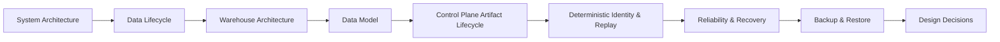
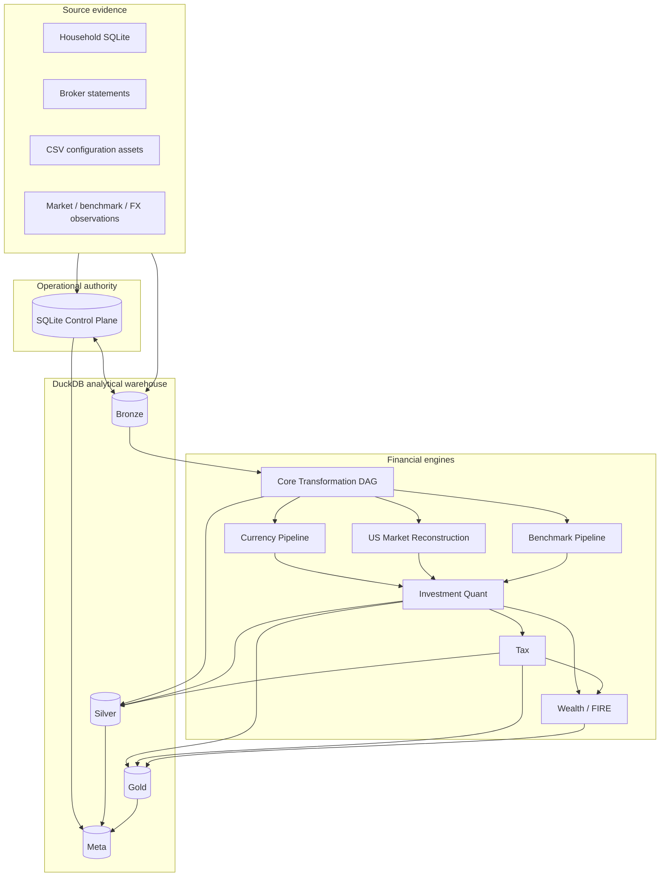
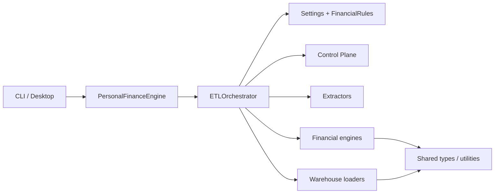
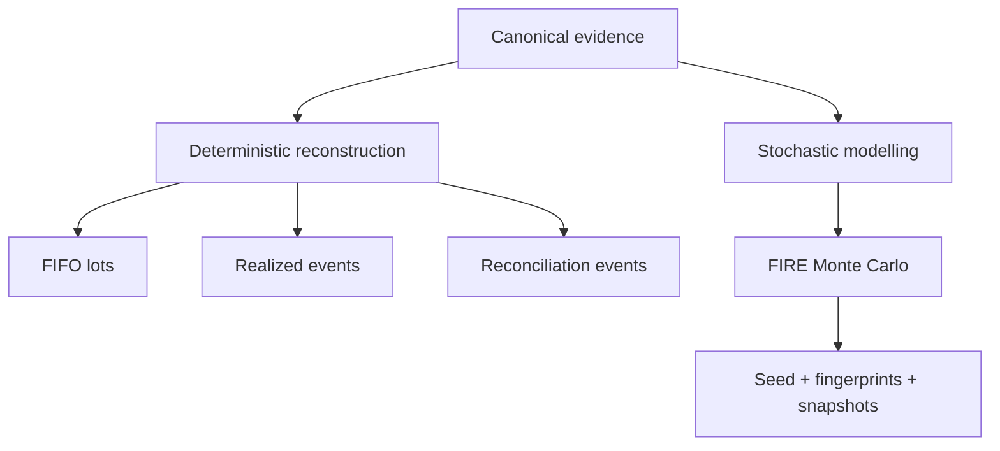

# Architecture

Personal Finance ETL is not organized as a single extract-transform-load script. The application separates **source evidence**, **operational provenance**, **canonical financial facts**, **reconstructed financial state**, and **analytical presentation** so that each layer has a clear authority and failure boundary.

This section specifies that architecture from the outside in. It explains the application boundary, execution lifecycle, persistence model, logical data model, identity model, and recovery design before the finance-specific documents descend into FIFO lots, FX attribution, tax evidence, or stochastic wealth modelling.

> **Architecture rule:** a dataset is not authoritative merely because it is convenient to query. SQLite, Bronze, Silver, Gold, and DuckDB Meta deliberately own different kinds of state. DuckDB is excellent at analytics; it does not need a side hustle as the historical Control Plane.


## Learn the architecture first

These pages specify the architecture in implementation-level depth. For the guided mental model, start with the Wiki's **[Architecture Tour](https://github.com/tks18/personal-finance-etl/wiki/02-Architecture-Tour)**, then follow [Follow the Data](https://github.com/tks18/personal-finance-etl/wiki/03-Follow-the-Data), [Operational Truth](https://github.com/tks18/personal-finance-etl/wiki/04-Operational-Truth), and [Reliability & Recovery](https://github.com/tks18/personal-finance-etl/wiki/12-Reliability-and-Recovery).

## Reading map



| Document | Question it owns |
|---|---|
| [System architecture](system-architecture.md) | What are the major components and dependency boundaries? |
| [Data lifecycle](data-lifecycle.md) | How does evidence move from discovery to analytical publication? |
| [Warehouse architecture](warehouse-architecture.md) | Where does persistent state live, and which layer owns it? |
| [Data model](data-model.md) | What are the canonical financial domains and relationships? |
| `control-plane-artifact-lifecycle.md` | How are artifacts discovered, identified, synchronized, renamed, removed, and healed? |
| `deterministic-identity-and-replay.md` | How are stable financial identities, fingerprints, and replay context produced? |
| `reliability-and-recovery.md` | What happens when execution fails or persistence layers diverge? |
| `backup-and-restore.md` | How are SQLite and DuckDB snapshotted and restored as one application unit? |
| `design-decisions.md` | Why does the system use these boundaries and trade-offs? |

The latter five specifications are authored in Architecture Batch 1B. Their filenames are already part of the frozen documentation catalog.

## Architecture at a glance



The diagram intentionally separates **operational authority** from **analytical storage**. Source lifecycle, run history, payload retention, artifact events, and simulation provenance belong to the SQLite Control Plane. DuckDB owns persistent Bronze evidence, rebuilt Silver/Gold analytical publications, and a current-state Meta projection.

## Four forms of truth

The architecture becomes much easier to reason about once “truth” is split into four categories.

### 1. Source evidence

Source evidence is what entered the system: household transactions, broker files, market observations, FX observations, mapping/configuration files, and the source SQLite database. The Control Plane records the lifecycle of these artifacts; Bronze persists their extracted analytical representation.

### 2. Canonical financial facts

Core transformations normalize heterogeneous sources into common dimensions and facts such as income, expenses, transfers, purchases, sales, instruments, currencies, benchmarks, and macro parameters.

These facts deliberately remove source-specific shape without pretending that derived state was directly observed.

### 3. Reconstructed financial state

Some financially useful state cannot be read directly from a source artifact. It must be reconstructed. Examples include historical US holdings, FIFO acquisition lots, realized disposal components, reconciliation adjustments, and derived valuations.

Reconstructed state remains distinguishable from source evidence. A reconstructed US holding is useful financial state; it is not magically transformed into a broker-certified daily holdings statement.

### 4. Financial presentation

Gold tables convert canonical and reconstructed facts into BI-facing analytical products: tax summaries, portfolio aggregations, cashflow analytics, wealth metrics, budget variance, and FIRE analytics.

Gold is presentation, not source authority.

## Primary implementation boundaries

| Boundary | Primary implementation |
|---|---|
| Backend façade | `backend/api/engine.py` |
| Runtime settings | `backend/config/settings.py` |
| Financial semantics | `backend/config/financial_rules.py` |
| ETL orchestration | `backend/pipeline/etl_pipeline.py` |
| Core Polars DAG | `backend/pipeline/core/transformer.py` |
| Source extraction | `backend/extract/` |
| Control Plane | `backend/load/control_plane/` |
| Bronze persistence | `backend/load/bronze.py` |
| Contract registry | `backend/load/registry.py` |
| Silver publication | `backend/load/silver.py` |
| Gold publication | `backend/load/gold.py` |
| DuckDB Meta | `backend/load/metadata.py` |
| Quant | `backend/engines/analytics/` |
| Tax | `backend/engines/tax/` |
| Wealth / FIRE | `backend/engines/presentation/` |
| Identity | `backend/utils/identity.py` |
| Reproducibility | `backend/utils/reproducibility.py` |
| Backup / restore | `backend/load/backup.py` |
| CLI | `frontend/cli/` |
| Desktop | `frontend/desktop/` |
| Integrated docs | `frontend/commons/docs/` |

## Dependency direction



The frontend does not directly orchestrate financial engines or persistence. `PersonalFinanceEngine` is the façade presented to UI surfaces, while `ETLOrchestrator` owns execution order and cross-subsystem coordination.

## Configuration is split by responsibility

Two Pydantic configuration trees deliberately answer different questions:

- `Settings`: **where and how does the application run?** Paths, database names, source locations, discovery behavior, and file-hash policy live here.
- `FinancialRules`: **how should financial evidence be interpreted?** Classification, tax exclusions, investment semantics, portfolio rules, macro assumptions, FIRE, Monte Carlo, regime models, human-capital shocks, glide paths, and withdrawal rules live here.

This split prevents infrastructure configuration from quietly becoming financial policy.

## Contract-governed analytical publication

`backend/load/registry.py` defines two registries:

- `BRONZE_CONTRACT_REGISTRY`: 20 extraction/synchronization contracts.
- `DATA_CONTRACT_REGISTRY`: 24 Silver + 22 Gold analytical contracts.

Before publication, the orchestrator enforces equality between the registered analytical contract set and the datasets actually produced by the engines:

```python
registered_contracts = {c.contract_id for c in DATA_CONTRACT_REGISTRY}
for df_key in self.dfs.keys():
    if df_key not in registered_contracts:
        raise RuntimeError(
            f"Engine produced unregistered table '{df_key}'. "
            "All analytical tables must be defined in DATA_CONTRACT_REGISTRY."
        )

missing_contracts = registered_contracts - set(self.dfs.keys())
if missing_contracts:
    raise RuntimeError(f"Engine failed to produce required tables: {missing_contracts}")
```

This turns the registry into an executable publication boundary rather than a decorative catalog.

## Deterministic versus stochastic computation

Two very different forms of reproducibility coexist:



FIFO and identity generation are deterministic given canonical inputs and compatible implementation semantics. FIRE simulation is stochastic but records the seed and replay context. Treating those as the same kind of “reproducibility” would make the documentation simpler and the architecture less true, so the system does not do that.

## Reliability boundary

SQLite and DuckDB participate in one logical run, but they do not form a distributed ACID database. The pipeline begins transactions in both, commits DuckDB first, then commits SQLite. If the second commit fails, the next run relies on idempotency and Bronze/registry healing to converge state.

That is a deliberate recovery model, not a claim of two-phase commit.

## Where to continue

Start with [System Architecture](system-architecture.md) for the component model, then follow [Data Lifecycle](data-lifecycle.md), [Warehouse Architecture](warehouse-architecture.md), and [Data Model](data-model.md). The Batch 1B specifications then descend into the Control Plane, identity/replay, recovery, backup/restore, and design rationale.

## Related specifications

- [System Architecture](system-architecture.md)
- [Data Lifecycle](data-lifecycle.md)
- [Warehouse Architecture](warehouse-architecture.md)
- [Data Model](data-model.md)
- [Control Plane Artifact Lifecycle](control-plane-artifact-lifecycle.md)
- [Deterministic Identity and Replay](deterministic-identity-and-replay.md)
- [Reliability and Recovery](reliability-and-recovery.md)
- [Backup and Restore](backup-and-restore.md)
- [Design Decisions](design-decisions.md)
