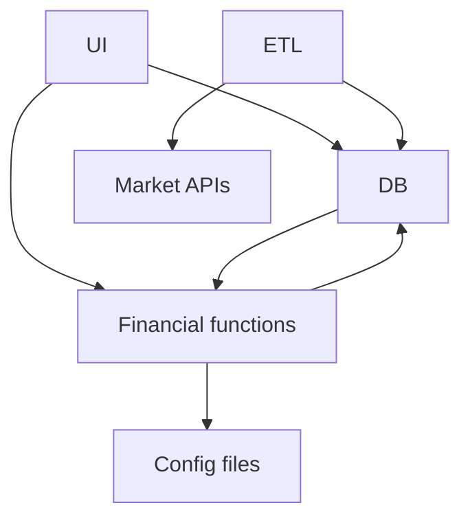
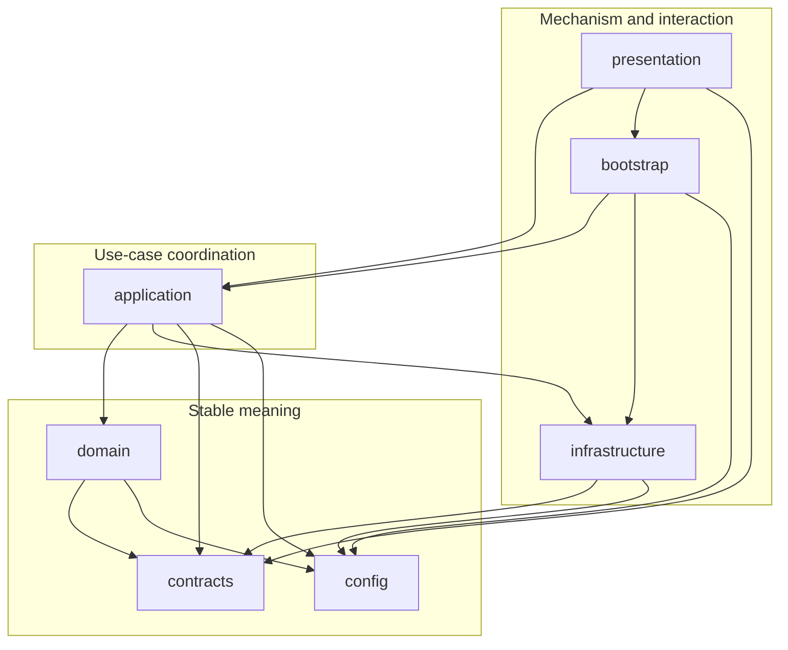
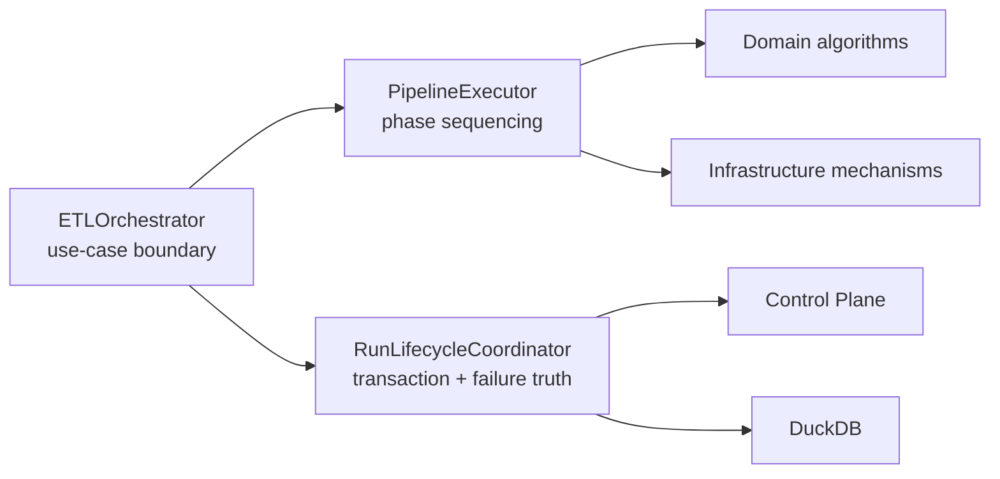
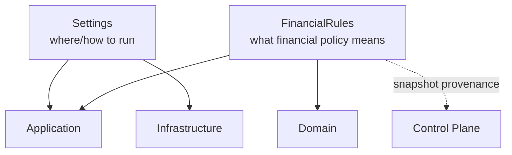
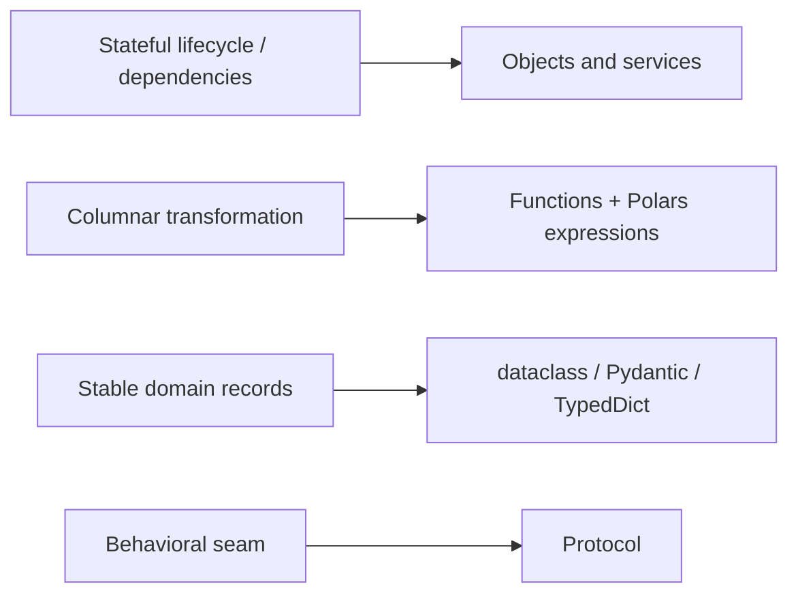
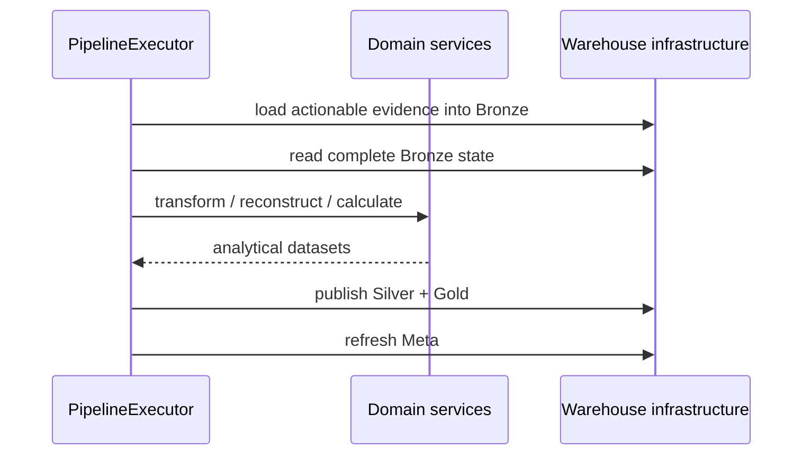

# Application and Dependency Architecture

The package tree answers **where** code lives. It does not answer the harder question:

> Why is a given dependency legal here, and why would the same dependency be a design bug somewhere else?

That question matters because a finance system accumulates pressure from both directions. Infrastructure wants to leak upward because databases and providers are convenient. Domain logic wants to leak outward because formulas are needed everywhere. Presentation code wants shortcuts because the user is waiting. Orchestration wants to become a god object because it sees the whole run.

The application architecture exists to absorb that pressure without letting responsibility collapse back into one procedural pipeline.

This specification defines that boundary system.

## Start with the dependency problem, not the folder names

A naïve ETL program can call everything from everything:



That works until change arrives.

A UI redesign touches persistence. A schema migration touches formulas. A new provider changes orchestration. A financial rule becomes hidden inside a loader. Tests need real databases because the calculation code imports them directly.

The target architecture instead asks each package to answer one kind of question.

## The seven ownership questions

| Package | Question it owns | Typical examples |
|---|---|---|
| `presentation` | How does a human invoke or inspect the application? | CLI, Desktop, docs browser |
| `application` | Which use case runs and in what order? | orchestration, ingestion coordination, portfolio/tax/wealth services |
| `domain` | What does the financial state mean? | FIFO, reconciliation, returns, Tax, wealth, FIRE |
| `infrastructure` | How is an external mechanism implemented? | DuckDB, SQLite, files, market providers, recovery, logging |
| `config` | What runtime settings and financial policies are valid? | `Settings`, `FinancialRules` |
| `contracts` | What typed message genuinely crosses a boundary? | status, extraction, lifecycle, recovery |
| `bootstrap` | Which concrete implementations are assembled together? | `ServiceContainer` |

This is not a hierarchy of importance. It is a partition of reasons to change.

## The legal dependency shape

The most important direction is that financial meaning remains independent of storage and presentation mechanisms.



The diagram is intentionally not a simplistic set of concentric circles. The implementation is pragmatic:

- application code coordinates concrete infrastructure in several use cases;
- configuration models are imported by both domain and infrastructure where the semantics require them;
- contracts provide selective cross-boundary types;
- bootstrap is allowed to know concrete classes because composition is its purpose.

The invariant is **not** “all dependencies point inward.”

The invariant is:

> financial algorithms do not depend on concrete storage, provider, orchestration, or presentation mechanisms, and boundary-crossing messages are explicit enough to make coupling visible.

## Architecture rules are tested, not merely narrated

The repository parses imports with `ast` and rejects forbidden arrows.

```python
# tests/test_architecture_boundaries.py
FORBIDDEN_IMPORTS = {
    "contracts": [
        "personal_finance_etl.domain",
        "personal_finance_etl.application",
        "personal_finance_etl.infrastructure",
        "personal_finance_etl.presentation",
    ],
    "domain": [
        "personal_finance_etl.application",
        "personal_finance_etl.infrastructure",
        "personal_finance_etl.presentation",
        "duckdb",
        "sqlite3",
    ],
    "presentation": [
        "personal_finance_etl.domain.investments.lots.fifo",
        "personal_finance_etl.infrastructure.warehouse.connection",
        "personal_finance_etl.infrastructure.control_plane.connection",
    ],
}
```

The test is deliberately structural rather than style-based. It does not care whether a forbidden import is hidden in a helper or wrapped in an attractive class. The arrow itself is the problem.

The same architecture suite verifies:

- the expected package topology exists;
- package `__init__.py` files document `Owns` and `Does not own` boundaries;
- retired package structures do not reappear;
- source remains parseable for boundary inspection.

This gives the dependency model an executable backstop.

## The application layer is a coordinator, not the finance brain

`application/` owns use cases and sequencing.

The clearest example is the end-to-end pipeline. `ETLOrchestrator` does not calculate XIRR, execute FIFO, write DuckDB DDL, or parse GUI widgets. It creates a lifecycle coordinator, asks the executor to run the phases, commits, reports success, and delegates failure handling.

```python
# src/personal_finance_etl/application/pipeline/orchestrator.py
def run(self) -> None:
    """Run the end-to-end quantitative ETL pipeline."""
    start_time = time.perf_counter()
    lifecycle = RunLifecycleCoordinator(
        self.cfg, self.status_queue, self.db_manager, self.rules
    )

    try:
        cp, run_id, _ = lifecycle.initialize()
        self.executor.execute_phases(cp, run_id)
        lifecycle.commit()
    except Exception as e:
        lifecycle.handle_failure(e)
        raise e
    finally:
        lifecycle.teardown()
```

This shape is important because it separates three different forms of complexity:



One class can now change its implementation without forcing the others to absorb its responsibility.

## The executor owns phase order, not financial formulas

`PipelineExecutor.execute_phases()` is the explicit five-phase application workflow:

1. discovery and synchronization;
2. Bronze upsert;
3. canonical transformation and enrichment;
4. advanced financial engines and contract completeness;
5. Silver/Gold publication plus Meta refresh.

Its job is to say **when** these activities happen and **which application/domain service** is responsible.

The executor can therefore enforce financial ordering without implementing financial mathematics.

That distinction is especially important in investment processing. Reconciliation, FIFO, market reconstruction, Tax, wealth, and FIRE are not interchangeable plugins. Their order carries economic meaning.

## Engine ordering is an application-level financial contract

The run sequence creates dependencies between financial facts.

For example:


If Tax were executed before realized investment events existed, the resulting system could be technically valid Python and financially meaningless.

Application orchestration therefore protects domain preconditions that cannot be expressed purely as import rules.

## The façade is the application boundary presented to humans

`PersonalFinanceEngine` is the stable boundary exposed to CLI and Desktop surfaces.

Its responsibilities include:

- recent configuration/rules history;
- configuration validation;
- coordinated snapshot and restore;
- synchronous pipeline execution;
- asynchronous worker execution and status streaming.

```python
# src/personal_finance_etl/application/facade.py
class ContainerProtocol(Protocol):
    def create_orchestrator(
        self,
        config_path: str | None = None,
        rules_path: str | None = None,
        status_queue: ILogger | None = None,
        settings: Settings | None = None,
    ) -> ETLOrchestrator:
        ...
```

The façade depends on a structural protocol rather than on a concrete container type. That keeps the presentation-facing API stable while still allowing bootstrap to own concrete assembly.

## Bootstrap owns concrete wiring because somebody must

Dependency inversion does not eliminate construction. It moves construction to a place where concrete knowledge is expected.

`ServiceContainer` is that place.

```python
# src/personal_finance_etl/bootstrap/container.py
def create_duckdb_manager(self, cfg: Settings) -> DuckDBManager:
    return DuckDBManager(cfg.TARGET_DB_BASE_PATH, cfg.TARGET_DB_NAME)

def create_control_plane(self, cfg: Settings) -> ControlPlane:
    return ControlPlane(cfg.TARGET_DB_BASE_PATH, cfg.RAW_DOCUMENT_STORE_NAME)

def create_backup_manager(self, cfg: Settings) -> SystemBackupManager:
    return SystemBackupManager(
        cfg.TARGET_DB_BASE_PATH,
        sqlite_db_name=cfg.RAW_DOCUMENT_STORE_NAME,
        duckdb_name=cfg.TARGET_DB_NAME,
    )
```

This is intentionally explicit. There is no reflection-driven dependency container, runtime scanning, or global registry.

For a local application of this size, explicit Python construction is easier to audit than framework magic.

## Configuration is split into environment and policy

`Settings` and `FinancialRules` are deliberately different concepts.

`Settings` describes the runtime environment and operational locations: source folders, database names, file-hash policy, provider settings, and similar execution concerns.

`FinancialRules` describes policy used by financial computation: Tax, investment, household, and FIRE rules.



Combining them into one configuration object would make it difficult to distinguish an operational change from a financial-policy change during replay.

The Control Plane snapshots them separately for the same reason.

## Contracts exist only where the boundary deserves a name

The codebase uses several Python typing mechanisms, each for a different kind of boundary.

### Protocols for behavioral capability

`ILogger` and `ContainerProtocol` describe what a collaborator can do without forcing inheritance from a framework base class.

### `TypedDict` for structured mapping records

Run-sync summaries and domain records that move naturally as mappings can remain lightweight while still getting static structure.

### dataclasses for immutable/internal value records

`TaxLot` is a frozen, slotted dataclass because it is an in-memory domain value with stable fields and no need for input aliasing.

### Pydantic for validation and alias-rich boundary/domain records

Purchase, Sale, realized event, and other models can accept external field names while presenting typed Python attributes.

The architecture does not impose one “best” type system on every problem.

It chooses based on boundary semantics.

## `contracts/` is deliberately narrow

The cross-boundary package currently exposes lifecycle, logging, application status, extraction, and recovery contracts.

```python
# src/personal_finance_etl/contracts/__init__.py
__all__ = [
    "CommitState",
    "EngineExecutionResult",
    "EngineStage",
    "EngineStatusMessage",
    "ExtractionBatchResult",
    "ExtractionCompletenessError",
    "FailureDomain",
    "ILogger",
    "RestoreResult",
    "SnapshotResult",
    "classify_failure_domain",
]
```

A useful test for adding a new type here is:

> Would two architectural layers otherwise have to agree on this message while importing one another's internal model?

If the answer is no, the type probably belongs with its domain or owner instead.

## Domain types remain close to financial meaning

Investment contracts illustrate the difference.

`domain/investments/contracts.py` contains:

- `TaxLot` / `AcquisitionLot`;
- `Purchase` and `Sale`;
- `RealizedEventRecord`;
- reconciliation records;
- cashflow and terminal-value records;
- performance metric structures.

Those records are not cross-layer plumbing. They encode the vocabulary of the investment domain.

Keeping them there lets algorithms and invariants evolve together.

## Infrastructure implements mechanisms without becoming policy

`infrastructure/` is intentionally broad in mechanisms:

```text
infrastructure/
├── control_plane/
├── filesystem/
├── logging/
├── preferences/
├── providers/
├── recovery/
└── warehouse/
```

But broad mechanism ownership does not make it a business layer.

For example:

- `warehouse/silver.py` knows how to publish Silver tables and enforce physical publication checks;
- it does not calculate realized gain/loss;
- `providers/market/` knows how to acquire external market evidence;
- it does not decide portfolio performance methodology;
- `recovery/backup.py` knows how to validate and install database snapshots;
- it does not decide whether a financial run should be considered economically valid.

This separation keeps IO-heavy code from swallowing domain semantics.

## Presentation is intentionally thin

Presentation owns:

- CLI commands and arguments;
- Desktop widgets and views;
- the embedded docs renderer;
- the application launcher.

It does not own:

- direct DuckDB/SQLite connection logic;
- FIFO implementation;
- Tax calculation;
- pipeline transaction state.

The architecture tests specifically prohibit several direct infrastructure and deep-domain imports from presentation.

That turns “thin UI” from a preference into a constraint.

## Public APIs communicate intended entry points

Several packages use `__all__` to expose a deliberately small surface.

Examples:

```text
application    → PersonalFinanceEngine
bootstrap      → ServiceContainer
config         → Settings, FinancialRules, FileHashPolicy
presentation   → build_argument_parser, main
contracts      → shared message/result contracts
```

The absence of a broad top-level `domain.__all__` is also meaningful. Domain consumers should depend on the specific domain package they need instead of importing a giant convenience namespace.

## Dependency legality is different from runtime ownership

A subtle but important distinction:

- **dependency legality** asks whether package A may import package B;
- **runtime ownership** asks which object coordinates a particular action.

For example, `application` may legally call infrastructure. That does not mean application owns DuckDB mechanics.

Likewise, infrastructure may import a cross-boundary contract. That does not mean the contract belongs to infrastructure.

Confusing those two concepts produces architectures that look layered on disk but remain tangled in responsibility.

## The architecture uses both OOP and functional transforms deliberately

Object orientation is useful where there is state, lifecycle, dependency identity, or a cohesive service boundary:

- `RunLifecycleCoordinator`;
- `ControlPlane`;
- `SystemBackupManager`;
- `AggregationService`;
- `TaxService`;
- provider implementations.

Functional transformation is useful where data-in/data-out semantics are the clearest expression of the rule:

- household transforms;
- investment transforms;
- calculations;
- Polars expression builders.



The architecture optimizes for semantic fit, not paradigm purity.

## Process boundaries require explicit messages

Asynchronous pipeline execution uses a multiprocessing worker and streams typed status messages back to presentation.

That makes process boundaries another place where hidden coupling would be expensive.

The application contract `EngineStatusMessage`, logging protocol, and worker coordination keep status transport separate from GUI widget state.

A process can fail without the UI needing to understand the internals of the financial engine that failed.

## Application services are allowed to coordinate domain specialization

The application layer contains dedicated areas for:

```text
application/
├── ingestion/
├── investments/
├── pipeline/
├── recovery/
├── tax/
└── wealth/
```

This does not duplicate the corresponding domain packages.

The distinction is:

```text
application/investments → coordinate investment use cases
 domain/investments      → define investment meaning and algorithms
```

The same logic applies to Tax and wealth.

A useful code-review question is therefore:

> Is this function deciding **what the financial result means**, or deciding **when/how to invoke components that already know the meaning**?

The first belongs in domain. The second is usually application.

## Storage boundaries remain visible in application code

The application layer does not pretend persistence is invisible.

That would be false abstraction for an ETL system.

Instead, persistence operations are visible at use-case boundaries while concrete SQL and DDL stay in infrastructure.

For example, the executor explicitly invokes `BronzeLayer`, `SilverLayer`, `GoldLayer`, and `MetaLayer`, because publication timing is part of the use case. The layer classes own how those operations are implemented.

This is a pragmatic boundary:



## Financial correctness sometimes constrains architecture

Several dependencies exist because the finance requires them, not because a software pattern suggests them.

Examples:

- benchmark processing must happen before benchmark-relative performance can be finalized;
- FX evidence must exist before local/reporting-currency attribution is complete;
- realized events must exist before investment-related Tax evidence can be classified;
- wealth combines domains late to avoid circular ownership;
- stochastic FIRE consumes prepared wealth/cashflow inputs rather than becoming a general-purpose pipeline primitive.

The application layer is where those cross-domain sequencing constraints are made explicit.

## What belongs where: practical decision table

| Change | Primary owner | Why |
|---|---|---|
| add a new FIFO matching rule | `domain/investments/lots` | changes financial meaning |
| change DuckDB publication SQL | `infrastructure/warehouse` | changes persistence mechanism |
| add a new run phase | `application/pipeline` | changes use-case sequencing |
| add a CLI flag | `presentation/cli` + `config` if persisted | changes human invocation |
| add a typed worker status | `contracts/application` | crosses process/presentation boundary |
| wire a new concrete provider | `bootstrap` + `infrastructure/providers` | mechanism + composition |
| add a Tax policy parameter | `config/financial_rules/tax.py` | changes explicit financial policy |
| add a reconciliation event model | `domain/investments/reconciliation` | changes domain vocabulary |

## Architectural failure modes to watch for

The architecture can regress even while all tests remain green if new code follows the wrong ownership instinct.

Common warning signs include:

### A domain module imports DuckDB or SQLite

That couples financial meaning to persistence and makes isolated calculation testing harder.

### Presentation reaches around the façade

A GUI convenience import can quietly turn UI state into an application dependency.

### `contracts/` becomes a dumping ground

If every dataclass is promoted to a cross-boundary contract, package ownership becomes meaningless.

### Application services reimplement algorithms

Coordination code that starts computing gains, Tax, or reconciliation semantics is domain leakage.

### Infrastructure starts deciding policy

A provider or warehouse class should not invent financial fallback rules because a value is missing.

### Bootstrap accumulates runtime logic

The composition root should assemble objects, not become a second orchestrator.

## The dependency model is stable because responsibility is explicit

The architecture is not valuable because it has seven top-level packages. Another project could copy those names tomorrow and gain nothing.

The value is that the package boundaries correspond to real tensions in this system:

- evidence versus interpretation;
- mechanism versus meaning;
- coordination versus calculation;
- policy versus environment;
- domain record versus boundary message;
- construction versus execution;
- human interaction versus application behavior.

Those distinctions are now reflected in source layout, public APIs, protocols, composition, and executable architecture tests.

## Continue through the runtime

The dependency rules become easier to understand when seen under load.

Read [System Architecture](system-architecture.md) for the complete runtime view, then [Data Lifecycle](data-lifecycle.md) to follow one run through these boundaries.

For persistence-specific ownership, continue with [Warehouse Architecture](warehouse-architecture.md) and [Control Plane Artifact Lifecycle](control-plane-artifact-lifecycle.md).

## Related specifications

- [Architecture](README.md)
- [System Architecture](system-architecture.md)
- [Data Lifecycle](data-lifecycle.md)
- [Data Model](data-model.md)
- [Design Decisions](design-decisions.md)
- [Developer Guide](../developer/README.md)
