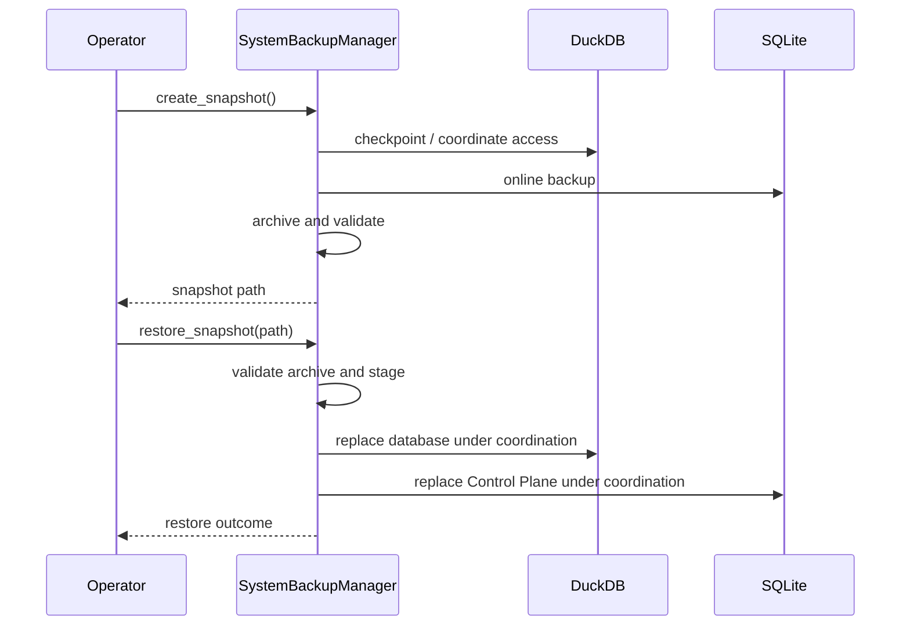

# Backup And Restore

I document this subsystem as a contract with explicit authority, inputs, state transitions and failure behavior. The snippets below come from the current production modules. I do not equate an implemented mechanism with an untested universal guarantee.



## 1. Backup manager dependencies

The implementation for this responsibility lives in `load/backup.py`. The source excerpt below establishes its inputs, mutations, and outputs.

**Implementation:** `src/personal_finance_etl/backend/load/backup.py` (lines 1–56).

```python
import os
import shutil
import sqlite3
import stat
import tempfile
import uuid
import zipfile
from datetime import datetime

import duckdb
from filelock import FileLock, Timeout

from personal_finance_etl.backend.utils.helpers import get_temp_dir
from personal_finance_etl.backend.utils.logger import logger


class SystemBackupManager:
    """Coordinate SQLite Control Plane and DuckDB state as one recovery unit."""

    def __init__(
        self,
        base_path: str,
        sqlite_db_name: str = "Raw_Documents.sqlite",
        duckdb_name: str = "Personal_Finance_DB.duckdb",
    ):
        self.base_path = base_path
        self.sqlite_path = os.path.join(base_path, sqlite_db_name)
        self.duckdb_path = os.path.join(base_path, duckdb_name)
        self.backup_dir = os.path.join(base_path, "backups")
        os.makedirs(self.backup_dir, exist_ok=True)

    @staticmethod
    def _checkpoint_duckdb(db_path: str) -> None:
        """Flush committed DuckDB state before a filesystem-level snapshot."""

        connection = duckdb.connect(db_path)
        try:
            connection.execute("CHECKPOINT")
        finally:
            connection.close()

    @staticmethod
    def _validate_sqlite(db_path: str) -> None:
        connection = sqlite3.connect(f"file:{db_path}?mode=ro", uri=True)
        try:
            result = connection.execute("PRAGMA integrity_check").fetchone()
            if not result or result[0] != "ok":
                raise ValueError(f"Snapshot SQLite integrity check failed: {result!r}")
        finally:
            connection.close()

    @classmethod
    def _validate_duckdb(cls, db_path: str) -> None:
        """Open and checkpoint an extracted copy before production files are touched."""
        cls._checkpoint_duckdb(db_path)

```

## 2. Coordinated snapshot entry point

The implementation for this responsibility lives in `load/backup.py`. The source excerpt below establishes its inputs, mutations, and outputs.

**Implementation:** `src/personal_finance_etl/backend/load/backup.py` (lines 57–92).

```python
    def create_snapshot(self) -> str | None:
        """Create an atomic archive of a checkpointed, coordinated database pair."""
        missing = [
            os.path.basename(path)
            for path in (self.sqlite_path, self.duckdb_path)
            if not os.path.isfile(path)
        ]
        if missing:
            logger.error(
                "Cannot create coordinated snapshot. Missing required database(s): "
                + ", ".join(missing)
            )
            return None

        lock_path = os.path.join(self.base_path, "pipeline.lock")
        temp_sqlite: str | None = None
        temp_zip: str | None = None
        try:
            with FileLock(lock_path, timeout=0):
                # Recheck after taking the production lock to avoid a check/use race.
                missing = [
                    os.path.basename(path)
                    for path in (self.sqlite_path, self.duckdb_path)
                    if not os.path.isfile(path)
                ]
                if missing:
                    raise FileNotFoundError(
                        "Cannot create coordinated snapshot. Missing required database(s): "
                        + ", ".join(missing)
                    )

                ts = datetime.now().strftime("%Y%m%d_%H%M%S_%f")
                zip_filename = f"pf_etl_snapshot_{ts}.zip"
                zip_path = os.path.join(self.backup_dir, zip_filename)
                temp_zip = os.path.join(self.backup_dir, f".{zip_filename}.{uuid.uuid4().hex}.tmp")

```

## 3. SQLite online backup and DuckDB checkpoint

The implementation for this responsibility lives in `load/backup.py`. The source excerpt below establishes its inputs, mutations, and outputs.

**Implementation:** `src/personal_finance_etl/backend/load/backup.py` (lines 92–144).

```python

                # A database file copy is only a sound boundary after DuckDB has
                # checkpointed its committed WAL state. If checkpoint fails, fail closed.
                self._checkpoint_duckdb(self.duckdb_path)

                temp_dir = get_temp_dir()
                os.makedirs(temp_dir, exist_ok=True)
                temp_sqlite = os.path.join(
                    temp_dir, f"snapshot_sqlite_{ts}_{uuid.uuid4().hex}.sqlite"
                )
                source = sqlite3.connect(self.sqlite_path, timeout=5)
                destination = sqlite3.connect(temp_sqlite, timeout=5)
                try:
                    source.backup(destination)
                    destination.commit()
                finally:
                    destination.close()
                    source.close()

                with zipfile.ZipFile(temp_zip, "w", zipfile.ZIP_DEFLATED) as archive:
                    archive.write(temp_sqlite, os.path.basename(self.sqlite_path))
                    archive.write(self.duckdb_path, os.path.basename(self.duckdb_path))

                    # A WAL should normally be consumed by CHECKPOINT. If DuckDB
                    # leaves one, preserve it with its matching database file.
                    duckdb_wal = self.duckdb_path + ".wal"
                    if os.path.isfile(duckdb_wal):
                        archive.write(duckdb_wal, os.path.basename(duckdb_wal))

                with zipfile.ZipFile(temp_zip, "r") as archive:
                    bad_member = archive.testzip()
                    if bad_member is not None:
                        raise ValueError(f"Snapshot archive verification failed: {bad_member}")

                # Publish only a complete, CRC-verified archive.
                os.replace(temp_zip, zip_path)
                temp_zip = None
                logger.info(f"Coordinated snapshot created at {zip_path}")
                return zip_path
        except Timeout:
            logger.error("Cannot create snapshot: Pipeline is currently running.")
            return None
        finally:
            for path in (temp_sqlite, temp_zip):
                if path and os.path.exists(path):
                    try:
                        os.remove(path)
                    except OSError as cleanup_error:
                        logger.warning(
                            f"Could not remove temporary snapshot file {path}: {cleanup_error}"
                        )

    def restore_snapshot(self, zip_path: str) -> None:
```

## 4. Archive validation

The implementation for this responsibility lives in `load/backup.py`. The source excerpt below establishes its inputs, mutations, and outputs.

**Implementation:** `src/personal_finance_etl/backend/load/backup.py` (lines 144–180).

```python
    def restore_snapshot(self, zip_path: str) -> None:
        """Restore the pair atomically, rolling back to the complete prior pair on failure."""
        if not os.path.isfile(zip_path):
            raise FileNotFoundError(f"Backup file not found: {zip_path}")

        lock_path = os.path.join(self.base_path, "pipeline.lock")
        temp_root = get_temp_dir()
        os.makedirs(temp_root, exist_ok=True)
        temp_extract_dir = tempfile.mkdtemp(prefix="snapshot_restore_", dir=temp_root)

        try:
            with FileLock(lock_path, timeout=0):
                required_names = {
                    os.path.basename(self.sqlite_path),
                    os.path.basename(self.duckdb_path),
                }
                duckdb_wal_name = os.path.basename(self.duckdb_path) + ".wal"
                allowed_names = required_names | {duckdb_wal_name}

                with zipfile.ZipFile(zip_path, "r") as archive:
                    members = [item for item in archive.infolist() if not item.is_dir()]
                    names = [item.filename.replace("\\", "/") for item in members]
                    member_names = set(names)

                    if len(names) != len(member_names):
                        raise ValueError("Invalid coordinated snapshot: duplicate archive members.")

                    invalid_paths = {
                        name
                        for name in names
                        if name.startswith("/")
                        or "/" in name
                        or "\\" in name
                        or name in {"", ".", ".."}
                    }
                    if invalid_paths:
                        raise ValueError(
```

## 5. Restore staging and file safety

The implementation for this responsibility lives in `load/backup.py`. The source excerpt below establishes its inputs, mutations, and outputs.

**Implementation:** `src/personal_finance_etl/backend/load/backup.py` (lines 180–240).

```python
                        raise ValueError(
                            "Invalid coordinated snapshot path(s): "
                            + ", ".join(sorted(invalid_paths))
                        )

                    symlinks = [
                        item.filename for item in members if stat.S_ISLNK(item.external_attr >> 16)
                    ]
                    if symlinks:
                        raise ValueError(
                            "Invalid coordinated snapshot: symbolic links are not allowed."
                        )

                    missing = required_names - member_names
                    if missing:
                        raise ValueError(
                            "Invalid coordinated snapshot. Missing required database(s): "
                            + ", ".join(sorted(missing))
                        )

                    unexpected = member_names - allowed_names
                    if unexpected:
                        raise ValueError(
                            "Invalid coordinated snapshot. Unexpected file(s): "
                            + ", ".join(sorted(unexpected))
                        )

                    bad_member = archive.testzip()
                    if bad_member is not None:
                        raise ValueError(f"Snapshot archive is corrupt: {bad_member}")

                    archive.extractall(temp_extract_dir)

                extracted_sqlite = os.path.join(
                    temp_extract_dir, os.path.basename(self.sqlite_path)
                )
                extracted_duckdb = os.path.join(
                    temp_extract_dir, os.path.basename(self.duckdb_path)
                )

                # Validate the extracted pair before moving any production file.
                self._validate_sqlite(extracted_sqlite)
                self._validate_duckdb(extracted_duckdb)

                restore_names = [
                    os.path.basename(self.sqlite_path),
                    os.path.basename(self.duckdb_path),
                ]
                extracted_wal = os.path.join(temp_extract_dir, duckdb_wal_name)
                if os.path.isfile(extracted_wal):
                    restore_names.append(duckdb_wal_name)

                active_paths = [
                    self.sqlite_path,
                    self.sqlite_path + "-wal",
                    self.sqlite_path + "-shm",
                    self.duckdb_path,
                    self.duckdb_path + ".wal",
                ]
                backed_up_files: list[tuple[str, str]] = []
                installed_paths: list[str] = []
```

## 6. Restore replacement and rollback

The implementation for this responsibility lives in `load/backup.py`. The source excerpt below establishes its inputs, mutations, and outputs.

**Implementation:** `src/personal_finance_etl/backend/load/backup.py` (lines 240–297).

```python
                installed_paths: list[str] = []

                try:
                    # Preserve every member of the old recovery unit first.
                    for original_path in active_paths:
                        if not os.path.exists(original_path):
                            continue
                        backup_path = original_path + ".restore_bak"
                        if os.path.exists(backup_path):
                            os.remove(backup_path)
                        os.replace(original_path, backup_path)
                        backed_up_files.append((original_path, backup_path))

                    # Install the already validated new pair.
                    for name in restore_names:
                        src = os.path.join(temp_extract_dir, name)
                        dst = os.path.join(self.base_path, name)
                        shutil.move(src, dst)
                        installed_paths.append(dst)
                except Exception:
                    # Remove only files actually installed by this attempt. Never
                    # delete an untouched old database if preserving it failed.
                    for installed_path in reversed(installed_paths):
                        if os.path.exists(installed_path):
                            os.remove(installed_path)

                    for original_path, backup_path in reversed(backed_up_files):
                        if os.path.exists(backup_path):
                            if os.path.exists(original_path):
                                os.remove(original_path)
                            os.replace(backup_path, original_path)
                    raise

                # Installation is complete. Backup cleanup is non-transactional:
                # a cleanup failure must not trigger a rollback after some backups
                # have already been deleted.
                for _, backup_path in backed_up_files:
                    try:
                        if os.path.exists(backup_path):
                            os.remove(backup_path)
                    except OSError as cleanup_error:
                        logger.warning(
                            f"Restored successfully but could not remove recovery file "
                            f"{backup_path}: {cleanup_error}"
                        )

                logger.info(f"Coordinated snapshot restored from {zip_path} to {self.base_path}")
        except Timeout as err:
            logger.error("Cannot restore snapshot: Pipeline is currently running.")
            raise RuntimeError("Cannot restore snapshot: Pipeline is currently running.") from err
        except PermissionError as pe:
            raise PermissionError(
                "Cannot restore snapshot: A database or backup file is currently in use. "
                "Close active dashboards or database tools and try again."
            ) from pe
        finally:
            if os.path.exists(temp_extract_dir):
                shutil.rmtree(temp_extract_dir, ignore_errors=True)
```

## 7. SQLite transaction boundaries

The implementation for this responsibility lives in `load/control_plane/connection.py`. The source excerpt below establishes its inputs, mutations, and outputs.

**Implementation:** `src/personal_finance_etl/backend/load/control_plane/connection.py` (lines 247–260).

```python
    def begin_transaction(self) -> None:
        if self.conn.in_transaction:
            raise RuntimeError("A SQLite transaction is already active.")
        self.conn.execute("BEGIN IMMEDIATE;")
        logger.debug("[DATABASE:SQLITE] BEGIN IMMEDIATE")

    def commit(self) -> None:
        self.conn.commit()
        logger.info("Control Plane transaction committed.")

    def rollback(self) -> None:
        if self._conn is None or not self._conn.in_transaction:
            return
        try:
```

## 8. Pipeline lock and application coordination

The implementation for this responsibility lives in `pipeline/etl_pipeline.py`. The source excerpt below establishes its inputs, mutations, and outputs.

**Implementation:** `src/personal_finance_etl/backend/pipeline/etl_pipeline.py` (lines 248–289).

```python
    def run(self) -> None:
        self.cfg.validate_config()

        validate_registry()

        start_time = time.perf_counter()

        run_id = None
        cp = None
        log_file_path = self.db_manager.db_path.replace(".duckdb", ".log")

        try:
            add_queue_handler(cast("multiprocessing.Queue[Any]", self.status_queue))
            add_file_handler(log_file_path)

            logger.debug("=== ETL CONFIGURATION DUMP ===")
            if hasattr(self.cfg, "model_dump_json"):
                logger.debug(self.cfg.model_dump_json(indent=2))
            else:
                logger.debug(str(self.cfg))

            logger.debug("=== FINANCIAL RULES DUMP ===")
            if self.rules is not None and hasattr(self.rules, "model_dump_json"):
                logger.debug(self.rules.model_dump_json(indent=2))
            else:
                logger.debug(str(self.rules))
            logger.debug("==============================")

            logger.info("Initializing Quantitative Master Engine...")
            self.status_queue.put(EngineStatus(msg="", data=None, progress=0.0))

            logger.info(f"Target Database: {self.cfg.TARGET_DB_BASE_PATH}")
            logger.info(f"Source Extractor Folder: {self.cfg.STATEMENTS_FOLDER}")

            self.db_manager.open()
            self.db_manager.ensure_schemas()

            cp = ControlPlane(self.cfg.TARGET_DB_BASE_PATH, self.cfg.RAW_DOCUMENT_STORE_NAME)
            cp.open()
            cp.ensure_schema()

            # 1. Authoritative SQLite State
```

## Related specifications

- [System architecture](system-architecture.md)
- [Reliability and recovery](reliability-and-recovery.md)
- [Data lifecycle](data-lifecycle.md)

