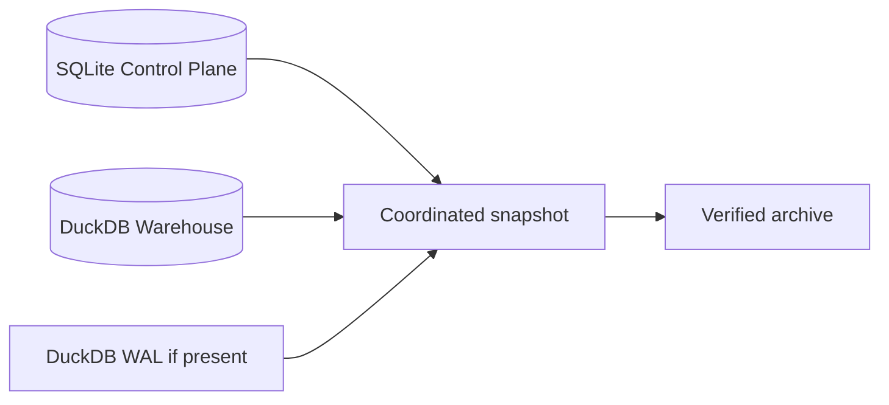
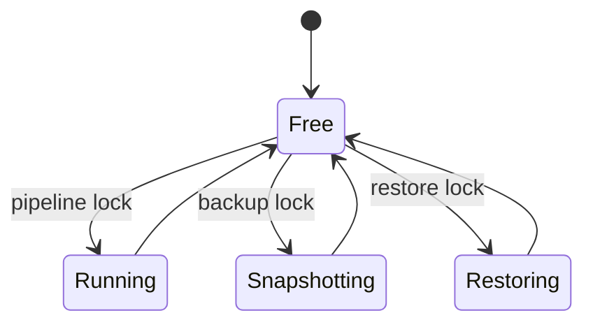
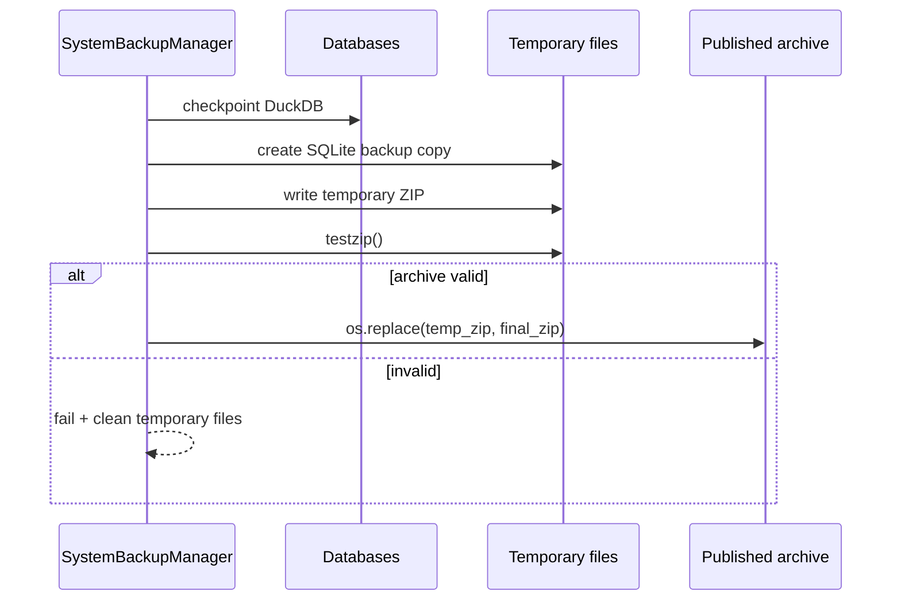
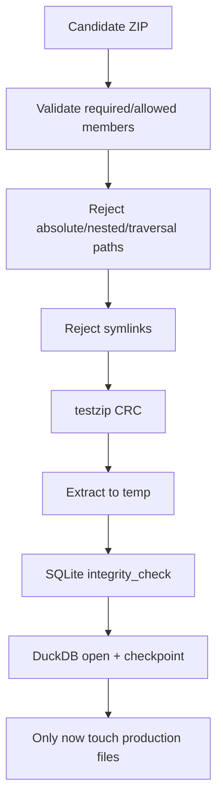
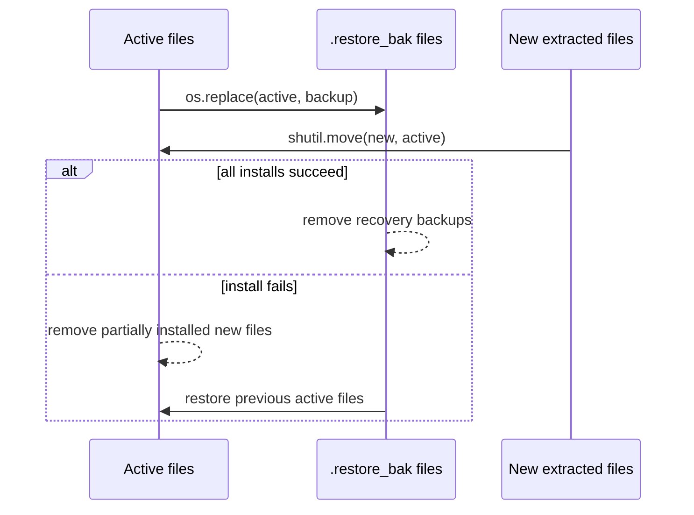

# Backup and Restore

Replay and restore solve different problems.

Replay asks the current authoritative evidence to rebuild financial state. Restore asks the system to replace its active persistence pair with a previously captured pair.

That distinction matters because the application has **two databases with different authority roles**. A valid recovery snapshot therefore has to treat SQLite and DuckDB as one operational unit even though they remain two files.

## The recovery unit is a pair, not a file

The active persistence unit contains:

```text
SQLite Control Plane
+ DuckDB analytical warehouse
+ optional DuckDB WAL sidecar
```

A snapshot of only one side can still be useful for specialized recovery, but it is not the coordinated application snapshot defined here.



The reason is semantic, not cosmetic.

SQLite explains the history and evidence behind the current analytical state. DuckDB contains the current analytical state itself. Restoring one without the other can create a valid file pair but an incoherent application history.

## Snapshot and restore share the pipeline lock

The first safety rule is exclusion.

`SystemBackupManager` uses the same `pipeline.lock` as the production Control Plane.

That prevents three dangerous races:

- snapshot while a pipeline transaction is mutating the databases;
- restore while a pipeline is reading/writing them;
- pipeline start while restore is replacing the active files.



The manager uses a zero-timeout lock. If the pipeline owns the lock, snapshot/restore fails rather than waiting indefinitely behind a long-running operation.

## Snapshot prerequisites are checked twice

`create_snapshot()` verifies that both required database files exist before acquiring the lock and again after the lock is acquired.

That second check closes a time-of-check/time-of-use gap where a file could disappear between initial validation and exclusive ownership.

The required files are:

- configured SQLite Control Plane database;
- configured DuckDB warehouse database.

If either is missing, no partial coordinated snapshot is published.

## DuckDB is checkpointed before capture

The manager opens DuckDB and executes `CHECKPOINT` before archiving the database file.

```python
# src/personal_finance_etl/infrastructure/recovery/backup.py
@staticmethod
def _checkpoint_duckdb(db_path: str) -> None:
    connection = duckdb.connect(db_path)
    try:
        connection.execute("CHECKPOINT")
    finally:
        connection.close()
```

The purpose is to flush committed state into a clean filesystem representation before capture.

If a DuckDB WAL remains present, the snapshot may include it as well.

## SQLite uses the backup API instead of raw copying

The manager does not simply copy the live SQLite database file.

It opens source and temporary destination connections and uses SQLite's `backup()` API:

```python
source = sqlite3.connect(self.sqlite_path, timeout=5)
destination = sqlite3.connect(temp_sqlite, timeout=5)
try:
    source.backup(destination)
    destination.commit()
finally:
    destination.close()
    source.close()
```

This produces a coherent SQLite copy even when ordinary sidecar mechanics would make a raw filesystem copy unsafe.

## Snapshot publication is staged

The archive is first written to a hidden temporary filename in the backup directory.

Only after construction and CRC verification succeeds does the manager publish it with `os.replace()`.



This prevents an interrupted archive build from leaving a final-looking snapshot filename that is actually incomplete.

## Archive naming is operational, not identity semantics

Published snapshots use a timestamped name such as:

```text
pf_etl_snapshot_YYYYMMDD_HHMMSS_microseconds.zip
```

The filename answers **when the archive was created**, not **what economic state it contains**.

The archive is validated by structure and database integrity, not trusted because of its name.

## CRC validation happens before publication

After writing the temporary archive, the manager reopens it and calls `testzip()`.

If any member fails ZIP CRC validation, snapshot publication fails.

This catches archive corruption at creation time rather than deferring the discovery until an emergency restore.

CRC is not a cryptographic authenticity guarantee, but it is an appropriate transport-integrity check for the local snapshot artifact.

## Snapshot results are typed

The backup manager does not return only a path or raise every failure.

`SnapshotResult` carries a categorical outcome plus optional path/error metadata.

```python
# src/personal_finance_etl/contracts/recovery.py
class SnapshotOutcome(StrEnum):
    SNAPSHOT_STARTED = "SNAPSHOT_STARTED"
    SNAPSHOT_VALIDATED = "SNAPSHOT_VALIDATED"
    SNAPSHOT_PUBLISHED = "SNAPSHOT_PUBLISHED"
    SNAPSHOT_FAILED = "SNAPSHOT_FAILED"

@dataclass
class SnapshotResult:
    outcome: SnapshotOutcome
    zip_path: str | None = None
    error_message: str | None = None
```

That typed boundary lets CLI/Desktop/application code communicate recovery outcomes without parsing log messages.

## Restore distrusts the archive before touching production

The restore path is intentionally defensive.

Validation occurs in a temporary extraction directory while the active database pair remains untouched.

The archive must satisfy all of the following before installation begins:

1. required SQLite member exists;
2. required DuckDB member exists;
3. optional DuckDB WAL is the only additional permitted file;
4. member names are unique;
5. members are flat names, not absolute/nested traversal paths;
6. symbolic links are forbidden;
7. ZIP CRC verification passes;
8. extracted SQLite passes `PRAGMA integrity_check`;
9. extracted DuckDB can be opened/checkpointed successfully.



This ordering is one of the strongest safety properties of the restore design.

## Archive path validation prevents extraction tricks

The validator rejects members that:

- start with `/`;
- contain `/` or `\` path separators;
- are empty or `.` / `..`;
- are symbolic links.

The snapshot format intentionally needs only flat database filenames.

That makes the allowed archive surface very small and lets restore reject unexpected structure rather than attempting to sanitize a general-purpose ZIP layout.

## Unexpected files fail validation

The allow-list is:

```text
SQLite database
DuckDB database
optional DuckDB .wal
```

Anything else causes restore validation to fail.

This is preferable to “ignore unknown files,” because an archive with unexpected contents may indicate corruption, operator confusion, or a format the current restore logic does not understand.

Fail closed is safer than inventing compatibility during recovery.

## Extracted SQLite is validated read-only

The manager opens the extracted SQLite copy using a read-only URI and runs:

```sql
PRAGMA integrity_check
```

Only the exact result `ok` is accepted.

This catches structural corruption before the active Control Plane is moved aside.

## Extracted DuckDB is validated independently

The extracted DuckDB copy is opened and checkpointed.

That confirms the file is structurally usable by DuckDB before production installation starts.

Again, the restore process validates the **candidate pair** before mutating the **active pair**.

## Installation uses rename-style staging

Once validation passes, restore moves every active database-related file to a `.restore_bak` name before installing the extracted replacements.

The active set includes:

```text
SQLite database
SQLite -wal
SQLite -shm
DuckDB database
DuckDB .wal
```

The extracted replacement set includes required database files plus DuckDB WAL if the snapshot contained one.



This gives the installer a concrete rollback path without deleting the previous pair first.

## Restore rollback has its own success state

Installation can fail after some active files have been moved or some new files installed.

The manager therefore tracks:

- `backed_up_files`;
- `installed_paths`;
- whether rollback succeeded.

If installation fails but rollback succeeds, the result is not generic failure. It is:

```text
RESTORE_INSTALL_FAILED_ROLLED_BACK
active_database_state = PREVIOUS_PAIR_INTACT
```

That distinction tells the operator that the restore did not happen, but the previous production pair is still known-good.

## Restore can truthfully admit uncertainty

The worst case is:

1. installation fails;
2. rollback also fails.

The code does not downgrade that to a normal restore failure.

It returns:

```text
RESTORE_STATE_UNCERTAIN
active_database_state = INSPECTION_REQUIRED
```

That state is operationally important because automated retries could make the situation worse.

The correct next action is inspection, not optimism.

## Restore outcomes encode both operation and active state

`RestoreResult` combines categorical outcome with `ActiveDatabaseState`.

```python
class ActiveDatabaseState(StrEnum):
    PREVIOUS_PAIR_INTACT = "PREVIOUS_PAIR_INTACT"
    NEW_PAIR_INSTALLED = "NEW_PAIR_INSTALLED"
    INSPECTION_REQUIRED = "INSPECTION_REQUIRED"
```

This avoids a common ambiguity where a function returns `False` but does not tell the caller whether the previous system is safe to keep using.

The active-state dimension answers that explicitly.

## A successful restore means a new coordinated pair is active

`RestoreResult.is_success` is true only when:

- outcome is `RESTORE_SUCCEEDED`; and
- active database state is `NEW_PAIR_INSTALLED`.

That is stronger than checking whether the restore function reached the end without raising.

The result contract therefore encodes the semantic success condition.

## The façade preserves detailed and simple APIs

`PersonalFinanceEngine` exposes both convenience and detailed recovery calls.

The detailed methods return `SnapshotResult` / `RestoreResult`.

The simple methods return path/bool behavior for presentation surfaces that do not need the full outcome model.

This keeps typed recovery semantics available without forcing every caller to render the same level of detail.

## Permission failures are translated for operator action

Restore can fail because a database or backup file is in use by another local program.

The manager translates `PermissionError` into a human-actionable message instructing the operator to close dashboards or database tools.

That is a product-level reliability detail: a correct recovery system should help distinguish a locked file from a corrupt archive.

## Temporary extraction never becomes production state by accident

Archive extraction happens under the configured temp directory with a unique `snapshot_restore_...` folder.

The directory is removed in `finally` regardless of validation/install outcome.

Likewise, temporary snapshot files are removed if creation fails.

This prevents failed recovery operations from accumulating ambiguous candidate files near production databases.

## Snapshot is not a substitute for the run transaction

A snapshot captures already-persisted application state.

It does not make an active pipeline transaction more atomic.

The pipeline lock prevents overlap, so a snapshot should never represent a half-running financial transaction.

This distinction is important:

```text
run transaction → controls one execution's persistence
snapshot        → captures a stable persisted recovery point
```

They solve different temporal problems.

## Snapshot versus deterministic replay

| Recovery strategy | Best fit | Requires historical archive? | Preserves run history as captured? | Recomputes financial state? |
|---|---|---:|---:|---:|
| rollback open transaction | current failure before commit | no | current operational record | no |
| replay / convergence | split commit or derived-state repair | no | yes, including divergence/convergence | yes |
| full analytical rebuild | suspect Silver/Gold | no | yes | yes |
| coordinated snapshot restore | return both stores to captured past state | yes | restores captured history | no, unless run again later |

No one mechanism dominates the others.

The architecture chooses based on which truth needs to be recovered.

## Failure matrix

| Failure point | Production pair touched? | Expected result |
|---|---:|---|
| required database missing before snapshot | no | `SNAPSHOT_FAILED` |
| pipeline lock held during snapshot | no | `SNAPSHOT_FAILED` |
| archive CRC failure during snapshot | no published snapshot | `SNAPSHOT_FAILED` |
| restore ZIP missing | no | validation failure, previous pair intact |
| unexpected archive member | no | validation failure, previous pair intact |
| path traversal/symlink member | no | validation failure, previous pair intact |
| extracted SQLite integrity failure | no | validation failure, previous pair intact |
| extracted DuckDB validation failure | no | validation failure, previous pair intact |
| install fails, rollback succeeds | temporarily, then restored | previous pair intact |
| install fails, rollback fails | yes | inspection required |
| install succeeds | yes | new pair installed |

The table is deliberately explicit because recovery software should be understood in terms of **what state remains active after each failure**.

## Operational guarantees

The coordinated manager is designed to guarantee that:

1. snapshot/restore does not race the production pipeline;
2. a snapshot is not published until archive CRC validation passes;
3. SQLite is copied through its backup API;
4. DuckDB is checkpointed before snapshot capture;
5. restore validates candidate files before moving active files;
6. only expected flat archive members are accepted;
7. rollback attempts restore the prior pair if installation fails;
8. typed outcomes identify whether previous/new/uncertain state is active;
9. temporary working files are cleaned on exit paths.

## Explicit non-guarantees

The manager does not guarantee:

- cryptographic authenticity of a ZIP from an untrusted party;
- remote/off-site backup durability;
- protection from disk-wide hardware loss if backups live on the same disk;
- successful rollback after arbitrary filesystem failure;
- that restored historical financial state is the state the operator *should* use;
- compatibility with unknown future archive formats;
- that manual copying of the two database files is equivalent to a coordinated snapshot.

Those limits should inform any future backup strategy beyond local recovery.

## The threat model is intentionally local and strict

The snapshot feature is designed for a local application where the primary threats are:

- interrupted copy;
- database sidecar inconsistency;
- accidental partial restore;
- malformed or wrong snapshot archive;
- active file locks;
- operator mistakes;
- filesystem installation failure.

It is not pretending to be a cloud backup service, ransomware vault, or signed archival system.

That scope keeps the implementation understandable and the guarantees defensible.

## Continue into the financial model

Recovery has now established how persisted state can be captured and restored. The next question is what that state actually **means** at the financial grain level.

Continue with [Data Model](data-model.md).

## Related specifications

- [Architecture](README.md)
- [Reliability and Recovery](reliability-and-recovery.md)
- [Control Plane Artifact Lifecycle](control-plane-artifact-lifecycle.md)
- [Warehouse Architecture](warehouse-architecture.md)
- [Data Model](data-model.md)
