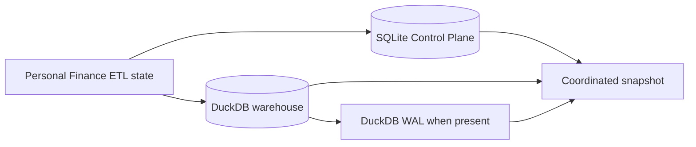
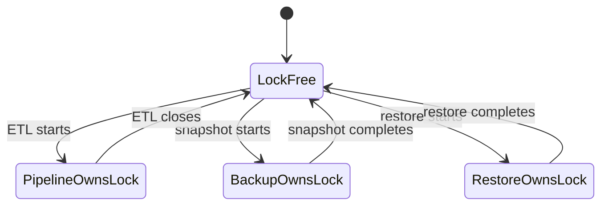
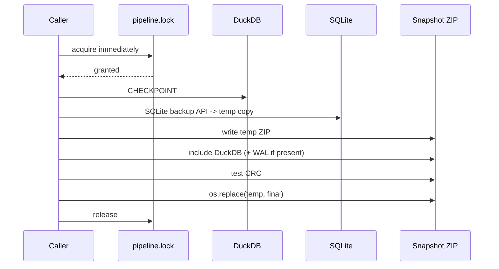
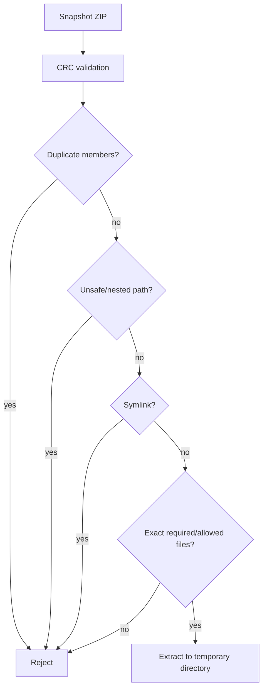
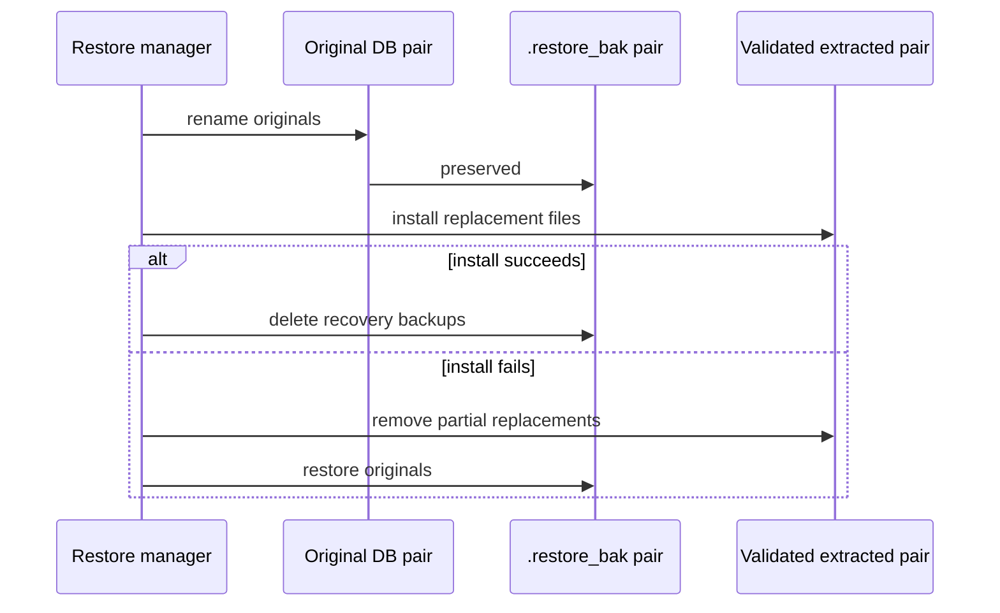
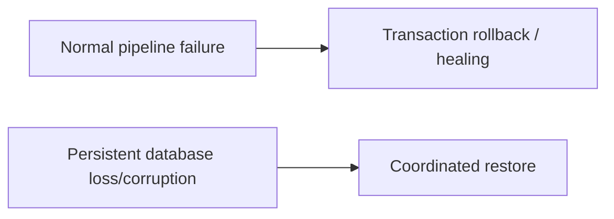

# Backup and Restore

Personal Finance ETL persists operational history in SQLite and analytical state in DuckDB. A useful backup therefore has to treat the two databases as a **coordinated application state pair**, not as unrelated files copied whenever the operating system happens to look away.

`SystemBackupManager` implements that recovery boundary with pipeline locking, DuckDB checkpointing, SQLite's backup API, archive validation, temporary staging, atomic publication, and rollback-aware restoration.

## Source authority

Primary implementation:

- `backend/load/backup.py`
- `backend/load/control_plane/orchestrator.py`
- `backend/load/control_plane/connection.py`
- `backend/load/database.py`
- `backend/api/engine.py`

## Recovery unit



The snapshot is meaningful because it captures the databases together under the same application-level lock.

## Pipeline exclusion

Backup and restore acquire `pipeline.lock` with immediate timeout. If the production pipeline owns the lock, the operation refuses to proceed.

This avoids snapshots being assembled while the pipeline is mutating one or both databases.



## Snapshot prerequisites

`create_snapshot()` verifies that both required database files exist before doing work. Missing SQLite or DuckDB state aborts the operation.

A partial "backup" containing only whichever database happened to exist would be operationally convenient and architecturally useless.

## DuckDB checkpoint

Before filesystem-level capture, DuckDB is explicitly checkpointed:

```python
@staticmethod
def _checkpoint_duckdb(db_path: str) -> None:
    conn = duckdb.connect(db_path)
    try:
        conn.execute("CHECKPOINT")
    finally:
        conn.close()
```

The checkpoint flushes committed DuckDB state toward the main database file before snapshot assembly.

If a WAL still exists afterward, the snapshot includes it.

## SQLite backup API

SQLite is not copied as a live database file. The implementation opens source and destination SQLite connections and uses SQLite's backup mechanism:

```python
source = sqlite3.connect(sqlite_path)
destination = sqlite3.connect(sqlite_temp)
try:
    source.backup(destination)
finally:
    destination.close()
    source.close()
```

This creates a consistent SQLite copy even though SQLite may use WAL internally.

## Snapshot construction

The snapshot lifecycle is:



The archive is first written under a temporary filename. Only after integrity testing succeeds is it atomically published with `os.replace()`.

That avoids advertising a half-written archive as a valid recovery point.

## Snapshot naming

Snapshots use a timestamped filename:

```text
pf_etl_snapshot_<timestamp>.zip
```

Temporary files include a UUID component to avoid collisions during construction.

## Archive integrity

Before publication, the generated ZIP is opened and checked with `testzip()`. A CRC failure prevents the temporary archive from becoming the final snapshot.

This verifies ZIP member integrity, not the semantic correctness of every financial row. Different layer, different promise.

## Restore threat model

Restore treats a ZIP archive as untrusted input until validated.

The implementation rejects:

- duplicate archive members;
- path traversal;
- nested/unexpected paths;
- symbolic links;
- missing required databases;
- unexpected files;
- CRC corruption.



Restore does not call `extractall()` and hope filenames are friendly. Financial recovery is a poor place for optimism-driven path handling.

## Database validation

After extraction and before installation, both databases are opened/validated using engine-specific checks.

SQLite validation ensures the extracted Control Plane is a usable SQLite database. DuckDB validation opens/checks the analytical database using DuckDB.

The new pair must prove basic structural viability before the existing pair is displaced.

## Staged replacement

The current databases are renamed to `.restore_bak` recovery files before the validated replacement files are installed.



The old state remains recoverable during the dangerous replacement window.

## Restore rollback

If installation fails after originals have been moved aside, the restore path:

1. removes any partially installed replacement files;
2. walks backed-up originals in reverse order;
3. moves `.restore_bak` files back to their original locations;
4. re-raises the failure.

Cleanup after a successful installation is deliberately separated from the rollback-sensitive section so a cleanup error does not accidentally trigger restoration after a valid new pair has already been installed.

That is a subtle but important failure-boundary design.

## DuckDB WAL restoration

If the snapshot contains the DuckDB WAL, it participates in the replacement set. If not, restoration does not invent one.

The snapshot therefore preserves the post-checkpoint physical state that actually existed at capture time.

## Temporary extraction

Restore extracts into a temporary directory under the target root. Production files are not modified until archive and database validation succeed.

This gives the process three states:

```text
untrusted archive
    -> validated staged databases
    -> installed production pair
```

rather than mixing validation and production mutation.

## Snapshot versus run transaction

Snapshots are not a substitute for normal transaction recovery.



Transactions protect a run. Snapshots protect persisted application state across larger failures.

## Operational guarantees

The implementation provides the following recovery properties:

1. Snapshot and restore are excluded from a concurrently running production pipeline.
2. DuckDB is checkpointed before capture.
3. SQLite is captured through its backup API.
4. A DuckDB WAL is included when still present.
5. The ZIP is integrity-tested before final publication.
6. Final snapshot publication uses atomic filesystem replacement.
7. Restore validates archive membership and paths before extraction.
8. Extracted databases are validated before installation.
9. Existing databases are preserved as temporary recovery backups during replacement.
10. Failed installation attempts restore the prior pair when possible.

## Non-guarantees

The implementation does not claim:

- distributed transactional snapshots across database engines;
- protection from storage hardware failure when snapshots live on the same failed device;
- cryptographic archive authentication;
- encrypted backup contents;
- compatibility with arbitrary future schema/application versions;
- that a successful CRC check proves financial correctness;
- that restoring a snapshot reproduces external source files outside the snapshot.

A coordinated local snapshot is a recovery mechanism, not a time machine with an audit opinion.

## Failure matrix

| Stage | Failure behavior |
|---|---|
| Pipeline lock unavailable | Snapshot/restore refuses operation |
| Required source DB missing | Snapshot aborts |
| DuckDB checkpoint fails | Snapshot aborts |
| SQLite backup fails | Snapshot aborts and cleans temporary state |
| ZIP CRC fails | Temporary archive is not published |
| Restore archive has unsafe member | Restore rejects before production mutation |
| Extracted DB invalid | Restore rejects before replacement |
| Replacement fails mid-install | Partial replacements removed; originals restored |
| Post-success backup cleanup fails | Logged without rolling back a successful install |

## API boundary

The application API exposes snapshot/restore operations through `PersonalFinanceEngine`, keeping frontend code away from filesystem/database recovery internals.

The CLI and desktop application therefore request a recovery operation rather than implementing one independently.

## Related specifications

- [Reliability and Recovery](reliability-and-recovery.md)
- [Warehouse Architecture](warehouse-architecture.md)
- [Control Plane Artifact Lifecycle](control-plane-artifact-lifecycle.md)
- [System Architecture](system-architecture.md)
- [CLI and Desktop](../getting-started/cli-and-desktop.md)
