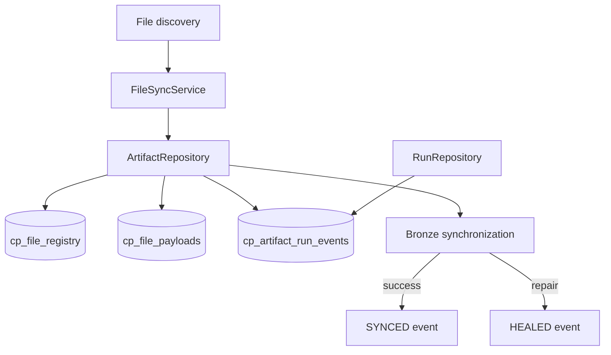

# Control Plane Artifact Lifecycle

I document this subsystem as a contract with explicit authority, inputs, state transitions and failure behavior. The snippets below come from the current production modules. I do not equate an implemented mechanism with an untested universal guarantee.



## 1. Artifact registry versus event history

The implementation for this responsibility lives in `load/schema/control_plane.py`. The source excerpt below establishes its inputs, mutations, and outputs.

**Implementation:** `src/personal_finance_etl/backend/load/schema/control_plane.py` (lines 1–76).

```python
RAW_DDL = """
PRAGMA foreign_keys = ON;

CREATE TABLE IF NOT EXISTS cp_file_registry (
    file_id TEXT PRIMARY KEY,
    file_name TEXT NOT NULL,
    relative_path TEXT NOT NULL UNIQUE,
    file_category TEXT NOT NULL,
    file_type TEXT,
    file_hash TEXT NOT NULL,
    file_size_bytes BIGINT,
    sync_status TEXT DEFAULT 'PENDING_BRONZE',
    first_seen_run_id TEXT,
    first_seen_at TIMESTAMP NOT NULL,
    last_seen_run_id TEXT,
    last_seen_at TIMESTAMP NOT NULL,
    last_changed_run_id TEXT,
    last_changed_at TIMESTAMP,
    last_synced_run_id TEXT,
    last_synced_at TIMESTAMP,
    FOREIGN KEY(first_seen_run_id) REFERENCES cp_runs(run_id),
    FOREIGN KEY(last_seen_run_id) REFERENCES cp_runs(run_id),
    FOREIGN KEY(last_changed_run_id) REFERENCES cp_runs(run_id),
    FOREIGN KEY(last_synced_run_id) REFERENCES cp_runs(run_id)
);

CREATE TABLE IF NOT EXISTS cp_file_payloads (
    file_id TEXT PRIMARY KEY,
    file_bytes BLOB,
    FOREIGN KEY(file_id) REFERENCES cp_file_registry(file_id) ON DELETE CASCADE
);

CREATE TABLE IF NOT EXISTS cp_settings_snapshots (
    snapshot_id TEXT PRIMARY KEY,
    content_hash TEXT NOT NULL,
    canonical_payload TEXT NOT NULL,
    created_at TIMESTAMP NOT NULL
);

CREATE TABLE IF NOT EXISTS cp_rules_snapshots (
    snapshot_id TEXT PRIMARY KEY,
    content_hash TEXT NOT NULL,
    canonical_payload TEXT NOT NULL,
    created_at TIMESTAMP NOT NULL
);

CREATE TABLE IF NOT EXISTS cp_runs (
    run_id TEXT PRIMARY KEY,
    started_at TIMESTAMP NOT NULL,
    finished_at TIMESTAMP,
    status TEXT,
    application_version TEXT,
    schema_version TEXT,
    settings_snapshot_id TEXT,
    rules_snapshot_id TEXT,
    execution_log BLOB,
    FOREIGN KEY(settings_snapshot_id) REFERENCES cp_settings_snapshots(snapshot_id),
    FOREIGN KEY(rules_snapshot_id) REFERENCES cp_rules_snapshots(snapshot_id)
);

CREATE TABLE IF NOT EXISTS cp_run_failures (
    id INTEGER PRIMARY KEY AUTOINCREMENT,
    run_id TEXT NOT NULL,
    failed_isin TEXT,
    stage TEXT,
    error_type TEXT,
    error_message TEXT,
    traceback_log TEXT,
    created_at TIMESTAMP NOT NULL,
    FOREIGN KEY(run_id) REFERENCES cp_runs(run_id)
);

CREATE TABLE IF NOT EXISTS cp_artifact_run_events (
    event_id TEXT PRIMARY KEY,
    run_id TEXT NOT NULL,
    file_id TEXT NOT NULL,
```

## 2. Connection and nested savepoint contract

The implementation for this responsibility lives in `load/control_plane/connection.py`. The source excerpt below establishes its inputs, mutations, and outputs.

**Implementation:** `src/personal_finance_etl/backend/load/control_plane/connection.py` (lines 23–85).

```python
    def conn(self) -> sqlite3.Connection:
        if self._conn is None:
            raise RuntimeError("SQLiteManager connection not opened.")
        return self._conn

    def open(self) -> None:
        if self._conn is not None:
            return
        parent = os.path.dirname(os.path.abspath(self.db_path))
        os.makedirs(parent, exist_ok=True)
        logger.debug("[DATABASE:SQLITE] Opening connection to %s", self.db_path)
        connection: sqlite3.Connection | None = None
        try:
            connection = sqlite3.connect(
                self.db_path,
                timeout=30.0,
                isolation_level=None,
            )
            connection.execute("PRAGMA foreign_keys = ON;")
            connection.execute("PRAGMA busy_timeout = 30000;")
            connection.execute("PRAGMA journal_mode = WAL;")
            connection.execute("PRAGMA synchronous = NORMAL;")
            connection.execute("PRAGMA cache_size = -64000;")
            connection.execute("PRAGMA mmap_size = 2147483648;")
            connection.execute("PRAGMA temp_store = MEMORY;")
            if connection.execute("PRAGMA foreign_keys;").fetchone()[0] != 1:
                raise RuntimeError("SQLite foreign-key enforcement could not be enabled.")
            self._conn = connection
        except Exception:
            if connection is not None:
                connection.close()
            raise
        logger.debug("[DATABASE:SQLITE] Configured WAL, busy timeout, and foreign keys")
        logger.info("Control Plane DB connected at %s", self.db_path)

    def close(self) -> None:
        if self._conn is None:
            return
        try:
            if self._conn.in_transaction:
                logger.warning("[DATABASE:SQLITE] Rolling back open transaction during close.")
                self._conn.rollback()
            self._conn.close()
        finally:
            self._conn = None
        logger.info("Control Plane DB connection closed.")

    @contextmanager
    def atomic(self) -> Generator[None]:
        """Atomic scope that works both standalone and nested in a pipeline transaction."""
        savepoint = f"cp_scope_{uuid.uuid4().hex}"
        self.conn.execute(f"SAVEPOINT {savepoint}")
        try:
            yield
            self.conn.execute(f"RELEASE SAVEPOINT {savepoint}")
        except Exception:
            try:
                self.conn.execute(f"ROLLBACK TO SAVEPOINT {savepoint}")
            finally:
                self.conn.execute(f"RELEASE SAVEPOINT {savepoint}")
            raise

    @property
```

## 3. Event creation and active-run provenance

The implementation for this responsibility lives in `load/control_plane/artifact_repo.py`. The source excerpt below establishes its inputs, mutations, and outputs.

**Implementation:** `src/personal_finance_etl/backend/load/control_plane/artifact_repo.py` (lines 17–60).

```python
class ArtifactRepository:
    """Persistence and lifecycle transitions for source-file artifacts."""

    def __init__(self, db: SQLiteManager):
        self.db = db
        self.active_run_id: str | None = None

    @staticmethod
    def _now() -> str:
        return datetime.now().isoformat(timespec="seconds")

    def _insert_event(
        self,
        *,
        file_id: str,
        event_type: str,
        event_at: str,
        path: str | None,
        content_hash: str | None = None,
        previous_status: str | None = None,
        new_status: str | None = None,
        reason: str | None = None,
    ) -> None:
        if not self.active_run_id:
            return
        self.db.conn.execute(
            """INSERT INTO cp_artifact_run_events
               (event_id, run_id, file_id, event_type, event_at, observed_path,
                content_hash, previous_status, new_status, event_reason)
               VALUES (?, ?, ?, ?, ?, ?, ?, ?, ?, ?)""",
            (
                str(uuid.uuid4()),
                self.active_run_id,
                file_id,
                event_type,
                event_at,
                path,
                content_hash,
                previous_status,
                new_status,
                reason,
            ),
        )

```

## 4. Discovering and synchronizing files

The implementation for this responsibility lives in `load/control_plane/file_sync.py`. The source excerpt below establishes its inputs, mutations, and outputs.

**Implementation:** `src/personal_finance_etl/backend/load/control_plane/file_sync.py` (lines 30–85).

```python
    def sync_with_disk(
        self,
        discovered_files: dict[str, list[str]],
        hash_policy: FileHashPolicy,
        full_replace_categories: list[str],
    ) -> tuple[dict[str, list[str]], dict[str, list[str]], int, list[tuple[str, str, str]]]:
        """Synchronize the scan as one atomic control-plane operation."""
        with self.artifact_repo.db.atomic():
            return self._sync_with_disk(discovered_files, hash_policy, full_replace_categories)

    def _sync_with_disk(
        self,
        discovered_files: dict[str, list[str]],
        hash_policy: FileHashPolicy,
        full_replace_categories: list[str],
    ) -> tuple[dict[str, list[str]], dict[str, list[str]], int, list[tuple[str, str, str]]]:
        registry_with_status = self.artifact_repo.get_registry_with_status()
        registry: dict[str, tuple[str, str]] = {
            path: (digest, category)
            for path, (digest, category, _status) in registry_with_status.items()
        }

        hash_to_paths: dict[str, dict[str, list[str]]] = {}
        for path, (digest, category, status) in registry_with_status.items():
            if status != "REMOVED" and digest:
                hash_to_paths.setdefault(category, {}).setdefault(digest, []).append(path)

        new_files: dict[str, list[str]] = {}
        changed_files: dict[str, list[str]] = {}
        renames: list[tuple[str, str, str]] = []
        renamed_old_paths: set[str] = set()
        all_active_paths: set[str] = set()
        seen_path_categories: dict[str, str] = {}
        unique_input_count = 0
        full_replace = set(full_replace_categories)

        # Canonicalize/deduplicate before any destructive pruning. A path assigned to
        # multiple categories is a contract error and must not silently change identity.
        normalized_by_category: dict[str, list[str]] = {}
        for category, filepaths in discovered_files.items():
            normalized_paths: list[str] = []
            category_seen: set[str] = set()
            for filepath in filepaths:
                path = normalize_path(filepath)
                prior_category = seen_path_categories.get(path)
                if prior_category is not None and prior_category != category:
                    raise ValueError(
                        f"Discovered path {path!r} appears in both {prior_category!r} and {category!r}."
                    )
                seen_path_categories[path] = category
                if path not in category_seen:
                    normalized_paths.append(path)
                    category_seen.add(path)
            normalized_by_category[category] = normalized_paths
            unique_input_count += len(normalized_paths)

```

## 5. File registry upserts and identity migration

The implementation for this responsibility lives in `load/control_plane/artifact_repo.py`. The source excerpt below establishes its inputs, mutations, and outputs.

**Implementation:** `src/personal_finance_etl/backend/load/control_plane/artifact_repo.py` (lines 117–170).

```python
    def migrate_identity(
        self,
        old_rel_path: str,
        new_filepath: str,
        *,
        observed_hash: str | None = None,
        file_size_bytes: int | None = None,
    ) -> bool:
        """Atomically move an artifact's current identity, retaining the old history.

        Returns False if the source has no payload to transfer. The caller should
        ingest the destination as a new artifact rather than claiming a successful rename.
        """
        old_path = normalize_path(old_rel_path)
        new_path = normalize_path(new_filepath)
        if old_path == new_path:
            return True

        row = self.db.conn.execute(
            """SELECT file_id, file_name, file_category, file_type, file_hash,
                      file_size_bytes, first_seen_run_id, first_seen_at,
                      last_seen_run_id, last_seen_at, last_changed_run_id,
                      last_changed_at, last_synced_run_id, last_synced_at, sync_status
               FROM cp_file_registry WHERE relative_path = ?""",
            (old_path,),
        ).fetchone()
        if not row:
            return False

        (
            old_id,
            _old_name,
            category,
            file_type,
            old_hash,
            old_size,
            first_run,
            first_at,
            last_run,
            _,
            changed_run,
            changed_at,
            synced_run,
            synced_at,
            old_status,
        ) = row
        payload_row = self.db.conn.execute(
            "SELECT file_bytes FROM cp_file_payloads WHERE file_id = ?", (old_id,)
        ).fetchone()
        if not payload_row or payload_row[0] is None:
            logger.warning(
                "[SYNC:RENAME] Cannot migrate %s because its payload is missing; "
                "destination will be ingested as new.",
                old_path,
```

## 6. Persisting raw payloads

The implementation for this responsibility lives in `load/control_plane/artifact_repo.py`. The source excerpt below establishes its inputs, mutations, and outputs.

**Implementation:** `src/personal_finance_etl/backend/load/control_plane/artifact_repo.py` (lines 301–361).

```python
    def ingest_binaries(
        self,
        actionable_files: dict[str, list[str]],
        new_files: dict[str, list[str]] | None = None,
        changed_files: dict[str, list[str]] | None = None,
    ) -> None:
        new_paths = {normalize_path(path) for paths in (new_files or {}).values() for path in paths}
        changed_paths = {
            normalize_path(path) for paths in (changed_files or {}).values() for path in paths
        }
        total_count = 0
        for category, filepaths in actionable_files.items():
            file_type = FILE_TYPE_MAP.get(category, "csv")
            for filepath in filepaths:
                path = normalize_path(filepath)
                try:
                    # Read once so the persisted bytes and their hash always describe the same content.
                    with open(filepath, "rb") as file_handle:
                        raw_bytes = file_handle.read()
                    digest = hash_bytes(raw_bytes)
                    size = len(raw_bytes)
                    now = self._now()
                    filename = os.path.basename(path)
                    with self.db.atomic():
                        file_id, previous_status = self._upsert_registry(
                            filepath=path,
                            filename=filename,
                            category=category,
                            file_type=file_type,
                            file_hash=digest,
                            file_size=size,
                            now=now,
                        )
                        self.db.conn.execute(
                            "INSERT INTO cp_file_payloads (file_id, file_bytes) VALUES (?, ?) "
                            "ON CONFLICT(file_id) DO UPDATE SET file_bytes = excluded.file_bytes",
                            (file_id, raw_bytes),
                        )
                        if path in new_paths:
                            event_type = "DISCOVERED"
                        elif path in changed_paths:
                            event_type = "CHANGED"
                        else:
                            event_type = "REINGESTED"
                        self._insert_event(
                            file_id=file_id,
                            event_type=event_type,
                            event_at=now,
                            path=path,
                            content_hash=digest,
                            previous_status=previous_status,
                            new_status="PENDING_BRONZE",
                            reason="Binary payload stored in control-plane vault",
                        )
                    total_count += 1
                except Exception:
                    logger.exception("[INGEST:ERROR] Failed to ingest %s", filepath)
                    raise
        if total_count:
            logger.info("[INGEST] Safely vaulted %d payloads into SQLite Raw Store.", total_count)

```

## 7. Virtual artifacts

The implementation for this responsibility lives in `load/control_plane/artifact_repo.py`. The source excerpt below establishes its inputs, mutations, and outputs.

**Implementation:** `src/personal_finance_etl/backend/load/control_plane/artifact_repo.py` (lines 362–393).

```python
    def inject_virtual_file(self, filename: str, category: str, raw_bytes: bytes) -> str:
        path = normalize_path(f"virtual://{category}/{filename}")
        now = self._now()
        file_type = FILE_TYPE_MAP.get(category, "csv")
        digest = hash_bytes(raw_bytes)
        with self.db.atomic():
            file_id, previous_status = self._upsert_registry(
                filepath=path,
                filename=filename,
                category=category,
                file_type=file_type,
                file_hash=digest,
                file_size=len(raw_bytes),
                now=now,
            )
            self.db.conn.execute(
                "INSERT INTO cp_file_payloads (file_id, file_bytes) VALUES (?, ?) "
                "ON CONFLICT(file_id) DO UPDATE SET file_bytes = excluded.file_bytes",
                (file_id, raw_bytes),
            )
            self._insert_event(
                file_id=file_id,
                event_type="VIRTUAL_UPDATED" if previous_status else "VIRTUAL_CREATED",
                event_at=now,
                path=path,
                content_hash=digest,
                previous_status=previous_status,
                new_status="PENDING_BRONZE",
                reason="Virtual configuration artifact injected",
            )
        return path

```

## 8. Closing Bronze synchronization

The implementation for this responsibility lives in `load/control_plane/artifact_repo.py`. The source excerpt below establishes its inputs, mutations, and outputs.

**Implementation:** `src/personal_finance_etl/backend/load/control_plane/artifact_repo.py` (lines 426–460).

```python
    def mark_synced(self, filepaths: list[str]) -> None:
        if not filepaths:
            return
        now = self._now()
        marked = 0
        with self.db.atomic():
            for path in dict.fromkeys(normalize_path(fp) for fp in filepaths):
                row = self.db.conn.execute(
                    "SELECT file_id, sync_status, last_synced_run_id, file_hash FROM cp_file_registry WHERE relative_path = ?",
                    (path,),
                ).fetchone()
                if not row:
                    logger.warning("[ARTIFACT] Cannot mark unknown file as SYNCED: %s", path)
                    continue
                file_id, previous_status, last_run, digest = row
                if previous_status == "SYNCED" and last_run == self.active_run_id:
                    continue
                self._insert_event(
                    file_id=file_id,
                    event_type="SYNCED",
                    event_at=now,
                    path=path,
                    content_hash=digest,
                    previous_status=previous_status,
                    new_status="SYNCED",
                    reason="Bronze Sync Successful",
                )
                self.db.conn.execute(
                    "UPDATE cp_file_registry SET sync_status = 'SYNCED', last_synced_run_id = COALESCE(?, last_synced_run_id), last_synced_at = ? WHERE relative_path = ?",
                    (self.active_run_id, now, path),
                )
                marked += 1
        if marked:
            logger.debug("[ARTIFACT] Marked %d file(s) as SYNCED.", marked)

```

## 9. Healing and removal

The implementation for this responsibility lives in `load/control_plane/artifact_repo.py`. The source excerpt below establishes its inputs, mutations, and outputs.

**Implementation:** `src/personal_finance_etl/backend/load/control_plane/artifact_repo.py` (lines 461–525).

```python
    def mark_healed(self, filepaths: list[str]) -> None:
        if not filepaths:
            return
        now = self._now()
        healed = 0
        with self.db.atomic():
            for path in dict.fromkeys(normalize_path(fp) for fp in filepaths):
                row = self.db.conn.execute(
                    "SELECT file_id, sync_status, file_hash FROM cp_file_registry WHERE relative_path = ?",
                    (path,),
                ).fetchone()
                if not row or row[1] != "REMOVED":
                    continue
                file_id, previous_status, digest = row
                self._insert_event(
                    file_id=file_id,
                    event_type="HEALED",
                    event_at=now,
                    path=path,
                    content_hash=digest,
                    previous_status=previous_status,
                    new_status="PENDING_BRONZE",
                    reason="File re-appeared after prior removal",
                )
                self.db.conn.execute(
                    "UPDATE cp_file_registry SET sync_status = 'PENDING_BRONZE', last_seen_run_id = COALESCE(?, last_seen_run_id), last_seen_at = ? WHERE relative_path = ?",
                    (self.active_run_id, now, path),
                )
                healed += 1
        if healed:
            logger.info("[ARTIFACT] Marked %d file(s) as HEALED.", healed)

    def mark_removed(self, filepaths: list[str]) -> None:
        if not filepaths:
            return
        now = self._now()
        removed = 0
        with self.db.atomic():
            for path in dict.fromkeys(normalize_path(fp) for fp in filepaths):
                row = self.db.conn.execute(
                    "SELECT file_id, sync_status, file_hash FROM cp_file_registry WHERE relative_path = ?",
                    (path,),
                ).fetchone()
                if not row or row[1] == "REMOVED":
                    continue
                file_id, previous_status, digest = row
                self._insert_event(
                    file_id=file_id,
                    event_type="REMOVED",
                    event_at=now,
                    path=path,
                    content_hash=digest,
                    previous_status=previous_status,
                    new_status="REMOVED",
                    reason="File no longer present on disk",
                )
                self.db.conn.execute(
                    "UPDATE cp_file_registry SET sync_status = 'REMOVED' WHERE relative_path = ?",
                    (path,),
                )
                # Keep payloads for non-full-replacement categories. Full-replacement
                # categories already prune payloads in prune_category(); retaining the
                # others preserves the existing raw-store recovery/audit contract.
                removed += 1
        if removed:
```

## 10. Recovery, retention and limitations

The implementation for this responsibility lives in `load/control_plane/orchestrator.py`. The source excerpt below establishes its inputs, mutations, and outputs.

**Implementation:** `src/personal_finance_etl/backend/load/control_plane/orchestrator.py` (lines 14–80).

```python
class ControlPlane:
    """Authoritative lifecycle wrapper for the SQLite ETL control plane."""

    def __init__(self, base_path: str, db_name: str = "Raw_Documents.sqlite"):
        self.base_path = base_path
        self.db = SQLiteManager(base_path, db_name)
        self.artifacts = ArtifactRepository(self.db)
        self.runs = RunRepository(self.db)
        self.file_sync = FileSyncService(self.artifacts)
        self.lock_path = os.path.join(base_path or ".", "pipeline.lock")
        self._lock: Any = FileLock(self.lock_path)
        self._lock_acquired = False
        self._active_run_id: str | None = None

    @property
    def active_run_id(self) -> str | None:
        return self._active_run_id

    @active_run_id.setter
    def active_run_id(self, value: str | None) -> None:
        self._active_run_id = value
        self.artifacts.active_run_id = value
        self.file_sync.active_run_id = value

    def set_active_run_id(self, run_id: str | None) -> None:
        """Set the active run once and propagate it to every event-producing component."""
        self.active_run_id = run_id

    def open(self) -> None:
        if self._lock_acquired and self.db.is_open:
            return
        os.makedirs(self.base_path or ".", exist_ok=True)
        try:
            self._lock.acquire(timeout=0)
            self._lock_acquired = True
        except Timeout:
            raise RuntimeError(
                "Another instance of the production pipeline is currently running."
            ) from None
        try:
            self.db.open()
        except Exception:
            self._lock.release()
            self._lock_acquired = False
            raise

    def close(self) -> None:
        try:
            self.db.close()
        finally:
            if self._lock_acquired:
                self._lock.release()
                self._lock_acquired = False
            self.active_run_id = None

    def ensure_schema(self) -> None:
        self.db.ensure_schema()
        self.runs.recover_stale_runs()

    def begin_transaction(self) -> None:
        self.db.begin_transaction()

    def commit(self) -> None:
        self.db.commit()

    def rollback(self) -> None:
        self.db.rollback()
```

## Related specifications

- [System architecture](system-architecture.md)
- [Reliability and recovery](reliability-and-recovery.md)
- [Data lifecycle](data-lifecycle.md)

