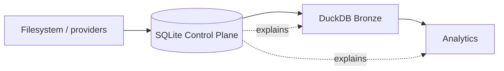
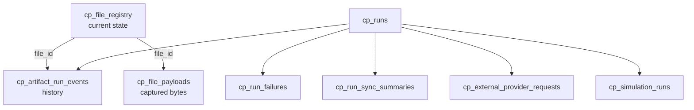
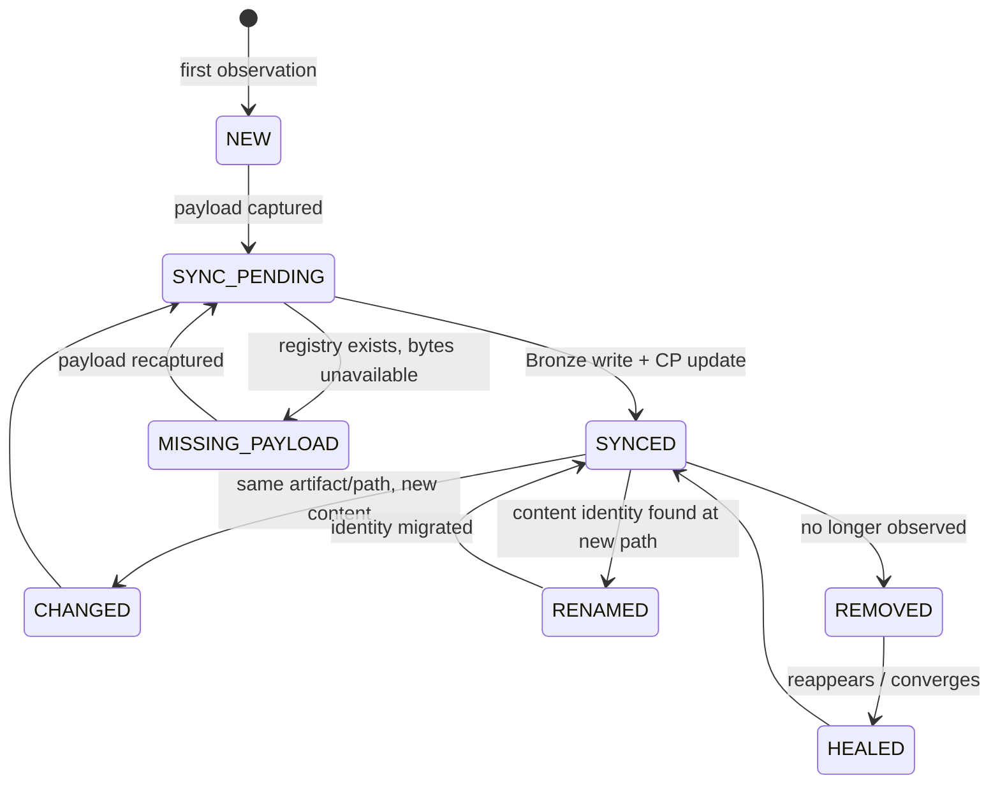
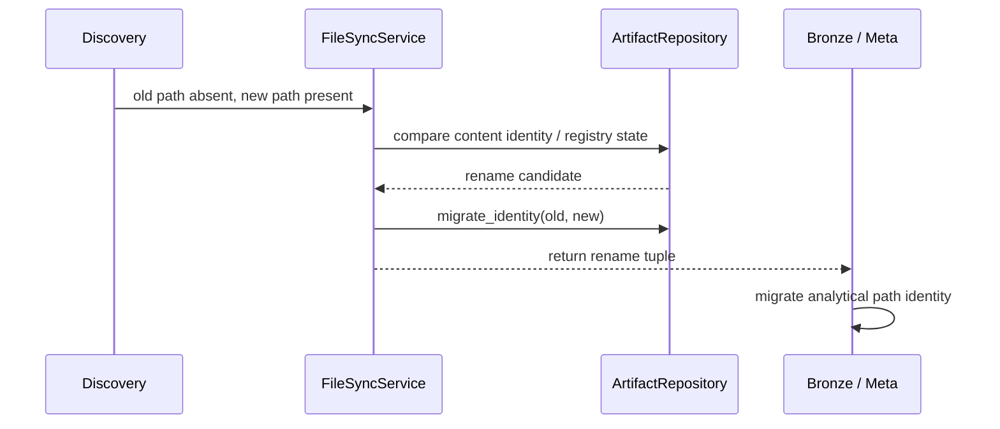
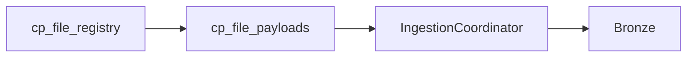
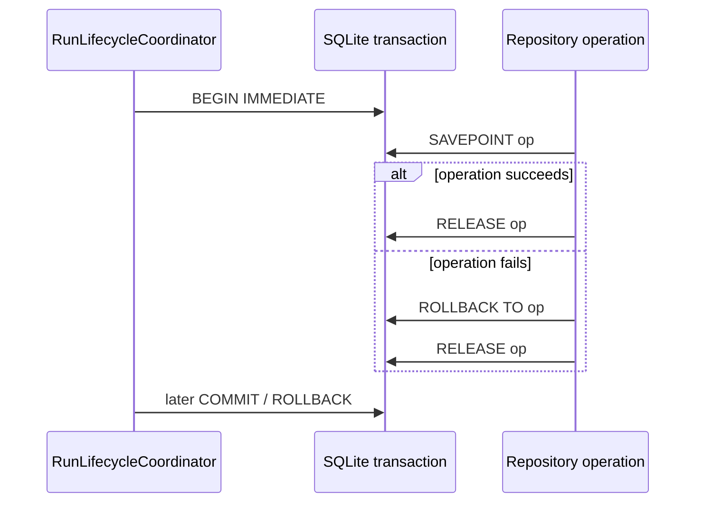

# Control Plane Artifact Lifecycle

A file-based finance pipeline has a deceptively difficult question hiding underneath ordinary ingestion:

> What exactly is the identity and state of a piece of evidence when files can change, move, disappear, reappear, fail to synchronize, or survive a crashed run?

A directory listing cannot answer that question.

The SQLite Control Plane exists because operational truth needs its own durable model.

It records what the system observed, what it captured, what changed, which run saw it, whether Bronze synchronized it, what failed, and how later runs converged state.

## Operational state is not analytical state

DuckDB answers questions such as:

- what is the current portfolio value?
- what were realized gains?
- what does the current Gold model contain?

The Control Plane answers different questions:

- which artifact did this run observe?
- did its content change?
- was the payload retained?
- did it synchronize into Bronze?
- was the path renamed?
- did a provider request fail?
- did this run split at the commit boundary?
- which later run converged it?



That asymmetry is intentional. Operational history explains analytical state; analytical state does not replace operational history.

## The Control Plane has ten durable table families

The schema declares ten tables, each with a different operational grain.

| Table | Grain | Purpose |
|---|---|---|
| `cp_file_registry` | one current row per artifact identity/path | current artifact state and synchronization metadata |
| `cp_file_payloads` | one payload per `file_id` | captured raw bytes |
| `cp_settings_snapshots` | one unique canonical settings content | reproducible runtime configuration |
| `cp_rules_snapshots` | one unique canonical financial-rules content | reproducible financial policy |
| `cp_runs` | one row per pipeline run | lifecycle and commit truth |
| `cp_run_failures` | one row per recorded failure | stage/error/failure-domain provenance |
| `cp_artifact_run_events` | one event per artifact/run transition | append-style artifact history |
| `cp_external_provider_requests` | one request attempt context | market/provider completeness evidence |
| `cp_run_sync_summaries` | one summary per run | Bronze synchronization completeness |
| `cp_simulation_runs` | one simulation provenance record | stochastic reproducibility metadata |

The current schema is explicit:

```python
# src/personal_finance_etl/infrastructure/control_plane/schema.py
CREATE TABLE IF NOT EXISTS cp_runs (
    run_id TEXT PRIMARY KEY,
    started_at TIMESTAMP NOT NULL,
    finished_at TIMESTAMP,
    status TEXT,
    commit_state TEXT NOT NULL DEFAULT 'NOT_STARTED',
    application_version TEXT,
    schema_version TEXT,
    settings_snapshot_id TEXT,
    rules_snapshot_id TEXT,
    execution_log BLOB,
    FOREIGN KEY(settings_snapshot_id) REFERENCES cp_settings_snapshots(snapshot_id),
    FOREIGN KEY(rules_snapshot_id) REFERENCES cp_rules_snapshots(snapshot_id)
);
```

The presence of version columns in the operational schema does not make canonical documentation release-specific. They are stored provenance fields for historical runs.

## Current state and event history are deliberately separate

`cp_file_registry` answers “what is the current operational state of this artifact?”

`cp_artifact_run_events` answers “how did that state change over time?”

Those are not the same data model.



Trying to store only events would make ordinary current-state queries expensive and awkward. Storing only current state would erase the evidence needed to explain changes.

The Control Plane keeps both.

## Artifact identity is not path identity

Paths are mutable operational labels.

A file can move from one folder to another without becoming new financial evidence.

The registry therefore has an explicit `file_id` primary key in addition to a unique `relative_path` and content hash.

```text
file_id          → durable artifact identity
relative_path    → current observed location
file_hash        → current content identity
sync_status      → relationship to Bronze
run IDs/times    → temporal operational provenance
```

That separation makes rename migration possible.

## Discovery creates an observation set

The pipeline first categorizes discovered source paths and injects configured artifacts.

`FileSyncService` then normalizes the discovery result before comparing it with the historical registry.

The service owns comparison mechanics; it does not decide financial meaning.

```python
# src/personal_finance_etl/infrastructure/control_plane/file_sync.py
class FileSyncService:
    """Synchronize discovered filesystem state with persistent artifact state."""

    def __init__(self, artifact_repo: ArtifactRepository) -> None:
        self.artifact_repo = artifact_repo
        self._active_run_id: str | None = None
```

The active run ID is propagated into event-producing components so every operational mutation can be attached to the run that caused it.

## Comparison must account for more than four cases

A simplistic synchronizer recognizes new, changed, unchanged, and deleted.

The actual lifecycle needs more nuance:



The exact event vocabulary is implementation-owned, but the important architecture is that divergence is modelled rather than flattened into a single boolean.

## New artifacts become operational evidence before Bronze evidence

When a new file is discovered, the Control Plane can:

1. assign artifact identity;
2. hash content according to configured policy;
3. capture raw bytes;
4. record first-seen run/time;
5. set a pending synchronization state;
6. emit an artifact-run event.

Only later does Bronze publication complete the analytical synchronization loop.

This ordering preserves evidence even if the analytical run fails after discovery.

## Changed content preserves identity while updating state

A file at the same logical path with a different hash is not necessarily a new artifact identity.

The current registry row can retain continuity while recording:

- new content hash;
- changed run/time;
- pending Bronze state;
- a `CHANGED` event;
- replaced payload bytes.

The event table preserves the transition so current state does not erase the previous observation.

## Missing payload repair is distinct from content change

A registry row can exist while its payload row is missing or incomplete.

That is not the same condition as “the file changed.”

The system can recapture the current bytes and restore the evidence store without inventing a content-change event when the hash is unchanged.

This distinction protects provenance from operational repair noise.

## Rename detection protects continuity

`FileSyncService._try_migrate_rename()` attempts to recognize cases where content identity survives at a new path.

The repository then migrates identity rather than creating duplicate historical artifacts.



The application executor later applies the returned rename set to Bronze and Meta.

Operational and analytical path identity therefore converge together.

## Removal is a state transition, not immediate historical deletion

If an artifact disappears from the discovery set, the Control Plane can mark it removed and record the event.

Historical evidence remains useful even when the current file is gone.

This is especially important for explaining why Bronze or downstream state changed after a source cleanup.

A removal event should not require deleting the run history that previously depended on the file.

## Reappearance can be healing rather than new evidence

An artifact that was previously removed or left in a divergent synchronization state may reappear with known identity/content.

The lifecycle can record healing and restore synchronized status.

The phrase **healing** is intentional:

- the historical divergence remains recorded;
- current state converges;
- a later event records the repair.

The system does not rewrite the past into a continuous success story.

## Artifact events carry convergence lineage

`cp_artifact_run_events` includes fields that allow an event to carry more than “what happened now”:

```text
detecting_run_id
replay_run_id
convergence_result
affected_table
previous_status
new_status
event_reason
```

That makes operational recovery inspectable as a relationship between runs rather than a single status mutation.

## Raw payloads make discovery replayable at the evidence boundary

`cp_file_payloads` stores raw binary content keyed by `file_id`.

The ingestion coordinator reads those bytes through `ArtifactRepository.get_file_bytes()`.

This means downstream parsing depends on retained evidence, not only on the live file still being present at its original location.



For a local system, retaining raw payload bytes is a practical way to make operational evidence inspectable without a separate object store.

## Virtual artifacts extend the same lifecycle grammar

Not all evidence begins as a user-managed file.

`ArtifactRepository.inject_virtual_file()` allows externally acquired or generated payloads to enter the artifact model with a filename/category/bytes representation.

That is useful because the rest of the system can then apply the same operational vocabulary:

```text
identity
payload
category
run provenance
synchronization
healing
```

External evidence does not need a second unrelated provenance model merely because it came from a provider rather than a folder.

## External provider requests are first-class history

`cp_external_provider_requests` records provider acquisition context:

- provider;
- entity;
- requested start/end range;
- attempt count;
- status;
- failure class;
- final error;
- creation time;
- owning run.

This makes market-data completeness auditable.

A missing price series can be distinguished from a transformation bug because the provider request history explains what was attempted.

## Sync summaries compress artifact-level state without replacing it

`cp_run_sync_summaries` gives each run a compact synchronization result:

```python
# src/personal_finance_etl/contracts/lifecycle.py
class SyncSummaryRecord(TypedDict, total=False):
    run_id: str
    actionable_count: int
    synced_count: int
    healed_count: int
    failed_count: int
    deferred_count: int
    sync_status: str
    created_at: str
```

The summary answers “did this run synchronize its actionable evidence?”

Artifact events answer “what happened to each artifact?”

Keeping both prevents dashboards from needing to reconstruct simple run-level status from a long event stream while preserving the detailed history for diagnosis.

## Run identity propagates through the operational subsystem

`ControlPlane.active_run_id` is propagated to artifact and file-sync components.

The façade provides `set_active_run_id()` so event-producing repositories share one execution identity.

```python
# src/personal_finance_etl/infrastructure/control_plane/facade.py
def set_active_run_id(self, run_id: str | None) -> None:
    """Set the active run once and propagate it to every event-producing component."""
    self.active_run_id = run_id
```

This avoids a common provenance failure where different subsystems invent or forget run identifiers independently.

## `RunRepository` owns lifecycle persistence

Run state is not mixed into artifact repository code.

`RunRepository` owns operations such as:

- starting a run;
- updating status;
- updating commit state;
- recording failures;
- recovering stale runs;
- querying recovery-required runs;
- marking convergence;
- logging sync summaries;
- recording provider requests;
- logging simulation provenance;
- storing compressed execution logs.

That repository boundary separates artifact-history semantics from execution-history semantics inside the same SQLite database.

## Settings and rules snapshots are content-addressed history

Run rows reference settings and financial-rules snapshots rather than copying arbitrary mutable files into every run record.

The snapshot model stores canonical payload plus content hash.

This lets identical configuration content be recognized independently of path or formatting noise.

It also keeps the run record compact while preserving the exact policy/environment state needed for later replay analysis.

## Simulation runs add a second provenance layer

A pipeline run can contain stochastic simulation.

`cp_simulation_runs` records simulation-specific provenance including:

- `simulation_id`;
- parent `run_id`;
- `root_seed`;
- iterations and horizon;
- input as-of date;
- settings/rules snapshots;
- input fingerprint;
- model fingerprint;
- model implementation version;
- status;
- result fingerprint.

This is intentionally richer than ordinary table provenance because stochastic reproducibility has extra degrees of freedom.

## SQLite savepoints provide nested atomicity

The Control Plane runs inside a run-level SQLite transaction, but repositories may need smaller atomic operations.

SQLite savepoints allow those nested operations to fail and roll back locally without forcing repository methods to own the outer transaction.



This is different from creating independent nested transactions, which SQLite does not provide in the same way.

## The pipeline lock protects process-level ownership

`ControlPlane.open()` acquires `pipeline.lock` with zero timeout before opening the SQLite connection.

```python
# src/personal_finance_etl/infrastructure/control_plane/facade.py
try:
    self._lock.acquire(timeout=0)
    self._lock_acquired = True
except Timeout:
    raise RuntimeError(
        "Another instance of the production pipeline is currently running."
    ) from None
```

The lock prevents concurrent production pipelines from mutating the same operational/analytical pair.

The same lock is reused by snapshot/restore operations so database replacement cannot race a run.

## Schema initialization also performs crash interpretation

`ControlPlane.ensure_schema()` does two things:

```python
def ensure_schema(self) -> None:
    self.db.ensure_schema()
    self.runs.recover_stale_runs()
```

This is a meaningful lifecycle choice.

A Control Plane that opens after an ungraceful termination should immediately interpret stale `RUNNING`/`COMMITTING` records rather than leaving them indefinitely ambiguous.

Stale-run recovery belongs close to operational schema availability because that is the first point at which history can be safely inspected.

## Control Plane to DuckDB healing is authority-driven

Before new transactions begin, `MetaLayer.heal_duckdb_registry(cp)` reconciles current analytical file-registry projections against SQLite operational truth.

The direction matters:

```text
SQLite Control Plane authority
            ↓
DuckDB current-context healing
```

not:

```text
whichever database has a row wins
```

Explicit authority is what makes healing deterministic.

## The Control Plane participates in cross-store commit truth

`cp_runs.commit_state` stores the coordinated state represented by `CommitState`.

Possible states include:

```text
NOT_STARTED
STARTED
ROLLED_BACK
DUCKDB_COMMITTED
FULLY_COMMITTED
RECOVERY_REQUIRED
CONVERGED
COMMIT_STATE_UNKNOWN
```

The run history therefore records more than `SUCCESS` or `FAILED`.

A failed run can still have durable DuckDB state, and the Control Plane has a vocabulary for that reality.

## Failure records keep both human and machine context

`cp_run_failures` records:

- `failed_isin` when relevant;
- stage;
- exception type;
- error message;
- traceback;
- `failure_domain`;
- timestamp;
- owning run.

The human-readable traceback helps debugging. The machine-readable failure domain supports aggregation and routing.

Those are complementary observability surfaces.

## Artifact lifecycle invariants

The Control Plane is designed around these invariants:

1. every current artifact has stable `file_id` identity separate from path;
2. captured payload bytes are associated with artifact identity;
3. current state and historical events are separate models;
4. run identity propagates into event-producing repositories;
5. pending Bronze work can survive a failed run;
6. rename does not automatically become new evidence;
7. removal does not erase historical provenance;
8. healing records convergence rather than rewriting the prior divergence;
9. provider requests are recorded as operational evidence;
10. simulation provenance is attached to the parent run;
11. current DuckDB registry state is healed from SQLite authority, not vice versa;
12. commit state is richer than binary success/failure.

## What the lifecycle does not claim

The Control Plane does not claim that:

- content hashes prove financial correctness;
- path rename detection can infer every possible semantic identity change;
- retained payload bytes eliminate the need for source validation;
- a `SYNCED` artifact guarantees every downstream financial calculation is correct;
- SQLite and DuckDB can commit atomically as one distributed transaction;
- stochastic outputs are reproducible without seed/model/input provenance;
- historical events should be used as the primary BI model.

These limits keep operational truth from being mistaken for analytical truth.

## Why this subsystem deserves first-class architecture

Without a Control Plane, a local ETL project can still produce correct numbers on a good day.

What it cannot do reliably is explain:

- why a source was or was not processed;
- whether the bytes changed;
- whether a rename duplicated state;
- whether a crash left pending work;
- whether Bronze actually synchronized;
- whether a provider failure created missing market evidence;
- whether a successful analytical commit lost its operational commit;
- which later run converged the divergence.

Those questions are where a pipeline becomes an operational system.

## Continue into economic identity

Artifact identity explains continuity of evidence. Financial entities need a different identity model that survives full analytical rebuilds.

Continue with [Deterministic Identity and Replay](deterministic-identity-and-replay.md), then [Reliability and Recovery](reliability-and-recovery.md).

## Related specifications

- [Architecture](README.md)
- [Data Lifecycle](data-lifecycle.md)
- [Warehouse Architecture](warehouse-architecture.md)
- [Deterministic Identity and Replay](deterministic-identity-and-replay.md)
- [Reliability and Recovery](reliability-and-recovery.md)
- [Backup and Restore](backup-and-restore.md)
- [Reference: Control Plane Data Contracts](../reference/control-plane-data-contracts.md)
