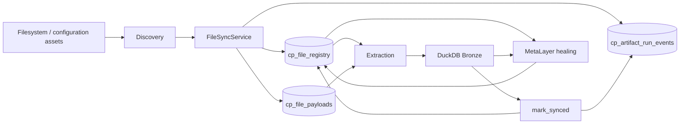
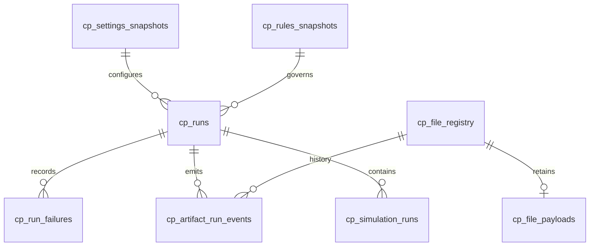
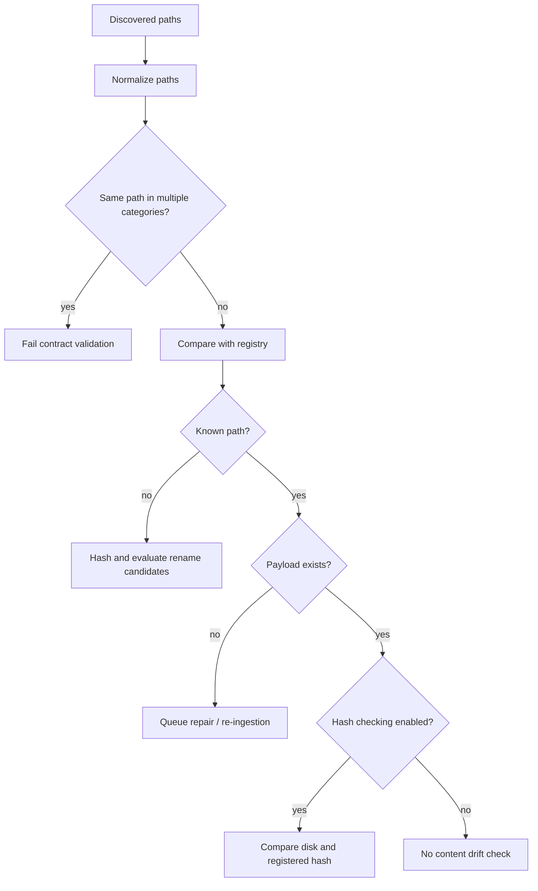
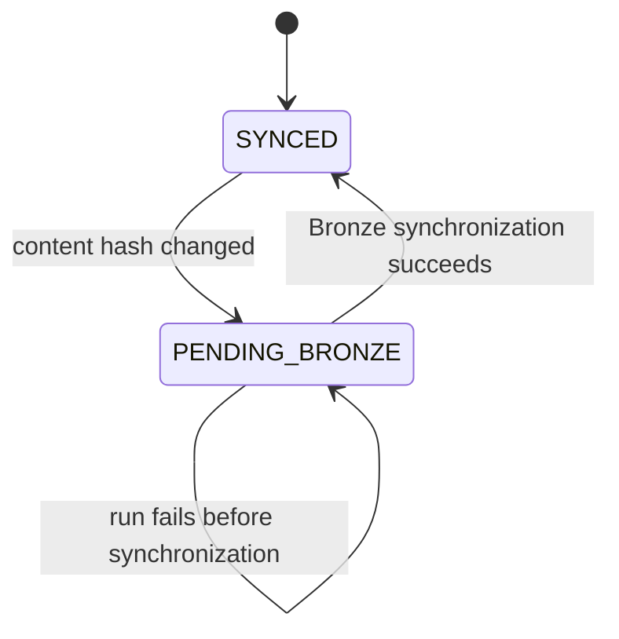
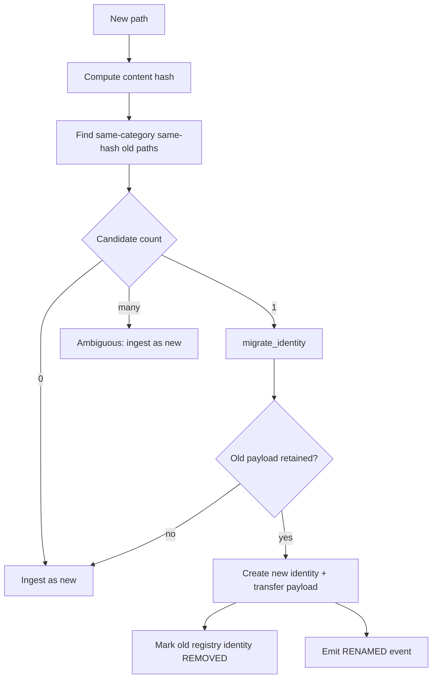
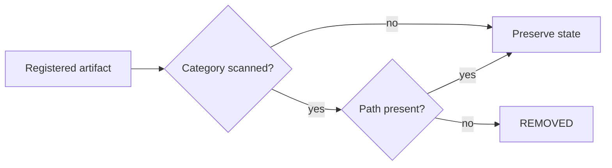
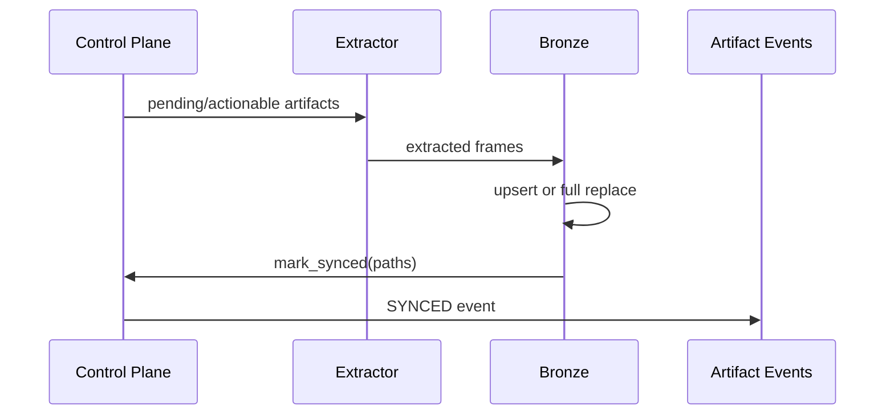
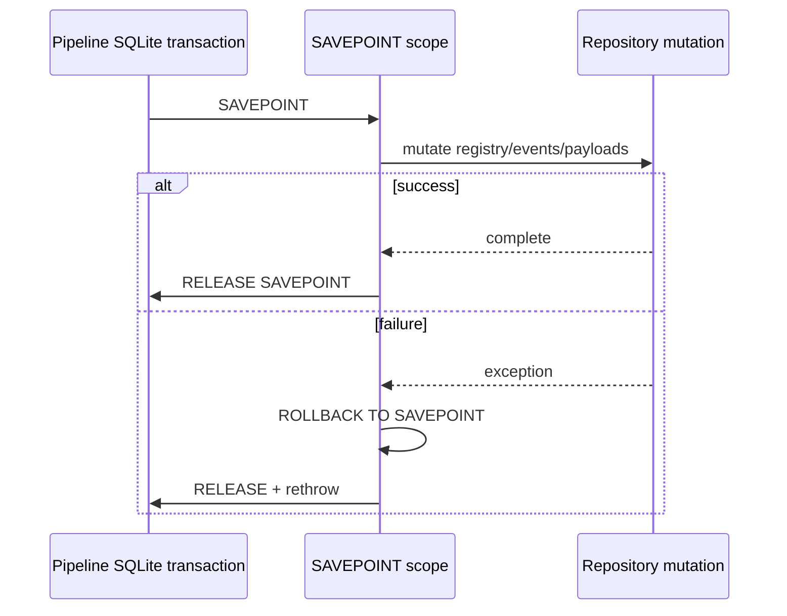
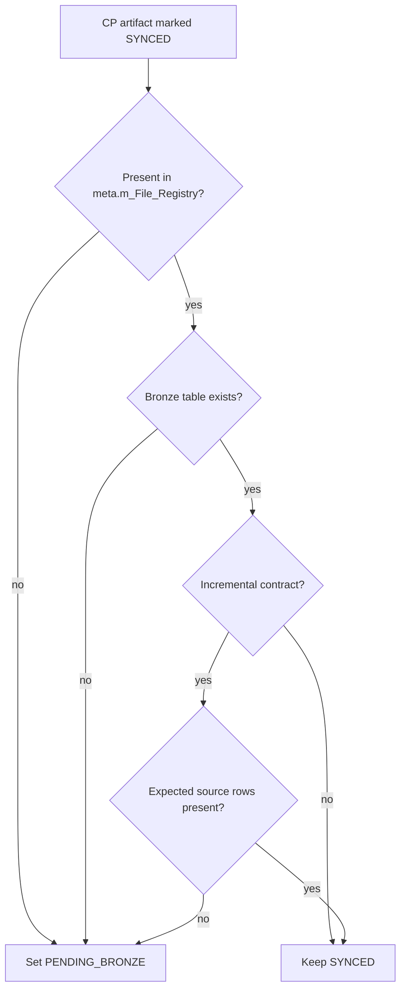

# Control Plane Artifact Lifecycle

Personal Finance ETL treats source files as **operational artifacts with history**, not anonymous byte streams that happen to exist when a run starts. The SQLite Control Plane is the durable authority for that history. It records what was observed, what changed, what was retained, what was synchronized into Bronze, and which run made each transition visible.

That distinction matters because a financial pipeline must answer more than *what is in the warehouse now?* It also needs to answer *which evidence produced it, when did that evidence change, and what happened when the filesystem stopped agreeing with persisted state?*

> The Control Plane is an operational history system. DuckDB remains the analytical system. Asking either database to impersonate the other would make both worse at their actual jobs.

## Scope and source authority

This specification is grounded primarily in:

- `backend/load/control_plane/orchestrator.py` — lifecycle façade and pipeline lock.
- `backend/load/control_plane/connection.py` — SQLite connection, schema validation, transactions, nested savepoints.
- `backend/load/control_plane/artifact_repo.py` — artifact persistence and lifecycle transitions.
- `backend/load/control_plane/file_sync.py` — disk-to-registry synchronization and rename detection.
- `backend/load/control_plane/run_repo.py` — run, failure, snapshot, and simulation provenance.
- `backend/load/schema/control_plane.py` — physical Control Plane schema.
- `backend/load/metadata.py` — reconciliation between Control Plane state and DuckDB Bronze/Meta state.
- `backend/pipeline/etl_pipeline.py` — orchestration order and synchronization boundaries.

Physical column-by-column definitions belong in [`../reference/control-plane-data-contracts.md`](../reference/control-plane-data-contracts.md). This page owns lifecycle semantics.

## Operational ownership



The Control Plane owns historical operational truth. Bronze owns persisted analytical source rows. DuckDB Meta projects current state. These roles overlap in information, but not in authority.

## The eight Control Plane tables

The current schema contains eight first-class tables:

| Table | Responsibility |
|---|---|
| `cp_file_registry` | Current artifact identity, location, content hash, category, size and synchronization state |
| `cp_file_payloads` | Retained binary payload keyed by artifact identity |
| `cp_settings_snapshots` | Content-addressed runtime configuration snapshots |
| `cp_rules_snapshots` | Content-addressed financial-rule snapshots |
| `cp_runs` | Run lifecycle and links to configuration/rule snapshots |
| `cp_run_failures` | Structured execution failures |
| `cp_artifact_run_events` | Append-style artifact lifecycle events associated with a run |
| `cp_simulation_runs` | Stochastic simulation provenance and fingerprints |



## Artifact identity is not path identity

`cp_file_registry.relative_path` is unique and represents the artifact's current observed location. `file_id` is the persisted identity used by payload and event relationships.

The implementation deliberately distinguishes:

```text
artifact identity  !=  filesystem path  !=  content hash
```

A path can change without the underlying evidence changing. A path can remain constant while content changes. A hash can match another historical artifact and still require ambiguity handling before identity migration.

That separation is what makes rename handling possible without pretending every rename is a delete-plus-new financial event.

## Discovery and synchronization

`FileSyncService.sync_with_disk()` wraps the complete synchronization pass in a nested atomic SQLite scope:

```python
with self.artifact_repo.db.atomic():
    return self._sync_with_disk(
        discovered_files,
        hash_policy,
        full_replace_categories,
    )
```

Before mutating registry state, the service normalizes and deduplicates paths. A single canonical path assigned to two categories is rejected because category is part of the ingestion contract.



## New artifacts

A path absent from the registry is hashed. If it cannot be read after discovery, synchronization fails rather than silently losing evidence between discovery and ingestion.

If no unambiguous rename candidate exists, the path is queued as new and `ArtifactRepository.ingest_binaries()` persists both metadata and payload.

The registry transition is conceptually:

```text
not registered
    -> binary ingested
    -> PENDING_BRONZE
    -> Bronze load
    -> SYNCED
```

The event history records the transition under the active run.

## Changed artifacts

For file types enabled by `FILE_HASH_POLICY`, the disk hash is compared with the registered hash. Drift queues the artifact for re-ingestion.



The pending state is useful precisely because a failed run does not need to invent what should happen next. The artifact remains actionable.

## Missing payload repair

A registry row without a retained payload is treated as damaged operational state even if hash checking is disabled for that category:

```python
if not self.artifact_repo.has_payload(path):
    logger.warning("[SYNC:REPAIR] Registered artifact has no payload: %s", path)
    new_files[category].append(path)
    continue
```

The source is re-ingested. Registry existence alone is therefore not considered sufficient evidence that the artifact vault is healthy.

## Rename detection

Rename detection uses category-local content hashes. For a newly observed path, the synchronizer searches for active registry paths in the same category with the same hash that are no longer active in the current scan.



Ambiguity is deliberately fail-safe. Two historical files with identical content are not enough evidence to guess which one was renamed.

### Identity migration

`ArtifactRepository.migrate_identity()` copies the historical timestamps and synchronization context into the destination identity, transfers the retained payload, emits a `RENAMED` event, and marks the old identity `REMOVED`.

```python
self._insert_event(
    file_id=new_id,
    event_type="RENAMED",
    event_at=now,
    path=new_path,
    content_hash=current_hash,
    previous_status=old_status,
    new_status=new_status,
    reason=f"Migrated identity from {old_path}",
)
```

The old registry row is intentionally retained. Historical identity is not garbage-collected merely because the filesystem got reorganized.

## Removal

If a previously active artifact disappears from a category that was actually scanned, it is marked `REMOVED`.

An absent category is **not** automatically pruned. That distinction prevents incomplete discovery from being interpreted as mass deletion.



`prune_category()` may delete obsolete payload bytes for full-replace categories, but it deliberately retains registry identities and historical events.

That gives the retention contract an important boundary:

> Historical operational identity can survive even when the original binary payload no longer does.

## Healing a reappearing artifact

A path previously marked `REMOVED` that reappears is marked `HEALED`, which transitions it back to `PENDING_BRONZE` for synchronization.

```python
self._insert_event(
    file_id=file_id,
    event_type="HEALED",
    event_at=now,
    path=path,
    content_hash=file_hash,
    previous_status=previous_status,
    new_status="PENDING_BRONZE",
    reason="File re-appeared after prior removal",
)
```

Healing is therefore not a mystical database self-repair spell. It is an explicit lifecycle transition backed by source evidence becoming observable again.

## Synchronization into Bronze

After extraction, Bronze consumes actionable artifacts. Successful synchronization calls `mark_synced()` and records both registry timestamps and a `SYNCED` event.



The synchronization state belongs to the artifact registry because it describes the relationship between source evidence and Bronze persistence.

## Virtual artifacts

Not every configuration input needs to arrive as a conventional discovered statement. `inject_virtual_file()` persists generated/configuration evidence into the same artifact model and emits either:

- `VIRTUAL_CREATED`, or
- `VIRTUAL_UPDATED`.

This keeps configuration-derived evidence inside the same provenance universe rather than creating a second unofficial lineage system in a utility function somewhere. One lineage model is plenty.

## Artifact event vocabulary

Current event types emitted by `ArtifactRepository` include:

| Event | Meaning |
|---|---|
| `DISCOVERED` | A new artifact payload was registered |
| `CHANGED` | Existing path received changed content |
| `REINGESTED` | Existing evidence was ingested again for repair/recovery semantics |
| `RENAMED` | Identity migrated to a new observed path |
| `SYNCED` | Artifact successfully synchronized into Bronze |
| `HEALED` | Previously removed artifact reappeared and was re-queued |
| `REMOVED` | Artifact disappeared from a positively scanned category |
| `VIRTUAL_CREATED` | Virtual/configuration artifact created |
| `VIRTUAL_UPDATED` | Virtual/configuration artifact changed |

The event row records `observed_path`, `content_hash`, `previous_status`, `new_status`, and a human-readable reason. Events are associated with the active `run_id`.

## Run identity propagation

`ControlPlane.active_run_id` propagates the active run to both `ArtifactRepository` and `FileSyncService`:

```python
@active_run_id.setter
def active_run_id(self, value: str | None) -> None:
    self._active_run_id = value
    self.artifacts.active_run_id = value
    self.file_sync.active_run_id = value
```

This prevents individual event-producing components from inventing their own run context.

## Nested atomicity with SQLite savepoints

File synchronization and repository mutations frequently use `SQLiteManager.atomic()`. The implementation uses a uniquely named savepoint, not a new independent transaction:

```python
savepoint = f"cp_scope_{uuid.uuid4().hex}"
self.conn.execute(f"SAVEPOINT {savepoint}")
try:
    yield
    self.conn.execute(f"RELEASE SAVEPOINT {savepoint}")
except Exception:
    self.conn.execute(f"ROLLBACK TO SAVEPOINT {savepoint}")
    self.conn.execute(f"RELEASE SAVEPOINT {savepoint}")
    raise
```



A savepoint provides scoped atomicity **inside SQLite**. It does not create distributed atomicity with DuckDB.

## Control Plane to DuckDB healing

Before a new pipeline transaction begins, `MetaLayer.heal_duckdb_registry()` compares Control Plane artifacts marked `SYNCED` with DuckDB Meta and physical Bronze ownership.

If Control Plane says an artifact is synchronized but its DuckDB representation is missing, the artifact is moved back to `PENDING_BRONZE`.

For incremental Bronze contracts, the healer can also verify that an artifact expected to own rows actually appears in the physical Bronze table.



The reverse direction is also handled: DuckDB registry entries no longer represented by Control Plane state are purged from current analytical state.

## Lifecycle invariants

The implementation establishes several useful invariants:

1. Canonical paths cannot silently belong to multiple source categories.
2. Registry rows are historical identities and are not casually hard-deleted.
3. Payload retention and identity retention are separate concerns.
4. A registered artifact with a missing payload is actionable for repair.
5. Rename migration requires unambiguous content evidence and a retained source payload.
6. A removed artifact can re-enter the lifecycle through an explicit healing transition.
7. Bronze synchronization is not considered complete until the artifact is marked `SYNCED`.
8. Artifact events inherit one authoritative pipeline run identity.
9. Nested repository operations use SQLite savepoints.
10. Control Plane state can re-queue DuckDB state that no longer matches operational truth.

## Failure semantics

| Failure | Behavior |
|---|---|
| File disappears between discovery and hashing | Synchronization fails |
| Same path discovered under two categories | Contract error |
| Rename candidate ambiguous | Destination treated as new |
| Rename source payload missing | Migration rejected; destination re-ingested |
| Registry payload missing | Artifact queued for repair |
| Bronze synchronization fails | Artifact remains actionable/pending under transaction rollback semantics |
| SQLite nested mutation fails | Savepoint rolls back scoped changes |
| Control Plane and DuckDB disagree on next run | Healing can re-queue or purge current analytical state |

## What the lifecycle does not claim

The implementation does **not** claim that:

- every historical payload is retained forever;
- path alone is immutable identity;
- matching content hashes always prove a rename;
- Control Plane events replace financial-domain lineage;
- SQLite savepoints make DuckDB and SQLite one ACID database;
- a reconstructed financial state becomes source evidence merely because its producing run is traceable.

Operational provenance and financial semantics intersect, but they are not interchangeable.

## Related specifications

- [Data Lifecycle](data-lifecycle.md)
- [Warehouse Architecture](warehouse-architecture.md)
- [Deterministic Identity and Replay](deterministic-identity-and-replay.md)
- [Reliability and Recovery](reliability-and-recovery.md)
- [Backup and Restore](backup-and-restore.md)
- [Control Plane Data Contracts](../reference/control-plane-data-contracts.md)
