# Data Lifecycle

Personal Finance ETL treats data movement as a lifecycle of **evidence acquisition, operational registration, persistent synchronization, canonicalization, financial reconstruction, analytical publication, and provenance capture**. The lifecycle is intentionally more explicit than “read files → transform → save tables” because financial correctness depends on knowing what was observed, what changed, what was reconstructed, and which state can be rebuilt.

This document follows one run from source discovery to commit, including rename, healing, failure, and replay-relevant metadata paths.

## 1. Lifecycle overview

```mermaid
flowchart LR
    SRC[Source artifacts] --> DISC[Discover]
    DISC --> CP[Register / compare]
    CP --> ACT[Actionable artifacts]
    ACT --> EXT[Extract]
    EXT --> BR[Bronze sync]
    BR --> FULL[Complete Bronze state]
    FULL --> CORE[Canonical DAG]
    CORE --> ENRICH[FX / US / Benchmark]
    ENRICH --> Q[Quant]
    Q --> T[Tax]
    T --> W[Wealth / FIRE]
    W --> VAL[Contract validation]
    VAL --> PUB[Silver / Gold]
    PUB --> META[Meta refresh]
    META --> COMMIT[Coordinated commit]
```

The key architectural split is between **actionable source changes** and **complete analytical state**. Only changed/pending evidence needs physical extraction, while transformations consume the full Bronze dataset.

## 2. Run creation precedes financial work

A run becomes an operational entity before discovery/transformation:

```python
run_id = cp.runs.start_run(
    cfg_json=self.cfg.model_dump_json(),
    rules_json=self.rules.model_dump_json() if self.rules else None,
)
cp.active_run_id = run_id
cp.artifacts.active_run_id = run_id
cp.file_sync.active_run_id = run_id
```

`start_run()` captures settings/rules snapshots and establishes the run identity used throughout operational provenance. The run ID also becomes the root seed for stochastic wealth modelling later in the lifecycle.

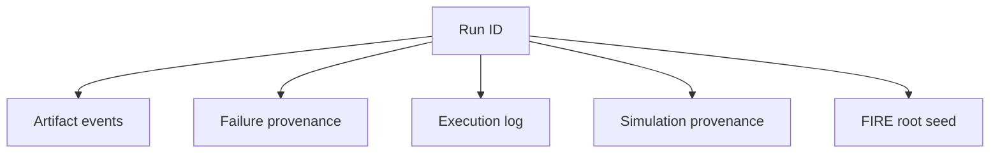

One identity therefore connects deterministic ETL history and stochastic model context without pretending those computations are identical.

## 3. Pre-run convergence

Before beginning the transactional analytical work, `MetaLayer.heal_duckdb_registry(cp)` compares Control Plane authority with DuckDB's registry projection.

This matters because the previous run could have committed DuckDB and then failed to commit SQLite. The architecture accepts that narrow cross-database window and provides a convergence path on the next run.

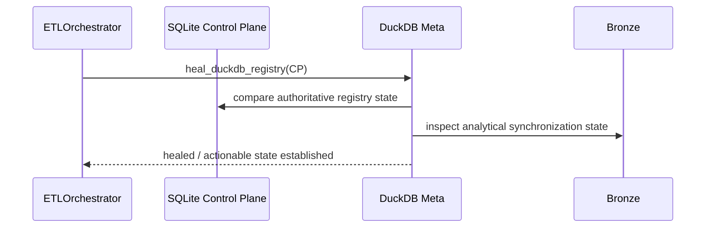

The exact healing algorithm belongs in the reliability and Control Plane specifications; lifecycle-wise, the important rule is **converge before discovering new work**.

## 4. Discovery

When file discovery is enabled, `categorize_statement_files()` scans the statements directory and classifies discovered artifacts. The orchestrator then injects eight configuration/source assets that do not originate from the statement directory:

- source SQLite database;
- MF ISIN mapping;
- benchmark mapping;
- opening balances;
- benchmark master;
- macro parameters;
- currency mapping;
- column master.

```python
discovered_files["sqlite_source"] = [
    SQLiteExtractor(self.cfg.SOURCE_DB_FOLDER)
    .get_latest_sqlite_backup()
    .replace("\\", "/")
]
discovered_files["mf_isin"] = [self.cfg.MF_ISIN_CSV_PATH.replace("\\", "/")]
```

Discovery answers **what exists now**, not yet **what must be reprocessed**.

## 5. Artifact comparison

`FileSyncService.sync_with_disk()` compares discovered artifacts against the Control Plane registry using the configured hash policy and full-replace category semantics.

Its outputs include:

```text
new files
changed files
removed files
renames
```

Pending artifacts already retained in the Control Plane are then merged with new/changed paths:

```python
pending_files = cp.artifacts.get_pending_files()
...
paths = new_files.get(k, []) + changed_files.get(k, []) + pending_files.get(k, [])
```

Paths are normalized before de-duplication so slash differences do not manufacture duplicate work.

## 6. Artifact lifecycle is not file-path identity

A rename can preserve artifact continuity. The pipeline receives rename tuples and later migrates identity in Bronze and Meta:

```python
if renames:
    bronze.migrate_identity(renames)
    meta_layer.migrate_identity(renames)
```

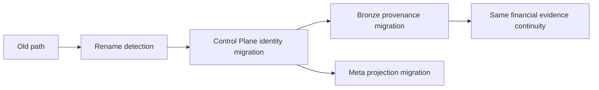

Without this behavior, moving a statement could look like deleting one piece of financial evidence and creating another. Filesystems care about paths; financial lineage cares about identity.

## 7. Actionable extraction

`DataExtractor` receives only actionable paths. It returns an `ExtractionResult` containing source frames plus mappings used downstream.

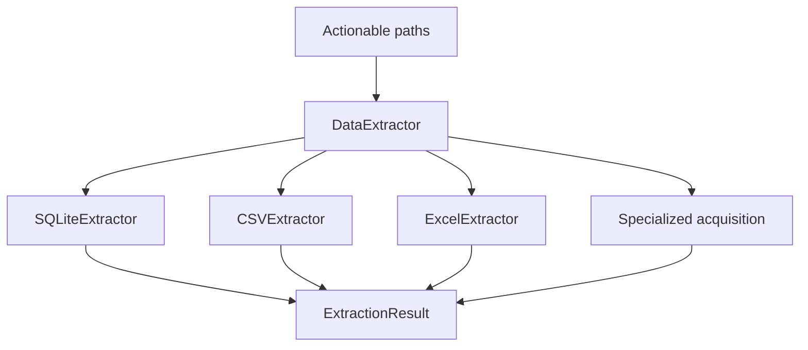

If discovery is disabled, the system does not blindly read everything from disk. It asks the Control Plane for pending files and processes that retained operational state.

## 8. Bronze synchronization

`BronzeLayer.load()` maps extraction attributes to physical Bronze tables through `BRONZE_CONTRACT_REGISTRY`.

Each Bronze contract defines:

```python
@dataclass
class BronzeDataContract:
    extraction_attribute: str
    sync_category: str
    physical_table: str
    is_full_replace: bool
```

This separates source/extraction names from synchronization categories and physical tables.

### Full-replace sources

Full-replace contracts represent current authoritative snapshots such as master/mapping/configuration assets.

### Incremental sources

Incremental contracts represent accumulating history such as market data and transaction/order files.

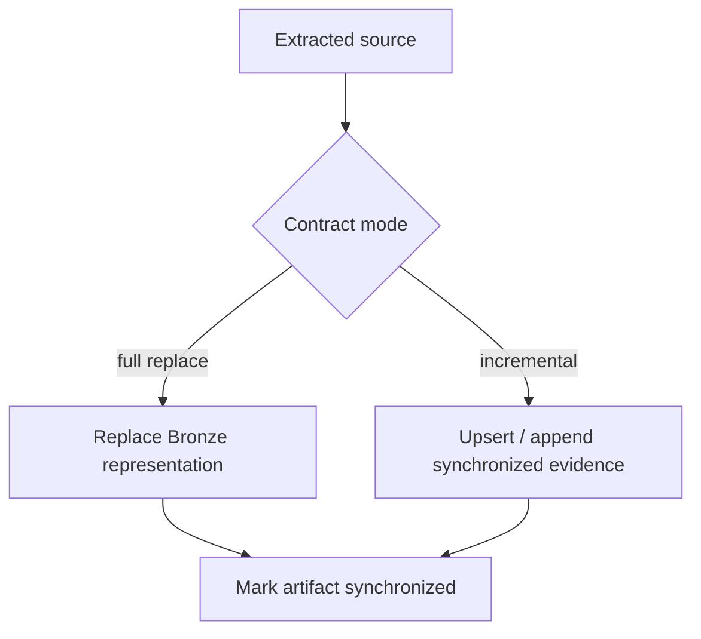

The exact physical semantics are documented in the Bronze Reference specification.

## 9. Complete Bronze state becomes transformation input

After synchronizing only actionable evidence, the orchestrator reads the full Bronze dataset:

```python
bronze.load(extracted_data, actionable_all)
full_dataset = bronze.get_full_dataset(extracted_data.mappings)
self._transform(full_dataset)
```

This is the pivot between ingestion and analytics.

```text
incremental source work
        ↓
persistent Bronze state
        ↓
complete analytical reconstruction
```

It means a run can ingest two changed files but still rebuild a portfolio using the entire financial history.

## 10. Canonical transformation DAG

`TransformationDAG` creates normalized household and investment facts from complete Bronze state.

Its base outputs include:

- category/subcategory dimensions;
- asset dimensions;
- currency;
- benchmark master;
- macro parameters;
- income/expense/transfer facts;
- opening balances;
- investment market data;
- purchase/sale facts;
- investment master;
- calendar.

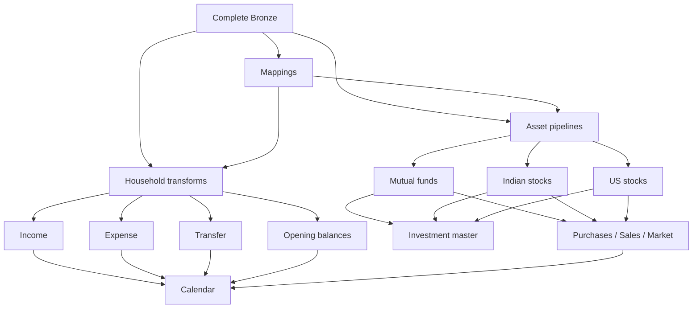

Polars LazyFrames allow independent nodes to be optimized before `pl.collect_all(..., engine="streaming")` materializes them.

## 11. Asset-pipeline normalization

Mutual funds, Indian stocks, and US stocks enter through different physical evidence, but `AssetPipeline` strategies normalize them into common intermediate shapes before shared investment transforms build canonical facts.

This is an important dependency inversion in the data model:

```text
source-specific adapters
        ↓
common investment references
        ↓
canonical investment facts
```

The rest of the Quant stack should not need to know whether a purchase originated from an MF order workbook or a US transaction file.

## 12. Currency lifecycle

The currency pipeline runs after the base DAG because it requires the canonical currency dimension and date boundaries.

The start date is derived from the calendar. The end date is aligned to available market data. The resulting `df_f_currency_fx_rates` is then available to US reconstruction and Quant.

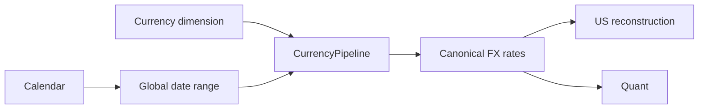

## 13. US historical market-state lifecycle

The US market pipeline derives its start date from the earliest US purchase/sale and uses the broader market end date. It reconstructs US historical market state from:

- canonical purchase/sale facts;
- instrument master;
- canonical FX;
- acquired historical US prices.

The result is unioned into canonical `df_f_investment_market_data`.

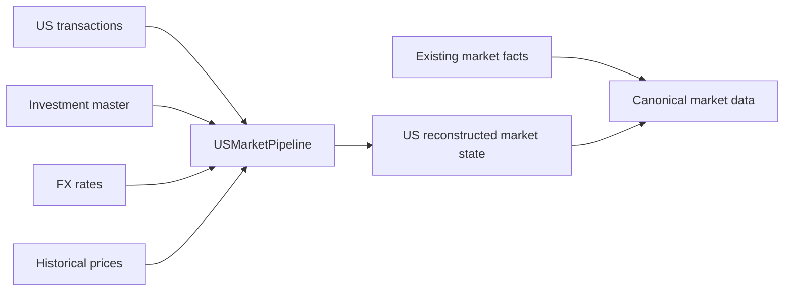

This state is **reconstructed financial state**, not independent broker holdings evidence. Canonical FIFO lot ownership remains with Quant.

## 14. Benchmark lifecycle

`BenchmarkPipeline` aligns benchmark history/master evidence with canonical investment market/purchase context and publishes `df_f_investment_benchmark_data` for Quant comparison.

Benchmarks therefore enter the financial model before post-processing rather than being attached only to final charts.

## 15. Quant lifecycle

`InvestmentQuantEngine` runs after all canonical market, FX, benchmark, and macro dependencies exist.

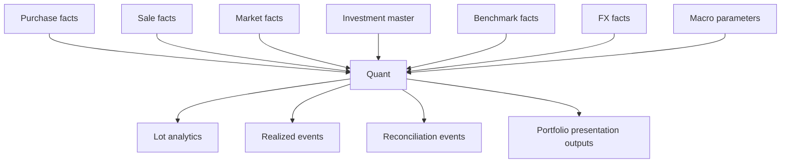

The engine processes instrument workloads, reconstructs FIFO state, records realized disposal components, reconciles reconstructed state against observations where applicable, and performs post-processing such as XIRR/benchmark/weight analytics.

## 16. Tax lifecycle

Tax runs **after Quant** because realized investment events are canonical Tax inputs.

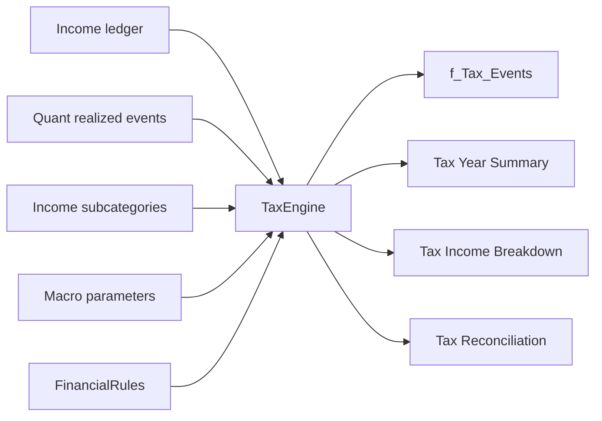

FinancialRules provide investment-related STCG/LTCG ledger exclusions so the same economic gain is not counted once from household ledger evidence and again from Quant.

## 17. Wealth and presentation lifecycle

`WealthPresentationEngine` receives the complete analytical dictionary after Quant and Tax. It builds LazyFrame outputs for cashflow, wealth, investment presentation, budgeting, and FIRE/risk analytics.

The orchestrator executes all presentation graphs together:

```python
keys = list(presentation_lazy.keys())
lazy_frames = [presentation_lazy[k] for k in keys]
results = pl.collect_all(lazy_frames, engine="streaming")
```

This is a presentation DAG, not a sequence of pandas-style table mutations.

## 18. Simulation provenance lifecycle

After presentation execution, the run records simulation provenance:

```python
cp.runs.log_simulation_run(
    run_id=str(run_id),
    root_seed=str(run_id),
    rules=self.rules,
    input_df=self.dfs.get("df_p_tf_wealth_risk_analytics_inputs"),
    settings_snapshot_id=settings_snapshot_id,
    rules_snapshot_id=rules_snapshot_id if rules_snapshot_id != "UNKNOWN" else None,
)
```

The internal simulation input frame is then removed before contract validation/publication.

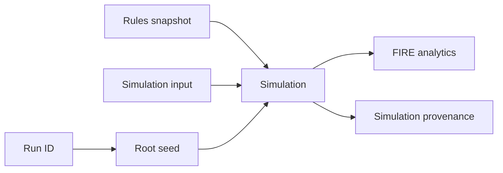

This keeps transient model input separate from published warehouse contracts while preserving replay-relevant metadata.

## 19. Contract completeness gate

Before any Silver/Gold publication, the orchestrator verifies that:

1. every produced dataset is registered;
2. every registered analytical dataset was produced.

This creates a hard lifecycle gate:

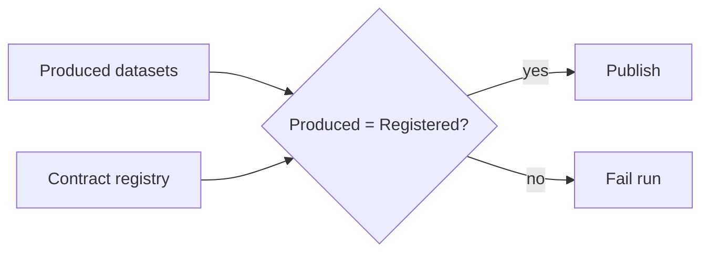

An engine cannot quietly create a new warehouse table by returning another DataFrame. Schema evolution must be intentional.

## 20. Silver and Gold publication

`SilverLayer` and `GoldLayer` publish in registry `publication_order`. Their schemas are rebuilt for the run, making them current analytical publications rather than incremental histories.

This design is especially useful for deterministic financial reconstruction: analytical tables do not need elaborate correction logic for every upstream change because they can be recomputed from complete Bronze evidence.

## 21. Meta refresh

After analytical publication, `MetaLayer.load()` updates current-state metadata such as:

- file registry projection;
- table row counts;
- financial rules;
- settings;
- data contracts;
- latest simulation.

Meta is therefore the analytical database's current context, while historical operational context remains in SQLite.

## 22. Commit lifecycle

The run status transitions to `COMMITTING` before database commit.

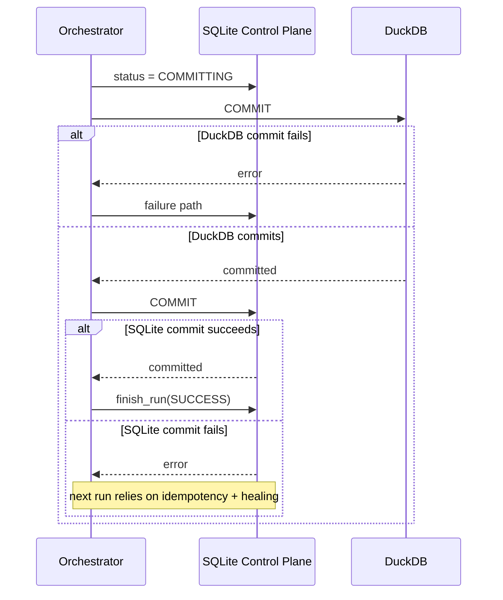

This ordering is a deliberate implementation fact. Documentation must not upgrade it into distributed atomicity merely because “ACID” sounds comforting.

## 23. Failure lifecycle

Any exception enters a rollback/failure path:

1. attempt DuckDB rollback;
2. attempt SQLite rollback;
3. persist structured failure details where possible;
4. mark the run failed;
5. re-raise the exception;
6. in `finally`, stop logging infrastructure, compress/persist execution log, close databases, collect garbage.

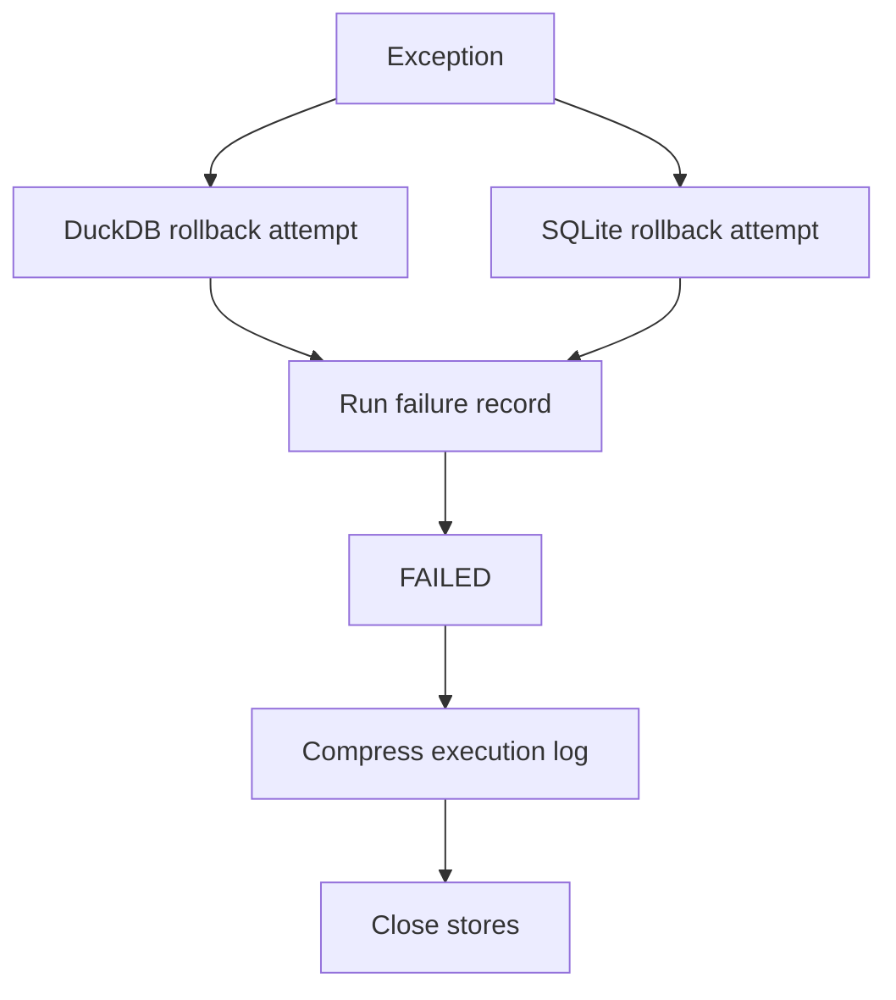

A failure while logging failure metadata is itself caught so that provenance problems do not mask the original pipeline exception.

## 24. Stale-run lifecycle

The Control Plane can recover stale runs left in nonterminal states such as `STARTED`, `RUNNING`, or `COMMITTING`. This is operational recovery, not financial recomputation: it prevents abandoned process state from being mistaken for a completed run.

Detailed status semantics are specified in the Control Plane lifecycle document.

## 25. Backup/restore lifecycle

Backup and restore sit outside the ETL transformation path but inside the application data lifecycle.

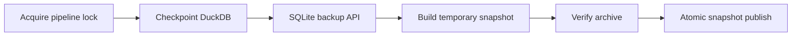

Restore performs the reverse only after archive and database validation, with recovery backups protecting the existing pair during replacement.

## 26. Lifecycle invariants

The implementation establishes several lifecycle invariants:

- a run identity exists before artifact/financial processing;
- source discovery and source extraction are separate concerns;
- actionable extraction is driven by Control Plane state;
- Bronze synchronization precedes analytical reconstruction;
- transformations consume complete Bronze state;
- Quant precedes Tax;
- Tax precedes presentation;
- all analytical outputs must match the registry;
- Silver/Gold publication precedes Meta refresh;
- DuckDB commits before SQLite;
- simulation provenance is linked to run/snapshot context;
- finalization attempts to preserve execution logs even on failure.

## 27. Lifecycle non-invariants

The system does not promise that:

- every run extracts every source artifact;
- every source is incremental;
- Silver/Gold preserve historical versions internally;
- SQLite and DuckDB can never temporarily diverge;
- reconstructed state is equivalent to observed source evidence;
- a stochastic simulation from a different run will use the same random path.

## 28. Why this lifecycle works for the workload

The lifecycle trades some recomputation for simpler analytical correctness. Persistent Bronze absorbs incremental source growth. Silver and Gold are rebuilt from that stable base, which avoids carrying years of analytical mutation logic for a local workload that can be recomputed quickly.

In other words, the system spends CPU to save state complexity. For personal finance scale, that is often a very good trade: silicon is cheap; debugging a subtly corrupted cost basis at 1:30 AM is not.

## Related specifications

- [System Architecture](system-architecture.md)
- [Warehouse Architecture](warehouse-architecture.md)
- [Data Model](data-model.md)
- [Control Plane Artifact Lifecycle](control-plane-artifact-lifecycle.md)
- [Deterministic Identity and Replay](deterministic-identity-and-replay.md)
- [Reliability and Recovery](reliability-and-recovery.md)
