# Data Lifecycle

The architecture becomes concrete when one question is followed all the way through the system:

> How does a piece of financial evidence become decision-ready state without losing the ability to explain where it came from, what changed, and whether the run completed truthfully?

The answer is not a single ETL arrow.

The lifecycle is a sequence of state transitions across operational evidence, persistent Bronze, canonical financial models, reconstructed finance, publication contracts, and coordinated commit state.

This specification follows that sequence in execution order.

## The lifecycle has five application phases and more than five semantic transitions

`PipelineExecutor.execute_phases()` names five runtime phases:

1. discovery and synchronization;
2. Bronze upsert;
3. transformation and enrichment;
4. advanced analytics and financial engines;
5. Silver and Gold publication.

But those five labels hide several distinct state transitions.

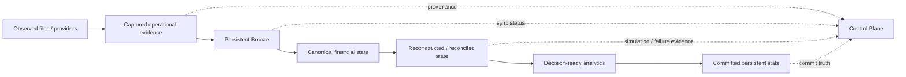

The runtime phases exist to move safely between those semantic states.

## Run creation comes before financial work

A run is created before discovery and before any financial transformation.

`RunLifecycleCoordinator.initialize()`:

- attaches queue and file logging;
- opens DuckDB;
- ensures DuckDB schemas;
- opens the SQLite Control Plane under the pipeline lock;
- ensures Control Plane schema and recovers stale runs;
- snapshots settings and financial rules through `start_run()`;
- assigns the active run ID to all event-producing Control Plane services;
- detects prior `RECOVERY_REQUIRED` runs;
- heals DuckDB registry state from SQLite authority;
- opens the DuckDB and SQLite transactions;
- marks the current run `RUNNING`.

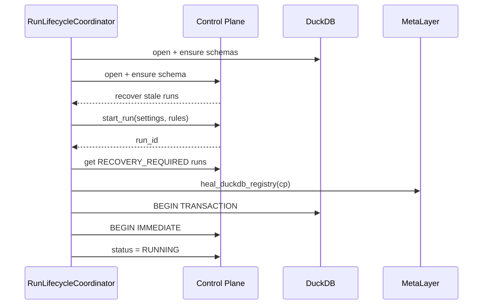

The run therefore has provenance before it has results.

## Pre-run convergence happens before new analytical work

The lifecycle checks for previous split-commit runs before beginning the new workload.

Those run IDs are retained in `pending_recovery_runs`.

The current run does not immediately rewrite their history. Instead, it rebuilds analytical state from authoritative evidence. Only after a later full commit succeeds are prior recovery-required runs marked converged.

That produces an important temporal distinction:

```text
previous run diverged
        ↓
current run starts and knows divergence exists
        ↓
current run reconstructs and republishes complete state
        ↓
current run fully commits
        ↓
previous divergence may now be marked CONVERGED
```

Convergence is therefore evidence of a later successful state, not retroactive denial that the earlier split occurred.

## Discovery asks what exists, not what it means

Phase 1 begins by building the set of observable source artifacts.

Configured assets are injected into discovery alongside statement files so the lifecycle treats configuration-driven data inputs as evidence too.

The current execution path explicitly adds:

- source SQLite backup;
- mutual-fund ISIN mapping;
- benchmark mapping;
- opening balances;
- benchmark master;
- macro parameters;
- currency mapping;
- column master.

The discovery result is a category-to-path mapping, not a financial model.

That separation matters because discovery should not need to understand whether a column represents Tax basis or benchmark metadata. It needs to know that an artifact exists and belongs to a synchronization category.

## Artifact comparison uses history, not only the current directory listing

`FileSyncService.sync_with_disk()` compares discovery against the Control Plane registry.

The comparison can produce several operational interpretations:

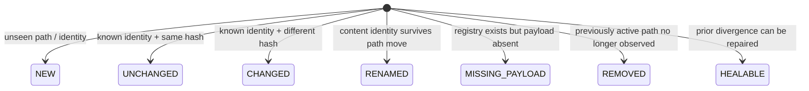

The lifecycle therefore does not equate “file path” with “artifact identity.”

That distinction is essential on OneDrive/SharePoint-style working folders and for ordinary local reorganizations where content can survive a path change.

## Full-replace and incremental Bronze categories are known before synchronization

`BRONZE_CONTRACT_REGISTRY` tells the executor which source families represent full-replace state.

```python
# src/personal_finance_etl/infrastructure/warehouse/registry.py
@dataclass
class BronzeDataContract:
    extraction_attribute: str
    sync_category: str
    physical_table: str
    is_full_replace: bool
```

The contract lets synchronization behavior be driven by source semantics instead of hard-coded table-name conditionals scattered through the pipeline.

A configuration/master artifact can replace its current Bronze representation, while append-like historical statement evidence can be synchronized incrementally.

## Actionable evidence includes pending historical work

The executor does not use only `new_files` and `changed_files` from the current filesystem comparison.

It also asks the Control Plane for pending artifacts and unions those paths into the actionable set.

That matters because a prior run may have captured an artifact but failed before Bronze synchronization completed.

The next run should not require the file to change again before retrying the unfinished work.

```text
new/changed now
      +
pending from prior run
      =
actionable evidence
```

This is a small design choice with large recovery value.

## Extraction consumes captured bytes

The ingestion coordinator reads raw bytes from `ArtifactRepository` rather than reopening arbitrary source files for transformation.

```python
# src/personal_finance_etl/application/ingestion/coordinator.py
def _get_bytes(self, filepath: str) -> bytes:
    raw_bytes = self.cp.artifacts.get_file_bytes(filepath)
    if raw_bytes is None:
        raise FileNotFoundError(f"Binary payload not found in Raw Store for: {filepath}")
    return raw_bytes
```

This creates a defensible evidence chain:

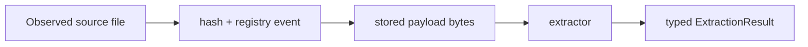

The bytes transformed in the run are the bytes retained by the operational evidence store.

## Extraction keeps file-specific mess outside the financial model

Excel, CSV, and SQLite extractors can understand vendor quirks and physical source shapes.

Their output is still not the final financial vocabulary.

The ingestion coordinator assembles source streams and mappings into `ExtractionResult`, including raw investment evidence, base reference tables, configuration datasets, and column mappings.

This is the boundary where source variability is normalized enough for the canonical transformation DAG to take over.

## A schema gate fails early

Before the extraction result is trusted by deeper transforms, the coordinator asks Polars to resolve the schemas of active lazy streams and performs a small collection gate.

That catches corrupted or structurally invalid source data close to the evidence boundary.

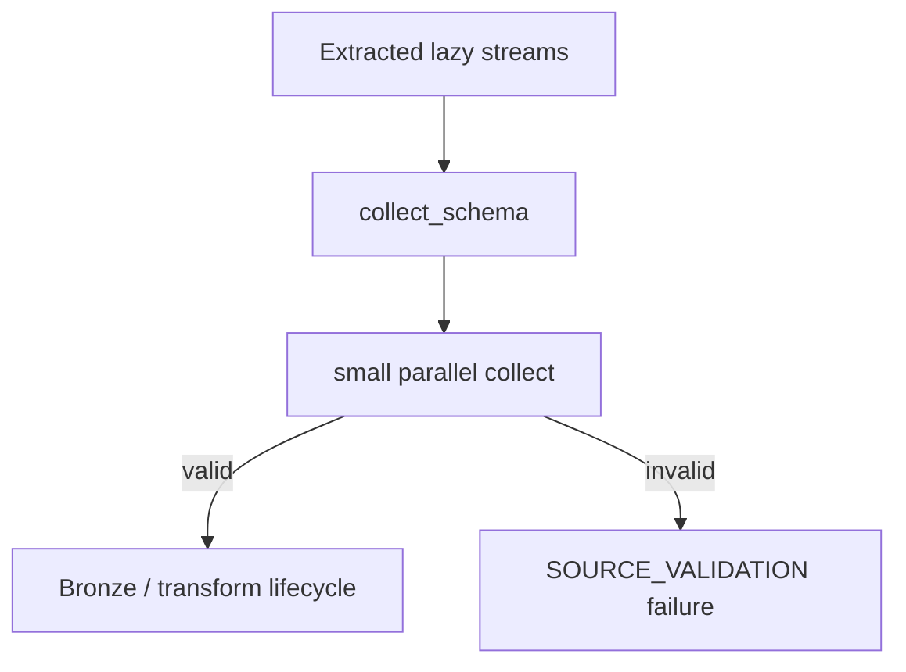

The objective is not exhaustive financial validation at extraction time. It is to prevent malformed physical data from travelling deep into unrelated domain algorithms.

## Phase 2 synchronizes Bronze

`BronzeLayer` receives the extracted actionable state plus the Control Plane and current Meta layer.

If discovery detected renames, identity migration is applied before ordinary loading.

```python
# src/personal_finance_etl/application/pipeline/execution.py
meta_layer = MetaLayer(self.db_manager, self.cfg, self.rules)
bronze = BronzeLayer(self.db_manager, cp, meta_layer)
if renames:
    bronze.migrate_identity(renames)
    meta_layer.migrate_identity(renames)

bronze.load(extracted_data, actionable_all)
```

The lifecycle therefore preserves artifact continuity across both operational and analytical representations.

## Bronze is persistent because it is the rebuild boundary

Silver and Gold are rebuilt. Bronze persists synchronized source-oriented state.

This creates a recovery-friendly asymmetry:

```text
Control Plane payloads = operational evidence authority
Bronze                 = persistent analytical evidence state
Silver / Gold          = rebuildable derived state
```

If a run fails after Bronze synchronization but before analytical publication, the next run can reconstruct the complete analytical state without rereading every historical source file from disk.

## Synchronization completeness is recorded per run

After Bronze loading, the executor creates a run-level synchronization summary.

It records:

- actionable count;
- synced count;
- healed count;
- failed count;
- deferred count;
- final sync status.

A run with no actionable artifacts is recorded as `NOT_REQUIRED` rather than as an empty success that obscures what happened.

If artifacts were actionable, the status becomes `COMPLETE`, `PARTIAL`, or `FAILED` based on actual registry state.

This gives operational diagnostics a compact run-level view without discarding artifact-level events.

## Complete Bronze state is reread before canonical transformation

This is one of the lifecycle's most important transitions.

Only changed evidence is synchronized, but **the full Bronze state** becomes the downstream transformation input.

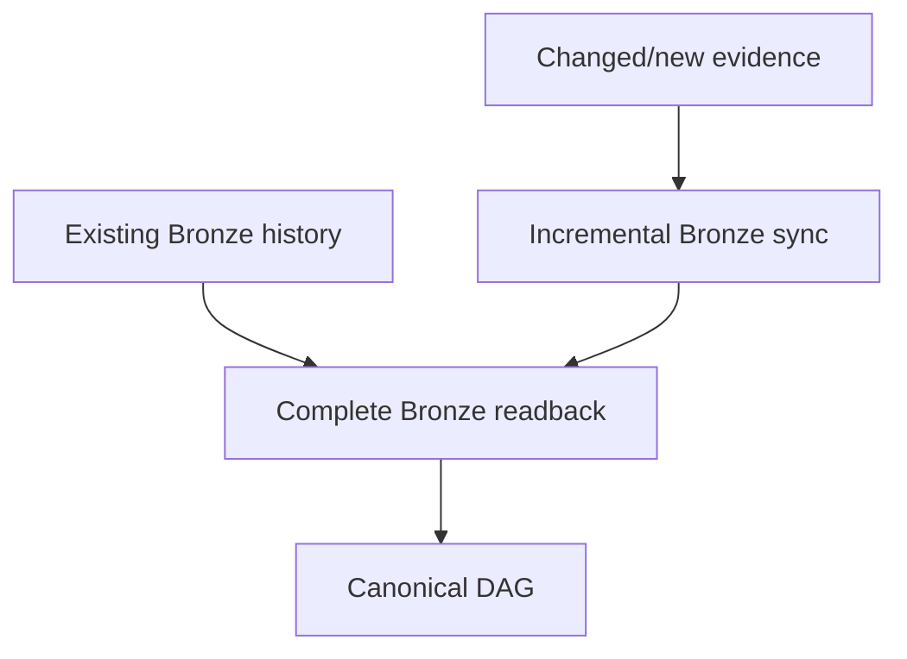

That avoids a difficult class of incremental-invalidity bugs where a changed upstream record would require the pipeline to know every downstream table and calculation that must be selectively recomputed.

For the current workload, deterministic full analytical rebuild is the safer strategy.

## Phase 3 constructs canonical financial vocabulary

`TransformationDAG` maps complete source-oriented state into canonical dimensions and facts.

Its ownership includes:

- 18 base Silver-oriented transformation outputs;
- household dimensions and transactions;
- investment asset pipelines;
- calendar construction and date bounds.

This transition is not merely column renaming.

It decides which source distinctions are economically meaningful and which are source-specific noise.

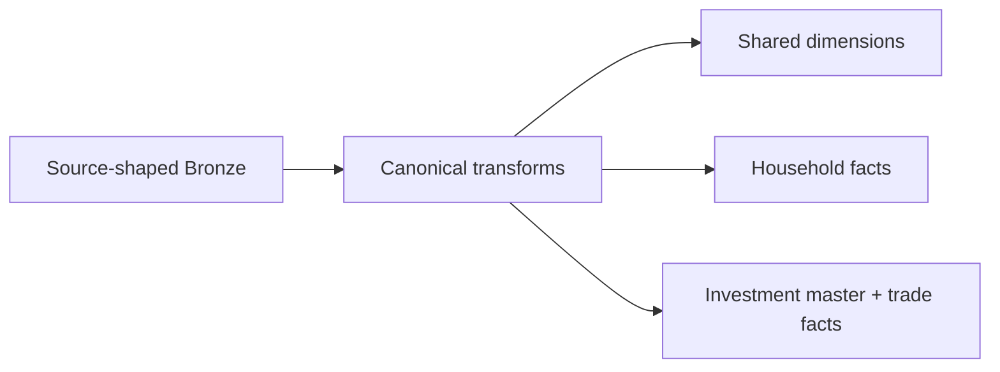

The resulting frames become the shared vocabulary used by specialized domains.

## Asset pipelines normalize source-specific investment evidence

Mutual funds, local stocks, and US stocks do not arrive in the same physical form.

The application layer uses asset strategies to coordinate source-specific normalization while domain transforms own the financial semantics.

This is the point where the lifecycle begins to unify different acquisition channels into comparable investment evidence.

The later Quant engine should not care whether the purchase came from one Excel layout or another.

## Currency evidence has its own lifecycle

Currency is not a formatting concern.

It participates in:

- transaction value normalization;
- local versus reporting-currency performance;
- realized gain decomposition;
- terminal valuation;
- FX attribution;
- benchmark comparison.

The application therefore processes currency evidence after the base canonical DAG but before calculations that require complete FX context.

External currency acquisition is tracked as provider evidence rather than appearing as an invisible network side effect.

## US historical market state has its own lifecycle

US investment reconstruction requires historical market and FX state that is not present in ordinary local broker transaction evidence.

The lifecycle separates:

```text
canonical trade evidence
        ↓
market-history acquisition
        ↓
historical valuation spine
        ↓
investment reconstruction
```

Temporal joins must be backward-looking or otherwise explicitly causal. Future prices must not leak into historical state merely because they are easier to join.

## Benchmark evidence is processed before benchmark-relative analytics

Benchmark mappings identify the appropriate comparison series; benchmark history supplies the actual market path.

Those are distinct evidence roles.

The benchmark lifecycle prepares the state consumed later by CAGR/XIRR comparisons and attribution.

A benchmark is therefore not a post-hoc chart label. It is part of the financial calculation graph.

## Phase 4 reconstructs investment state

The investment pipeline moves through several grains:

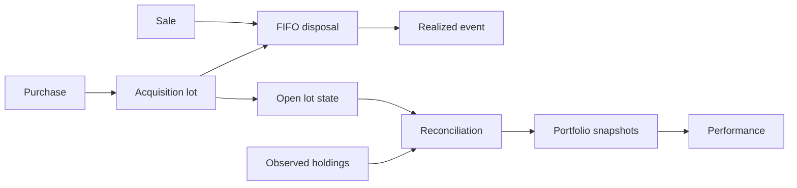

These grains are intentionally not collapsed.

A purchase can create a lot. One sale can consume several lots. Each sale-lot match can create a realized event. Reconciliation can then create synthetic adjustments when reconstructed book state does not agree with observed broker state.

Stable identity across these transitions is covered in [Deterministic Identity and Replay](deterministic-identity-and-replay.md).

## Reconciliation enters only after reconstruction has something to compare

The system distinguishes observed broker state from reconstructed book state.

If they disagree, the discrepancy itself becomes financial evidence.

The reconciliation lifecycle can represent:

- quantity additions;
- quantity removals;
- cost-basis adjustments.

This prevents the pipeline from hiding upstream incompleteness by mutating reconstructed state with no trace of why it changed.

## Performance consumes both book and market state

Returns are not calculated from a single table.

They combine:

- cashflow timing;
- realized events;
- terminal valuation;
- benchmark state;
- local/reporting currency values;
- Tax-aware terminal values where applicable.

That is why performance lives after reconstruction and market enrichment rather than in the initial canonical transform.

## Tax consumes evidence, not vendor layouts

Tax calculation is downstream of the financial events it needs.

Investment Tax evidence is derived from realized/reconciled financial state. Household income evidence comes from canonical household models. Financial rules provide policy.

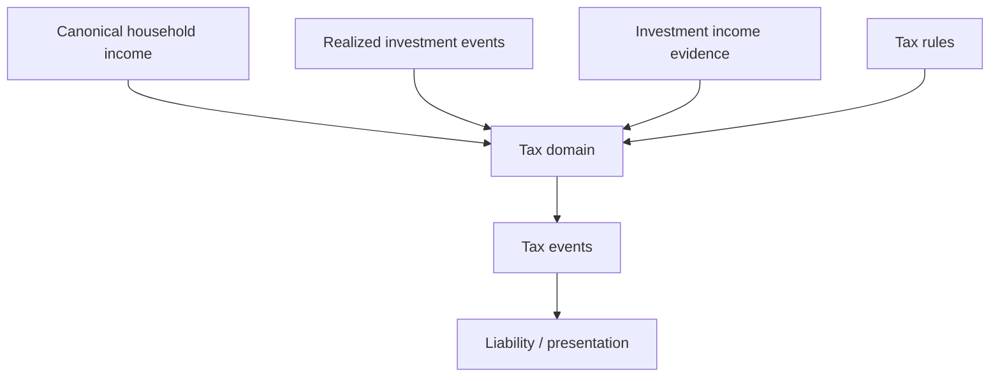

This prevents Tax code from becoming a second source parser or a second FIFO engine.

## Wealth composes domains late

Wealth and net-worth analytics combine household and investment state only after each source domain is coherent.

This ordering keeps aggregate wealth from owning the semantics of its components.

Typical inputs include:

- cashflow and savings history;
- asset and liability state;
- investment market value;
- after-Tax values;
- macro parameters.

The result becomes both a decision surface and an input to FIRE modelling.

## FIRE provenance is part of the run lifecycle

Stochastic output needs more provenance than a deterministic table.

After FIRE risk analytics are produced, the executor logs a simulation run in the Control Plane with:

- run ID;
- root seed;
- rules;
- input frame;
- result frame;
- settings snapshot ID;
- rules snapshot ID.

The Control Plane schema also supports input fingerprint, model fingerprint, implementation version, and result fingerprint.

This separates two questions:

```text
Can I rebuild the deterministic inputs?
Can I reproduce the stochastic simulation from the same provenance?
```

They are related, but not identical.

## Presentation graphs can execute in parallel

The wealth presentation engine can return a mapping of independent `LazyFrame` graphs.

The executor uses `pl.collect_all(..., engine="streaming")` to execute those terminal graphs together.

This is a performance optimization with a clear architectural location: the application coordinates when independent presentation DAGs may be materialized; the domain still owns how each result is calculated.

## The contract completeness gate comes before persistence

The executor compares the set of produced analytical datasets with `DATA_CONTRACT_REGISTRY`.

There are two symmetric failure modes:

### Produced but unregistered

A new dataset exists in memory but has no declared publication contract.

### Registered but missing

The contract says a dataset is required, but the engine failed to produce it.

Both fail the run before Silver/Gold publication.

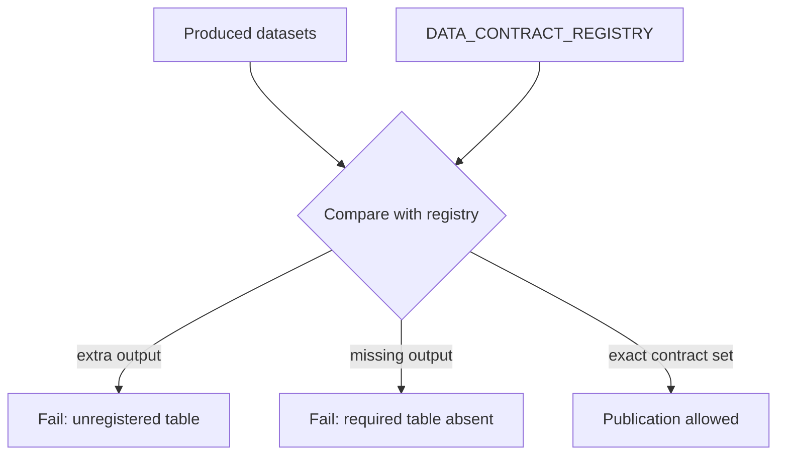

This turns the registry into a schema-evolution checkpoint.

## Phase 5 replaces Silver and Gold

Silver and Gold are recreated and repopulated in registry publication order.

Silver performs physical quality checks such as critical `ISIN` and `TAX_TYPE` null validation on the investment master before insertion.

Gold logs optimized lazy plans and materializes at the publication boundary.

The full-replace strategy means a successful analytical publication represents one coherent rebuild rather than a collection of partially refreshed marts.

## Meta refresh comes after analytical publication

`MetaLayer.load()` refreshes current analytical context:

- row counts;
- current financial rules;
- current settings;
- Bronze and analytical contract inventory;
- current file context.

Meta exists for inspection and analytical convenience.

Historical truth remains in the Control Plane.

## The commit lifecycle starts only after all phase work succeeds

The pipeline does not commit after each phase.

The DuckDB analytical transaction and SQLite Control Plane transaction span the run-level workflow.

The lifecycle coordinator then commits DuckDB first and SQLite second.

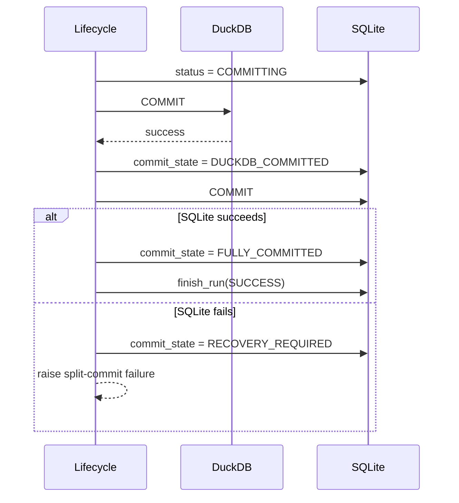

The split state is explicit because the system cannot truthfully call it a rollback.

## A successful run can close prior divergence

Only after the current run reaches `FULLY_COMMITTED` does the lifecycle mark previously pending recovery runs as converged.

That creates a lineage from the diverged run to the later replay/convergence run rather than rewriting the earlier state in isolation.

Recovery becomes an event in history.

## Failure lifecycle depends on commit progress

If an exception occurs, `handle_failure()` classifies the failure and resolves the truthful commit state from the two component transaction flags.

The practical cases are:

| DuckDB committed | SQLite committed | Truth |
|---:|---:|---|
| no | no | rollback may return both stores to pre-run state |
| yes | no | `RECOVERY_REQUIRED`; DuckDB cannot be uncommitted |
| yes | yes | failure happened after durable commit; state remains committed |
| unknown/inconsistent | unknown | `COMMIT_STATE_UNKNOWN` |

The failure record includes stage/type/message/traceback and machine-readable `FailureDomain` where available.

## Stale runs cover process death

Normal exception handling cannot run if the process is killed or the machine stops.

On a later Control Plane open, stale-run recovery identifies interrupted run records and moves them into a truthful recovery state.

This ensures the run ledger does not depend on graceful Python teardown to remain interpretable.

## Backup/restore is outside the ordinary run-replay path

Coordinated snapshots are a separate lifecycle.

They acquire the same pipeline lock so a snapshot or restore cannot race an active production run.

Snapshot captures the SQLite + DuckDB pair. Restore distrusts the archive, validates it in a temporary area, and only then stages database replacement.

This is covered in [Backup and Restore](backup-and-restore.md).

## Lifecycle invariants

The lifecycle is designed around the following invariants.

### Evidence invariants

1. source discovery is recorded before transformed state depends on it;
2. extraction consumes captured payload bytes;
3. path identity is not treated as immutable artifact identity;
4. pending unsynchronized work survives into later runs;
5. provider acquisition is operationally observable.

### Analytical invariants

6. complete Bronze state feeds the analytical rebuild;
7. canonicalization precedes specialized finance;
8. market/FX context precedes dependent valuation/performance;
9. realized investment evidence precedes dependent Tax treatment;
10. wealth composes mature upstream domains;
11. registry completeness precedes Silver/Gold publication.

### Reliability invariants

12. run identity exists before financial execution;
13. settings and financial rules are separately snapshotted;
14. split commit is represented explicitly;
15. prior recovery-required runs are only marked converged after a later successful full commit;
16. backup/restore cannot race the active pipeline lock.

## Lifecycle non-invariants

The system does not promise that:

- every run has changed input evidence;
- every source category is incremental;
- every external provider request succeeds on the first attempt;
- every domain uses the same compute abstraction;
- every dataset remains lazy to the same point;
- every failed run leaves both databases byte-for-byte unchanged;
- every future workload size will justify full analytical replacement.

Those are intentionally not architectural contracts.

## Why this lifecycle fits the workload

The workload has three useful characteristics:

1. source evidence grows incrementally;
2. analytical dependency relationships are rich;
3. the complete dataset remains practical to rebuild locally.

That makes a hybrid strategy attractive:

```text
incremental operational capture
+ persistent Bronze synchronization
+ full deterministic analytical rebuild
+ explicit financial reconciliation
+ coordinated commit/recovery
```

The design avoids both extremes:

- reparsing every historical file every run;
- maintaining a fragile graph of partial analytical invalidations forever.

## Continue into persistence

The lifecycle has now reached durable analytical state. The next question is what each DuckDB layer stores and why publication is registry-governed.

Continue with [Warehouse Architecture](warehouse-architecture.md), then [Control Plane Artifact Lifecycle](control-plane-artifact-lifecycle.md) for the operational history behind the same run.

## Related specifications

- [Architecture](README.md)
- [System Architecture](system-architecture.md)
- [Application and Dependency Architecture](application-and-dependency-architecture.md)
- [Warehouse Architecture](warehouse-architecture.md)
- [Control Plane Artifact Lifecycle](control-plane-artifact-lifecycle.md)
- [Deterministic Identity and Replay](deterministic-identity-and-replay.md)
- [Reliability and Recovery](reliability-and-recovery.md)
- [Data Model](data-model.md)
