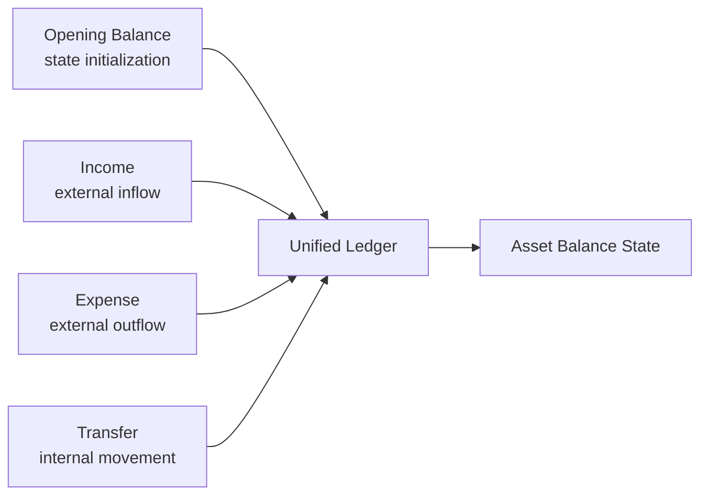
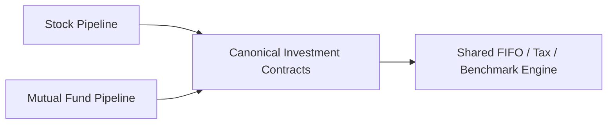

# Data Model

The data model is built around **financial meaning and analytical grain**, not around the shape of source files.

The central modelling boundary is:

```text
Source-shaped Bronze
        ↓
Canonical Silver
        ↓
Decision-oriented Gold
```

A bank column, broker worksheet or vendor label should disappear before it becomes a permanent downstream financial concept.

The physical analytical contract surface behind that model is currently:

```text
Bronze   16 source contracts
Silver   20 canonical contracts
Gold     17 decision marts
Meta      5 current-state tables
```

Bronze preserves source identity. Silver introduces canonical financial identity. Gold publishes only decision-serving grains.


---

## 1. Financial authority and grain

The registry encodes grain explicitly:

```python
@dataclass
class DataContract:
    contract_id: str
    layer: str
    physical_table: str
    domain: str
    grain: str
    producer: str
    publication_order: int
```

Examples in the hardened registry include:

```python
DataContract(
    "df_p_tf_net_worth_monthly_summary",
    "gold",
    "gold.Wealth_Asset_Breakdown",
    "Wealth",
    "Month-Asset",
    "WealthPresentationEngine",
    110,
)

DataContract(
    "df_f_investment_analytics_isin",
    "gold",
    "gold.Investment_By_ISIN",
    "Investments",
    "Date-ISIN",
    "InvestmentQuantEngine",
    200,
)
```

**Implementation:** `src/personal_finance_etl/backend/load/registry.py` (lines 1–15).

```python
from dataclasses import dataclass


@dataclass
class DataContract:
    contract_id: str
    layer: str
    physical_table: str
    domain: str
    grain: str
    producer: str
    publication_order: int


@dataclass
```

## 2. Calendar, currency and category dimensions

The current Silver surface contains **20 contracts**.

### Reference / dimensions

```text
d_Calendar
d_Income_Category
d_Income_Subcategory
d_Expense_Category
d_Expense_Subcategory
d_Asset_Category
d_Asset_SubCategory
d_Currency
d_Investment_Benchmark_Master
d_Investment_Master
d_Macro_Parameters
```

### Facts

```text
f_Income_Transactions
f_Expense_Transactions
f_Transfer_Transactions
f_Opening_Balances
f_Investment_Market_Data
f_Investment_Purchase_Data
f_Investment_Sale_Data
f_Investment_Benchmark_Data
f_Investment_Analytics_Lot
```

Silver is where source vocabulary becomes stable financial vocabulary.

---

**Implementation:** `src/personal_finance_etl/backend/load/schema/silver.py` (lines 1–48).

```python
SILVER_DDL = """
CREATE TABLE IF NOT EXISTS silver.d_Calendar (
    -- Identifiers
    Date DATE PRIMARY KEY,
    -- Descriptors/Classifications
    Day BIGINT,
    Day_Name TEXT,
    Day_Name_Short TEXT,
    Day_Ordinal BIGINT,
    Day_Ordinal_Name TEXT,
    Weekday BIGINT,
    IS_WEEKEND BIGINT,
    Week BIGINT,
    Week_Ordinal BIGINT,
    Week_Ordinal_Name TEXT,
    Week_Name TEXT,
    Week_Year TEXT,
    Week_Name_Year TEXT,
    Start_of_Week DATE,
    End_of_Week DATE,
    Month BIGINT,
    Month_Name TEXT,
    Month_Name_Short TEXT,
    Month_Year TEXT,
    Short_Month_Year TEXT,
    V_Short_Month_Year TEXT,
    Month_Ordinal BIGINT,
    Start_of_Month DATE,
    End_of_Month DATE,
    Days_in_Month BIGINT,
    Month_Progress_Pct DOUBLE,
    Quarter BIGINT,
    Quarter_Name TEXT,
    Quarter_Year TEXT,
    Quarter_Ordinal BIGINT,
    Start_of_Quarter DATE,
    End_of_Quarter DATE,
    Year BIGINT,
    Days_in_Year BIGINT,
    Year_Progress_Pct DOUBLE,
    Financial_Year TEXT,
    FY_Year BIGINT,
    FY_Month BIGINT,
    FY_Month_Ordinal BIGINT,
    FY_Quarter BIGINT,
    FY_Quarter_Name TEXT,
    FY_Quarter_Year TEXT,
    FY_Quarter_Ordinal BIGINT,
```

## 3. Household transaction semantics

The household model distinguishes four fundamental activity/state types:



These concepts are intentionally separate.

### Opening balance

Initializes state when complete lifetime history is unavailable.

It is not income.

### Income

Represents household inflow under canonical classification.

FinancialRules can further distinguish:

```text
cash
non-cash
active
dividend
interest
```

### Expense

Represents household outflow/consumption.

**Implementation:** `src/personal_finance_etl/backend/transform/facts.py` (lines 1–44).

```python
import polars as pl

from personal_finance_etl.backend.config.financial_rules import FinancialRules

BASE_TRANSACTION_COLS = [
    "__file_name__",
    "__folder_path__",
    "S_NO",
    "UID",
    "ASSET_ID",
    "CARDDIVIDMONTH",
    "CATEGORY_ID",
    "TO_ASSET_ID",
    "DESCRIPTION",
    "TIMESTAMP",
    "DATE",
    "TIME",
    "PAID",
    "TRANSACTION_TYPE",
    "BASE_AMOUNT",
    "TRANSFER_UID",
    "FEES_NOTES",
    "LOCAL_AMOUNT",
    "MARK",
    "TRANSFER_FEES",
    "UPDATED_TIME",
    "CURRENCY_ID",
    "AMOUNT_ACCOUNT",
    "EXCH_RATE",
]


def get_base_transactions(df_lazy: pl.LazyFrame, column_mapping: dict[str, str]) -> pl.LazyFrame:
    """
    Acts as the TRANSACTIONS helper query.
    Reads INOUTCOME once, renames columns, and filters deleted rows.
    """
    df_renamed = df_lazy.rename(column_mapping)
    raw_columns = set(df_renamed.collect_schema().names())
    required_columns = {"IS_DEL", "UID", "BASE_AMOUNT"}
    missing_columns = sorted(required_columns - raw_columns)
    if missing_columns:
        raise ValueError(f"INOUTCOME is missing required transaction columns: {missing_columns}")

```

## 4. Instrument and investment identity

`d_Investment_Master` provides stable instrument identity and analytical classification.

Important concepts include:

```text
ISIN
instrument name
instrument type
subtype
class
sector
industry
benchmark
tax type
```

The Silver loader performs quality checks for fields that downstream financial methodology requires.

For example:

```python
if table_name == "silver.d_Investment_Master":
    if "ISIN" in df.columns:
        missing_isin = df.filter(
            pl.col("ISIN").is_null()
        )

    if "TAX_TYPE" in df.columns:
        missing_tax = df.filter(
            pl.col("TAX_TYPE").is_null()
        )
```

Those are not cosmetic dimensions.

Missing identity or tax classification can invalidate downstream lot/tax analytics.

**Implementation:** `src/personal_finance_etl/backend/transform/investments.py` (lines 1–48).

```python
from datetime import datetime, timezone
from typing import Any

import polars as pl

from personal_finance_etl.backend.utils.identity import generate_deterministic_id


def get_purchase_reference(
    df_lazy: pl.LazyFrame,
    instrument_col: str,
    date_col: str,
    price_col: str,
    qty_col: str,
    extra_group_cols: list[str] | None = None,
) -> pl.LazyFrame:
    """
    Translates DAX SUMMARIZE + CALCULATE(SUM) for Purchases.
    Groups by Instrument, ISIN, Date, and Price, then sums the Quantity.
    Returns: ISIN, Date, Price, Quantity, Value
    """
    group_cols = [
        "__file_name__",
        "__folder_path__",
        "__file_category__",
        "ISIN",
        pl.col(instrument_col).alias("Instrument name"),
        pl.col(date_col).alias("Date"),
        pl.col(price_col).alias("Price"),
    ]
    if extra_group_cols:
        group_cols.extend(extra_group_cols)

    df_grouped = (
        df_lazy
        # SUMMARIZE equivalent
        .group_by(group_cols)
        # CALCULATE(SUM(Quantity)) equivalent
        .agg(pl.col(qty_col).sum().alias("Quantity"))
        # DAX: Value = Quantity * Price
        .with_columns((pl.col("Quantity") * pl.col("Price")).alias("Value"))
    )
    return df_grouped


def get_sale_reference(
    df_sale_lazy: pl.LazyFrame,
    df_purchase_ref_lazy: pl.LazyFrame,
```

## 5. Canonical purchases and sales

The shared investment engine consumes canonical:

```text
Investment Master
Purchase Data
Sale Data
Market Data
Benchmark Data
Macro / Tax Context
```

That lets stocks and mutual funds converge into one analytical model after asset-specific upstream transformation.



The asset pipeline boundary absorbs source/asset variation.

The investment engine should not need to know which source worksheet produced a purchase.

---

**Implementation:** `src/personal_finance_etl/backend/utils/identity.py` (lines 1–38).

```python
import hashlib
import json
import unicodedata
from datetime import date, datetime
from decimal import Decimal, InvalidOperation
from typing import Any

# Preserve the established v2 serialization order for known identity contracts.
# This makes the output independent of caller dict construction order without
# silently changing existing IDs. Add a contract here whenever a namespace's
# defining fields change.
_IDENTITY_FIELD_ORDERS: dict[str, tuple[tuple[str, ...], ...]] = {
    "PURCHASE": (("ISIN", "Date", "Price", "Quantity", "CURRENCY_ID"),),
    "SALE": (("ISIN", "Date", "Sell_Price", "Quantity", "CURRENCY_ID"),),
    "LOT": (
        ("ISIN", "Purchase_ID", "Quantity", "Date"),
        ("ISIN", "Date", "Quantity", "Price", "Currency", "Event"),
        ("ISIN", "Date", "Quantity", "Price", "Currency", "Event", "Recon_Group"),
        ("ISIN", "Event", "Recon_Group"),
    ),
    "REALIZED": (("Sale_ID", "Lot_ID"),),
    "RECON_GROUP": (
        (
            "ISIN",
            "Reconciliation_Date",
            "Adjustment_Type",
            "Broker_Quantity",
            "Reconstructed_Quantity",
            "Broker_Cost_Basis",
            "Reconstructed_Cost_Basis",
        ),
    ),
    "RECON_EVENT": (("Reconciliation_Group_ID", "Lot_ID", "Adjustment_Type"),),
    "RECON_LOT_GROUP": (("ISIN", "Reconciliation_Date", "Adjustment_Type", "Quantity"),),
    "TAX": (("Source_Type", "Source_ID", "Tax_Sub_Head"),),
}


```

## 6. FIFO lot and realized-event grains

`f_Investment_Analytics_Lot` is the deepest persistent investment analytical fact.

Conceptually:

```text
Date × ISIN × Active Tax Lot
```

It carries state needed for:

- acquisition context,
- quantity,
- cost basis,
- market value,
- holding period,
- tax classification,
- benchmark state,
- realized/unrealized state,
- estimated tax,
- after-tax value,
- return context.

Gold aggregates from this deeper state where appropriate.

---

**Implementation:** `src/personal_finance_etl/backend/engines/analytics/core/fifo.py` (lines 1–48).

```python
from collections import deque
from datetime import date
from typing import Any

from personal_finance_etl.backend.engines.analytics.rules.macro import FYMacroParametersTable
from personal_finance_etl.backend.utils.identity import generate_deterministic_id
from personal_finance_etl.backend.utils.logger import logger
from personal_finance_etl.backend.utils.models import TaxLot


class FIFOPortfolio:
    """Manages the FIFO tracking of a single instrument's lots."""

    def __init__(
        self,
        tax_type: str,
        tax_subtype: str,
        fy_table: FYMacroParametersTable,
        default_currency_id: str,
        isin: str,
    ):
        self._active_lots: deque[TaxLot] = deque()
        self.tax_type = tax_type
        self.tax_subtype = tax_subtype
        self.fy_table = fy_table
        self.default_currency_id = default_currency_id
        self.isin = isin

    @property
    def active_lots(self) -> list[TaxLot]:
        """Read-only access to active lots."""
        return list(self._active_lots)

    def buy(
        self,
        buy_date: date,
        qty: float,
        price: float,
        shadow_qty: float,
        bm_price: float,
        price_local: float = 0.0,
        fx_rate_buy: float = 1.0,
        currency_id: str | None = None,
        bm_buy_local: float | None = None,
        purchase_id: str | None = None,
        lot_source_type: str = "PURCHASE",
        reconciliation_group_id: str | None = None,
    ) -> None:
```

## 7. Observed versus reconstructed market state

The data model intentionally contains several epistemic categories.

| State | Example |
| --- | --- |
| **Observed** | Broker-reported quantity, market price |
| **Reconstructed** | FIFO lot inventory, household book balance |
| **Derived** | XIRR, savings rate, active return |
| **Estimated** | Tax if sold |
| **Modelled** | FI target |
| **Simulated** | P50 months to FI |

Those values can coexist in one analytical system without pretending they carry the same certainty.

---

**Implementation:** `src/personal_finance_etl/backend/transform/us_stocks_transformer.py` (lines 1–42).

```python
import dataclasses
from collections import defaultdict, deque
from datetime import date, timedelta
from typing import Any

import polars as pl

from personal_finance_etl.backend.utils.ordering import sort_purchases, sort_sales


def transform_us_market_data(
    df_bronze_prices_lazy: pl.LazyFrame,
    df_purchase_lazy: pl.LazyFrame,
    df_sale_lazy: pl.LazyFrame,
    df_fx_lazy: pl.LazyFrame,
    global_start_date: date,
    global_end_date: date,
) -> pl.LazyFrame:
    """
    Transforms bronze raw US stock prices into a continuous silver daily series,
    builds the FIFO spine, joins FX rates, and calculates PnL.
    """
    df_purchase = df_purchase_lazy.collect()
    df_sale = df_sale_lazy.collect()

    if df_purchase.is_empty():
        return pl.DataFrame().lazy()

    us_purchases = df_purchase.filter(pl.col("__file_category__") == "US Stocks")
    if us_purchases.is_empty():
        return pl.DataFrame().lazy()

    active_isins = us_purchases["ISIN"].unique().to_list()

    # --- Phase 1: Reconstruct FIFO Spine ---
    df_p_us = us_purchases.select(
        ["ISIN", "Date", "Quantity", "Value_Local", "Value", "CURRENCY_ID"]
    ).sort(["ISIN", "Date"])
    df_s_us = (
        df_sale.filter(pl.col("__file_category__") == "US Stocks")
        .select(["ISIN", "Date", "Quantity"])
        .sort(["ISIN", "Date"])
```

## 8. Currency and financial valuation semantics


The distinctions matter for planning.

A book balance can be internally coherent while differing from market value.

Market value can be observable while after-tax liquidation value remains modelled.

---

**Implementation:** `src/personal_finance_etl/backend/transform/currency_transformer.py` (lines 1–42).

```python
from datetime import date

import polars as pl


def transform_currency_fx_rates(
    df_bronze_lazy: pl.LazyFrame,
    df_currency_master_lazy: pl.LazyFrame,
    global_start_date: date,
    global_end_date: date,
) -> pl.LazyFrame:
    """
    Transforms Bronze FX observations into a daily Silver series.

    Missing dates may use the latest prior observation for up to seven calendar
    days (weekends and short market holidays). Rates before the first observation,
    rates older than the staleness limit, and invalid rates fail closed.
    """
    # 1. Create a continuous date spine
    df_spine = pl.DataFrame(
        {
            "Date": pl.date_range(
                start=global_start_date, end=global_end_date, interval="1d", eager=True
            )
        }
    ).lazy()

    # 2. Get active tickers
    df_active_tickers = (
        df_currency_master_lazy.filter(pl.col("Is_Active"))
        .select(["UID", "ISO", "Target_Currency_Code", "yF_Ticker"])
        .rename({"UID": "Currency_ID", "ISO": "Currency_Code"})
    )

    # 3. Join Spine with Tickers (Cross Join to get all combinations)
    df_spine_full = df_spine.join(df_active_tickers, how="cross")

    # 4. Validate malformed observed rates, then aggregate valid observations to daily level.
    invalid_source_fx = (
        df_bronze_lazy.filter(
            pl.col("FX_Rate").is_not_null()
            & (~pl.col("FX_Rate").is_finite() | (pl.col("FX_Rate") <= 0))
```

## 9. Tax events and indicative estimates

A source may call the same concept:

```text
Txn Type
Nature
Movement
Debit/Credit
Order Type
```

The downstream model should not care.

Source adapters/mappings resolve those fields before canonical finance.

This is the main reason the project can support multiple upstream shapes without forcing every analytical engine to become source-aware.

---

**Implementation:** `src/personal_finance_etl/backend/engines/tax/core/base_events.py` (lines 1–46).

```python
from __future__ import annotations

import math
from datetime import date, datetime
from typing import Any

import polars as pl

from personal_finance_etl.backend.config.financial_rules import FinancialRules
from personal_finance_etl.backend.engines.analytics.rules.macro import FYMacroParametersTable
from personal_finance_etl.backend.utils.identity import generate_deterministic_id

TAX_EVENT_SCHEMA: dict[str, pl.DataType] = {
    "Tax_Event_ID": pl.String(),
    "FY": pl.String(),
    "Event_Date": pl.Date(),
    "Source_Type": pl.String(),
    "Source_ID": pl.String(),
    "Income_Head": pl.String(),
    "Tax_Sub_Head": pl.String(),
    "Amount_INR": pl.Float64(),
    "Applied_Rate": pl.Float64(),
    "Estimated_Tax": pl.Float64(),
    "CURRENCY_ID": pl.String(),
    "Tax_Status": pl.String(),
    "Tax_Status_Reason": pl.String(),
    "ISIN": pl.String(),
    "Lot_ID": pl.String(),
}


class BaseEventsBuilder:
    """Normalize ledger, tax-credit and Quant FIFO evidence into canonical TaxEvents.

    The builder carries FIFO-provided investment estimates and calculates indicative
    ledger estimates using the configured ordinary-income rate. It does not calculate
    final statutory liability or apply annual set-off/credit rules.
    """

    def __init__(
        self,
        df_income: pl.DataFrame,
        df_realized_events: pl.DataFrame,
        df_subcategory: pl.DataFrame,
        rules: FinancialRules | None,
        df_macro_parameters: pl.DataFrame | None = None,
```

## 10. Gold aggregation and additivity

Not every numeric field can be summed.

### Additive

Often valid across compatible dimensions:

```text
income
expense
current value
realized gain/loss
```

### Semi-additive

Balances can aggregate across assets but generally not across time:

```text
cash balance
market value
net worth
```

### Non-additive

Require target-grain methodology:

```text
XIRR
CAGR
max drawdown
allocation weight
rates / ratios
```

For example:

**Implementation:** `src/personal_finance_etl/backend/load/registry.py` (lines 100–127).

```python
    DataContract(
        "df_d_expense_subcategory",
        "silver",
        "silver.d_Expense_Subcategory",
        "Wealth",
        "Subcategory",
        "CoreEngine",
        50,
    ),
    DataContract(
        "df_d_asset_category",
        "silver",
        "silver.d_Asset_Category",
        "Wealth",
        "Category",
        "CoreEngine",
        60,
    ),
    DataContract(
        "df_d_asset_subcategory",
        "silver",
        "silver.d_Asset_SubCategory",
        "Wealth",
        "Subcategory",
        "CoreEngine",
        70,
    ),
    DataContract(
```

## 11. Contract evolution and invariants

Changing a canonical or Gold contract can affect:

```text
transformation
engine builders
DataContract registry
DuckDB DDL
Meta row counts
Power BI
documentation
```

That is why physical schemas are treated as interfaces inside the project.

A column rename is not merely cosmetic when external BI consumes it.

---

**Implementation:** `src/personal_finance_etl/backend/load/registry.py` (lines 477–502).

```python
def get_contract_by_table(physical_table: str) -> DataContract | None:
    for contract in DATA_CONTRACT_REGISTRY:
        if contract.physical_table.lower() == physical_table.lower():
            return contract
    return None


def validate_registry() -> None:
    seen_ids: set[str] = set()
    seen_tables: set[str] = set()
    silver_count = 0
    gold_count = 0

    for contract in DATA_CONTRACT_REGISTRY:
        if not contract.contract_id:
            raise ValueError("Contract ID cannot be empty.")
        if contract.contract_id in seen_ids:
            raise ValueError(f"Duplicate contract_id found: {contract.contract_id}")
        seen_ids.add(contract.contract_id)

        table_lower = contract.physical_table.lower()
        if table_lower in seen_tables:
            raise ValueError(
                f"Duplicate Silver/Gold physical table mapping: {contract.physical_table}"
            )
        seen_tables.add(table_lower)
```

## Integration and related specifications

- [System architecture](system-architecture.md)
- [Artifact lifecycle](control-plane-artifact-lifecycle.md)
- [Identity and replay](deterministic-identity-and-replay.md)
- [Backup and restore](backup-and-restore.md)

