# Data Model

Personal Finance ETL models finance as a set of related evidence domains rather than one universal transaction table. Household cashflow, assets, currencies, investment trades, market observations, reconstructed lots, realized events, tax evidence, and wealth presentation have different grains and different authorities. The data model keeps those distinctions visible.

This document describes the **logical model** and ownership boundaries. Exact physical columns and types belong in the Reference contracts.

## 1. Domain map

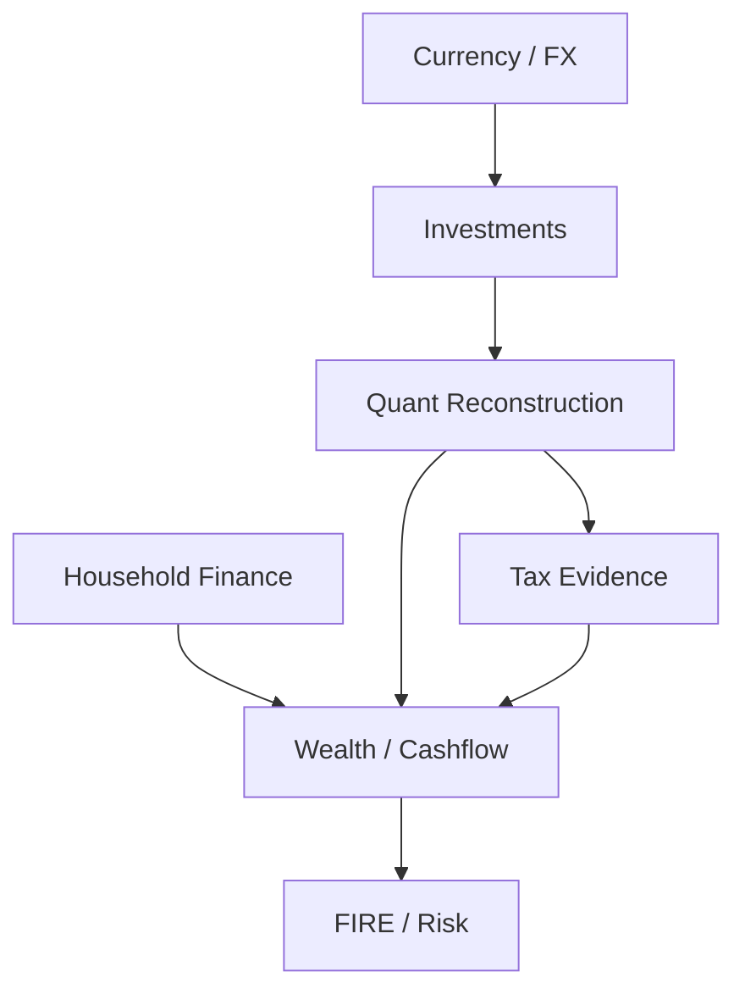

The model is intentionally directional. Tax consumes Quant realized events; it does not own investment lot reconstruction. Wealth consumes canonical and reconstructed facts; it does not become their source authority.

## 2. Observed, canonical, reconstructed, reconciled, estimated

Financial meaning depends on provenance. The model uses several semantic classes:

| Semantic class | Meaning | Example |
|---|---|---|
| Observed evidence | supplied by an external/source artifact | broker transaction, household ledger row, market quote |
| Canonical fact | normalized representation of evidence | canonical purchase/sale fact |
| Reconstructed state | derived from evidence over time | historical US holding, FIFO lot state |
| Reconciled state | explicit adjustment between reconstructed and observed state | quantity/cost-basis reconciliation event |
| Estimated value | model-derived amount with bounded interpretation | indicative tax estimate, FIRE percentile |
| Presentation | consumption-oriented aggregation | portfolio-by-sector, tax-year summary |

A useful documentation invariant follows:

> Derived convenience never upgrades provenance.

A reconstructed holding remains reconstructed even if it is the best available historical state.

## 3. Layered logical model

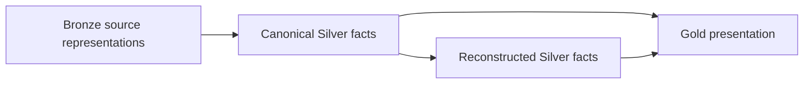

Not all Silver facts are purely observed/canonical. Quant outputs such as lots, realized events, and reconciliation events are derived but remain Silver because they are canonical analytical facts consumed by multiple presentation outputs.

## 4. Common dimensions

The shared model includes:

- `silver.d_Calendar` at day grain;
- `silver.d_Currency` at currency grain;
- `silver.f_Currency_FX_Rates` at date-currency grain.

These dimensions/facts connect household and investment analytics to consistent time/currency semantics.

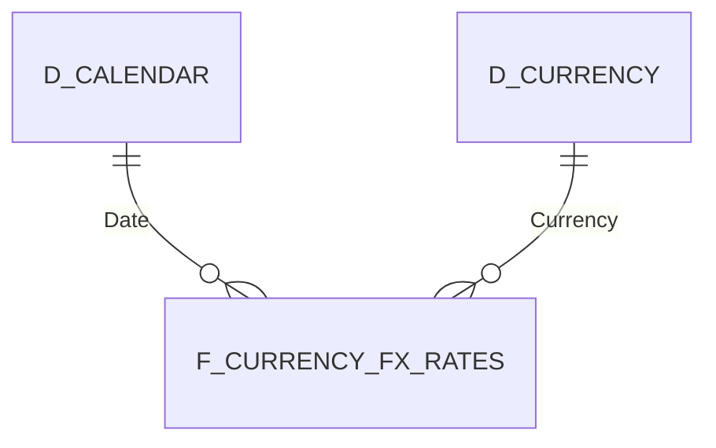

## 5. Household finance model

Household finance is built around classification dimensions and transaction facts.

### Dimensions

- income category;
- income subcategory;
- expense category;
- expense subcategory;
- asset category;
- asset subcategory.

### Facts

- income transactions;
- expense transactions;
- transfer transactions;
- opening balances.

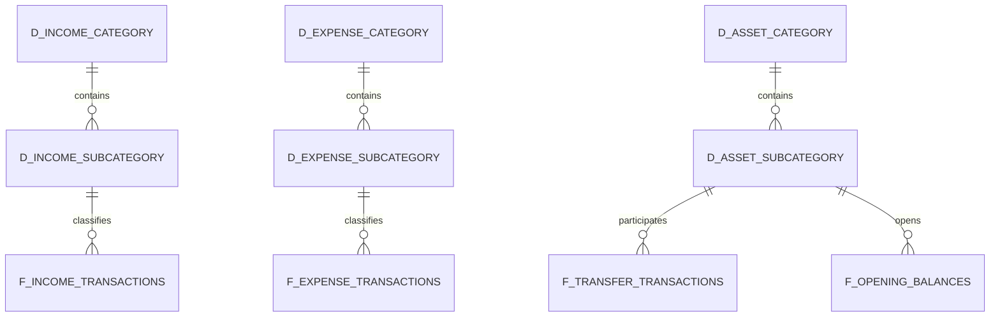

The household model separates transfers from income/expense so movement between owned assets does not automatically become economic income or consumption.

## 6. Household transaction derivation

`TransformationDAG` begins with a common base transaction representation from the source household ledger and then derives income, expense, and transfer facts through separate transformations.

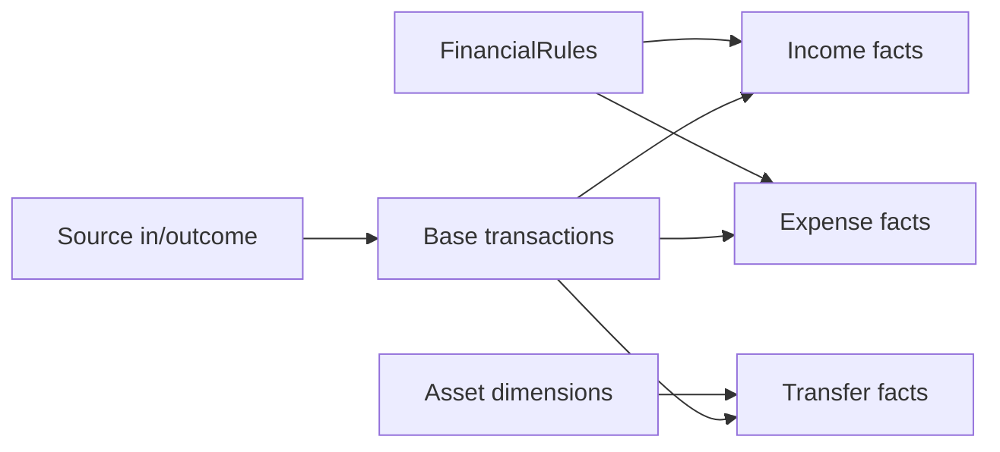

This keeps financial classification rules explicit rather than encoding meaning solely in source labels.

## 7. Investment evidence model

The canonical investment model begins with five core evidence families:

```text
instrument master
purchase facts
sale facts
market observations
benchmark observations
```

Currency/FX and macro parameters provide additional interpretation context.

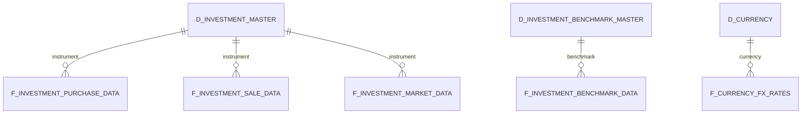

The common investment facts normalize mutual funds, Indian equities, and US equities into a shared downstream model.

## 8. Investment master

`silver.d_Investment_Master` is at ISIN/instrument grain according to the registry. It provides the instrument attributes required by market, Quant, tax, and presentation processing.

Source-specific master fragments are produced by asset pipelines and unified by `get_d_investment_master()`.

The master is canonical metadata. It does not contain the temporal holding state of an instrument.

## 9. Canonical purchase and sale facts

`silver.f_Investment_Purchase_Data` and `silver.f_Investment_Sale_Data` are trade-grain canonical facts.

Deterministic transaction identities are generated from semantic fields rather than row positions. Current identity namespaces include `PURCHASE` and `SALE`, with canonical field ordering defined in `backend/utils/identity.py`.

Conceptually:

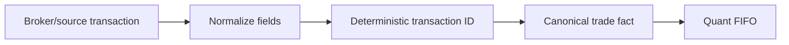

This stable identity is critical because downstream lot and realized-event identities build on transaction identity.

## 10. Market-data model

`silver.f_Investment_Market_Data` is quote-grain canonical market state. It combines market representations across asset types, including reconstructed US historical state.

That last clause matters: the physical table is canonical for analytics, but not every row has identical provenance.

```text
Indian/MF market observations
        +
US reconstructed historical market state
        ↓
canonical investment market fact
```

The Finance market-reconstruction specification documents this provenance in depth.

## 11. Currency model

The currency model distinguishes local/instrument currency from reporting currency.

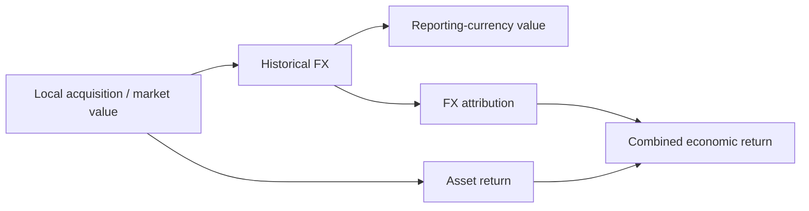

This enables the system to distinguish asset performance from currency translation effects rather than treating every INR movement as instrument alpha.

## 12. Historical US reconstruction model

US broker evidence does not provide an equivalent reliable daily holdings history. The application therefore reconstructs historical holdings/market state from canonical transactions plus historical price/FX evidence.

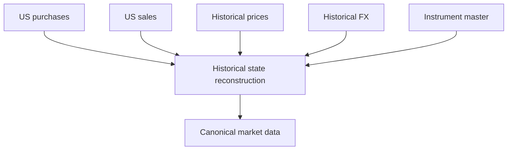

This reconstruction is **not** the canonical acquisition-lot model. Its purpose is historical market/valuation state. `FIFOPortfolio` remains the canonical lot authority.

## 13. Quant reconstruction model

The Quant Engine publishes three important Silver facts:

- `f_Investment_Analytics_Lot` at ISIN-lot grain;
- `f_Investment_Realized_Events` at realized-event grain;
- `f_Investment_Reconciliation_Events` at reconciliation-event grain.

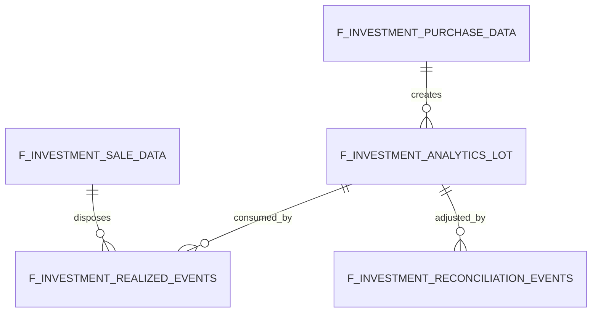

The exact physical relationships are identity/provenance relationships rather than necessarily enforced SQL foreign keys.

## 14. Lot model

`FIFOPortfolio` maintains active acquisition lots. A normal purchase creates a deterministic lot identity derived from purchase semantics. Sales consume oldest active lots first.

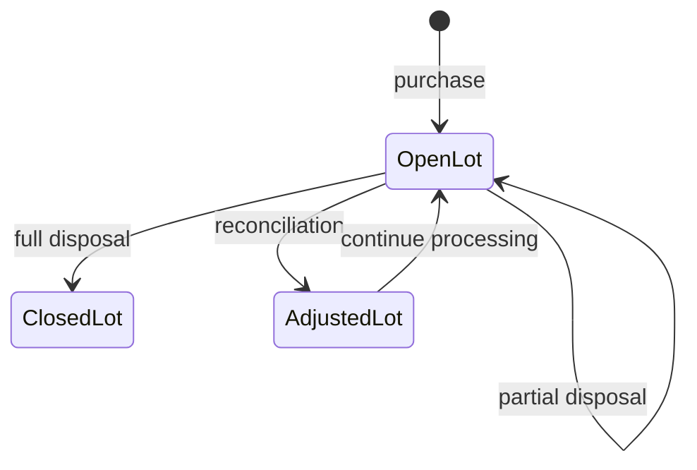

A lot is reconstructed financial state, not a direct broker row.

## 15. Realized-event model

A single sale can consume multiple lots. The model therefore represents realized disposal components rather than collapsing the entire sale into one opaque PnL number.

Current realized identity semantics are based on sale and lot identity:

```text
REALIZED(Sale_ID, Lot_ID)
```

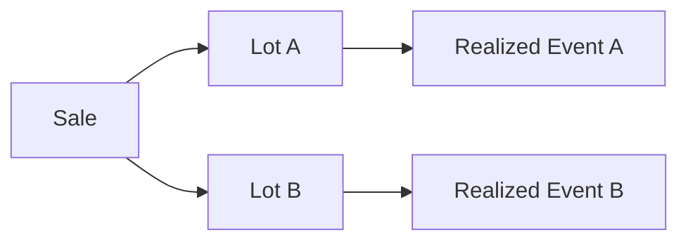

This preserves acquisition lineage for holding period, tax classification, local/INR gain, and reconciliation-aware analysis.

## 16. Reconciliation model

Reconciliation compares reconstructed portfolio state with externally observed state where such observations are available.

Two discrepancies are semantically different:

### Quantity discrepancy

```text
observed quantity != reconstructed quantity
```

### Cost-basis discrepancy

```text
observed quantity == reconstructed quantity
but
observed cost basis != reconstructed cost basis
```

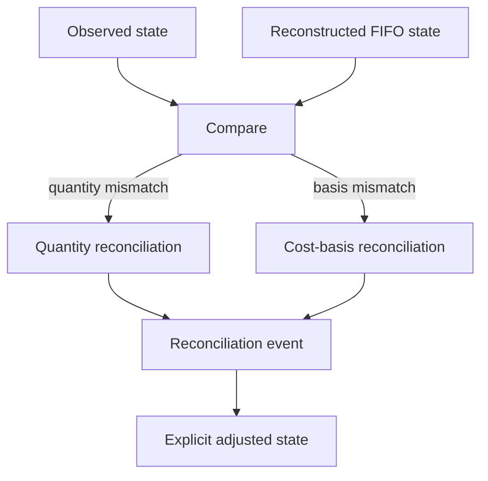

The model records adjustment provenance instead of silently rewriting lot history.

## 17. Benchmark model

Benchmark data is canonicalized separately from investment market data and consumed by Quant for comparative analytics. This allows portfolio/instrument performance to be compared against configured benchmarks without embedding benchmark values directly into transaction facts.

## 18. Macro-parameter model

`silver.d_Macro_Parameters` is at financial-year grain according to the registry. It supplies time-sensitive financial interpretation such as holding-period/tax-rate context used by Quant and Tax.

Keeping macro parameters in canonical data makes financial-year behavior inspectable rather than hiding it entirely inside Python constants.

## 19. Tax evidence model

`silver.f_Tax_Events` is the canonical tax-relevant evidence table.

Its upstream evidence comes from:

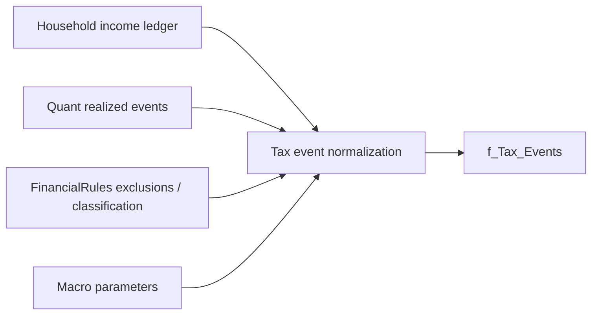

Investment-related ledger categories can be excluded when Quant already owns the realized economic event, preventing double counting.

## 20. Tax presentation model

Three Gold tables present tax evidence:

- `Tax_Year_Summary`;
- `Tax_Income_Breakdown`;
- `Tax_Reconciliation`.

These are presentation outputs over canonical tax events. They are not a statutory tax return model.

Indicative estimates and evidence-quality status can coexist. `CHECK_REQUIRED` does not necessarily mean “no estimate can be calculated”; it means the evidence/classification requires review.

## 21. Wealth model

Wealth presentation combines household ledger state, asset balances, investment analytics, inflation, and tax-aware context into BI-facing measures.

Core builders include:

- `InflationBuilder`;
- `LedgerBuilder`;
- `NetWorthBuilder`.

Presentation modules then derive spending, income streams, budget forecasts, investment presentation, cashflow, and wealth-risk analytics.

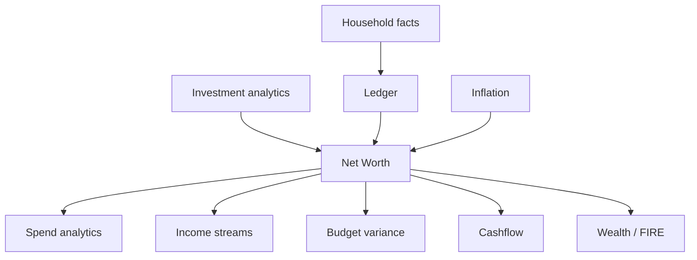

## 22. FIRE model

FIRE outputs are probabilistic presentation, not canonical evidence.

The simulation incorporates configured components including:

- expected real return and volatility;
- Markov market regimes;
- jump diffusion;
- inflation mean reversion;
- human-capital shocks;
- glide paths;
- debt allocation;
- Guyton-Klinger withdrawal behavior;
- sequence-of-returns risk;
- lifespan/horizon assumptions.

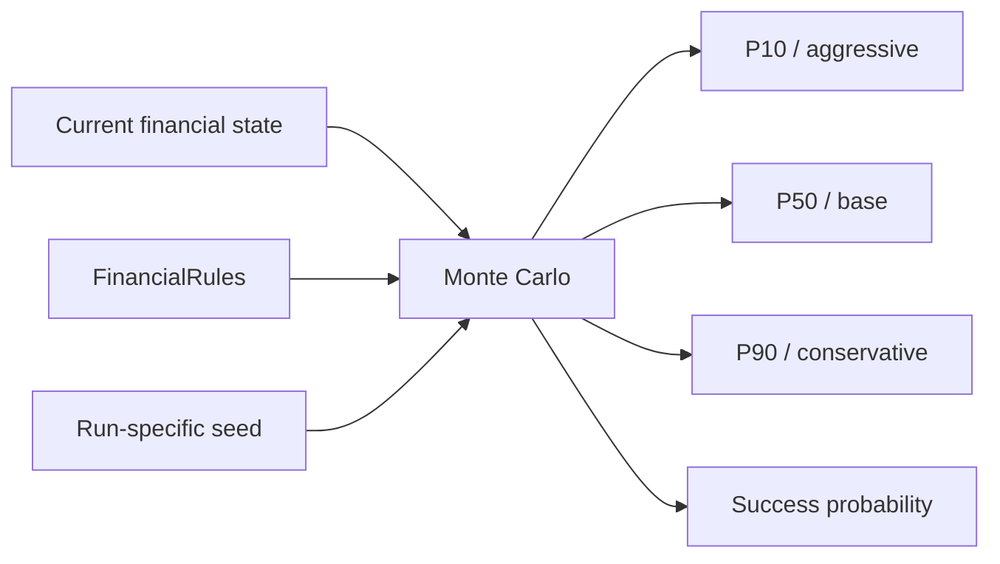

These outputs answer planning questions under uncertainty. They do not become historical facts simply because they live in Gold.

## 23. Gold presentation domains

Gold currently publishes 23 contracts across tax, wealth/cashflow, and investment presentation.

Investment presentation includes aggregations by:

- ISIN;
- subtype;
- class;
- instrument type;
- sector;
- industry;
- portfolio;
- geography;
- country;
- currency.

These views reuse canonical facts rather than introducing independent definitions of trades or lots.

## 24. Identity model

Deterministic identity namespaces currently include:

```text
PURCHASE
SALE
LOT
REALIZED
RECON_GROUP
RECON_EVENT
RECON_LOT_GROUP
TAX
```

The identity protocol canonicalizes nulls, booleans, dates/datetimes, numeric values, and strings before hashing a versioned serialized payload.

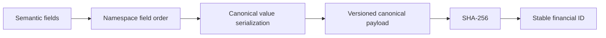

Identity is therefore part of the data model, not merely a utility implementation detail.

## 25. Grain model

Grain is explicitly represented in `DataContract` and should be treated as a first-class contract.

Examples from the current registry:

| Table | Registry grain |
|---|---|
| `d_Calendar` | Day |
| `d_Currency` | Currency |
| `f_Currency_FX_Rates` | Date-Currency |
| `d_Investment_Master` | ISIN |
| `d_Macro_Parameters` | FinancialYear |
| purchase/sale facts | Trade |
| `f_Investment_Analytics_Lot` | ISIN-Lot |
| `f_Investment_Realized_Events` | RealizedEvent |
| `f_Investment_Reconciliation_Events` | ReconEvent |
| `f_Tax_Events` | TaxEvent |
| `Tax_Year_Summary` | FY |

Exact grain/identity contracts are consolidated in Reference.

## 26. Producer ownership

The registry also records producer ownership:

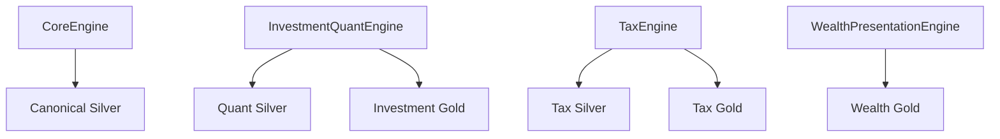

This prevents physical tables from becoming ownerless shared mutable state.

## 27. Null and missing-state semantics

The model distinguishes several reasons a value can be absent:

- source evidence genuinely missing;
- not applicable for the instrument/domain;
- derived metric unavailable because prerequisites are missing;
- evidence quality requires review;
- stochastic output not produced for an invalid/empty input state.

Reference specifications must document column-specific null semantics. A generic “nullable” flag is not enough for financial data.

## 28. Temporal semantics

Dates mean different things across domains:

- transaction date;
- acquisition date;
- disposal date;
- market observation date;
- valuation date;
- FX observation date;
- financial year;
- simulation as-of date.

US market reconstruction explicitly preserves price observation date/age and uses backward causal joins so a future quote does not leak into a historical valuation.

## 29. Local currency versus reporting currency

Foreign assets can carry both local-currency and INR/reporting-currency economics.

The model must preserve:

```text
local acquisition basis
local disposal / market value
acquisition FX
valuation/disposal FX
reporting-currency basis
reporting-currency value
asset PnL
FX PnL
```

Flattening those into a single gain number would destroy useful attribution.

## 30. Evidence lineage across domains

A representative investment lineage is:

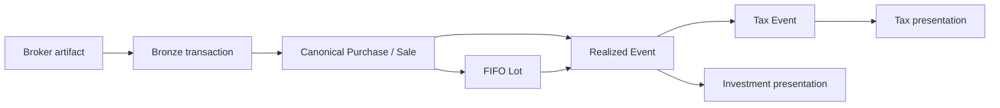

This lineage is one reason deterministic identities matter: downstream facts can retain stable semantic relationships even when analytical schemas are rebuilt.

## 31. Model invariants

1. Household transfers are not automatically income/expense.
2. Canonical investment trades are distinct from reconstructed holdings state.
3. US historical reconstruction does not replace canonical Quant FIFO.
4. Realized events retain acquisition-lot lineage.
5. Reconciliation is explicit state/provenance.
6. Quant owns realized investment economics.
7. Tax consumes Quant realization rather than duplicating it.
8. Gold is presentation, not evidence authority.
9. Local-currency and reporting-currency values remain distinguishable.
10. Stochastic FIRE outputs remain estimates/distributions, not historical facts.

## 32. Model non-guarantees

The data model does not imply:

- every market-state row was directly observed from a broker;
- every tax estimate is filing-ready statutory liability;
- every reconciliation event represents an external transaction;
- every Gold table can reconstruct source evidence;
- every null has the same semantic cause;
- every deterministic financial computation implies deterministic Monte Carlo paths across independent runs.

## 33. Where physical detail lives

This document intentionally avoids reproducing hundreds of physical columns. Exact contracts belong in:

- `../reference/bronze-data-contracts.md`;
- `../reference/silver-data-contracts.md`;
- `../reference/gold-data-contracts.md`;
- `../reference/meta-data-contracts.md`;
- `../reference/control-plane-data-contracts.md`;
- `../reference/identity-and-grain-contracts.md`.

Architecture explains the model. Reference specifies the tables. Duplicating both would give us two sources of documentation truth, and this project already has enough databases to coordinate.

## Related specifications

- [System Architecture](system-architecture.md)
- [Data Lifecycle](data-lifecycle.md)
- [Warehouse Architecture](warehouse-architecture.md)
- [Deterministic Identity and Replay](deterministic-identity-and-replay.md)
- [Financial Model](../finance/financial-model.md)
- [Investment Data Model](../finance/investment-data-model.md)
- [FIFO and Realized Events](../finance/fifo-and-realized-events.md)
- [Investment Reconciliation](../finance/investment-reconciliation.md)
- [Multi-Currency and FX](../finance/multi-currency-and-fx.md)
- [Tax Methodology](../finance/tax-methodology.md)
- [FIRE Methodology](../finance/fire-methodology.md)
