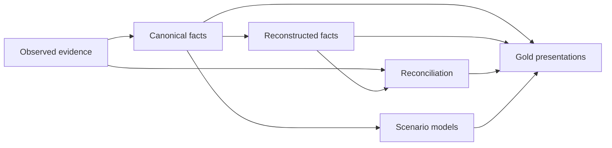
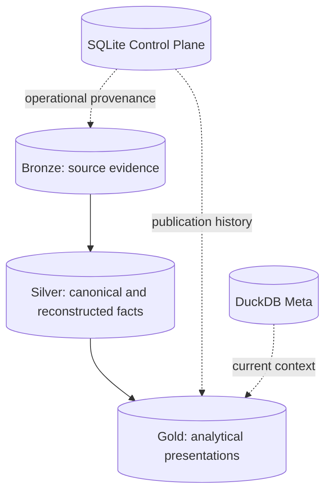
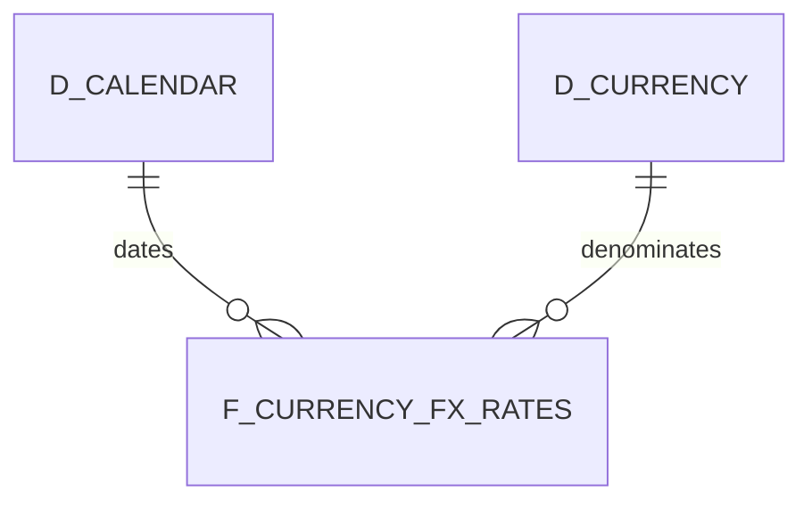
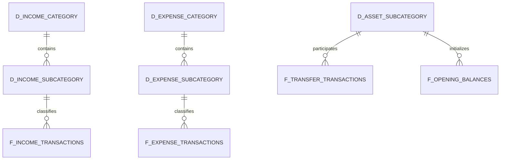
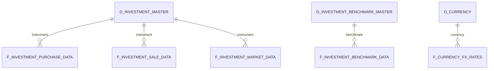
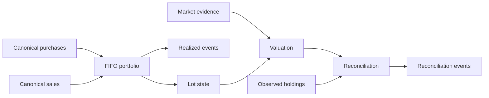
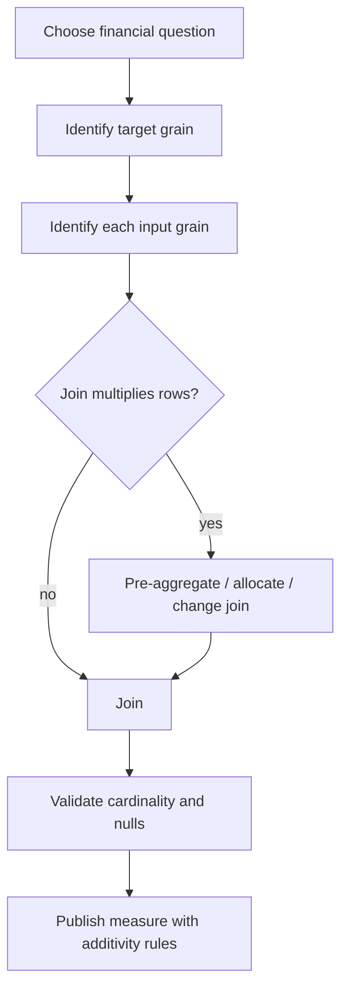
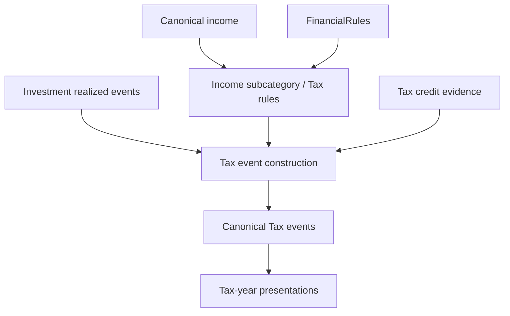
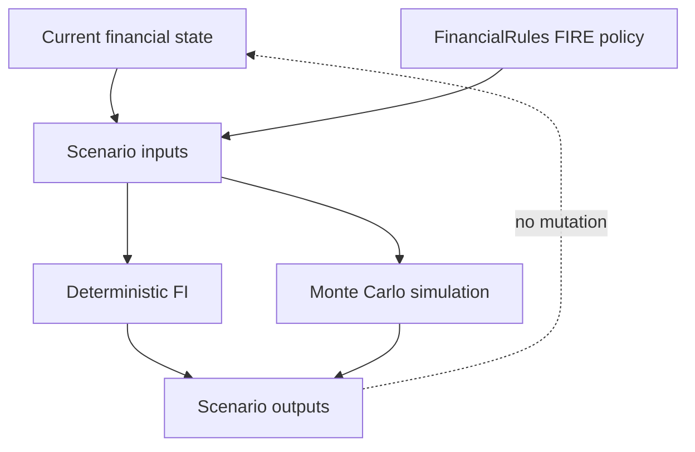

# Data Model

The most dangerous question in a financial warehouse is not *which table contains the number?* It is *what does one row mean, and which evidence gives that row authority?*

A broker transaction, an acquisition lot, a daily quote, a reconciliation adjustment, and a FIRE simulation percentile can all contain an amount and a date. They cannot safely be added, deduplicated, or compared as though they were the same kind of fact. The data model makes those differences explicit before a dashboard can obscure them.

## Start with provenance, then choose a grain

The model distinguishes five kinds of financial statement:

| Kind | Meaning | Example | Authority |
| --- | --- | --- | --- |
| Observed | Supplied by a source | Broker trade, market observation, household ledger entry | Source evidence |
| Canonical | Validated and normalized | Silver purchase or expense transaction | Domain transformation |
| Reconstructed | Derived by an algorithm | FIFO lots, historical holdings, daily terminals | Owning financial domain |
| Reconciled | Explicitly explains disagreement | Quantity or cost-basis reconciliation event | Reconciliation algorithm plus observation |
| Estimated / scenario | Conditional result | Tax estimate, FIRE percentile | Model, inputs and assumptions |

A Gold row is a *presentation* of one or more of these kinds. Publication does not upgrade estimated or reconstructed data into independently observed fact.



That distinction explains why there is no universal `transactions` table. Household transfers are not expenses; market quotations are not purchases; reconciliation events are not broker trades; and simulation outcomes are not balances.

## How the physical model encodes that distinction

The warehouse's physical DDL is declarative and layer-specific. The relevant implementation authorities are:

```text
infrastructure/warehouse/schema/bronze.py
infrastructure/warehouse/schema/silver.py
infrastructure/warehouse/schema/gold.py
infrastructure/warehouse/schema/meta.py
infrastructure/warehouse/registry.py
```

The schema definition for a shared calendar starts with a real key, not an implied row order:

```sql
-- infrastructure/warehouse/schema/silver.py (SILVER_DDL)
CREATE TABLE IF NOT EXISTS silver.d_Calendar (
    Date DATE PRIMARY KEY,
    Day BIGINT,
    Day_Name TEXT,
    Day_Name_Short TEXT,
    Day_Ordinal BIGINT,
    Day_Ordinal_Name TEXT,
    Weekday BIGINT,
    IS_WEEKEND BIGINT,
    Week BIGINT,
```

The calendar also carries calendar-year and financial-year attributes. Those are not interchangeable: household trends may use calendar months, while Tax and other reporting periods can require financial-year keys. The date grain remains one day in either interpretation.

Bronze preserves source-shaped evidence. Silver represents canonical dimensions and facts, including reconstructed financial events that downstream marts need to reuse. Gold is the consumer-facing analytical model. Meta carries current run/warehouse context; historical operational lineage belongs to the SQLite Control Plane.



The boundary between Silver and Gold is semantic, not simply “detail versus aggregate.” A detailed canonical realized event can belong in Silver even when a Gold Tax summary aggregates it by financial year.

## Shared dimensions make separate domains comparable

Three shared foundations connect otherwise distinct financial questions:

- `silver.d_Calendar` defines the date grain and period attributes.
- `silver.d_Currency` defines currency identity.
- `silver.f_Currency_FX_Rates` represents historical FX evidence at its date/currency grain.



A local-currency investment return and an INR-reporting return answer different questions. FX is therefore modelled as evidence used in conversion and attribution, not merely a formatting operation on a Gold column.

## Household: cash movement is not automatically income

The household model has category/subcategory dimensions for income, expenses and assets, plus separate income, expense, transfer and opening-balance facts. The separation matters because moving money between owned accounts changes *location*, not necessarily net worth or consumption.



The canonicalization pipeline separates source shape from economic meaning. Source-specific parsing belongs at ingestion/provider boundaries. Domain household transforms apply validated financial policy and derive canonical facts. A transfer is not relabelled as an expense simply because its source amount is negative.

This gives wealth analytics a coherent ledger basis: opening state plus classified movements, with investment positions and other assets/liabilities incorporated at their own grains.

## Investments: instrument metadata is not position history

The investment master describes an instrument. It does not tell us how many units were owned on a particular date.

The canonical investment evidence families are:

```text
instrument master
purchase events
sale events
market observations
benchmark observations
FX and macro context
```



`silver.d_Investment_Master` supplies canonical instrument attributes. `silver.f_Investment_Purchase_Data` and `silver.f_Investment_Sale_Data` are trade-grain facts. `silver.f_Investment_Market_Data` is market/valuation evidence. Combining these inputs into a portfolio snapshot requires an algorithm, not a join that assumes market value and cost basis are the same thing.

Mutual funds, Indian equities and US equities normalize into the common investment model, but source provenance remains relevant. Historical US holdings may be reconstructed from transactions and market data rather than directly observed in a complete daily broker history. The resulting market-state record must not masquerade as an observed acquisition lot.

## Quant: lots, realizations and reconciliations have different grains

FIFO consumes canonical purchases and sales chronologically. A purchase may open a lot; a sale may consume multiple lots; one sale can therefore produce multiple realization fragments. The grain of a realized event is not necessarily the grain of the original sale row.



The warehouse publishes distinct canonical investment facts, including:

- `silver.f_Investment_Analytics_Lot`: lot-oriented reconstructed holding state;
- `silver.f_Investment_Realized_Events`: realization fragments/events;
- `silver.f_Investment_Reconciliation_Events`: explicit differences between observation and reconstruction.

The source authority for the *meaning* of these records is `domain/investments/` and its typed contracts. The warehouse schema is the persistence contract, not the algorithm definition.

### Why reconciliation is a separate fact

A quantity difference and a cost-basis difference can have different causes and downstream consequences. Quietly adjusting a purchase to force the reconstructed balance to equal a broker snapshot would erase the discrepancy and corrupt realized history.

Instead, reconciliation keeps the two sides visible:

```text
reconstructed state
       +
independent observation
       ↓
comparison at explicit grain
       ↓
reconciliation event / status
```

This makes it possible to distinguish an accounting reconstruction from an observed valuation and to audit adjustments without inventing transactions.

### Why identity cannot be row position

Investment transactions and downstream events use deterministic identity. The identity contract is based on canonical economic fields and namespace-specific serialization rather than insertion order. Changing source-file order must not generate new financial events.

Identity is discussed in [Deterministic Identity & Replay](deterministic-identity-and-replay.md), with exact grains in [Identity & Grain Contracts](../reference/identity-and-grain-contracts.md).

## The physical contracts make event grain enforceable

The canonical purchase schema demonstrates that the warehouse does not identify a trade by its row position or a mutable filename:

```sql
-- infrastructure/warehouse/schema/silver.py (SILVER_DDL)
CREATE TABLE IF NOT EXISTS silver.f_Investment_Purchase_Data (
    Purchase_ID TEXT PRIMARY KEY,
    Date DATE NOT NULL,
    ISIN TEXT NOT NULL,
    CURRENCY_ID TEXT,
    __file_category__ TEXT,
    Quantity DOUBLE,
    Price DOUBLE,
    Value DOUBLE,
    Price_Local DOUBLE,
    Value_Local DOUBLE,
    FX_Rate DOUBLE,
```

The primary key identifies the canonical purchase. Date and ISIN connect it to time and instrument identity. Source metadata remains available for traceability, but the source filename is not the economic event key.

Realization has a different grain. One sale can consume more than one acquisition lot:

```sql
-- infrastructure/warehouse/schema/silver.py (SILVER_DDL)
CREATE TABLE IF NOT EXISTS silver.f_Investment_Realized_Events (
    Realized_Event_ID TEXT PRIMARY KEY,
    Sale_ID TEXT NOT NULL,
    Lot_ID TEXT NOT NULL,
    Purchase_ID TEXT,
    ISIN TEXT,
    Acquisition_Date DATE,
    Disposal_Date DATE,
    FY TEXT,
    Quantity_Disposed DOUBLE,
```

The schema also declares `UNIQUE(Sale_ID, Lot_ID)`. That constraint describes a meaningful realized-event relationship, not an arbitrary deduplication optimization. It is also why joining realizations directly to sales and summing original sale proceeds can double-count unless the measure is allocated to realization grain.

Tax events have yet another authority and shape:

```sql
-- infrastructure/warehouse/schema/silver.py (SILVER_DDL)
CREATE TABLE IF NOT EXISTS silver.f_Tax_Events (
    Tax_Event_ID TEXT PRIMARY KEY,
    FY TEXT NOT NULL,
    Event_Date DATE NOT NULL,
    Source_Type TEXT NOT NULL,
    Source_ID TEXT NOT NULL,
    Income_Head TEXT NOT NULL,
    Tax_Sub_Head TEXT NOT NULL,
    Amount_INR DOUBLE NOT NULL,
```

`Source_Type` and `Source_ID` preserve the evidence relationship, while financial-year and income-head fields encode the Tax interpretation. A Tax event is therefore not simply a relabelled purchase or household income row.

## A practical grain ledger

Before writing a join or a Gold aggregation, identify the input grains and the intended output grain:

| Record family | Typical key / grain | Additive across time? | Caution |
| --- | --- | --- | --- |
| Calendar | Date | No | Period attributes are labels, not flows |
| Currency FX | Date × currency | No | Rates cannot be summed |
| Income / expense | Canonical transaction | Usually amounts within valid groupings | Do not count transfers as expense |
| Purchase / sale | Trade event ID | Quantity/value within compatible currencies and semantics | Never sum original trade value after one-to-many realization join |
| Lot | Acquisition lot / valuation context | Quantity may aggregate across disjoint lots at one date | Lot value is a stock, not a flow |
| Realized event | Realized event ID; sale × lot relationship | Gain/proceeds can aggregate with consistent currency/grain | A sale may have multiple realization rows |
| Reconciliation event | Reconciliation event ID | Only with reason/type context | Not a broker transaction |
| Tax event | Tax event ID | Amount within compatible Tax treatment | Estimates and credits have distinct meaning |
| Net-worth snapshot | Valuation date × aggregation entity | Across disjoint entities at one point | Never sum net worth over dates |
| FIRE simulation | Scenario × horizon × statistic | No | Percentiles are not independent cash flows |

The table is a reasoning aid, not a substitute for the physical registry. Exact keys, nullable fields and grain constraints remain defined in the reference contracts.

## From grain to safe analytical joins



This discipline matters most at the intersections of household transactions, instrument holdings, realized events, reconciliation, and Tax. A syntactically valid SQL join is not evidence of an economically valid result.

## Benchmarks and FX preserve attribution

Benchmark observations are separate from the asset's own market observations. Benchmark shadow performance is an analytical comparison, not a broker-held asset.

Similarly, FX has two distinct roles:

1. converting a local-currency amount into reporting currency at the appropriate historical point;
2. attributing changes between asset return and currency movement.

The model must not double-count FX or treat an INR reporting gain as entirely asset-price appreciation. The finance methodology defines the actual return formulas and validity conditions.

## Tax consumes canonical financial evidence

Tax does not own FIFO. It consumes canonical realized investment events, classified household income and separate credit/exemption evidence under `FinancialRules`.



The distinction between taxable, exempt, residual and `CHECK_REQUIRED` treatment is financial semantics, not a null-handling convenience. Estimated Tax amounts are conditional outputs and must not be represented as actual tax liabilities paid.

## Wealth aggregates without claiming new source authority

Wealth and cash-flow presentations combine canonical household state with investment positions and other assets/liabilities. The model separates flows (income, expense, transfers) from stocks (balances, holdings, net worth).

A useful check is additivity: a daily position value cannot be summed across dates to produce a valid current net worth. Likewise, summing portfolio-level and instrument-level Gold rows can double-count the same economic state.

Gold mart grains and additive/non-additive measures are defined in [Gold Data Contracts](../reference/gold-data-contracts.md).

## FIRE describes futures, not financial history

FIRE consumes a financial starting state, policy assumptions and scenario parameters. Deterministic projections and Monte Carlo distributions are **model outputs**, not observed household transactions.



A percentile has meaning only together with its horizon, simulation assumptions and model provenance. Reproducibility metadata belongs with the scenario rather than being hidden inside presentation labels.

## Null, missing, invalid and zero are different

Financial input validation cannot collapse all problematic values to zero. An absent quote, an invalid populated number, a legitimate zero, and a failed calculation are different states. Each can change downstream financial meaning.

The same distinction applies to dates, missing FX, stale benchmarks, and Tax evidence completeness. Source validation and typed calculation results preserve these differences so a Gold number is not silently plausible but wrong.

## Temporal semantics are part of grain

A trade date, quote date, valuation date, fiscal period, simulation step and run timestamp are not interchangeable. Joining them without an explicit temporal rule can create look-ahead effects or accidental duplicates.

The model therefore keeps the calendar dimension, financial-year interpretation, market staleness policy and run-time provenance separate.

## Where the exact contracts live

The logical model tells us what the rows mean. The reference specifications define their physical shape:

- [Bronze Data Contracts](../reference/bronze-data-contracts.md)
- [Silver Data Contracts](../reference/silver-data-contracts.md)
- [Gold Data Contracts](../reference/gold-data-contracts.md)
- [Meta Data Contracts](../reference/meta-data-contracts.md)
- [Control Plane Data Contracts](../reference/control-plane-data-contracts.md)
- [Identity & Grain Contracts](../reference/identity-and-grain-contracts.md)

The code authorities are `infrastructure/warehouse/schema/`, `infrastructure/warehouse/registry.py`, and the relevant financial domains. A schema change is not automatically a financial-model change, but a grain or identity change almost certainly is.

## The non-guarantees matter

The model does **not** imply that every market row was independently observed, every Tax estimate is a final filing result, every stochastic scenario will occur, or every Gold measure can be summed over every dimension. These limits are part of the model's correctness.

The result is a warehouse in which financial meaning survives normalization, reconstruction, reconciliation and presentation. The remaining question is *why these particular boundaries were chosen*. That is the job of [Design Decisions](design-decisions.md).

## Related specifications

- [System Architecture](system-architecture.md)
- [Warehouse Architecture](warehouse-architecture.md)
- [Data Lifecycle](data-lifecycle.md)
- [Deterministic Identity & Replay](deterministic-identity-and-replay.md)
- [Design Decisions](design-decisions.md)
- [Silver Data Contracts](../reference/silver-data-contracts.md)
- [Gold Data Contracts](../reference/gold-data-contracts.md)
