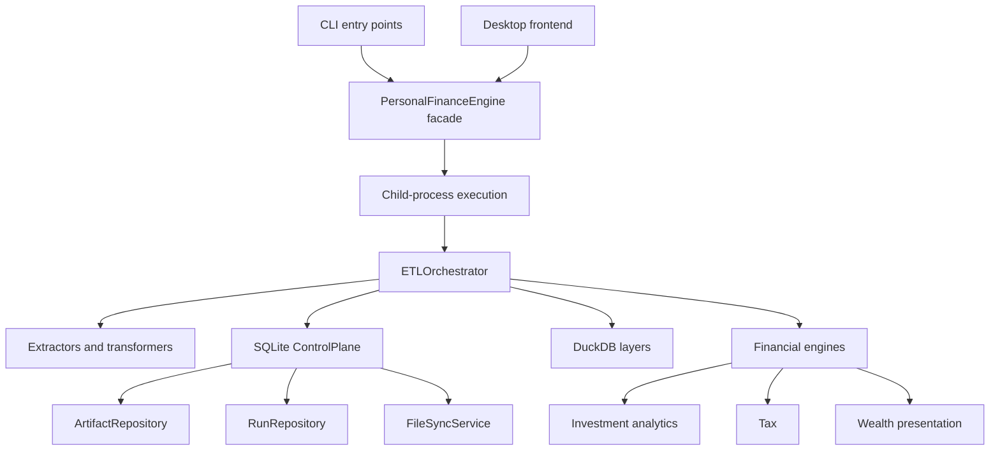
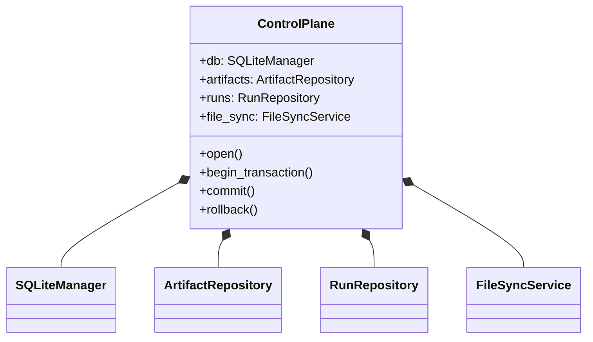

# Dependency Architecture

I deliberately keep interface entry points, pipeline orchestration, operational provenance, financial computation, and analytical persistence as separate responsibilities. This is a map of **actual module boundaries**, not a claim that the codebase implements a formally enforced hexagonal architecture.

## 1. Dependency map



The arrows denote invocation or orchestration dependencies, not necessarily Python import edges.

## 2. Responsibility ownership

| Boundary | Actual module | Responsibility |
| --- | --- | --- |
| Shared application facade | `backend/api/engine.py` | Common execution entry for frontends |
| Pipeline coordination | `backend/pipeline/etl_pipeline.py` | Sequencing, publication, transaction handling |
| Operational lifecycle | `backend/load/control_plane/orchestrator.py` | SQLite connection and file lock ownership |
| Artifact evidence | `backend/load/control_plane/artifact_repo.py` | Registry, retained bytes, lifecycle events |
| Run provenance | `backend/load/control_plane/run_repo.py` | Run state, logs, failure and simulation metadata |
| Artifact synchronization | `backend/load/control_plane/file_sync.py` | Disk-to-registry synchronization |
| Physical contracts | `backend/load/registry.py` | Registered Bronze, Silver, Gold datasets |
| Investment computation | `backend/engines/analytics/` | Lot and investment calculations |
| Tax computation | `backend/engines/tax/` | Tax event calculations and classification |
| Wealth computation | `backend/engines/presentation/` | Wealth and FIRE presentation datasets |

All paths are relative to `src/personal_finance_etl/`.

## 3. Operational ownership



The Control Plane constructs its repositories around a shared `SQLiteManager`. It also owns the `pipeline.lock` lifetime, and propagates the active run ID to event-producing components.

```python
self.db = SQLiteManager(base_path, db_name)
self.artifacts = ArtifactRepository(self.db)
self.runs = RunRepository(self.db)
self.file_sync = FileSyncService(self.artifacts)
self.lock_path = os.path.join(base_path or ".", "pipeline.lock")
```

The excerpt comes from `ControlPlane.__init__()` in `backend/load/control_plane/orchestrator.py`.

## 4. Boundaries that should not be collapsed

**SQLite versus DuckDB.** I keep operational provenance in SQLite while DuckDB serves analytical data. Mirrored metadata is a projection, not a competing source of truth.

**Data contracts versus calculations.** A registered table specifies shape and publication obligations. It does not establish that FIFO, tax, FX, or FIRE calculations are numerically correct.

**Facade versus execution.** CLI and desktop workflows share backend execution; the UI is not a second implementation of the financial engine.

**Analytics versus operations.** The financial engines own computation, while the pipeline coordinates the persistence and lifecycle boundaries.

## 5. Where detailed ownership moves

The future `control-plane/` section will specify artifact states and lineage; `data-engineering/` will specify transformations and publication; `interfaces/` will specify process and progress behavior; `operations/` will specify recovery and fault boundaries; `reference/` will specify exact tables, columns, and signatures. This page remains the cross-domain dependency map.

[← Architecture](README.md)
