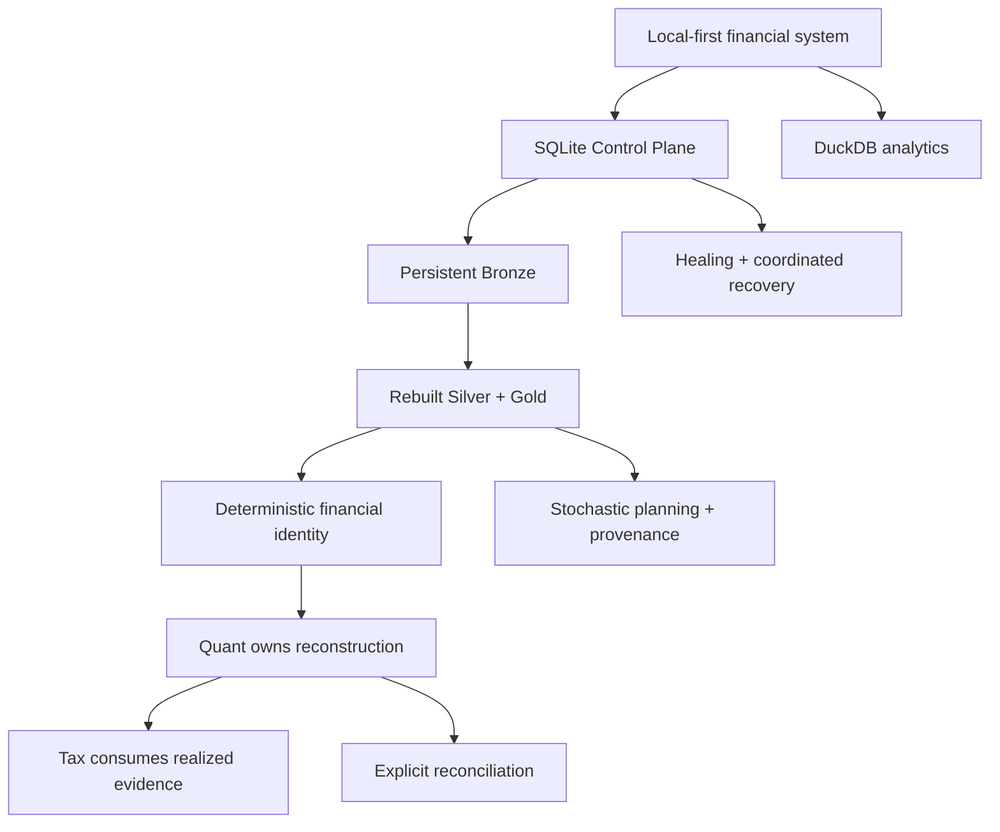
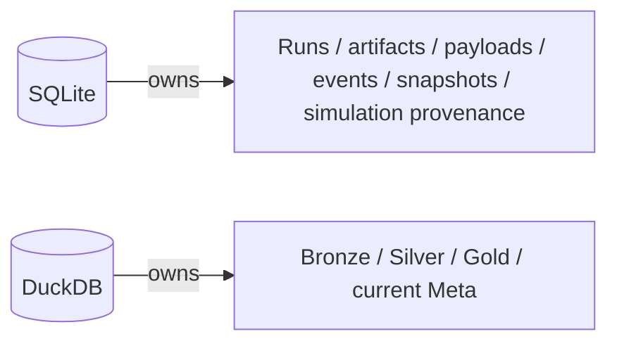
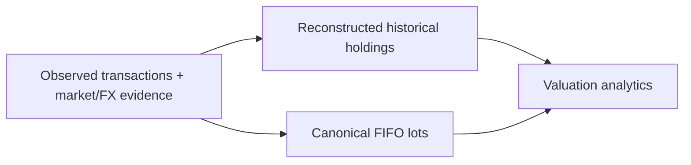
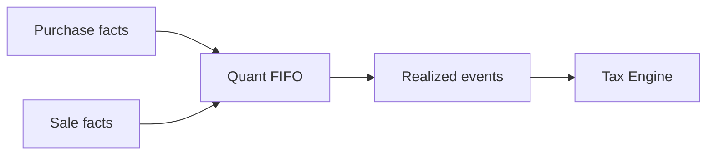
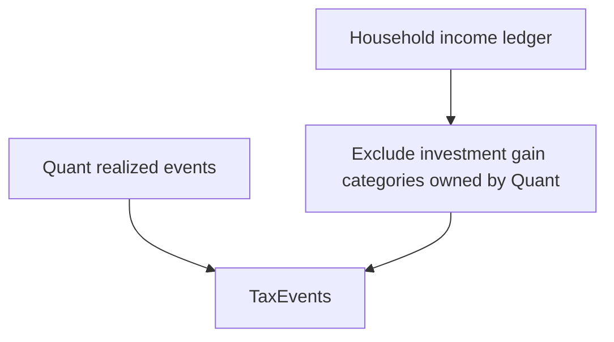

# Design Decisions

Personal Finance ETL did not arrive at its current architecture by starting with a diagram full of boxes and then searching for problems worthy of them. The boundaries emerged from repeated financial and operational requirements: source evidence changes, brokers disagree with reconstructed state, historical US holdings are incomplete, analytical tables need deterministic rebuilds, stochastic forecasts need provenance, and local databases occasionally need to survive real-world failure.

This document explains **why the major boundaries exist**, what each decision buys, and what complexity it deliberately refuses to buy.

## Decision map



## 1. Local-first by default

Financial source evidence, reconstructed holdings, tax-preparation events, and wealth simulations remain on the local machine. The architecture does not require a cloud warehouse or hosted processing service for normal operation.

### Why

- personal financial data is unusually sensitive;
- the workload fits comfortably on local analytical engines;
- offline execution is useful;
- filesystem/broker exports are naturally local inputs;
- operational complexity stays proportional to a personal system.

### Trade-off

Local-first shifts responsibility for backup, file access, locking and environment management into the application. That is why backup/restore and the Control Plane are first-class architecture rather than README footnotes.

## 2. SQLite for operational authority, DuckDB for analytics

SQLite and DuckDB are intentionally assigned different jobs.



SQLite provides a durable transactional control store with foreign keys, WAL and a mature backup API. DuckDB provides high-performance columnar analytical execution and convenient SQL access for BI.

### Rejected alternative: everything in DuckDB

That would simplify the file count but mix historical operational lifecycle with current analytical publication. It would also make operational provenance depend more tightly on warehouse replacement semantics.

### Rejected alternative: everything in SQLite

That would sacrifice the analytical strengths that make DuckDB appropriate for large Polars-produced fact tables and BI queries.

The split creates cross-database recovery complexity, but it keeps ownership clean.

## 3. Control Plane as historical operational authority

The Control Plane retains run identity, artifact lifecycle, payload relationships, configuration/rule snapshots, failures and simulation provenance.

DuckDB Meta remains a **current analytical projection**.

This prevents two databases from both claiming to be the historical source of truth. Two sources of truth are usually just two sources of future archaeology.

## 4. Persistent Bronze, rebuilt Silver and Gold

Bronze synchronizes source evidence incrementally/full-replace according to contract. Silver and Gold are fully rebuilt.


### Why

- source ingestion benefits from not rereading every unchanged artifact;
- derived analytical state benefits from deterministic reconstruction;
- full rebuild avoids stale derived rows and complicated incremental dependency invalidation;
- current workload size makes the trade practical.

### Cost

Analytical runtime grows with total current state rather than only the latest delta.

The architecture chooses a simpler correctness model over incremental cleverness downstream.

## 5. Registry-driven publication

Every analytical output must be registered. The pipeline rejects unregistered engine outputs and missing registered outputs before publication.

This makes the contract registry an executable boundary rather than a documentation wish list.

### Why

Without a registry, producer code, DDL, BI expectations and documentation can drift independently. With one, drift can still happen, but at least the pipeline has somewhere concrete to complain.

## 6. Deterministic IDs instead of row-order identity

Financial facts use canonical field-based identities.

### Why

Silver and Gold rebuild completely. Auto-increment keys or row numbers would create artificial identity churn even when the economic fact did not change.

Deterministic IDs preserve continuity for:

- purchases;
- sales;
- lots;
- realized disposal components;
- reconciliation events;
- tax events.

### Trade-off

Identity contracts become protocol. Changing defining fields requires migration reasoning rather than a casual refactor.

That is the correct cost for IDs that carry financial lineage.

## 7. Explicit identity serialization version

Canonical ID payloads include `"v2"`.

### Why

Serialization behavior itself affects identity. Versioning makes protocol changes visible instead of silently changing hashes under the same conceptual label.

## 8. Separate observed evidence from reconstructed state

The data model distinguishes broker/ledger observations from reconstructed holdings, lots, valuations and reconciliations.

This is particularly important for US holdings, where reliable downloadable daily holdings evidence is unavailable.

### Why

A derived state can be financially useful without being source-certified. Documentation and schemas should preserve that epistemic boundary.



## 9. US market reconstruction does not own canonical FIFO

Historical US holdings reconstruction uses transaction evidence to construct a daily market-state spine. `FIFOPortfolio` separately owns canonical acquisition lots and realized disposals.

### Why

The two processes answer different questions:

- market reconstruction: *what quantity/value should exist on this historical date?*
- FIFO: *which acquisition lots were consumed by this disposal?*

Merging them would couple valuation reconstruction to tax-lot semantics unnecessarily.

## 10. Backward-only historical market joins

Historical prices and FX use backward as-of semantics with explicit staleness checks.

### Why

Future observations cannot be allowed to leak backward into historical valuation. A future price makes a historical chart smoother and the model wrong. Smooth wrongness is still wrongness.

The US price path additionally limits acceptable observation age.

## 11. Quant owns realized investment economics

The Quant Engine reconstructs FIFO lots and realized investment events. The Tax Engine consumes those events.



### Why

Realized gain is an investment reconstruction concern. Tax classification/presentation is a tax concern. Recomputing FIFO inside Tax would create competing economic authorities.

## 12. Reconciliation is explicit financial evidence

When reconstructed quantity or cost basis disagrees with observed broker state, the discrepancy becomes a reconciliation group/event and can create synthetic/adjusted lot state.

### Why

Silently mutating lots would make the final number look tidy while destroying the reason it became tidy.

Explicit reconciliation preserves:

- discrepancy type;
- observed value;
- reconstructed value;
- adjustment lineage;
- effect on future FIFO state.

## 13. Quantity and cost-basis reconciliation are separate

A portfolio can agree on quantity and disagree on acquisition basis. Treating both discrepancies as the same problem loses financially important information.

Therefore the implementation separates quantity correction from cost-basis correction.

## 14. Multi-currency economics remain decomposable

Foreign investments preserve local-currency and INR/reporting-currency values. Realized economics can distinguish asset PnL from FX PnL.

### Why

An INR gain can come from the asset, the currency, or both. Collapsing those effects too early makes performance attribution less meaningful.

## 15. Evidence-first Tax Engine

Tax consumes household income evidence and Quant realized events, normalizes them into `f_Tax_Events`, and produces three Gold views.

It intentionally does not pretend to be a complete statutory income-tax engine.

### Why

Tax-preparation evidence and indicative estimates are useful even without implementing every loss-setoff, carry-forward, exemption and filing rule.

The architecture chooses a narrower honest contract over a larger misleading one.

## 16. Investment income exclusions prevent double counting

FinancialRules contains STCG/LTCG ledger subcategory exclusions because Quant already owns realized investment gains.



This is a domain ownership rule encoded as configuration.

## 17. Stochastic FIRE is not deterministic financial reconstruction

FIFO and canonical financial facts are deterministic for unchanged evidence/contracts. FIRE Monte Carlo intentionally samples future paths.

### Why

Uncertain future wealth should be represented as a distribution, not disguised as a deterministic forecast because deterministic numbers look reassuring in a dashboard.

The system records seed and model/input provenance so a specific experiment can be revisited.

## 18. Run-specific stochastic seed

The run identity participates in stochastic seed context.

### Why

Independent runs are allowed to explore different Monte Carlo paths. Reproducibility means replaying the recorded context, not freezing all future runs onto one eternal random sequence.

## 19. Configuration and financial rules are separate domains

`Settings` controls physical/runtime behavior. `FinancialRules` controls financial interpretation and modeling assumptions.

### Why

Changing a source path is operational configuration. Changing LTCG exclusions, portfolio assumptions or FIRE parameters changes financial semantics. Those should not be conceptually indistinguishable just because both happen to be configuration files.

## 20. Snapshot settings and rules by content

Runs reference content-addressed snapshots of Settings and FinancialRules.

### Why

A future configuration file at the same path may contain different semantics. Provenance should point to what the run actually used, not where a mutable file happened to live.

## 21. Coordinated transactions without distributed transaction machinery

The pipeline begins transactions in SQLite and DuckDB but commits them sequentially.

### Why not distributed transactions?

The application is local, the databases are embedded, the workload is bounded, and Bronze/idempotent reconstruction provide a practical convergence mechanism. Introducing a distributed transaction coordinator would add significant machinery for a narrow commit window.

### Cost

A DuckDB-success/SQLite-failure window exists and must be healed on the next run.

The architecture documents the window rather than naming it away.

## 22. SQLite savepoints for nested atomic operations

Repository-level operations use savepoints because they may run inside the larger pipeline transaction.

### Why

A helper that unconditionally starts/commits its own transaction would break the outer transaction boundary. Savepoints provide composable SQLite atomicity.

## 23. Healing instead of assuming stores never diverge

`MetaLayer.heal_duckdb_registry()` compares Control Plane state with current DuckDB ownership and requeues/purges inconsistencies.

### Why

Once two persistence engines exist, divergence is a state worth designing for rather than a state worth denying.

## 24. One pipeline lock

Pipeline, backup and restore coordinate through the same lock path.

### Why

A local embedded architecture benefits more from simple single-writer exclusion than from building a concurrent mutation protocol that the application does not need.

## 25. Coordinated backup instead of raw file copying

Snapshot creation checkpoints DuckDB and uses SQLite's backup API before publishing a validated ZIP.

Restore validates and stages replacements before touching production files.

### Why

Two live database files copied independently are not automatically a coherent recovery point. File copying is easy; recovery semantics are the actual feature.

## 26. Fail closed on stale or invalid market evidence

US prices have an age limit and FX/price observations are validated.

### Why

For financial analytics, a missing valuation is often safer than a confidently fabricated one.

This principle appears repeatedly throughout the codebase: invalid evidence tends to fail the run instead of being silently massaged into plausibility.

## 27. Polars DAG for transformation, DuckDB for publication/query

Polars performs transformation-heavy work and lazy/streaming collection. DuckDB persists/query-serves analytical layers.

### Why

The tools are used where their execution models are strongest instead of forcing one library to own every stage.

## 28. API façade between frontend and backend

CLI and desktop surfaces use `PersonalFinanceEngine` rather than reaching directly into ETL/recovery internals.

### Why

Presentation surfaces should not each invent pipeline lifecycle, error handling or backup semantics.

## 29. Documentation is integrated but not authoritative over code

CLI/desktop can render project documentation through a shared manifest/renderer. That makes docs part of the product experience.

But implementation remains authoritative. A beautifully rendered stale contract is still stale, just with better typography.

## 30. Deliberate limitations

The architecture consciously accepts several boundaries:

- local-first rather than multi-user distributed service;
- sequential cross-database commit rather than distributed ACID;
- full analytical rebuild rather than incremental Silver/Gold mutation;
- reconstructed US holdings rather than broker-certified daily holdings;
- indicative tax preparation rather than final statutory liability;
- stochastic replay under compatible implementation rather than timeless bitwise reproducibility;
- runtime validation with currently limited conventional automated test breadth.

These are not all deficiencies waiting for a feature sprint. Many are scope choices that keep the system honest and maintainable.

## Architectural character

The codebase's sophistication comes less from any single algorithm than from repeated separation of concerns:

```text
source evidence          != reconstructed state
operational provenance   != analytical presentation
artifact identity        != filesystem path
local asset return       != FX return
realized economics       != tax interpretation
financial determinism    != stochastic forecasting
transaction coordination != distributed atomicity
```

Those inequalities are effectively the architecture in miniature.

## Related specifications

- [System Architecture](system-architecture.md)
- [Data Lifecycle](data-lifecycle.md)
- [Warehouse Architecture](warehouse-architecture.md)
- [Data Model](data-model.md)
- [Control Plane Artifact Lifecycle](control-plane-artifact-lifecycle.md)
- [Deterministic Identity and Replay](deterministic-identity-and-replay.md)
- [Reliability and Recovery](reliability-and-recovery.md)
- [Backup and Restore](backup-and-restore.md)
