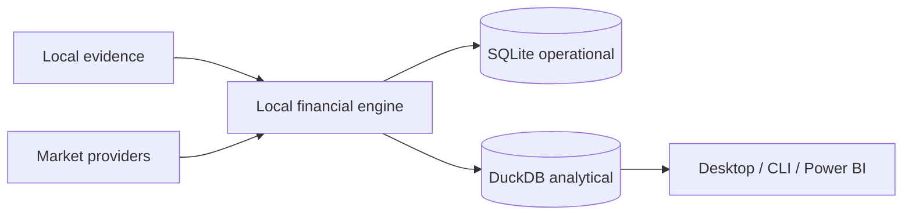
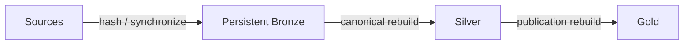
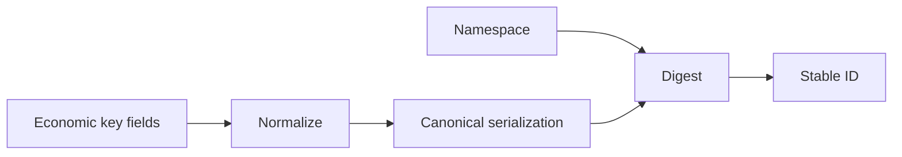
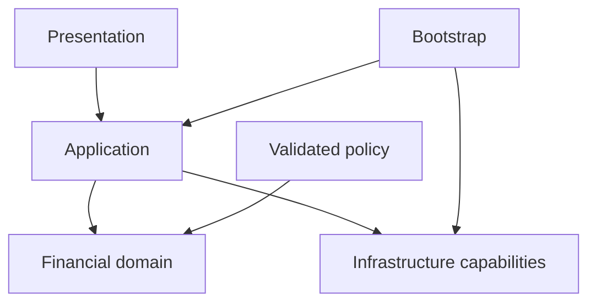
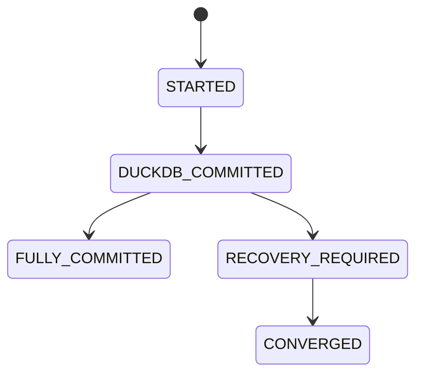

# Design Decisions

The architecture is easiest to evaluate by examining the alternatives it refuses. A single database, one generic transaction table, universal object orientation and fully incremental processing could all make particular diagrams smaller. They would also change which component owns financial truth, what can be replayed, and how failures can be explained.

This document follows the decisions from the first boundary, local evidence, through financial reconstruction and finally the engineering controls that keep those decisions intact.

## Begin with local ownership

The system keeps primary financial processing, storage, reconstruction and presentation local. External market providers enrich evidence; they do not become the financial ledger or the application runtime.

**Why:** broker exports, household ledgers, policy files and analytical models are naturally local inputs; the workload fits local compute; and retaining control over sensitive financial evidence is valuable.

**Cost:** the application must own file permissions, locking, backups, provider failures, and local environment management. Local-first reduces hosted dependencies, not the need for operational engineering.



## Give operational history and analytics different databases

SQLite is the historical Control Plane authority; DuckDB is the analytical warehouse. DuckDB Meta holds current analytical context, not the full operational history.

**Rejected: everything in DuckDB.** That would mix append/history-oriented operational provenance with replaceable analytical publication and make recovery authority ambiguous.

**Rejected: everything in SQLite.** That would give up DuckDB's columnar analytical execution and convenient BI access.

**Accepted cost:** the two stores cannot form one distributed ACID transaction. The application therefore models split-commit state explicitly and provides convergence/healing rather than pretending rollback is universal.

## Keep persistent evidence, rebuild derived state

Bronze is persistent source evidence with incremental synchronization. Silver and Gold are reconstructed analytical layers rather than complex independently incremental stores.



**Why:** unchanged source files need not be reingested, while a full derived rebuild avoids invalidation rules spanning income, investments, Tax, wealth and FIRE.

**Cost:** rebuild runtime grows with the current analytical workload. At this project's scale, deterministic simplicity is worth that cost. Incremental derived marts would require an explicit dependency/invalidation model before they could safely replace it.

## Record artifacts, not just file paths

Files can be renamed, removed, replaced, repaired or represented by virtual provider artifacts. A path alone cannot describe the source's history.

The Control Plane records artifact identity, content fingerprints, payload state, run participation and synchronization outcomes. This supports rename detection, missing-payload repair and healing without losing lineage.

**Rejected:** treat every discovered path as a new immutable source and reread everything each run. That would be simpler initially but would destroy useful idempotency and operational context.

## Fail closed on incomplete required evidence

A provider's partial success is not necessarily an acceptable input to financial reconstruction. The application uses typed extraction outcomes and completeness policy before downstream computation.

**Why:** an incomplete benchmark, currency series or market state can produce plausible-looking but economically invalid returns.

**Cost:** the system may refuse to publish when a less strict system would produce a partial result. The refusal is preferable to an unexplained financial approximation.

## Make identity deterministic and namespace-specific

Economic events use canonical serialization and stable namespace-specific field order. The identity implementation lives in `domain/common/identity.py`.



**Rejected:** random UUIDs for reconstructed events, or row-position IDs. Those cannot establish equivalence between independently replayed financial histories.

**Cost:** changing canonicalization or identity fields is a migration-level contract change, even if no calculation formula changes.

## Separate observed evidence from reconstructed state

A broker's reported holding and a FIFO-reconstructed holding are independent claims. Reconciliation should explain their difference, not erase one to force agreement.

**Why:** quantity and cost-basis disagreements can have different economic and operational causes.

**Rejected:** silently overwrite reconstructed positions from market observations or fabricate purchases to close a gap.

**Cost:** the data model carries additional reconciliation events and validity semantics. Those are necessary complexity, not redundant tables.

## Let FIFO own acquisition-lot truth

`domain/investments/lots/` owns chronological acquisition/disposal accounting. The investment application service coordinates the work; Tax consumes the realized events.

**Rejected:** recomputing lots in Tax, wealth or Gold builders. Multiple realizations of the same economic history would eventually disagree.

**Cost:** downstream domains must accept canonical realized-event contracts rather than reaching directly into FIFO mutable state.

## Keep market reconstruction distinct from lot accounting

Historical US market/holding reconstruction addresses incomplete market-state evidence. FIFO addresses acquisition cost basis and disposals. They are not the same reconstruction problem.

**Why:** a reconstructed daily position can be useful for valuation without being authoritative for acquisition-lot history.

**Cost:** two related investment models must coexist with explicit provenance and reconciliation.

## Make FX an economic dimension, not display formatting

The application distinguishes instrument/local currency from reporting currency and separates asset-price effects from currency translation.

**Rejected:** convert only the final Gold amount and call the difference asset performance.

**Cost:** historical FX evidence, staleness/validity and attribution become part of the calculation contract.

## Treat Tax as evidence-driven interpretation

Tax consumes canonical income classification, realized investment events and separate credit/exemption evidence under `FinancialRules`.

The income subcategory master can carry multiple exempt and residual categories. Tax rules own interpretation; they do not invent missing financial evidence.

**Rejected:** reconstruct investments again inside Tax or convert missing Tax evidence into confident zero-valued estimates.

**Cost:** explicit `CHECK_REQUIRED` and completeness states may be less convenient than a single number, but they are more truthful.

## Keep stochastic futures outside canonical history

FIRE modelling consumes current state and explicit assumptions. Deterministic projections and Monte Carlo simulations produce scenarios, not historical financial facts.

**Why:** forecasts are conditional on inflation, return, spending, regime and other assumptions. They should not mutate actual balances or transactions.

**Cost:** the system preserves simulation configuration and reproducibility/provenance separately from canonical identity.

## Preserve a cohesive numerical kernel where it earns its size

The Monte Carlo Numba kernel is intentionally treated differently from ordinary Python orchestration. Splitting a compiled numerical loop solely to satisfy a line-count rule can hurt clarity or performance.

**Rejected:** mechanically applying “every function must be small” to performance-sensitive mathematical code.

**Cost:** the exception must be documented, benchmarked and regression-protected rather than treated as a permanent exemption from review.

## Use functional transforms and stateful objects where each fits

Polars transformations are often pure `LazyFrame → LazyFrame` operations. FIFO, run lifecycle and recovery have meaningful mutable state.

**Decision:** preserve functional data transforms; use classes for state, lifecycle, invariants and dependencies. The codebase is deliberately hybrid, not OOP for its own sake.

**Rejected:** wrapping every expression in a class or replacing stateful FIFO with an unnatural vectorization.

## Give every architectural layer one reason to change



`application/` owns use-case sequence, `domain/` financial meaning, `infrastructure/` concrete mechanisms, `presentation/` human interaction, `config/` validated policy, `contracts/` cross-boundary messages and `bootstrap/` concrete assembly.

**Rejected:** a single undifferentiated backend umbrella as an architectural description, or a universal `contracts/everything.py`.

**Cost:** more modules and explicit imports. The payoff is that new features have obvious ownership and dependency rules can be tested.

## Use composition without hiding remaining concrete construction

`ServiceContainer` assembles the application graph. Some runtime objects may still construct specific collaborators internally; documentation must describe actual construction, not claim universal dependency injection.

**Rejected:** a globally accessible container/service locator that every domain object consults at runtime.

**Cost:** composition wiring is explicit and must be maintained when dependencies evolve.

## Make stable boundaries typed, leave dynamic edges honest

Cross-process status, extraction outcomes, lifecycle state and recovery results use named contracts. Domain-native records stay in their owning domains. Third-party or serialization edges are narrowed where possible and documented where genuinely dynamic.

**Rejected:** `dict[str, Any]` as the default stable financial API, or changing `Any` to `object` merely to satisfy a checker without narrowing behavior.

## Publish through explicit warehouse contracts

Bronze/Silver/Gold/Meta schemas and the registry define table names, types, grain and publication expectations. Financial domains define meaning; warehouse schemas define storage.

**Rejected:** dynamic table creation from whatever columns happened to appear in the current DataFrame.

**Cost:** schema evolution requires deliberate compatibility and migration work. That is the point of a contract.

## Use savepoints for nested operational units

SQLite savepoints allow nested persistence operations to roll back their own changes without pretending that the outer workflow has not progressed.

**Rejected:** ad hoc nested commits that break the enclosing lifecycle's ability to reason about transaction state.

**Cost:** repository methods must respect transaction ownership and explicit savepoint scope.

## Model cross-store commit truth instead of inventing atomicity



**Why:** if DuckDB has committed but SQLite fails, claiming both stores rolled back is false. The lifecycle records the actual durable boundary and subsequent convergence.

**Cost:** additional state and recovery logic. This is a reliability feature, not architectural overengineering.

## Use one pipeline lock and explicit recovery ownership

A local run should not compete with another run or restore for the same persistent stores. Locking and recovery are infrastructure/application concerns, not financial-domain concerns.

**Rejected:** optimistic simultaneous writers and raw file copying as a backup strategy.

The backup path validates archives, stages replacement and distinguishes successful rollback from uncertain final state.

## Keep the application façade stable across interfaces

CLI and Desktop consume `PersonalFinanceEngine`, not internal repository or FIFO classes. The same application capabilities can therefore serve interactive and unattended execution.

**Cost:** façade methods must remain intentional rather than becoming a grab bag of unrelated helpers.

## Preserve machine-readable failure truth

The lifecycle contract exposes states rather than asking callers to interpret a string message:

```python
# contracts/lifecycle.py
class CommitState(StrEnum):
    """Explicit cross-database transaction commit state."""

    NOT_STARTED = "NOT_STARTED"
    STARTED = "STARTED"
    ROLLED_BACK = "ROLLED_BACK"
    DUCKDB_COMMITTED = "DUCKDB_COMMITTED"
    FULLY_COMMITTED = "FULLY_COMMITTED"
    RECOVERY_REQUIRED = "RECOVERY_REQUIRED"
    CONVERGED = "CONVERGED"
```

The contract also includes an unknown-state representation and compatibility alias. Those details matter because an exception can occur at a point where the application cannot prove which store committed.

**Rejected:** decide recovery from phrases such as `"success" in message.lower()` or classify all failures as the same Boolean. Logs are useful for people; state drives software.

**Cost:** result and failure contracts must be evolved deliberately. The payoff is that CLI, Desktop, tests and recovery policy can all consume the same semantic outcome.

## Keep market evidence and provider behavior separate

External providers are adapters. They fetch or normalize source evidence and return typed extraction results; application ingestion owns completeness policy and operational provenance.

**Rejected:** allowing each provider to directly decide whether an incomplete market series is good enough to publish or to own the entire Control Plane lifecycle.

**Cost:** a few additional application-service boundaries. The benefit is consistent failure/completeness policy across file and market sources.

## Optimize execution at proven boundaries, not by slogan

Polars lazy plans are preserved where they permit optimizer pushdown and avoid Python round-trips. Materialization remains legitimate for stateful FIFO, publication, scalar diagnostics, schema inspection and third-party interfaces.

**Rejected:** either eager-convert every frame to dictionaries or ban `.collect()` categorically.

**Cost:** developers must classify execution boundaries and benchmark meaningful changes. The same principle protects Numba numerical kernels from cosmetic decomposition.

## Make engineering standards executable

Architecture dependency checks, typed contracts, public package surfaces, source documentation, regression tests and release gates protect the design against gradual erosion.

**Rejected:** relying on future maintainers to remember a long architecture document when adding a new import.

The development/release workflow belongs in the Developer specifications, not as a pile of tool badges in this page.

## Treat documentation as an implementation companion

The README showcases, the Wiki teaches, `/docs` specifies and code/tests prove. Those surfaces intentionally have different depths.

**Rejected:** copying the same explanation across all four or letting a generated architecture diagram overrule current implementation.

This separation makes it possible to improve the teaching experience without weakening the technical specification.

## Accepted limitations

The design does not promise a distributed transaction, perfectly complete third-party market history, universal additive measures, zero materialization, or risk-free stochastic forecasts. It promises explicit ownership, validation, recoverability and honest semantics within those boundaries.

The next architectural question is no longer *why these choices?* It is *how do I change the system without violating them?* That leads naturally to [Development Guide](../developer/development-guide.md) and the engineering standards documentation.

## Related specifications

- [System Architecture](system-architecture.md)
- [Application & Dependency Architecture](application-and-dependency-architecture.md)
- [Data Model](data-model.md)
- [Reliability & Recovery](reliability-and-recovery.md)
- [Testing & Validation](../developer/testing-and-validation.md)
