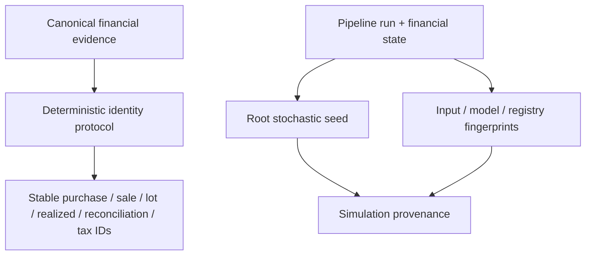
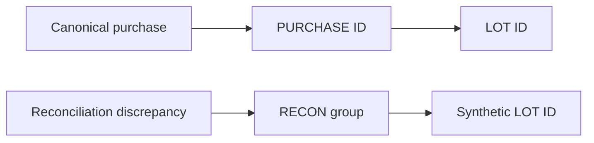
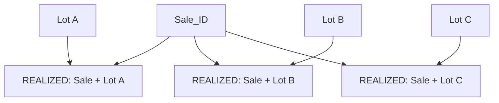
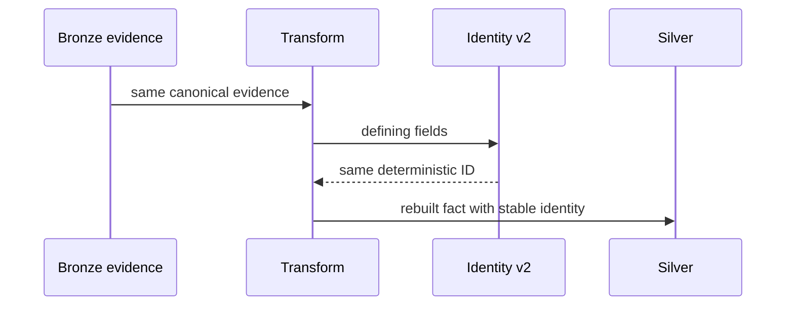
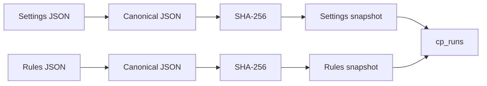
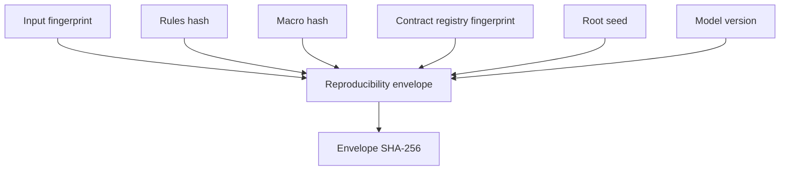

# Deterministic Identity and Replay

Personal Finance ETL uses deterministic identity to make reconstructed financial facts stable across complete analytical rebuilds. It separately records reproducibility context for stochastic simulations. Both mechanisms use canonicalization and hashing, but they solve different problems and must not be collapsed into one vague claim that "the pipeline is deterministic."

Deterministic finance answers **which fact is this?** Replay provenance answers **which stochastic experiment produced this result?**

## Source authority

Primary implementation:

- `backend/utils/identity.py`
- `backend/utils/reproducibility.py`
- `backend/transform/investment.py` and investment transformation producers
- `backend/engines/analytics/core/fifo.py`
- `backend/engines/tax/core/base_events.py`
- `backend/load/control_plane/run_repo.py`
- `backend/engines/presentation/wealth_engine.py`
- `backend/load/registry.py`

## Two different reproducibility problems



The left side is deterministic financial reconstruction. The right side records a stochastic experiment.

## Canonical ID Serialization v2

`backend/utils/identity.py` defines explicit field-order contracts for known namespaces. This removes caller dictionary construction order from identity semantics.

```python
_IDENTITY_FIELD_ORDERS = {
    "PURCHASE": (("ISIN", "Date", "Price", "Quantity", "CURRENCY_ID"),),
    "SALE": (("ISIN", "Date", "Sell_Price", "Quantity", "CURRENCY_ID"),),
    "REALIZED": (("Sale_ID", "Lot_ID"),),
    "RECON_EVENT": (("Reconciliation_Group_ID", "Lot_ID", "Adjustment_Type"),),
    "TAX": (("Source_Type", "Source_ID", "Tax_Sub_Head"),),
}
```

Some namespaces, especially `LOT`, accept multiple legitimate field sets because normal acquisition lots and reconciliation-created synthetic lots have different evidence contracts.

## Value canonicalization

Before hashing, values are converted into stable textual representations.

| Input type | Canonical representation |
|---|---|
| `None` | `<NULL>` |
| Boolean | `true` / `false` |
| `datetime` | ISO-8601 string |
| `date` | `YYYY-MM-DD` |
| Numeric | normalized `Decimal` fixed notation |
| Zero | `0` |
| String | Unicode NFC normalized and stripped |
| Other | stripped string representation |

```python
def canonicalize_value(val: Any) -> str:
    if val is None:
        return "<NULL>"
    elif isinstance(val, bool):
        return "true" if val else "false"
    elif isinstance(val, datetime):
        return val.isoformat()
    elif isinstance(val, str):
        return unicodedata.normalize("NFC", val).strip()
```

Unicode normalization matters because visually equivalent strings can otherwise have different byte representations. Financial identity should not change because Unicode decided to bring multiple spellings of the same glyph to the party.

## Ordered fields

For known contracts, the exact key set is matched against registered field orders. If no explicit contract matches, keys are sorted.

```python
for field_order in _IDENTITY_FIELD_ORDERS.get(namespace, ()):
    if keys == set(field_order):
        return [(key, fields[key]) for key in field_order]
return [(key, fields[key]) for key in sorted(fields)]
```

The fallback remains deterministic, but a namespace whose field order is semantically significant should be registered explicitly.

## Payload and hash

The serializer hashes a compact JSON payload containing:

```text
[
  namespace,
  "v2",
  ordered canonical key/value pairs
]
```

```python
payload = json.dumps(
    [namespace, "v2", pairs],
    ensure_ascii=False,
    separators=(",", ":"),
).encode("utf-8")
hash_str = hashlib.sha256(payload).hexdigest()
return f"{namespace}_{hash_str[:16]}"
```


The 16-character digest suffix is a compact application identifier, not a claim that SHA-256 itself has only 64 bits of output.

## Identity namespaces

Current explicit namespaces are:

- `PURCHASE`
- `SALE`
- `LOT`
- `REALIZED`
- `RECON_GROUP`
- `RECON_EVENT`
- `RECON_LOT_GROUP`
- `TAX`

Each namespace describes a different semantic entity. Reusing a hash function does not make the entities interchangeable.

## Purchase and sale identities

Canonical transaction identities derive from economic transaction fields rather than row number or load order.

```text
PURCHASE = ISIN + Date + Price + Quantity + CURRENCY_ID
SALE     = ISIN + Date + Sell_Price + Quantity + CURRENCY_ID
```

This means a complete Silver rebuild can reproduce transaction identity when the canonical evidence is unchanged.

## Lot identity

A normal acquisition lot can be defined from:

```text
ISIN + Purchase_ID + Quantity + Date
```

Reconciliation-created lots use alternate registered field sets including event/reconciliation context. This is deliberate: synthetic state must not masquerade as a broker-observed purchase.



## Realized-event identity

A realized disposal component is identified by:

```text
REALIZED = Sale_ID + Lot_ID
```

A sale that consumes three acquisition lots therefore has three stable realized-event identities rather than one opaque aggregate row.

This preserves disposal lineage:



## Reconciliation identities

Reconciliation uses three dedicated namespaces:

### `RECON_GROUP`

Defines the discrepancy context from ISIN, reconciliation date, adjustment type, broker/reconstructed quantities and broker/reconstructed cost bases.

### `RECON_EVENT`

Defines an event within the group from:

```text
Reconciliation_Group_ID + Lot_ID + Adjustment_Type
```

### `RECON_LOT_GROUP`

Defines grouped synthetic lot context from ISIN, date, adjustment type and quantity.

These IDs keep corrective state explicit and traceable. A reconciliation is not an excuse to quietly rewrite history until the numbers stop complaining.

## Tax event identity

Tax events derive identity from:

```text
TAX = Source_Type + Source_ID + Tax_Sub_Head
```

The tax layer therefore preserves the evidence lineage of the event it classifies instead of depending on output row order.

## Identity continuity across full analytical rebuilds

Silver and Gold are fully rebuilt. Stable financial identity is what allows complete reconstruction without treating every run as a new universe.



The guarantee depends on the identity-defining evidence and serialization contract remaining compatible.

## Identity protocol evolution

The literal `"v2"` marker is part of the hash payload. It prevents a serialization change from silently pretending to be the same protocol.

Changing:

- namespace field definitions;
- canonicalization behavior;
- serialization version;
- hash truncation;

can change persisted IDs and therefore requires deliberate migration reasoning.

This is why identity code belongs to architecture, not to the "tiny helper, probably harmless" drawer.

## Run configuration snapshots

`RunRepository.start_run()` canonicalizes Settings and FinancialRules JSON and stores content-addressed snapshots.

Snapshot IDs are based on SHA-256 digests:

```text
snap_set_<digest>
snap_rule_<digest>
```

Runs reference those snapshots rather than embedding mutable configuration semantics in prose logs.



Identical canonical payloads reuse snapshot identities through `INSERT OR IGNORE`.

## Simulation provenance

`cp_simulation_runs` records the stochastic context separately from ordinary run metadata. Fields include:

- `simulation_id`
- `run_id`
- `root_seed`
- `iterations`
- `horizon`
- `input_as_of_date`
- settings/rules snapshot IDs
- `input_fingerprint`
- `model_fingerprint`
- `model_implementation_version`
- status and result fingerprint

The simulation therefore has an operational identity of its own.

## Input fingerprinting

`RunRepository._fingerprint_dataframe()` normalizes simulation input into a deterministic representation before hashing. The goal is to identify the input state that entered the stochastic model, not merely the filename or in-memory object identity.

## Model fingerprinting

`log_simulation_run()` hashes model context separately from input context. This separation is useful because:

```text
same input + changed model != same experiment
same model + changed input != same experiment
```

## Contract registry fingerprint

`generate_contract_registry_fingerprint()` derives a deterministic fingerprint from active table metadata, including contract/grain/publisher information supplied by the caller.

The registry fingerprint lets reproducibility context include the analytical contract surface, not just model parameters.

## Reproducibility envelope

`generate_reproducibility_envelope()` combines:

- input fingerprint;
- financial-rules hash;
- macro-parameter hash;
- registry fingerprint;
- root seed;
- model version.



The envelope is a compact statement of *what must agree for the recorded experiment context to agree*.

## Standard PRNG derivation

`get_standard_prng(seed_string)` hashes an arbitrary seed string with SHA-256, takes the first 15 hexadecimal characters as an integer seed, and initializes NumPy's `PCG64` generator.

This provides stable application-level seed derivation from string context.

## FIRE root seed

The presentation engine receives the pipeline `run_id` as the root stochastic seed. Simulation-specific seeds are derived from that context.

This intentionally means two independent runs need not produce the same Monte Carlo paths simply because the financial inputs happen to match.

The reproducibility target is:

> replay the recorded run using its saved context and a compatible implementation.

It is **not**:

> force every future run to walk the same random path forever.

That latter design would be deterministic, but it would also be a rather strange Monte Carlo simulation.

## Replay assertion

`assert_simulation_replay()` compares actual and expected values using a strict numerical tolerance and raises on mismatch. It is a verification helper, not proof of environment-independent bitwise identity.

## Reproducibility boundaries

Exact replay can depend on more than application inputs:

- model implementation compatibility;
- NumPy/Numba behavior;
- numerical library versions;
- floating-point/runtime characteristics;
- PRNG compatibility.

The defensible guarantee is therefore **application-level replay under compatible implementation/runtime conditions**.

## Determinism matrix

| Concern | Deterministic? | Mechanism |
|---|---|---|
| Purchase identity | Yes for unchanged defining evidence | Canonical ID v2 |
| Sale identity | Yes | Canonical ID v2 |
| Lot identity | Yes for matching lot contract | Canonical ID v2 |
| Realized event identity | Yes | Sale + Lot identity |
| Reconciliation identity | Yes | Dedicated reconciliation namespaces |
| Tax event identity | Yes | Source identity + tax sub-head |
| Settings/rules snapshot identity | Yes | Canonical JSON + SHA-256 |
| Contract registry fingerprint | Yes for matching metadata | Sorted canonical payload + SHA-256 |
| Monte Carlo path across independent runs | No requirement | Run-specific seed context |
| Replay of recorded stochastic context | Intended under compatible runtime | Saved seed + fingerprints + model context |

## What deterministic identity does not solve

It does not make incorrect source evidence correct. It does not make reconstructed holdings broker-certified. It does not make tax estimates statutory. It does not turn stochastic forecasts into facts.

Identity answers **which thing**. It does not magically upgrade **what kind of thing** it is.

## Related specifications

- [Data Model](data-model.md)
- [Control Plane Artifact Lifecycle](control-plane-artifact-lifecycle.md)
- [Reliability and Recovery](reliability-and-recovery.md)
- [FIFO and Realized Events](../finance/fifo-and-realized-events.md)
- [Investment Reconciliation](../finance/investment-reconciliation.md)
- [FIRE Methodology](../finance/fire-methodology.md)
- [Identity and Grain Contracts](../reference/identity-and-grain-contracts.md)
