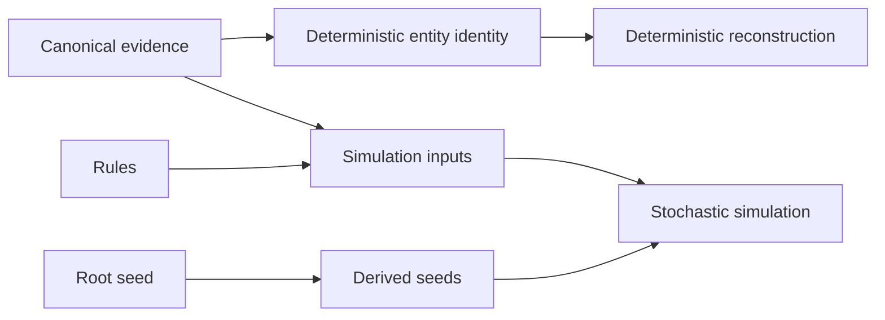
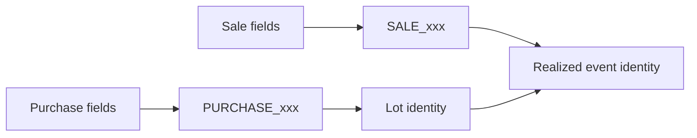
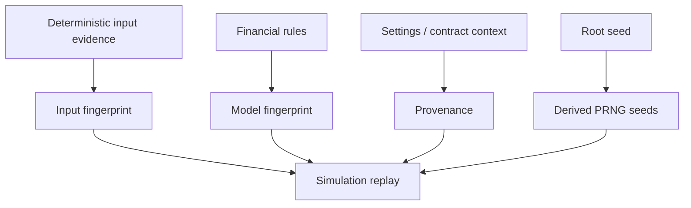

# Deterministic Identity and Replay

A run ID can tell me **which execution** produced a result.

It cannot tell me whether a purchase, sale, lot, realized event, reconciliation event, or Tax event is the **same economic entity** after a complete analytical rebuild.

That requires a different identity model.

The system therefore separates operational identity from economic identity and gives deterministic entities a canonical serialization protocol.

## There are two different reproducibility problems

The architecture deals with two broad categories of reproducibility:

### Deterministic reconstruction

Given equivalent canonical evidence and rules, economic entities such as purchases, sales, lots, realized events, and reconciliation events should receive stable identities and reconstruct consistently.

### Stochastic simulation

Given the same deterministic inputs, financial rules, model fingerprint, and root seed, a stochastic simulation should be reproducible within the model's stated boundaries.

These problems share provenance, but they do not use the same identity mechanism.



## Positional identity is not stable enough

Row numbers, DataFrame offsets, and database insertion order are convenient identifiers only until a rebuild changes ordering.

A stable financial identity must be based on the economic fields that define the entity.

For example:

```text
Purchase identity
≈ instrument + date + price + quantity + currency
```

That does not mean those exact fields are universally correct for every future product. It means identity is a declared contract rather than an accident of row order.

## Canonical ID Serialization defines the byte-level contract

`domain/common/identity.py` owns deterministic ID generation.

The protocol has four steps:

1. choose a namespace;
2. order the namespace's defining fields deterministically;
3. canonicalize each key and value;
4. serialize `[namespace, "v2", pairs]` as compact UTF-8 JSON and hash it with SHA-256.

```python
# src/personal_finance_etl/domain/common/identity.py
def generate_deterministic_id(namespace: str, fields: Mapping[str, object]) -> str:
    pairs = [
        [canonicalize_value(key), canonicalize_value(value)]
        for key, value in _ordered_identity_fields(namespace, fields)
    ]
    payload = json.dumps(
        [namespace, "v2", pairs], ensure_ascii=False, separators=(",", ":")
    ).encode("utf-8")
    hash_str = hashlib.sha256(payload).hexdigest()
    return f"{namespace}_{hash_str[:16]}"
```

The returned ID is readable enough to expose its namespace while remaining compact.

## Value canonicalization removes irrelevant representation differences

Hashing raw Python representations would make equivalent values diverge for reasons that have nothing to do with economics.

`canonicalize_value()` handles several classes explicitly:

| Input | Canonical form |
|---|---|
| `None` | `<NULL>` |
| boolean | `true` / `false` |
| `date` | `YYYY-MM-DD` |
| `datetime` | ISO 8601 |
| integer / float / `Decimal` | normalized decimal string |
| string | Unicode NFC + trimmed whitespace |
| other | trimmed `str()` fallback |

The numeric normalization is particularly important:

```python
case int() | float() | Decimal():
    try:
        d = Decimal(str(val)).normalize()
        if d.is_zero():
            return "0"
        return format(d, "f")
    except InvalidOperation:
        return str(val)
```

This prevents superficial representation differences such as `1`, `1.0`, and compatible decimal forms from generating different identities when they canonicalize to the same numeric value.

## Unicode normalization is part of identity correctness

Two visually identical strings can have different underlying Unicode code-point sequences.

The identity layer normalizes strings to NFC before trimming:

```python
case str():
    nfc = unicodedata.normalize("NFC", val)
    return nfc.strip()
```

That makes text identity less dependent on how upstream software encoded accented or composed characters.

For financial IDs, this is not a typography concern. It is a determinism concern.

## Field order is contract-defined where semantics are established

A Python mapping should not gain identity semantics from insertion order.

The module therefore declares stable field-order alternatives per known namespace.

```python
_IDENTITY_FIELD_ORDERS = {
    "PURCHASE": (("ISIN", "Date", "Price", "Quantity", "CURRENCY_ID"),),
    "SALE": (("ISIN", "Date", "Sell_Price", "Quantity", "CURRENCY_ID"),),
    "REALIZED": (("Sale_ID", "Lot_ID"),),
    "RECON_EVENT": (("Reconciliation_Group_ID", "Lot_ID", "Adjustment_Type"),),
    "TAX": (("Source_Type", "Source_ID", "Tax_Sub_Head"),),
}
```

`LOT` supports multiple established defining-field shapes because not every lot originates from the same event type.

Unknown/new contracts fall back to sorted key order so they remain deterministic, but a namespace whose field order is semantically important should be explicitly added to the contract map.

## The namespace is part of the hash payload

A purchase and a sale with coincidentally identical field values must not share identity.

The namespace participates in both the returned prefix and the hash payload.

```text
PURCHASE_...
SALE_...
LOT_...
REALIZED_...
RECON_GROUP_...
RECON_EVENT_...
TAX_...
```

This creates a lightweight type boundary in identifiers themselves.

## Purchase and sale identities anchor later reconstruction

Canonical purchase and sale IDs are upstream identity anchors.

They survive complete analytical rebuilds because they are derived from economic defining fields rather than runtime sequence.



That continuity matters because later entities can reference earlier IDs rather than repeating every original field.

## Lot identity reflects how the lot came into existence

Not every lot is a simple purchase lot.

The domain supports lot sources/actions such as:

- purchase;
- split;
- bonus;
- dividend reinvestment;
- reconciliation.

Identity therefore has to preserve the event semantics that created the lot.

The `LOT` namespace allows several explicit field signatures, including purchase-linked and reconciliation-linked forms.

This is a good example of why a generic “hash the whole row” strategy would be wrong. A row contains many values that can change during valuation without changing the lot's economic identity.

## Realized-event identity is sale-lot identity

FIFO creates one realized event for each economically relevant sale/lot match.

One sale can consume multiple lots, so `Sale_ID` alone is not enough.

The canonical identity is:

```text
REALIZED(Sale_ID, Lot_ID)
```

```mermaid
flowchart TD
    SALE[Sale S1] --> R1[REALIZED(S1, L1)]
    SALE --> R2[REALIZED(S1, L2)]
    L1[Lot L1] --> R1
    L2[Lot L2] --> R2
```

This grain preserves the actual FIFO matching result.

## Reconciliation identities model discrepancy evidence

Reconciliation has at least two useful identity levels.

### Reconciliation group

A group identifies the observed disagreement context for an instrument/date/adjustment type and observed/reconstructed values.

### Reconciliation event

An event can then identify the specific lot-level adjustment inside that group.

This produces a hierarchy:

```text
RECON_GROUP
    ├── RECON_EVENT lot A
    ├── RECON_EVENT lot B
    └── RECON_EVENT synthetic adjustment
```

The model preserves both the discrepancy as a whole and the concrete adjustments used to converge state.

## Tax identity attaches Tax evidence to source evidence

The Tax namespace uses source type, source ID, and Tax sub-head.

That architecture is important because Tax events should remain traceable to the financial evidence that created them.

```mermaid
flowchart LR
    SRC[Income / realized event / other source] --> SID[Source_ID]
    SID --> TAX[TAX(Source_Type, Source_ID, Tax_Sub_Head)]
```

Tax classification can evolve while provenance still points to the underlying financial event.

## Stable IDs survive full analytical rebuilds

Silver and Gold are rebuilt from complete upstream state.

Without deterministic identity, every rebuild could create new surrogate identifiers even when the economics were unchanged.

That would break:

- cross-run comparison;
- reconciliation lineage;
- event-level Tax traceability;
- debugging;
- result diffing;
- downstream analytical references.

Deterministic IDs turn a full rebuild from “new rows” into “reconstructed representations of the same economic entities.”

## Identity stability does not mean row equality

An entity can preserve identity while non-identifying attributes change.

For example, a lot's market value changes over time without changing which lot it is.

This distinction is essential:

```text
identity fields     → define sameness
state attributes    → describe current/derived condition
```

Hashing an entire evolving record would confuse state change with entity replacement.

## Identity protocol evolution is explicit

The serialized payload includes the literal protocol marker `"v2"`.

That prevents future identity changes from being silent.

If identity semantics must change, the protocol version can change with a deliberate migration/replay strategy.

The architecture does not assume that an identity contract can evolve invisibly while preserving all previous hashes.

## Run IDs solve a different problem

`RunRepository.start_run()` uses a UUID for execution identity.

```python
run_id = str(uuid.uuid4())
```

That is correct because a run is a unique occurrence, not a deterministic economic entity.

Two executions over identical inputs should still have different run IDs.

This creates a useful separation:

```text
run_id                 → which execution?
deterministic entity ID → which economic entity?
```

Conflating them would make replay either operationally ambiguous or economically unstable.

## Configuration snapshots are content-addressed

Settings and rules use another identity strategy: content hashing.

`start_run()` canonicalizes the JSON payload and stores a SHA-256 digest-derived snapshot ID.

```python
canonical_cfg = self._canonical_json(cfg_json)
digest_cfg = hashlib.sha256(canonical_cfg.encode("utf-8")).hexdigest()
settings_id = f"snap_set_{digest_cfg}"
```

The same pattern applies to financial rules.

This means two runs with semantically identical canonical configuration content can point to the same snapshot identity even if they occurred at different times.

## Content-addressed config identity helps answer replay questions

A replay investigation can distinguish:

```text
same evidence + same settings + same rules
same evidence + different settings
same evidence + different financial rules
```

Those scenarios should not be interpreted as equivalent simply because the source files did not change.

The snapshot IDs make the differences queryable.

## Contract registry fingerprinting adds structural provenance

Warehouse contract structure is fingerprinted from metadata rather than from a manually incremented counter.

```python
# src/personal_finance_etl/infrastructure/warehouse/fingerprints.py
def generate_contract_registry_fingerprint(
    tables_metadata: Sequence[Mapping[str, object]],
) -> str:
    sorted_metadata = sorted(tables_metadata, key=lambda x: str(x.get("table_name", "")))
    payload = json.dumps(sorted_metadata, sort_keys=True).encode("utf-8")
    return hashlib.sha256(payload).hexdigest()
```

This captures meaningful structural drift even if somebody forgets to bump a version field.

It is a different fingerprint from economic entity identity because it answers a different question: **did the publication contract change?**

## Simulation reproducibility uses deterministic seed derivation

FIRE simulation owns a separate reproducibility mechanism.

The root seed is converted into a bounded CRC-based offset:

```python
# src/personal_finance_etl/domain/fire/reproducibility.py
def derive_simulation_seed_offset(root_seed: str) -> int:
    return zlib.crc32(root_seed.encode("utf-8")) % 1_000_000


def derive_monthly_seed(root_seed: str, year: int, month: int) -> int:
    offset = derive_simulation_seed_offset(root_seed)
    return year * 12 + month + offset
```

A Polars expression provides the same derivation across temporal rows.

This gives each year/month a stable integer seed relative to the root seed.

## The root seed is isolated by run

The pipeline uses the run ID as the root seed when invoking the wealth/FIRE presentation engine.

That means independent production runs naturally get independent stochastic paths.

The seed is then recorded in `cp_simulation_runs` so the simulation can be investigated later.

If an exact stochastic replay is desired, reproducing the root seed is part of the provenance envelope.

## Simulation provenance fingerprints inputs and model assumptions

`RunRepository.log_simulation_run()` derives a model fingerprint from Monte Carlo, FIRE, and capital-market-assumption rule content.

It also fingerprints input and result DataFrames.

```python
combined_rules = {
    "monte_carlo": rules.assumptions.monte_carlo.model_dump(),
    "fire": rules.assumptions.fire.model_dump(),
    "cma": rules.assumptions.cma.model_dump(),
}
model_fingerprint = hashlib.sha256(
    json.dumps(
        self._json_safe(combined_rules),
        sort_keys=True,
        separators=(",", ":"),
        ensure_ascii=False,
        allow_nan=False,
    ).encode("utf-8")
).hexdigest()
```

This makes simulation reproducibility a multi-part contract rather than “same seed equals same meaning.”

## The reproducibility envelope is wider than the seed

A meaningful stochastic replay requires alignment across several dimensions:



A matching seed with different rules or inputs does not prove reproducibility.

## Deterministic versus stochastic replay

| Property | Deterministic financial reconstruction | Stochastic FIRE simulation |
|---|---|---|
| primary continuity mechanism | canonical economic IDs | root seed + model/input provenance |
| expected same result with same inputs | yes, within deterministic boundaries | yes only with equivalent stochastic envelope |
| run ID stable across executions | no | no |
| entity IDs stable across rebuilds | yes where identity contract applies | not the primary mechanism |
| fingerprints important | yes for config/contracts/results | essential for inputs/model/results |
| randomness involved | no | yes |

This distinction prevents “reproducible” from becoming one vague promise across unrelated compute models.

## Replay is enabled by more than IDs

Deterministic identity is necessary for useful replay but not sufficient.

A faithful replay also depends on:

- retained/canonical evidence;
- settings and financial-rules snapshots;
- deterministic transformation code;
- contract structure;
- temporal-causality rules;
- provider evidence completeness;
- simulation provenance where randomness is involved.

Identity tells me whether reconstructed entities line up. It does not recreate missing evidence by itself.

## Replay and reconciliation are related but not identical

Replay asks:

> If I rebuild from the same authoritative evidence and policy, do I reconstruct the same economic entities/state?

Reconciliation asks:

> Does reconstructed state agree with independently observed external state?

A pipeline can replay perfectly and still reproduce the same disagreement with the broker.

That is why reconciliation events are explicit domain evidence rather than treated as failures of deterministic identity.

## Identity and provenance answer different questions

Another useful distinction:

```text
identity   → what is this?
provenance → where did it come from and under what run/policy?
```

A realized event can have stable identity and still be associated with different run provenance if it is reconstructed again.

The architecture keeps both because auditability needs both.

## Reproducibility boundaries

The system can make strong deterministic claims only inside declared boundaries.

Potential sources of variation include:

- changed input evidence;
- changed financial rules;
- changed settings affecting acquisition/processing;
- changed contract structure;
- provider revisions;
- intentional stochastic variation;
- floating-point/library behavior at implementation boundaries;
- model implementation changes.

The provenance system exists to make those differences diagnosable, not to pretend they do not exist.

## What deterministic identity does not solve

Deterministic IDs do not prove:

- that the underlying source evidence is correct;
- that the chosen identifying fields are economically sufficient forever;
- that two semantically different source records cannot share identical defining fields;
- that provider data is immutable;
- that reconciliation is unnecessary;
- that every analytical metric is deterministic;
- that schema evolution can never require an identity protocol change.

Identity is one reliability mechanism inside a broader model.

## Identity invariants

1. known economic identity namespaces use explicit field-order contracts;
2. unknown mappings remain deterministic through sorted-key fallback;
3. values are canonicalized before hashing;
4. namespace and serialization version participate in the hash payload;
5. IDs are derived from identity-defining fields, not row position;
6. run identity remains unique rather than deterministic;
7. configuration/rules snapshots are content-addressed;
8. stochastic seed derivation is deterministic relative to root seed and month;
9. simulation provenance includes model/input context beyond the seed;
10. reconciliation remains independent evidence even under perfect replay.

## Continue into failure truth

Stable identity makes reconstruction meaningful. The next question is what the system can truthfully claim when reconstruction and persistence are interrupted.

Continue with [Reliability and Recovery](reliability-and-recovery.md).

## Related specifications

- [Architecture](README.md)
- [Control Plane Artifact Lifecycle](control-plane-artifact-lifecycle.md)
- [Reliability and Recovery](reliability-and-recovery.md)
- [Data Model](data-model.md)
- [Finance: FIFO and Realized Events](../finance/fifo-and-realized-events.md)
- [Finance: Investment Reconciliation](../finance/investment-reconciliation.md)
- [Finance: FIRE Methodology](../finance/fire-methodology.md)
- [Reference: Identity and Grain Contracts](../reference/identity-and-grain-contracts.md)
