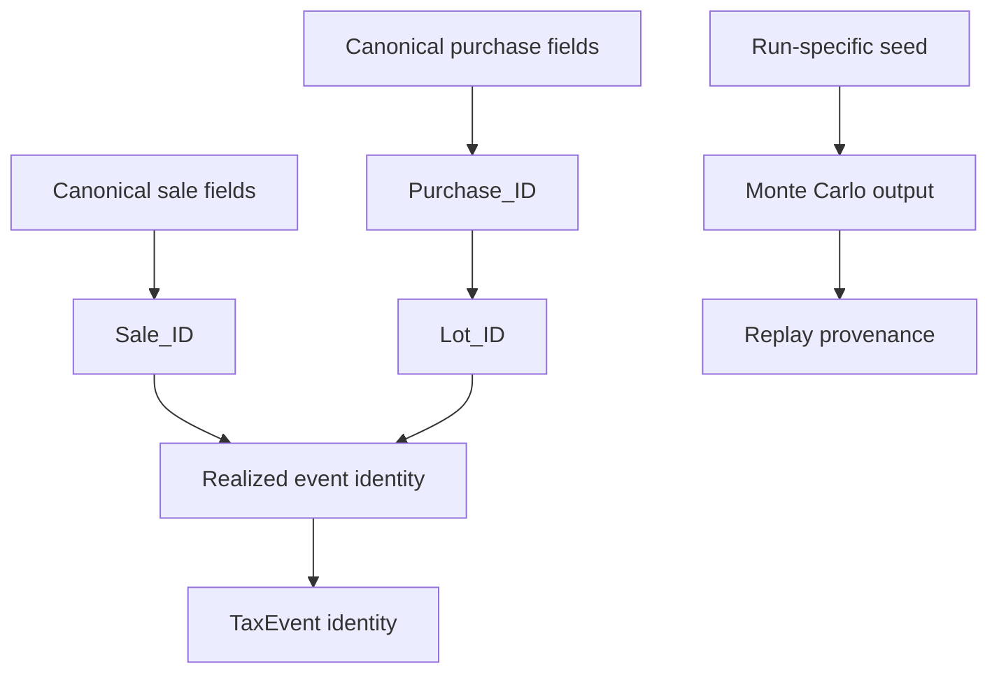

# Deterministic Identity And Replay

I document this subsystem as a contract with explicit authority, inputs, state transitions and failure behavior. The snippets below come from the current production modules. I do not equate an implemented mechanism with an untested universal guarantee.



## 1. Identity and evidence ownership

The implementation for this responsibility lives in `utils/identity.py`. The source excerpt below establishes its inputs, mutations, and outputs.

**Implementation:** `src/personal_finance_etl/backend/utils/identity.py` (lines 1–38).

```python
import hashlib
import json
import unicodedata
from datetime import date, datetime
from decimal import Decimal, InvalidOperation
from typing import Any

# Preserve the established v2 serialization order for known identity contracts.
# This makes the output independent of caller dict construction order without
# silently changing existing IDs. Add a contract here whenever a namespace's
# defining fields change.
_IDENTITY_FIELD_ORDERS: dict[str, tuple[tuple[str, ...], ...]] = {
    "PURCHASE": (("ISIN", "Date", "Price", "Quantity", "CURRENCY_ID"),),
    "SALE": (("ISIN", "Date", "Sell_Price", "Quantity", "CURRENCY_ID"),),
    "LOT": (
        ("ISIN", "Purchase_ID", "Quantity", "Date"),
        ("ISIN", "Date", "Quantity", "Price", "Currency", "Event"),
        ("ISIN", "Date", "Quantity", "Price", "Currency", "Event", "Recon_Group"),
        ("ISIN", "Event", "Recon_Group"),
    ),
    "REALIZED": (("Sale_ID", "Lot_ID"),),
    "RECON_GROUP": (
        (
            "ISIN",
            "Reconciliation_Date",
            "Adjustment_Type",
            "Broker_Quantity",
            "Reconstructed_Quantity",
            "Broker_Cost_Basis",
            "Reconstructed_Cost_Basis",
        ),
    ),
    "RECON_EVENT": (("Reconciliation_Group_ID", "Lot_ID", "Adjustment_Type"),),
    "RECON_LOT_GROUP": (("ISIN", "Reconciliation_Date", "Adjustment_Type", "Quantity"),),
    "TAX": (("Source_Type", "Source_ID", "Tax_Sub_Head"),),
}


```

## 2. Canonical value serialization

The implementation for this responsibility lives in `utils/identity.py`. The source excerpt below establishes its inputs, mutations, and outputs.

**Implementation:** `src/personal_finance_etl/backend/utils/identity.py` (lines 39–62).

```python
def canonicalize_value(val: Any) -> str:
    if val is None:
        return "<NULL>"
    elif isinstance(val, bool):
        return "true" if val else "false"
    elif isinstance(val, datetime):
        return val.isoformat()
    elif isinstance(val, date):
        return val.strftime("%Y-%m-%d")
    elif isinstance(val, (int, float, Decimal)):
        try:
            d = Decimal(str(val)).normalize()
            if d.is_zero():
                return "0"
            return format(d, "f")
        except InvalidOperation:
            return str(val)
    elif isinstance(val, str):
        nfc = unicodedata.normalize("NFC", val)
        return nfc.strip()
    else:
        return str(val).strip()


```

## 3. Namespace field ordering

The implementation for this responsibility lives in `utils/identity.py`. The source excerpt below establishes its inputs, mutations, and outputs.

**Implementation:** `src/personal_finance_etl/backend/utils/identity.py` (lines 63–74).

```python
def _ordered_identity_fields(namespace: str, fields: dict[str, Any]) -> list[tuple[str, Any]]:
    """Return identity fields in a contract-defined, caller-order-independent order."""
    keys = set(fields)
    for field_order in _IDENTITY_FIELD_ORDERS.get(namespace, ()):
        if keys == set(field_order):
            return [(key, fields[key]) for key in field_order]

    # Unknown/new contracts remain deterministic rather than inheriting insertion
    # order. Add a namespace contract above if its field order must be semantic.
    return [(key, fields[key]) for key in sorted(fields)]


```

## 4. Stable hash derivation

The implementation for this responsibility lives in `utils/identity.py`. The source excerpt below establishes its inputs, mutations, and outputs.

**Implementation:** `src/personal_finance_etl/backend/utils/identity.py` (lines 75–89).

```python
def generate_deterministic_id(namespace: str, fields: dict[str, Any]) -> str:
    """Generate a stable deterministic ID using Canonical ID Serialization v2.

    Known namespaces retain their established field order and hashes. New or
    changed field sets use sorted keys until an explicit order is registered.
    """
    pairs = [
        [canonicalize_value(key), canonicalize_value(value)]
        for key, value in _ordered_identity_fields(namespace, fields)
    ]
    payload = json.dumps(
        [namespace, "v2", pairs], ensure_ascii=False, separators=(",", ":")
    ).encode("utf-8")
    hash_str = hashlib.sha256(payload).hexdigest()
    return f"{namespace}_{hash_str[:16]}"
```

## 5. Canonical transaction producer semantics

The implementation for this responsibility lives in `transform/investments.py`. The source excerpt below establishes its inputs, mutations, and outputs.

**Implementation:** `src/personal_finance_etl/backend/transform/investments.py` (lines 1–55).

```python
from datetime import datetime, timezone
from typing import Any

import polars as pl

from personal_finance_etl.backend.utils.identity import generate_deterministic_id


def get_purchase_reference(
    df_lazy: pl.LazyFrame,
    instrument_col: str,
    date_col: str,
    price_col: str,
    qty_col: str,
    extra_group_cols: list[str] | None = None,
) -> pl.LazyFrame:
    """
    Translates DAX SUMMARIZE + CALCULATE(SUM) for Purchases.
    Groups by Instrument, ISIN, Date, and Price, then sums the Quantity.
    Returns: ISIN, Date, Price, Quantity, Value
    """
    group_cols = [
        "__file_name__",
        "__folder_path__",
        "__file_category__",
        "ISIN",
        pl.col(instrument_col).alias("Instrument name"),
        pl.col(date_col).alias("Date"),
        pl.col(price_col).alias("Price"),
    ]
    if extra_group_cols:
        group_cols.extend(extra_group_cols)

    df_grouped = (
        df_lazy
        # SUMMARIZE equivalent
        .group_by(group_cols)
        # CALCULATE(SUM(Quantity)) equivalent
        .agg(pl.col(qty_col).sum().alias("Quantity"))
        # DAX: Value = Quantity * Price
        .with_columns((pl.col("Quantity") * pl.col("Price")).alias("Value"))
    )
    return df_grouped


def get_sale_reference(
    df_sale_lazy: pl.LazyFrame,
    df_purchase_ref_lazy: pl.LazyFrame,
    instrument_col: str,
    date_col: str,
    price_col: str,
    qty_col: str,
    extra_group_cols: list[str] | None = None,
) -> pl.LazyFrame:
    """
```

## 6. FIFO and reconciliation identities

The implementation for this responsibility lives in `engines/analytics/core/fifo.py`. The source excerpt below establishes its inputs, mutations, and outputs.

**Implementation:** `src/personal_finance_etl/backend/engines/analytics/core/fifo.py` (lines 1–65).

```python
from collections import deque
from datetime import date
from typing import Any

from personal_finance_etl.backend.engines.analytics.rules.macro import FYMacroParametersTable
from personal_finance_etl.backend.utils.identity import generate_deterministic_id
from personal_finance_etl.backend.utils.logger import logger
from personal_finance_etl.backend.utils.models import TaxLot


class FIFOPortfolio:
    """Manages the FIFO tracking of a single instrument's lots."""

    def __init__(
        self,
        tax_type: str,
        tax_subtype: str,
        fy_table: FYMacroParametersTable,
        default_currency_id: str,
        isin: str,
    ):
        self._active_lots: deque[TaxLot] = deque()
        self.tax_type = tax_type
        self.tax_subtype = tax_subtype
        self.fy_table = fy_table
        self.default_currency_id = default_currency_id
        self.isin = isin

    @property
    def active_lots(self) -> list[TaxLot]:
        """Read-only access to active lots."""
        return list(self._active_lots)

    def buy(
        self,
        buy_date: date,
        qty: float,
        price: float,
        shadow_qty: float,
        bm_price: float,
        price_local: float = 0.0,
        fx_rate_buy: float = 1.0,
        currency_id: str | None = None,
        bm_buy_local: float | None = None,
        purchase_id: str | None = None,
        lot_source_type: str = "PURCHASE",
        reconciliation_group_id: str | None = None,
    ) -> None:
        """Register a new buy lot."""

        if currency_id is None:
            currency_id = self.default_currency_id

        if purchase_id:
            # Deterministically generate Lot_ID using the unique purchase_id and current qty in this execution context
            # (as partial executions or splits might happen).
            lot_fields = {
                "ISIN": self.isin,
                "Purchase_ID": purchase_id,
                "Quantity": qty,
                "Date": buy_date,
            }
            lot_id = generate_deterministic_id("LOT", lot_fields)
        else:
            if reconciliation_group_id is not None:
```

## 7. Realized and TaxEvent lineage

The implementation for this responsibility lives in `engines/tax/core/base_events.py`. The source excerpt below establishes its inputs, mutations, and outputs.

**Implementation:** `src/personal_finance_etl/backend/engines/tax/core/base_events.py` (lines 1–65).

```python
from __future__ import annotations

import math
from datetime import date, datetime
from typing import Any

import polars as pl

from personal_finance_etl.backend.config.financial_rules import FinancialRules
from personal_finance_etl.backend.engines.analytics.rules.macro import FYMacroParametersTable
from personal_finance_etl.backend.utils.identity import generate_deterministic_id

TAX_EVENT_SCHEMA: dict[str, pl.DataType] = {
    "Tax_Event_ID": pl.String(),
    "FY": pl.String(),
    "Event_Date": pl.Date(),
    "Source_Type": pl.String(),
    "Source_ID": pl.String(),
    "Income_Head": pl.String(),
    "Tax_Sub_Head": pl.String(),
    "Amount_INR": pl.Float64(),
    "Applied_Rate": pl.Float64(),
    "Estimated_Tax": pl.Float64(),
    "CURRENCY_ID": pl.String(),
    "Tax_Status": pl.String(),
    "Tax_Status_Reason": pl.String(),
    "ISIN": pl.String(),
    "Lot_ID": pl.String(),
}


class BaseEventsBuilder:
    """Normalize ledger, tax-credit and Quant FIFO evidence into canonical TaxEvents.

    The builder carries FIFO-provided investment estimates and calculates indicative
    ledger estimates using the configured ordinary-income rate. It does not calculate
    final statutory liability or apply annual set-off/credit rules.
    """

    def __init__(
        self,
        df_income: pl.DataFrame,
        df_realized_events: pl.DataFrame,
        df_subcategory: pl.DataFrame,
        rules: FinancialRules | None,
        df_macro_parameters: pl.DataFrame | None = None,
    ) -> None:
        self.df_income = df_income
        self.df_realized_events = df_realized_events
        self.df_subcategory = df_subcategory
        self.rules = rules
        self.macro_table = (
            FYMacroParametersTable(df_macro_parameters, rules=rules)
            if rules is not None
            and df_macro_parameters is not None
            and not df_macro_parameters.is_empty()
            else None
        )

    def build(self) -> pl.LazyFrame:
        """Return validated, deterministic TaxEvents as a LazyFrame."""
        if self.rules is None:
            raise ValueError("FinancialRules are required to build canonical TaxEvents.")

        self._validate_subcategory_dimension()
```

## 8. Registry fingerprint

The implementation for this responsibility lives in `utils/reproducibility.py`. The source excerpt below establishes its inputs, mutations, and outputs.

**Implementation:** `src/personal_finance_etl/backend/utils/reproducibility.py` (lines 9–48).

```python
def generate_contract_registry_fingerprint(tables_metadata: list[dict[str, Any]]) -> str:
    """
    Computes a deterministic fingerprint of the active table grains and publishers.
    Avoids using a manual registry version counter by hashing the actual structural metadata.
    """
    sorted_metadata = sorted(tables_metadata, key=lambda x: str(x.get("table_name", "")))
    payload = json.dumps(sorted_metadata, sort_keys=True).encode("utf-8")
    return hashlib.sha256(payload).hexdigest()


def generate_reproducibility_envelope(
    input_fingerprint: str,
    rules_hash: str,
    macro_settings_hash: str,
    registry_fingerprint: str,
    root_seed: str,
    model_version: str,
) -> dict[str, str]:
    """
    Ties the inputs, rules, macro settings, registry, and seed into the final unified envelope.
    This guarantees that if the envelope hash matches, the simulation is mathematically guaranteed
    to reproduce the exact same Monte Carlo distributions and projections.
    """
    envelope_data = {
        "input_fingerprint": input_fingerprint,
        "rules_hash": rules_hash,
        "macro_settings_hash": macro_settings_hash,
        "registry_fingerprint": registry_fingerprint,
        "root_seed": root_seed,
        "model_version": model_version,
    }
    envelope_payload = json.dumps(envelope_data, sort_keys=True).encode("utf-8")
    envelope_hash = hashlib.sha256(envelope_payload).hexdigest()

    return {
        "envelope_hash": envelope_hash,
        **envelope_data,
    }


```

## 9. Simulation PRNG and replay tolerance

The implementation for this responsibility lives in `utils/reproducibility.py`. The source excerpt below establishes its inputs, mutations, and outputs.

**Implementation:** `src/personal_finance_etl/backend/utils/reproducibility.py` (lines 49–74).

```python
def get_standard_prng(seed_string: str) -> Any:
    """
    Returns a standardized high-grade Pseudo-Random Number Generator (PRNG)
    for financial Monte Carlo simulations. Uses NumPy's PCG64 (Permuted Congruential Generator).
    The string seed is hashed into a deterministically derived integer seed.
    """
    # Deterministically convert the string seed into an integer suitable for PCG64
    seed_int = int(hashlib.sha256(seed_string.encode('utf-8')).hexdigest()[:15], 16)
    
    # PCG64 is statistically excellent and highly performant for Monte Carlo simulations
    return np.random.Generator(np.random.PCG64(seed_int))


def assert_simulation_replay(actual_val: float, expected_val: float, context: str = "") -> None:
    """
    Enforces the Simulation Replay Numerical Contract.
    Standardizes strict numerical tolerances for asserting simulation equivalence 
    across rebuilds or version upgrades.
    """
    # rel_tol of 1e-5 (0.001%) and abs_tol of 1e-4
    if not math.isclose(actual_val, expected_val, rel_tol=1e-5, abs_tol=1e-4):
        raise ValueError(
            f"Simulation replay contract broken {context}: "
            f"expected {expected_val}, got {actual_val}."
        )

```

## 10. Run-specific Wealth seed

The implementation for this responsibility lives in `engines/presentation/wealth_engine.py`. The source excerpt below establishes its inputs, mutations, and outputs.

**Implementation:** `src/personal_finance_etl/backend/engines/presentation/wealth_engine.py` (lines 36–70).

```python
class WealthPresentationEngine:
    """
    Presentation Engine for Wealth & Cashflow metrics.
    Consumes LazyFrames and produces aggregated summary tables suitable for BI dashboards.
    """

    def __init__(self, rules: FinancialRules, root_seed: str = "default_seed") -> None:
        self.rules = rules
        self.root_seed = root_seed

    def run(self, dfs: Mapping[str, pl.DataFrame | pl.LazyFrame]) -> dict[str, pl.LazyFrame]:
        """
        Takes collected DataFrames from the primary ETL, converts them to LazyFrames,
        performs presentation-tier aggregations, and returns them to be collected.
        """
        logger.debug("[ENGINE:PRESENTATION] Starting Wealth Engine presentation layer builds...")
        logger.debug(
            "[ENGINE:PRESENTATION] Imputing missing data (NaN) with 0.0 for BI Engine compatibility..."
        )

        # 1. Core Builders (Inflation, Ledger, Net Worth)
        inflation_res = InflationBuilder(dfs, rules=self.rules).build()
        if not inflation_res:
            return {}

        ledger_res = LedgerBuilder(dfs, rules=self.rules).build()
        if not ledger_res:
            return {}

        net_worth_res = NetWorthBuilder(
            dfs, inflation_res, ledger_res, self.rules.DEFAULT_CURRENCY_ID
        ).build()

        base_lf = {**inflation_res, **ledger_res, **net_worth_res}

```

## Related specifications

- [System architecture](system-architecture.md)
- [Reliability and recovery](reliability-and-recovery.md)
- [Data lifecycle](data-lifecycle.md)

