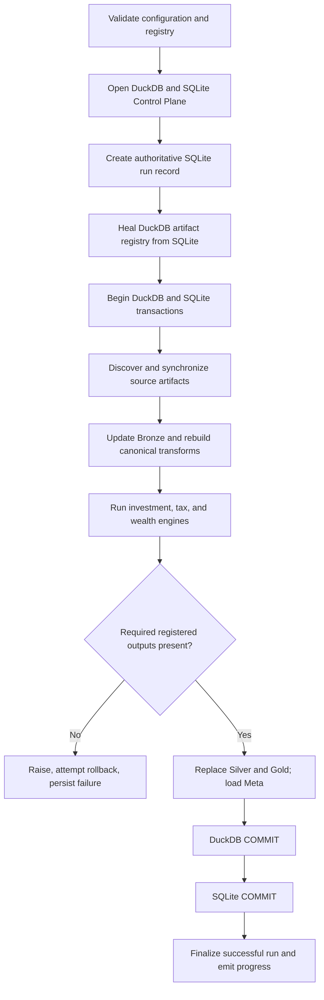
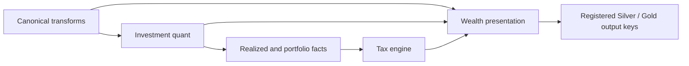
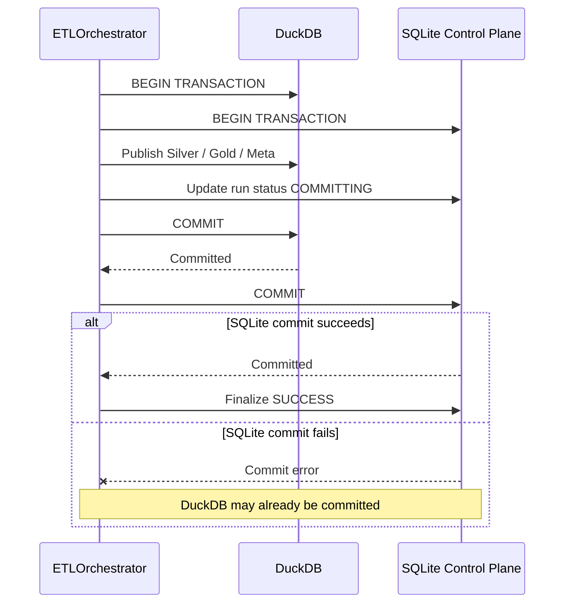
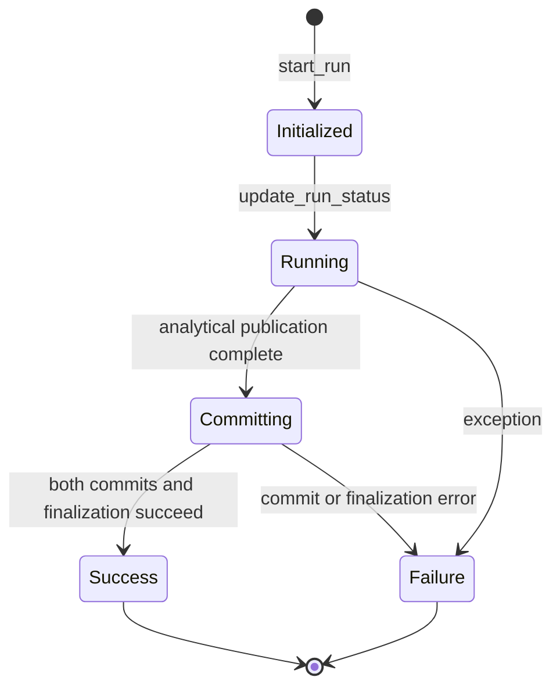

# Execution Lifecycle

I use a single `ETLOrchestrator.run()` method to coordinate the end-to-end rebuild. The source of truth for the sequence is `src/personal_finance_etl/backend/pipeline/etl_pipeline.py`, especially `run()` (starting near line 248). This specification separates **observable source behavior** from untested guarantees.

## 1. Run initialization

I validate configuration and the data contract registry before opening the operational and analytical stores. I open DuckDB, initialize its schemas, open the SQLite Control Plane under a non-blocking file lock, and recover stale run records when ensuring the Control Plane schema.

```python
self.cfg.validate_config()
validate_registry()
self.db_manager.open()
self.db_manager.ensure_schemas()
cp = ControlPlane(self.cfg.TARGET_DB_BASE_PATH, self.cfg.RAW_DOCUMENT_STORE_NAME)
cp.open()
cp.ensure_schema()
```

The snippet is excerpted from `ETLOrchestrator.run()` with adjacent logging omitted. `ControlPlane.open()` acquires a `pipeline.lock` using `FileLock(...).acquire(timeout=0)`, so another holder causes a failure rather than waiting indefinitely.

## 2. Execution sequence



This is a **hybrid ingestion/rebuild** design: Bronze contains both full-replace and file-incremental policies, while Silver and Gold are rebuilt rather than updated as an end-to-end incremental pipeline.

## 3. Engine dependencies

`_run_engines()` coordinates the investment quant engine, tax engine, and wealth presentation engine. The registry validates required output keys before analytical publication; this is a **contract-presence check**, not a mathematical proof of financial correctness.



The exact data dependencies are more granular than this overview and belong to the `finance/` and `reference/` domains.

## 4. Transaction boundary and partial commit

The application coordinates two *separate* transactional engines. The commit sequence is explicit:

```python
self.db_manager.conn.execute("COMMIT")
cp.commit()
cp.runs.finish_run(run_id, "SUCCESS")
```



I cannot describe this as global ACID atomicity. The source explicitly notes that a failed SQLite commit after a successful DuckDB commit must be reconciled by subsequent idempotency and Bronze self-healing. A later rollback attempt cannot reverse an already committed DuckDB transaction.

## 5. Failure handling and evidence

On an exception, the orchestrator attempts rollback on both connections, logs the failure, and attempts to persist run failure details. Its exception handler contains a broad rollback-success message; that message should **not** be treated as evidence of an atomic rollback across both databases.



This diagram summarizes the main orchestration states. Exact persisted status strings and exceptional transition handling should be taken from `run_repo.py` when implementing the `control-plane/run-lifecycle.md` specification.

## 6. Verification boundaries

- **Source-inspected:** ordering of validations, database opening, run creation, transaction begin, publication, commits, and exception handling.
- **Not established by source inspection alone:** fault-injection success for every commit boundary, all runtime data contract compatibility, or mathematical correctness of every financial output.
- **Operational observation:** my production workload contains 1,629 artifacts and typically runs in approximately 20 seconds cached or 40 seconds fresh, based on my own daily use. These are not portable benchmarks.

## Implementation references

- `backend/pipeline/etl_pipeline.py`: `ETLOrchestrator.run()`, `_run_engines()`.
- `backend/load/control_plane/orchestrator.py`: `ControlPlane.open()`, transaction delegation.
- `backend/load/control_plane/run_repo.py`: run statuses and failure persistence.
- `backend/load/registry.py`: contract validation.

[← Architecture](README.md)
