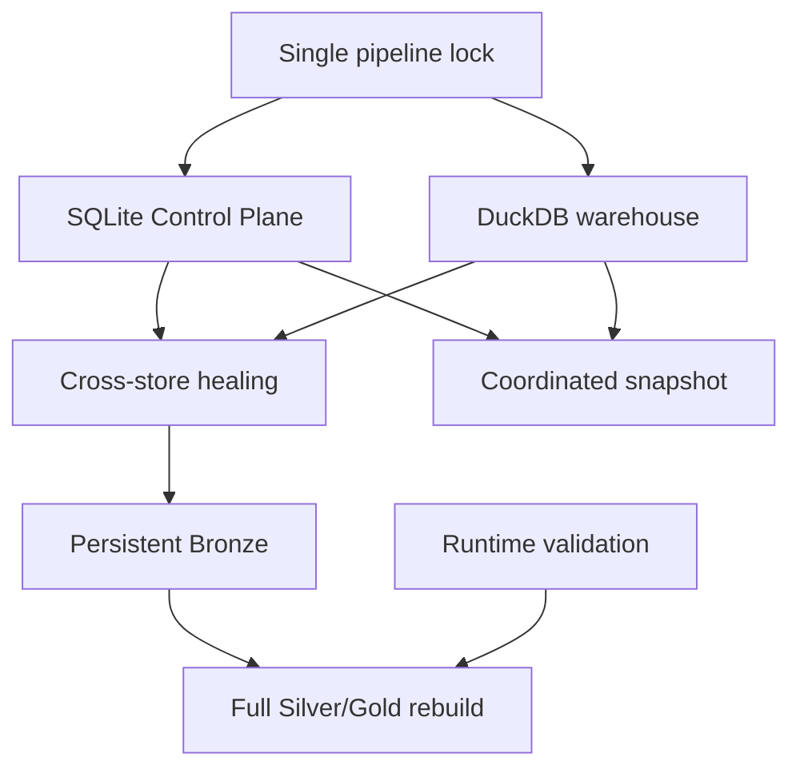
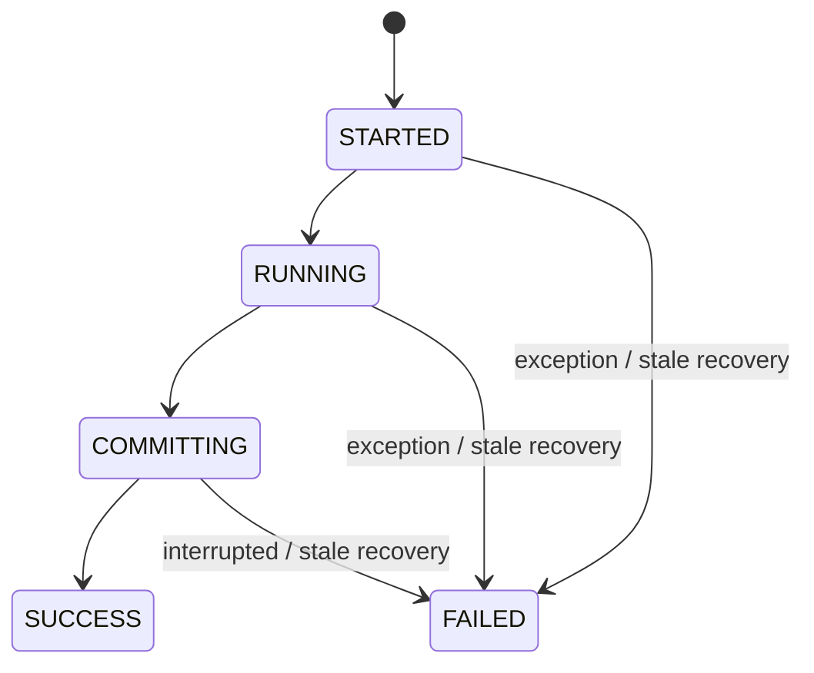
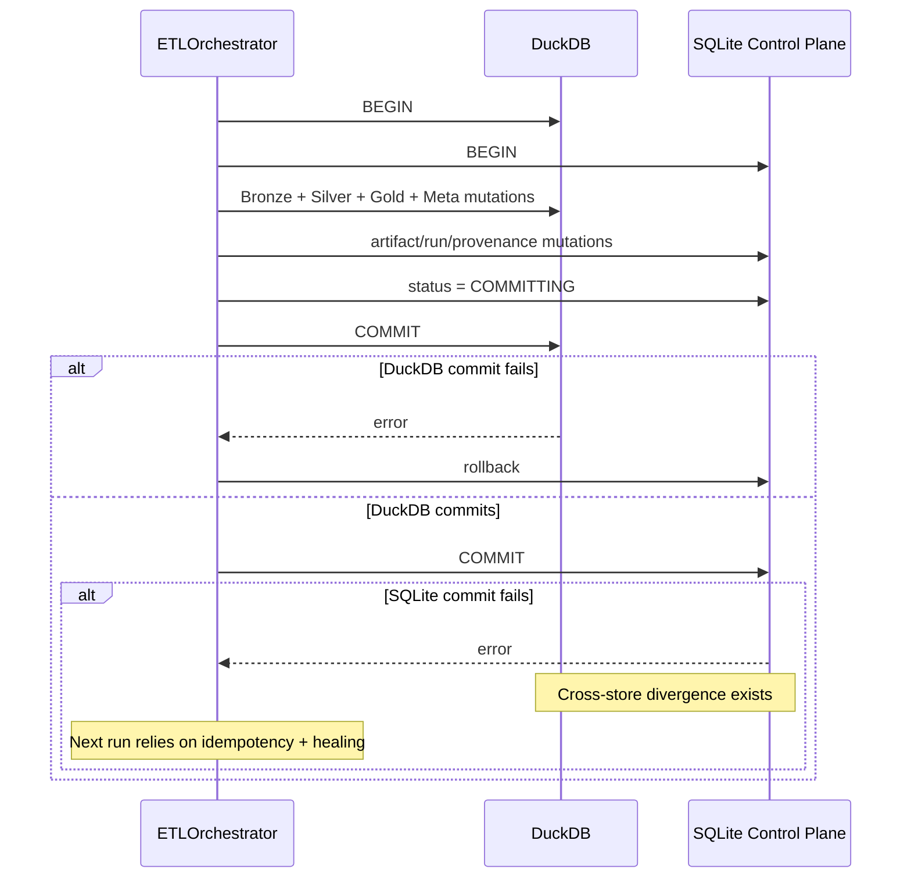
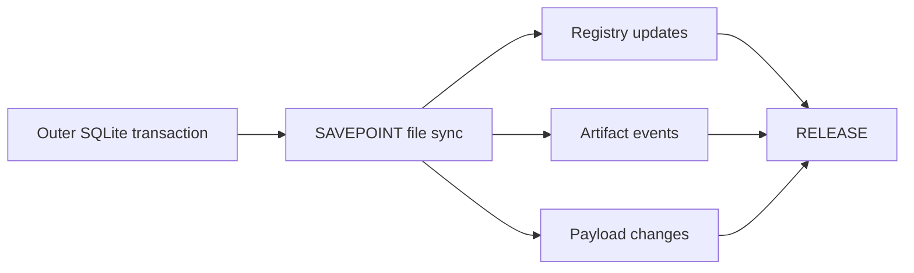
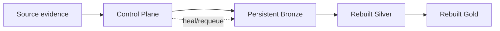
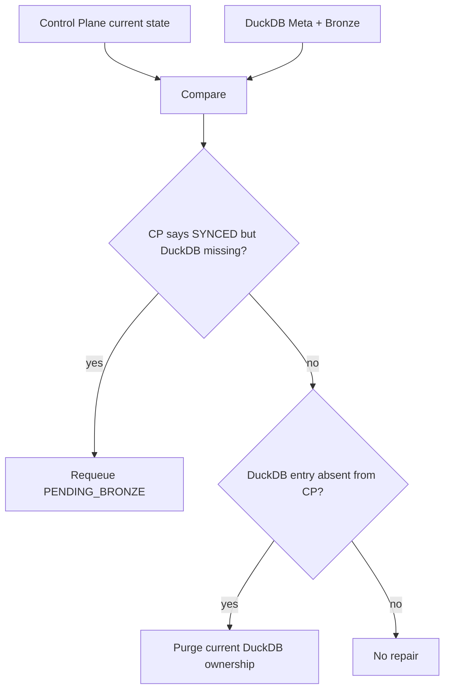
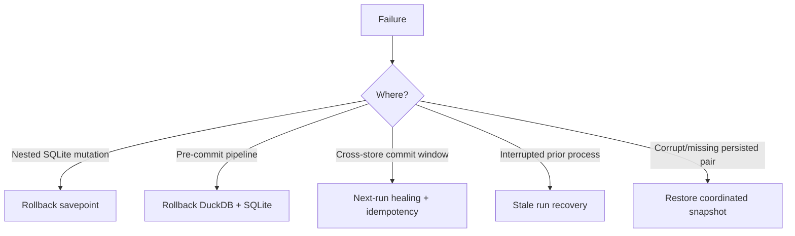

# Reliability and Recovery

Personal Finance ETL is local-first, but local does not mean casual. The pipeline coordinates a SQLite operational authority, a DuckDB analytical warehouse, filesystem source evidence, retained payloads, and long-running financial transformations. Reliability therefore comes from **explicit boundaries, idempotent reconstruction, validation, and recovery**, not from pretending the entire machine is one giant ACID transaction.

This document defines those boundaries precisely.

## Source authority

Primary implementation:

- `backend/pipeline/etl_pipeline.py`
- `backend/load/control_plane/connection.py`
- `backend/load/control_plane/orchestrator.py`
- `backend/load/control_plane/run_repo.py`
- `backend/load/control_plane/artifact_repo.py`
- `backend/load/metadata.py`
- `backend/load/bronze.py`
- `backend/load/database.py`
- `backend/load/backup.py`

## Reliability model



No single mechanism carries the entire reliability story. The system is resilient because the mechanisms compose.

## Single-writer pipeline lock

`ControlPlane.open()` acquires `pipeline.lock` with `timeout=0`. A competing production pipeline instance fails immediately.

```python
try:
    self._lock.acquire(timeout=0)
    self._lock_acquired = True
except Timeout:
    raise RuntimeError(
        "Another instance of the production pipeline is currently running."
    ) from None
```

The same lock concept is used by coordinated backup/restore. This prevents a snapshot or restore from racing a live ETL mutation.

## SQLite connection safety

The Control Plane enables:

- foreign keys;
- 30-second busy timeout;
- WAL journal mode;
- `synchronous=NORMAL`;
- memory-oriented cache/temp settings.

On close, any still-open SQLite transaction is rolled back before the connection is released.

## Schema validation before execution

`SQLiteManager.ensure_schema()` does not blindly rely on `CREATE TABLE IF NOT EXISTS`. If any current Control Plane tables already exist, the complete required table set must be present.

This prevents a stale/partial database from quietly looking "initialized" because SQLite was willing to create only the missing pieces.

Explicit migration is therefore a separate responsibility.

## Stale run recovery

When the Control Plane schema is ensured, `RunRepository.recover_stale_runs()` examines runs left in:

```text
STARTED
RUNNING
COMMITTING
```

from a previous interrupted process and marks them as failed/recovered according to repository behavior.

A dead process should not leave a run permanently masquerading as active.



## The two-database transaction boundary

The pipeline begins transactions in both persistence systems:

```python
self.db_manager.conn.execute("BEGIN TRANSACTION")
cp.begin_transaction()
```

All main ETL phases then execute before commit.

However, DuckDB and SQLite do not participate in a distributed transaction coordinator.

## Commit order

The implementation commits **DuckDB first, SQLite second**:

```python
self.db_manager.conn.execute("COMMIT")
try:
    cp.commit()
except Exception as sqlite_commit_err:
    # DuckDB committed, but SQLite failed. The next run will rely on idempotency
    # and Bronze self-healing to resolve this state mismatch.
    raise RuntimeError(...) from sqlite_commit_err
```



This is the most important reliability non-guarantee in the architecture:

> SQLite and DuckDB are coordinated, but they are **not distributed-atomic**.

## Why commit DuckDB first matters

Once DuckDB commits, a later SQLite failure cannot be undone by issuing a DuckDB rollback. The exception handler may attempt rollback calls, but a committed transaction is already durable.

The architecture therefore depends on convergence during the next run rather than impossible time travel.

That is not a flaw hidden under the rug. It is the explicit recovery model.

## Nested SQLite savepoints

Repository operations use savepoints so a smaller Control Plane mutation can roll back without inventing a nested top-level transaction.



A savepoint is scoped SQLite atomicity. It does not extend across DuckDB.

## Failure before commit

For exceptions before durable commit, the pipeline attempts rollback in both systems:

```python
try:
    self.db_manager.conn.execute("ROLLBACK")
except Exception as rollback_err:
    logger.error(...)

try:
    if cp is not None:
        cp.rollback()
except Exception as rollback_err:
    logger.error(...)
```

Rollback failures are themselves logged rather than masking the original pipeline failure.

## Failure provenance

When possible, the pipeline persists structured failure details through `cp_run_failures`.

Failure metadata can include:

- `run_id`;
- failed ISIN;
- pipeline stage;
- exception type;
- message;
- traceback;
- creation timestamp.

Investment Quant failures can preserve the failing ISIN context rather than reducing the incident to "something broke in analytics."

## Execution log retention

`cp_runs.execution_log` can retain compressed execution-log bytes. This places run diagnostics beside operational run identity rather than relying only on ephemeral console output.

## Bronze as the convergence layer

Bronze is persistent and synchronization-aware. Silver and Gold are rebuilt from complete Bronze state.

That split is central to recovery:



If current analytical publication fails, the next successful run can reconstruct Silver/Gold from persistent Bronze rather than incrementally repairing hundreds of derived tables.

## DuckDB registry healing

`MetaLayer.heal_duckdb_registry()` executes before the main ETL transaction.

For artifacts the Control Plane believes are `SYNCED`, it verifies current DuckDB state. Missing Meta ownership, missing Bronze tables, or missing incremental-source rows can move the artifact back to `PENDING_BRONZE`.

Conversely, DuckDB registry rows with no corresponding Control Plane artifact are purged from current analytical state.



This is eventual convergence between two stores with different responsibilities.

## Full analytical rebuild as reliability strategy

Silver and Gold are dropped/recreated as complete publications in registry order. The architecture deliberately avoids carrying incremental mutation history into derived analytical layers.

Advantages:

- deterministic reconstruction from current Bronze state;
- fewer partial-update edge cases;
- easier schema conformance;
- stale derived rows cannot survive simply because no incremental delete found them.

Trade-off:

- every analytical run recomputes the full publication surface.

At this workload, correctness and simplicity win over clever incrementalism. Sometimes the least exciting state machine is the one with fewer states.

## Data Contract enforcement

Before Silver/Gold publication, the pipeline compares engine outputs with `DATA_CONTRACT_REGISTRY`.

```python
registered_contracts = {c.contract_id for c in DATA_CONTRACT_REGISTRY}
for df_key in self.dfs.keys():
    if df_key not in registered_contracts:
        raise RuntimeError(...)

missing_contracts = registered_contracts - set(self.dfs.keys())
if missing_contracts:
    raise RuntimeError(...)
```

The required relationship is effectively:

```text
Produced analytical contract IDs = Registered analytical contract IDs
```

This catches both accidental extra outputs and missing required outputs before publication.

## Fail-closed financial validation

The implementation contains numerous domain gates beyond storage transactions. Examples include:

- missing or invalid market prices;
- stale US price observations;
- missing/non-positive FX;
- invalid deterministic identities;
- tax evidence validation;
- registry/schema mismatches;
- restore database validation.

Reliability is therefore not just "database commit succeeded." A perfectly committed nonsense valuation would still be nonsense.

## Temporal causality as correctness

US historical price and FX reconstruction uses backward-looking observations. Future evidence is not used to fill earlier valuation dates.

This is a financial correctness boundary, but it also belongs to reliability: a pipeline that succeeds while leaking future prices into history is operationally successful and analytically wrong.

## Coordinated snapshots

`SystemBackupManager` treats SQLite and DuckDB as one application recovery unit. Snapshot mechanics are specified in [`backup-and-restore.md`](backup-and-restore.md), but their architectural role is broader:

```text
transaction/rebuild mechanisms = recover within normal execution
snapshot/restore mechanisms    = recover persisted application state
```

## Recovery hierarchy



Different failures have different recovery tools. There is intentionally no universal `recover_everything()` button with suspicious confidence.

## Guarantees

The implementation supports the following defensible guarantees:

1. One production pipeline instance owns the Control Plane lock at a time.
2. SQLite foreign keys are enabled and verified.
3. Nested Control Plane operations can roll back to savepoints.
4. Pre-commit failures trigger rollback attempts in both databases.
5. Stale active runs are detected on Control Plane initialization.
6. Control Plane and DuckDB state can converge through healing/requeue behavior.
7. Silver/Gold publication is reconstructed from current upstream state.
8. Analytical outputs are checked against the registered contract set.
9. Structured failure context is persisted when the Control Plane is available.
10. Coordinated snapshots provide an external recovery point for the database pair.

## Non-guarantees

The architecture does **not** guarantee:

- distributed ACID across SQLite and DuckDB;
- zero failure window between the two commits;
- rollback of a DuckDB transaction after it has already committed;
- permanent retention of every source payload;
- perfect replay across incompatible numerical runtimes;
- that runtime validation substitutes for a comprehensive automated test suite;
- that reconstructed or estimated financial state is equivalent to source-certified evidence.

## QA boundary

The production code contains substantial runtime assertions and fail-closed checks, but the repository currently has limited conventional automated test coverage under `tests/` relative to the breadth of the system.

That distinction matters:

```text
runtime validation != regression test suite
QA specification   != executable coverage
```

The architecture is defensively coded, but documentation should not manufacture test guarantees the repository does not currently prove.

## Related specifications

- [Control Plane Artifact Lifecycle](control-plane-artifact-lifecycle.md)
- [Deterministic Identity and Replay](deterministic-identity-and-replay.md)
- [Backup and Restore](backup-and-restore.md)
- [Warehouse Architecture](warehouse-architecture.md)
- [Data Lifecycle](data-lifecycle.md)
- [Testing and Validation](../developer/testing-and-validation.md)
