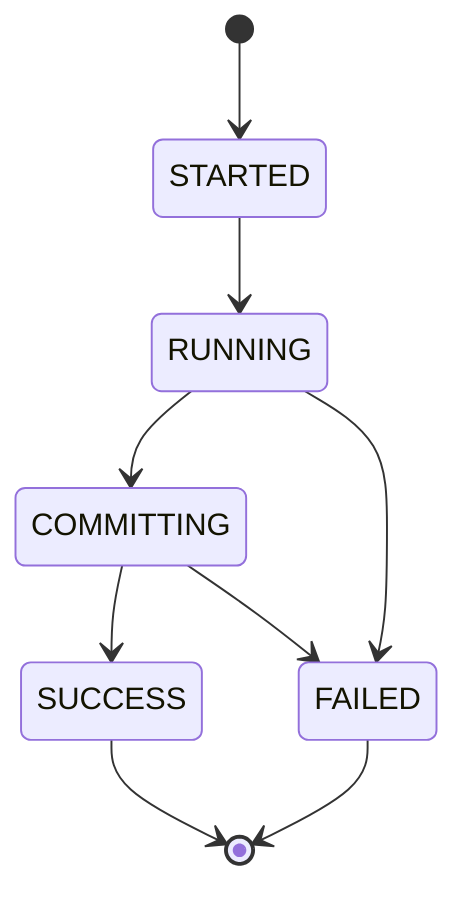
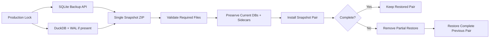

# Reliability & Recovery

Financial analytics can fail in two dangerous ways:

```text
obviously
→ pipeline crashes

quietly
→ pipeline succeeds with incomplete or inconsistent state
```

The second failure mode is worse.

The reliability architecture therefore focuses on explicit run state, fatal analytical failures, coordinated rollback, durable evidence, and deterministic recovery.

---

## 1. Failure and durability model



The run lifecycle lives in the SQLite Control Plane.

---

**Implementation:** `src/personal_finance_etl/backend/pipeline/etl_pipeline.py` (lines 248–285).

```python
    def run(self) -> None:
        self.cfg.validate_config()

        validate_registry()

        start_time = time.perf_counter()

        run_id = None
        cp = None
        log_file_path = self.db_manager.db_path.replace(".duckdb", ".log")

        try:
            add_queue_handler(cast("multiprocessing.Queue[Any]", self.status_queue))
            add_file_handler(log_file_path)

            logger.debug("=== ETL CONFIGURATION DUMP ===")
            if hasattr(self.cfg, "model_dump_json"):
                logger.debug(self.cfg.model_dump_json(indent=2))
            else:
                logger.debug(str(self.cfg))

            logger.debug("=== FINANCIAL RULES DUMP ===")
            if self.rules is not None and hasattr(self.rules, "model_dump_json"):
                logger.debug(self.rules.model_dump_json(indent=2))
            else:
                logger.debug(str(self.rules))
            logger.debug("==============================")

            logger.info("Initializing Quantitative Master Engine...")
            self.status_queue.put(EngineStatus(msg="", data=None, progress=0.0))

            logger.info(f"Target Database: {self.cfg.TARGET_DB_BASE_PATH}")
            logger.info(f"Source Extractor Folder: {self.cfg.STATEMENTS_FOLDER}")

            self.db_manager.open()
            self.db_manager.ensure_schemas()

            cp = ControlPlane(self.cfg.TARGET_DB_BASE_PATH, self.cfg.RAW_DOCUMENT_STORE_NAME)
```

## 2. Control Plane run state

A run is registered before the main transaction begins:

```python
run_id = cp.runs.start_run(
    cfg_json=self.cfg.model_dump_json(),
    rules_json=self.rules.model_dump_json() if self.rules else None,
)
```

`start_run()` also records:

```text
application version
schema version
Settings snapshot
FinancialRules snapshot
started_at
status = STARTED
```

The run therefore has an identity even if later analytical work is rolled back.

---

**Implementation:** `src/personal_finance_etl/backend/load/control_plane/orchestrator.py` (lines 14–52).

```python
class ControlPlane:
    """Authoritative lifecycle wrapper for the SQLite ETL control plane."""

    def __init__(self, base_path: str, db_name: str = "Raw_Documents.sqlite"):
        self.base_path = base_path
        self.db = SQLiteManager(base_path, db_name)
        self.artifacts = ArtifactRepository(self.db)
        self.runs = RunRepository(self.db)
        self.file_sync = FileSyncService(self.artifacts)
        self.lock_path = os.path.join(base_path or ".", "pipeline.lock")
        self._lock: Any = FileLock(self.lock_path)
        self._lock_acquired = False
        self._active_run_id: str | None = None

    @property
    def active_run_id(self) -> str | None:
        return self._active_run_id

    @active_run_id.setter
    def active_run_id(self, value: str | None) -> None:
        self._active_run_id = value
        self.artifacts.active_run_id = value
        self.file_sync.active_run_id = value

    def set_active_run_id(self, run_id: str | None) -> None:
        """Set the active run once and propagate it to every event-producing component."""
        self.active_run_id = run_id

    def open(self) -> None:
        if self._lock_acquired and self.db.is_open:
            return
        os.makedirs(self.base_path or ".", exist_ok=True)
        try:
            self._lock.acquire(timeout=0)
            self._lock_acquired = True
        except Timeout:
            raise RuntimeError(
                "Another instance of the production pipeline is currently running."
            ) from None
```

## 3. Scoped artifact atomicity

The orchestrator begins both transactions:

```python
self.db_manager.conn.execute("BEGIN TRANSACTION")
cp.begin_transaction()
```

On success:

```python
cp.runs.update_run_status(
    run_id,
    "COMMITTING",
)

self.db_manager.conn.execute("COMMIT")
cp.commit()

cp.runs.finish_run(
    run_id,
    "SUCCESS",
)
```

This gives the application a coherent local commit protocol.

But the boundary is important:

> **This is application-coordinated transaction management across SQLite and DuckDB, not distributed two-phase commit.**

There remains a narrow theoretical failure window between independent commits.

For the current local workload, I accept that trade-off rather than introducing distributed transaction machinery.

---

**Implementation:** `src/personal_finance_etl/backend/load/control_plane/connection.py` (lines 71–85).

```python
    def atomic(self) -> Generator[None]:
        """Atomic scope that works both standalone and nested in a pipeline transaction."""
        savepoint = f"cp_scope_{uuid.uuid4().hex}"
        self.conn.execute(f"SAVEPOINT {savepoint}")
        try:
            yield
            self.conn.execute(f"RELEASE SAVEPOINT {savepoint}")
        except Exception:
            try:
                self.conn.execute(f"ROLLBACK TO SAVEPOINT {savepoint}")
            finally:
                self.conn.execute(f"RELEASE SAVEPOINT {savepoint}")
            raise

    @property
```

## 4. Publication failure boundaries

Any exception enters the rollback path:

```python
try:
    self.db_manager.conn.execute("ROLLBACK")
except Exception as rollback_err:
    logger.error(
        f"Failed to rollback DuckDB transaction: {rollback_err}"
    )

try:
    cp.rollback()
except Exception as rollback_err:
    logger.error(
        f"Failed to rollback SQLite Raw Store transaction: {rollback_err}"
    )
```

Rollback failures are themselves logged.

The system does not assume rollback is infallible.

---

**Implementation:** `src/personal_finance_etl/backend/pipeline/etl_pipeline.py` (lines 430–473).

```python
            SilverLayer(self.db_manager).load(self.dfs)
            GoldLayer(self.db_manager).load(self.dfs)
            logger.info(
                f"[PHASE] 5/5 Complete [{time.perf_counter() - t_load_start:.2f}s] - Disk synchronization successful."
            )

            # Write ETL metadata to DB
            meta_layer = MetaLayer(self.db_manager, self.cfg, self.rules)
            meta_layer.load(self.dfs, cp=cp)

            cp.runs.update_run_status(run_id, "COMMITTING")

            # Commit the ACID Transaction
            try:
                logger.debug("[DATABASE:DUCKDB] COMMIT")
                self.db_manager.conn.execute("COMMIT")
            except Exception as duckdb_commit_err:
                raise RuntimeError(
                    f"DuckDB Commit Failed: {duckdb_commit_err}"
                ) from duckdb_commit_err

            try:
                cp.commit()
            except Exception as sqlite_commit_err:
                # DuckDB committed, but SQLite failed. The next run will rely on idempotency
                # and Bronze self-healing to resolve this state mismatch.
                raise RuntimeError(
                    f"SQLite Commit Failed after DuckDB committed: {sqlite_commit_err}"
                ) from sqlite_commit_err

            cp.runs.finish_run(run_id, "SUCCESS")

            self.status_queue.put(EngineStatus(msg="", data=None, progress=1.0))
            total_time = time.perf_counter() - start_time
            logger.info(
                f"✅ Pipeline Execution Successful in {total_time:.2f} seconds. Total Nodes: {len(self.dfs)}"
            )
        except Exception as e:
            logger.exception("CRITICAL PIPELINE FAILURE:")
            # Rollback all changes if any phase fails
            try:
                logger.debug("[DATABASE:DUCKDB] ROLLBACK")
                self.db_manager.conn.execute("ROLLBACK")
                logger.warning("DuckDB transaction rolled back.")
```

## 5. Provenance and operational diagnostics

The complete execution log is stored against the run.

This complements structured failure fields.

Structured fields answer:

```text
what failed?
where?
which ISIN?
what exception?
```

The execution log answers:

```text
what happened around it?
```

Both are useful.

---

**Implementation:** `src/personal_finance_etl/backend/load/control_plane/run_repo.py` (lines 1–48).

```python
from __future__ import annotations

import hashlib
import importlib.metadata
import json
import math
import uuid
from datetime import date, datetime
from typing import Any, cast

from personal_finance_etl.backend.load.control_plane.connection import SQLiteManager


class RunRepository:
    def __init__(self, db: SQLiteManager):
        self.db = db

    @staticmethod
    def _canonical_json(value: str) -> str:
        try:
            parsed = json.loads(value)
        except (TypeError, json.JSONDecodeError):
            return value
        return json.dumps(parsed, sort_keys=True, separators=(",", ":"), ensure_ascii=False)

    @staticmethod
    def _application_version() -> str:
        try:
            return f"v{importlib.metadata.version('personal-finance-etl')}"
        except importlib.metadata.PackageNotFoundError:
            return "v-unknown"

    def start_run(self, cfg_json: str | None = None, rules_json: str | None = None) -> str:
        run_id = str(uuid.uuid4())
        now = datetime.now().isoformat(timespec="seconds")
        settings_id: str | None = None
        rules_id: str | None = None
        with self.db.atomic():
            for payload, prefix, table in (
                (cfg_json, "snap_set_", "cp_settings_snapshots"),
                (rules_json, "snap_rule_", "cp_rules_snapshots"),
            ):
                if not payload:
                    continue
                canonical = self._canonical_json(payload)
                digest = hashlib.sha256(canonical.encode("utf-8")).hexdigest()
                snapshot_id = f"{prefix}{digest}"
                self.db.conn.execute(
```

## 6. Persistent Bronze and recovery

The strongest recovery property is independent raw persistence.


If derived analytical state is lost while the Control Plane survives, the system still has the source evidence needed to reconstruct it.

That is fundamentally different from a pipeline whose only copy of the input is a transient filesystem location.

---

**Implementation:** `src/personal_finance_etl/backend/load/control_plane/artifact_repo.py` (lines 301–333).

```python
    def ingest_binaries(
        self,
        actionable_files: dict[str, list[str]],
        new_files: dict[str, list[str]] | None = None,
        changed_files: dict[str, list[str]] | None = None,
    ) -> None:
        new_paths = {normalize_path(path) for paths in (new_files or {}).values() for path in paths}
        changed_paths = {
            normalize_path(path) for paths in (changed_files or {}).values() for path in paths
        }
        total_count = 0
        for category, filepaths in actionable_files.items():
            file_type = FILE_TYPE_MAP.get(category, "csv")
            for filepath in filepaths:
                path = normalize_path(filepath)
                try:
                    # Read once so the persisted bytes and their hash always describe the same content.
                    with open(filepath, "rb") as file_handle:
                        raw_bytes = file_handle.read()
                    digest = hash_bytes(raw_bytes)
                    size = len(raw_bytes)
                    now = self._now()
                    filename = os.path.basename(path)
                    with self.db.atomic():
                        file_id, previous_status = self._upsert_registry(
                            filepath=path,
                            filename=filename,
                            category=category,
                            file_type=file_type,
                            file_hash=digest,
                            file_size=size,
                            now=now,
                        )
```

## 7. Pending sync and healing

Artifact state distinguishes:

```text
persisted raw evidence
```

from:

```text
successfully represented in Bronze
```

The lifecycle is:

```text
new / changed artifact
        ↓
PENDING_BRONZE
        ↓
successful extraction + Bronze write
        ↓
SYNCED
```

If synchronization is incomplete, the artifact remains actionable.

---

**Implementation:** `src/personal_finance_etl/backend/load/control_plane/artifact_repo.py` (lines 426–461).

```python
    def mark_synced(self, filepaths: list[str]) -> None:
        if not filepaths:
            return
        now = self._now()
        marked = 0
        with self.db.atomic():
            for path in dict.fromkeys(normalize_path(fp) for fp in filepaths):
                row = self.db.conn.execute(
                    "SELECT file_id, sync_status, last_synced_run_id, file_hash FROM cp_file_registry WHERE relative_path = ?",
                    (path,),
                ).fetchone()
                if not row:
                    logger.warning("[ARTIFACT] Cannot mark unknown file as SYNCED: %s", path)
                    continue
                file_id, previous_status, last_run, digest = row
                if previous_status == "SYNCED" and last_run == self.active_run_id:
                    continue
                self._insert_event(
                    file_id=file_id,
                    event_type="SYNCED",
                    event_at=now,
                    path=path,
                    content_hash=digest,
                    previous_status=previous_status,
                    new_status="SYNCED",
                    reason="Bronze Sync Successful",
                )
                self.db.conn.execute(
                    "UPDATE cp_file_registry SET sync_status = 'SYNCED', last_synced_run_id = COALESCE(?, last_synced_run_id), last_synced_at = ? WHERE relative_path = ?",
                    (self.active_run_id, now, path),
                )
                marked += 1
        if marked:
            logger.debug("[ARTIFACT] Marked %d file(s) as SYNCED.", marked)

    def mark_healed(self, filepaths: list[str]) -> None:
```

## 8. Database snapshots

Snapshot/Restore treats SQLite and DuckDB as one logical recovery unit.



Restore rejects incomplete, nested or unexpected snapshot contents before replacing production databases.

Before installation it preserves the current recovery unit, including SQLite WAL/SHM and DuckDB WAL sidecars when present.

The invariant is:

```text
restore succeeds
→ complete snapshot pair

restore fails
→ complete previous pair

never
→ mixed SQLite / DuckDB generations
```

Snapshot and Restore are available through the shared backend facade and exposed by both CLI and Desktop surfaces.

**Implementation:** `src/personal_finance_etl/backend/load/backup.py` (lines 57–95).

```python
    def create_snapshot(self) -> str | None:
        """Create an atomic archive of a checkpointed, coordinated database pair."""
        missing = [
            os.path.basename(path)
            for path in (self.sqlite_path, self.duckdb_path)
            if not os.path.isfile(path)
        ]
        if missing:
            logger.error(
                "Cannot create coordinated snapshot. Missing required database(s): "
                + ", ".join(missing)
            )
            return None

        lock_path = os.path.join(self.base_path, "pipeline.lock")
        temp_sqlite: str | None = None
        temp_zip: str | None = None
        try:
            with FileLock(lock_path, timeout=0):
                # Recheck after taking the production lock to avoid a check/use race.
                missing = [
                    os.path.basename(path)
                    for path in (self.sqlite_path, self.duckdb_path)
                    if not os.path.isfile(path)
                ]
                if missing:
                    raise FileNotFoundError(
                        "Cannot create coordinated snapshot. Missing required database(s): "
                        + ", ".join(missing)
                    )

                ts = datetime.now().strftime("%Y%m%d_%H%M%S_%f")
                zip_filename = f"pf_etl_snapshot_{ts}.zip"
                zip_path = os.path.join(self.backup_dir, zip_filename)
                temp_zip = os.path.join(self.backup_dir, f".{zip_filename}.{uuid.uuid4().hex}.tmp")

                # A database file copy is only a sound boundary after DuckDB has
                # checkpointed its committed WAL state. If checkpoint fails, fail closed.
                self._checkpoint_duckdb(self.duckdb_path)
```

## 9. Restore and rollback

### Immutable historical replay

Rebuilding old raw evidence today can use newer:

- code,
- schema,
- FinancialRules,
- tax logic.

Configuration snapshots improve provenance, but the current system is not an immutable historical build system.

### Distributed atomicity

SQLite and DuckDB do not share one physical transaction manager.

### Complete lineage graph

The Control Plane does not yet normalize every:

```text
run → artifact → Bronze partition → Silver contract → Gold contract
```

edge into dedicated lineage tables.

### Coordinated recovery-unit snapshots

The current system snapshots the two persistence planes together:

```text
Raw_Documents.sqlite
+
Personal_Finance_DB.duckdb
```

Snapshot creation requires both databases, runs under the production lock, uses SQLite's backup API to consolidate SQLite state safely, and packages the DuckDB recovery state into the same archive.

**Implementation:** `src/personal_finance_etl/backend/load/backup.py` (lines 144–180).

```python
    def restore_snapshot(self, zip_path: str) -> None:
        """Restore the pair atomically, rolling back to the complete prior pair on failure."""
        if not os.path.isfile(zip_path):
            raise FileNotFoundError(f"Backup file not found: {zip_path}")

        lock_path = os.path.join(self.base_path, "pipeline.lock")
        temp_root = get_temp_dir()
        os.makedirs(temp_root, exist_ok=True)
        temp_extract_dir = tempfile.mkdtemp(prefix="snapshot_restore_", dir=temp_root)

        try:
            with FileLock(lock_path, timeout=0):
                required_names = {
                    os.path.basename(self.sqlite_path),
                    os.path.basename(self.duckdb_path),
                }
                duckdb_wal_name = os.path.basename(self.duckdb_path) + ".wal"
                allowed_names = required_names | {duckdb_wal_name}

                with zipfile.ZipFile(zip_path, "r") as archive:
                    members = [item for item in archive.infolist() if not item.is_dir()]
                    names = [item.filename.replace("\\", "/") for item in members]
                    member_names = set(names)

                    if len(names) != len(member_names):
                        raise ValueError("Invalid coordinated snapshot: duplicate archive members.")

                    invalid_paths = {
                        name
                        for name in names
                        if name.startswith("/")
                        or "/" in name
                        or "\\" in name
                        or name in {"", ".", ".."}
                    }
                    if invalid_paths:
                        raise ValueError(
```

## 10. Recovery limits and failure classes

| Failure | Example | Expected behaviour |
| --- | --- | --- |
| Source | unreadable file | fail actionable ingestion |
| Contract | missing critical identity | surface financial data-quality problem |
| Worker | ISIN analytics exception | fail investment stage/run |
| Persistence | DuckDB write failure | rollback |
| Control Plane | SQLite write failure | fail run / surface operational error |
| Simulation | invalid configured assumptions | validation or analytical failure |
| Frontend | UI rendering issue | should not redefine backend financial state |

---

**Implementation:** `src/personal_finance_etl/backend/load/control_plane/connection.py` (lines 247–260).

```python
    def begin_transaction(self) -> None:
        if self.conn.in_transaction:
            raise RuntimeError("A SQLite transaction is already active.")
        self.conn.execute("BEGIN IMMEDIATE;")
        logger.debug("[DATABASE:SQLITE] BEGIN IMMEDIATE")

    def commit(self) -> None:
        self.conn.commit()
        logger.info("Control Plane transaction committed.")

    def rollback(self) -> None:
        if self._conn is None or not self._conn.in_transaction:
            return
        try:
```

## Integration and related specifications

- [System architecture](system-architecture.md)
- [Artifact lifecycle](control-plane-artifact-lifecycle.md)
- [Identity and replay](deterministic-identity-and-replay.md)
- [Backup and restore](backup-and-restore.md)

