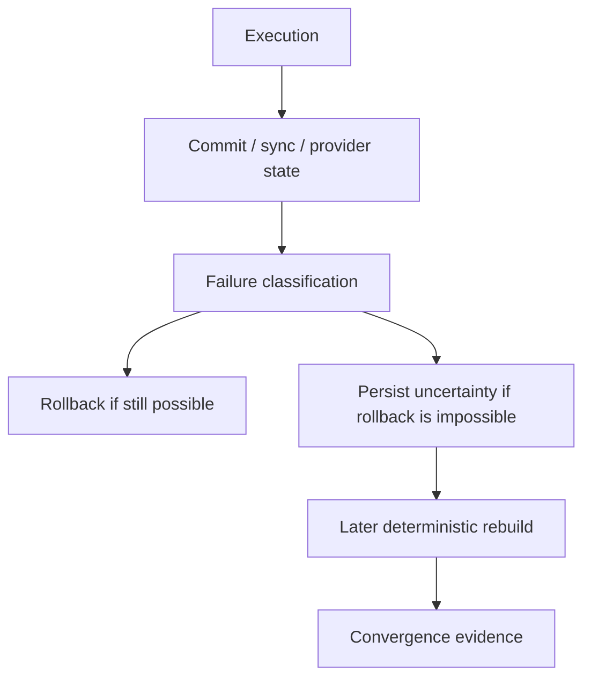
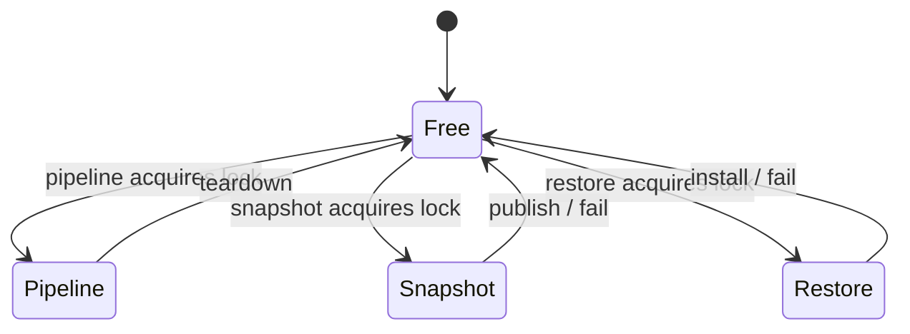
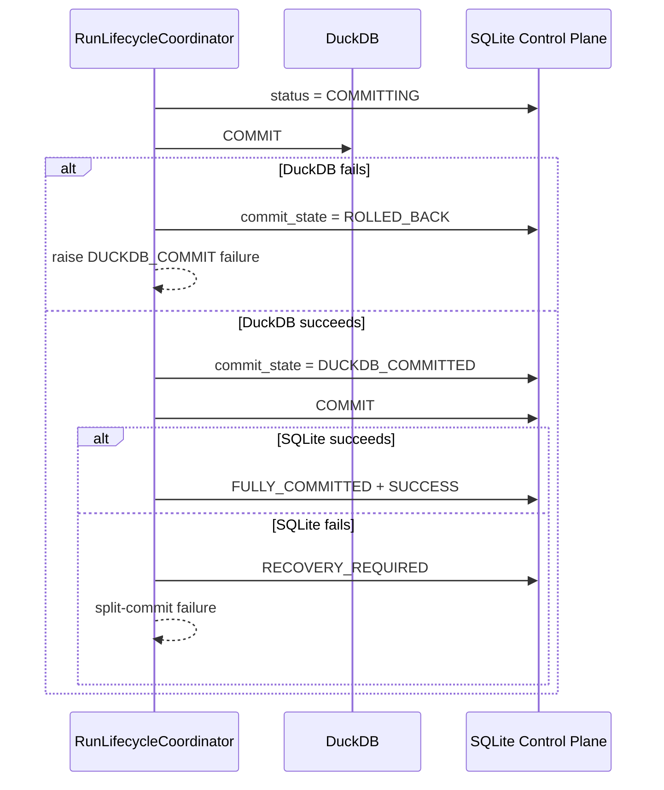
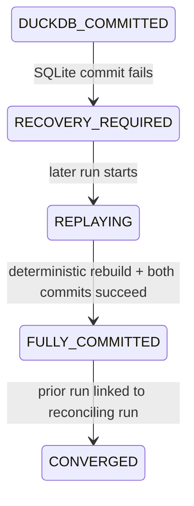
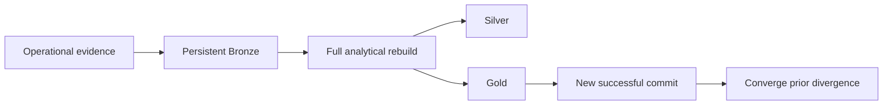
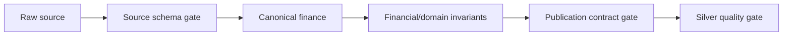
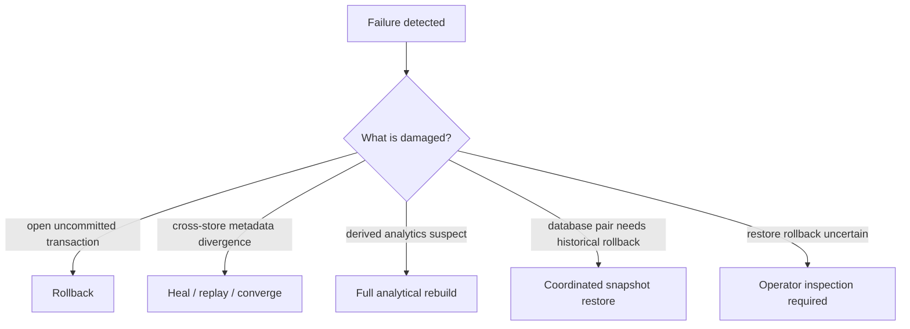
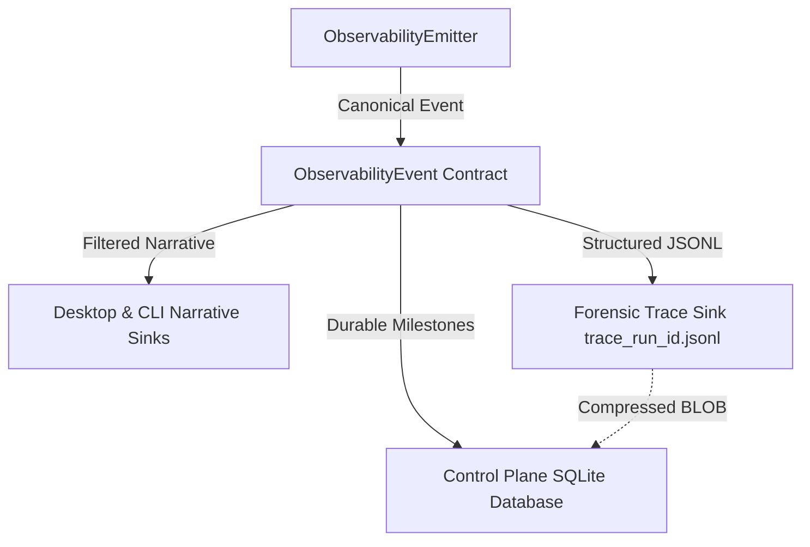

# Reliability and Recovery

Reliability starts where the happy-path architecture stops being honest.

The system writes to two different databases, calls external providers, executes process-boundary workers, reconstructs financial state from imperfect evidence, and includes a stochastic simulation kernel. None of those mechanisms share one global transaction.

So the reliability model does not begin with “everything is atomic.”

It begins with a harder promise:

> when the system cannot guarantee atomicity, it records the strongest truthful state it can prove and provides a deterministic path toward convergence.

This specification defines that promise.

## Reliability is a state model, not an exception handler

A broad `try/except` can stop a traceback from escaping.

It cannot tell me whether:

- DuckDB committed;
- SQLite committed;
- a stale run died before commit;
- Bronze synchronized only some actionable artifacts;
- a provider failed before market evidence became complete;
- a worker process died independently of the parent;
- a later run actually repaired the divergence.

Those questions require explicit state.



## The single-writer lock is the first reliability boundary

The Control Plane acquires `pipeline.lock` before opening the production SQLite connection.

This prevents two pipeline instances from concurrently mutating the same operational and analytical state.

The same lock is also used by snapshot and restore operations.



The lock is process-level coordination, not database transaction isolation.

Both are needed because a database transaction cannot stop another process from replacing the database file itself during restore.

## SQLite validates its schema before the run transaction starts

`SQLiteManager.ensure_schema()` refuses to run inside an active transaction, applies non-destructive migrations, creates current DDL, creates indexes, validates shape, and checks foreign keys.

```python
# src/personal_finance_etl/infrastructure/control_plane/connection.py
violations = self.conn.execute("PRAGMA foreign_key_check").fetchmany(10)
if violations:
    raise RuntimeError(
        "Control-plane database contains foreign-key violations; refusing to continue. "
        f"First violations: {violations!r}"
    )
```

This is fail-closed infrastructure behavior.

A structurally invalid Control Plane is not allowed to host a new financial run just because SQLite can open the file.

## Stale-run recovery handles failures that Python never caught

A process can terminate without executing `handle_failure()` or `teardown()`.

On the next Control Plane initialization, `recover_stale_runs()` inspects runs left in `STARTED`, `RUNNING`, or `COMMITTING`.

The distinction between those states matters.

```python
# src/personal_finance_etl/infrastructure/control_plane/run_repository.py
is_committing = str(status).upper() == "COMMITTING"
new_status = "RECOVERY_REQUIRED" if is_committing else "FAILED"
new_commit_state = (
    CommitState.RECOVERY_REQUIRED.value
    if is_committing
    else CommitState.ROLLED_BACK.value
)
```

A run that died during ordinary execution can be treated as failed/rolled back if no commit had begun.

A run that died during `COMMITTING` has uncertain cross-store durability and is escalated to recovery-required state.

The system stores uncertainty instead of guessing.

## The two-database transaction boundary is intentionally explicit

The run opens:

- one DuckDB transaction;
- one SQLite `BEGIN IMMEDIATE` transaction.

These are independent ACID systems.

There is no XA coordinator and no distributed prepare phase.

That means the phrase “two-phase commit” would be misleading if interpreted as a formal distributed transaction protocol.

The actual mechanism is **coordinated ordered commit with explicit split-state handling**.

## Commit state is a typed contract

`CommitState` provides the vocabulary used across application and infrastructure:

```python
# src/personal_finance_etl/contracts/lifecycle.py
class CommitState(StrEnum):
    NOT_STARTED = "NOT_STARTED"
    STARTED = "STARTED"
    ROLLED_BACK = "ROLLED_BACK"
    DUCKDB_COMMITTED = "DUCKDB_COMMITTED"
    FULLY_COMMITTED = "FULLY_COMMITTED"
    RECOVERY_REQUIRED = "RECOVERY_REQUIRED"
    CONVERGED = "CONVERGED"
    COMMIT_STATE_UNKNOWN = "COMMIT_STATE_UNKNOWN"
```

`DUCKDB_COMMITTED_SQLITE_FAILED` exists as a compatibility alias to `RECOVERY_REQUIRED`; the canonical semantic state is recovery required.

The important improvement over a boolean is that each state implies different rollback possibilities.

## Commit order encodes the failure asymmetry

The lifecycle commits DuckDB first.



Why this order?

Because after DuckDB commits, the analytical state that users query is durable. If SQLite then fails, operational history can be reconstructed/converged against a known analytical outcome.

Committing SQLite first would risk the opposite lie: operational history could say the run's state changes were committed while the analytical warehouse never made them durable.

The chosen order does not remove risk. It chooses the more recoverable truth model.

## Failure before DuckDB commit can still be rolled back

If neither store has committed, `handle_failure()` resolves the state as `ROLLED_BACK` and attempts to roll back open transactions.

```python
# src/personal_finance_etl/application/pipeline/lifecycle.py
match (self.duckdb_committed, self.sqlite_committed):
    case (True, False):
        return CommitState.RECOVERY_REQUIRED
    case (False, False):
        return CommitState.ROLLED_BACK
    case (True, True):
        return CommitState.FULLY_COMMITTED
    case _:
        return CommitState.COMMIT_STATE_UNKNOWN
```

This mapping is deliberately derived from component truth rather than from the exception location alone.

An exception raised during a logging call after commit should not make the lifecycle pretend the databases rolled back.

## An already committed DuckDB is never described as rolled back

`_rollback_open_transactions()` explicitly refuses to claim rollback for a durable DuckDB commit.

```python
elif self.duckdb_committed:
    self.emitter.emit_event(
        event_code=EventCode.DATABASE_ROLLBACK,
        message="DuckDB is already committed; cannot rollback DuckDB.",
        presentation_kind=PresentationKind.WARNING,
        severity=DiagnosticSeverity.WARNING,
    )
```

That line captures an important reliability philosophy: **truthful observability is part of correctness**.

A soothing “everything rolled back” log message would be operationally worse than a loud recovery-required state.

## Split commit becomes durable recovery evidence

If SQLite commit fails after DuckDB commit, the lifecycle moves to `RECOVERY_REQUIRED` and persists a recovery marker with traceback context where possible.

The failure message explicitly states that DuckDB is committed and SQLite failed.

A later run sees that marker during initialization.



The previous run is not overwritten into `SUCCESS`.

It can later be marked `CONVERGED`, preserving the fact that divergence actually happened.

## Convergence has lineage

`RunRepository.mark_recovery_converged()` updates the prior run and writes a recovery event explaining which later run resolved the divergence.

```python
def mark_recovery_converged(self, recovered_run_id: str, reconciling_run_id: str) -> None:
    self.db.conn.execute(
        "UPDATE cp_runs SET status = 'CONVERGED', commit_state = ? "
        "WHERE run_id = ? AND UPPER(status) = 'RECOVERY_REQUIRED'",
        (CommitState.CONVERGED.value, recovered_run_id),
    )
```

It also records a recovery-domain failure/event message identifying the reconciling run.

This gives recovery an audit trail rather than merely a final state.

## Bronze is the convergence layer for analytical reconstruction

Why can a later run repair a split state at all?

Because the architecture does not rely on incremental mutation of every derived table.

Persistent Bronze retains synchronized analytical evidence. Silver and Gold are rebuilt from complete Bronze state.



A later run can therefore replace suspect derived state with a complete reconstruction instead of calculating a fragile compensation patch.

## DuckDB registry healing repairs current-context drift

`MetaLayer.heal_duckdb_registry(cp)` executes before the new run transaction.

Its direction of authority is explicit: SQLite Control Plane state informs DuckDB current-context repair.

This can repair missing sync records and remove dangling analytical file-registry state.

Healing is not generic “make databases equal.”

It is a specific convergence algorithm based on which store owns which truth.

## SQLite savepoints isolate repository-level operations

Inside the outer SQLite run transaction, repository methods can use `SQLiteManager.atomic()`.

That context manager creates a unique savepoint, releases it on success, or rolls back to it on failure.

```python
@contextmanager
def atomic(self) -> Generator[None]:
    savepoint = f"cp_scope_{uuid.uuid4().hex}"
    self.conn.execute(f"SAVEPOINT {savepoint}")
    try:
        yield
        self.conn.execute(f"RELEASE SAVEPOINT {savepoint}")
    except Exception:
        try:
            self.conn.execute(f"ROLLBACK TO SAVEPOINT {savepoint}")
        finally:
            self.conn.execute(f"RELEASE SAVEPOINT {savepoint}")
        raise
```

This lets an operation remain internally atomic without committing the outer pipeline transaction prematurely.

## Failure domains make errors queryable

`FailureDomain` classifies operational failures into a stable taxonomy:

```text
CONFIGURATION
SOURCE_DISCOVERY
SOURCE_VALIDATION
EXTERNAL_PROVIDER
BRONZE_SYNC
TRANSFORMATION
FINANCIAL_INVARIANT
PUBLICATION
DUCKDB_COMMIT
SQLITE_COMMIT
RECOVERY
SNAPSHOT
RESTORE
WORKER
UNKNOWN
```

The classifier uses exception names/messages and stage names.

This is useful because a traceback is excellent for debugging one event and poor for aggregating many runs.

Machine-readable failure domains and human-readable tracebacks serve different observability needs.

## Financial invariant failures are not ordinary transform failures

Some failures indicate that the pipeline executed technically but encountered financially invalid state.

Investment processing can surface ISIN-specific failures; lifecycle telemetry classifies those under `FINANCIAL_INVARIANT` when appropriate.

That separation matters because remediation differs:

```text
SOURCE_VALIDATION    → inspect source structure
EXTERNAL_PROVIDER    → retry/repair market evidence
FINANCIAL_INVARIANT  → inspect economic state/rules/reconciliation
PUBLICATION          → inspect warehouse contract/DDL
```

Reliability is improved when failures point toward the correct kind of repair.

## Data contracts fail closed before publication

The pipeline refuses to publish when the produced dataset set does not exactly satisfy `DATA_CONTRACT_REGISTRY`.

This is a reliability control because partial publication can be more dangerous than total failure in finance analytics.

A missing table should stop the run before a new Silver/Gold surface appears to be complete.

## Source validation also fails closed

The ingestion gatekeeper resolves source schemas and performs a small collection before deep financial work.

Likewise, Silver publication rejects missing critical investment master fields such as `ISIN` or `TAX_TYPE`.

These checks occur at different semantic boundaries:



Reliability comes from layered validation rather than one giant validator at the end.

## Temporal causality is a correctness boundary

Market and benchmark reconstruction must not silently use future information to value historical state.

Backward-looking joins and date-aware evidence selection are therefore correctness mechanisms, not merely query techniques.

A pipeline can be perfectly transaction-safe and still be financially wrong if historical calculations leak future market evidence.

Reliability in this project includes temporal correctness.

## Provider completeness is observable

External market requests have dedicated Control Plane provenance.

Request history records provider, entity, date range, attempts, status, failure class, and error.

This lets the system distinguish:

```text
no market row because provider never returned it
```

from:

```text
provider returned evidence but downstream transformation dropped it
```

Those two failures require different investigation paths.

## Worker failures must cross the process boundary

Asynchronous execution creates another reliability boundary: a child process can fail independently of the presentation process.

The worker coordination layer uses typed status messages and parent monitoring so child failure becomes visible application state.

A Desktop UI should not hang forever because the engine crashed in another process.

The process boundary therefore belongs in the reliability model alongside database and provider boundaries.

## Execution logs are retained as run evidence

During teardown, the lifecycle coordinator reads the run log, compresses it with zlib, and stores it in the Control Plane when possible.

```python
with open(self.log_file_path, "rb") as f:
    log_bytes = f.read()
compressed_log = zlib.compress(log_bytes, level=9)
self.cp.runs.save_execution_log(self.run_id, compressed_log)
```

Log archival is treated as an optional operation during teardown. Failure to archive the log should be reported, but it should not rewrite the truth of an already completed database commit.

Again, failure semantics depend on what is actually authoritative.

## Garbage collection is a process boundary, not a finance step

Teardown explicitly calls `gc.collect()` and labels it as a process-boundary materialization/runtime operation.

That is a small example of a broader engineering discipline: performance and runtime hygiene operations are documented as such rather than being mixed into financial semantics.

## Snapshots solve a different recovery problem

Run-level recovery assumes authoritative evidence still exists and deterministic reconstruction is desirable.

Snapshot restore answers a different question:

> How do I return the operational + analytical database pair to a previously captured state?

That is useful for:

- corruption;
- destructive manual changes;
- operator error;
- migration rollback scenarios;
- cases where replaying forward is not the desired recovery path.

Snapshot mechanics are covered in [Backup and Restore](backup-and-restore.md).

## Recovery hierarchy

The system therefore has several recovery levels rather than one universal “restore” button.



The least destructive mechanism that can restore a truthful state should be preferred.

## Recovery guarantees

Within the implemented boundaries, the system aims to guarantee that:

1. concurrent production pipeline instances are rejected;
2. SQLite schema integrity is checked before use;
3. interrupted runs are reclassified on startup;
4. open uncommitted transactions are rolled back on handled failure;
5. an already committed DuckDB transaction is never falsely described as rolled back;
6. split commit becomes `RECOVERY_REQUIRED`;
7. later successful runs can mark prior divergence `CONVERGED`;
8. run failures retain machine-readable domain plus human diagnostics;
9. complete Bronze state can drive full analytical reconstruction;
10. coordinated snapshots/restore use the same pipeline exclusion lock.

## Explicit non-guarantees

The system does not guarantee:

- distributed atomicity between SQLite and DuckDB;
- automatic recovery from every filesystem or hardware failure;
- that every external provider is complete or immutable;
- that deterministic reconstruction can compensate for missing source evidence;
- that reconciliation means the broker is always correct;
- that a failed restore can always return to a known pair if filesystem replacement and rollback both fail;
- that stochastic results are replayable without matching provenance;
- that business correctness follows automatically from transaction correctness.

The last point matters most.

Reliability protects the execution and evidence model. Financial correctness still depends on the domain model, rules, invariants, and tests.

## The reliability model is convergence-oriented

A useful way to summarize the architecture is:

```text
prevent what can be prevented
        ↓
rollback what is still reversible
        ↓
record what became irreversible
        ↓
reconstruct from authoritative evidence
        ↓
prove later convergence without erasing the failure
```

That model is less magical than “atomic ETL.”

It is also much easier to trust because every claim corresponds to a state the code can observe.

## Unified Observability Architecture (Three Resolutions of Truth)

The engine enforces an enterprise observability architecture where every operational event originates from a single typed contract (`ObservabilityEvent`) and projects into three distinct resolutions:

> **User logs explain the run. Debug traces reconstruct the run. Control Plane proves the run happened.**

1. **User Narrative (UI Console / Desktop)**:
   Concise, high-level milestone badges (`>>`, `✓`, `↷`, `!`, `✗`) providing immediate progress visibility (~20–40 lines per run) without cluttering the screen with database internals or stack traces.
2. **Forensic Trace (`outputs/logs/runs/trace_{run_id}.jsonl`)**:
   High-density, structured JSONL audit trail capturing every ticker fetch, cache state, table row count, and per-ISIN quant completion with sub-millisecond timestamps, queryable natively via Polars (`pl.read_ndjson`).
3. **Control Plane (`control_plane.db`)**:
   Authoritative durable operational records storing run milestones, commit hashes, failure domains, and zlib-compressed trace evidence linked by `run_id`.



## Continue with captured-state recovery

The reliability model prefers rollback and deterministic convergence during ordinary run failure. The next specification covers the separate case where both databases must be restored from a coordinated historical snapshot.

Continue with [Backup and Restore](backup-and-restore.md).

## Related specifications

- [Architecture](README.md)
- [Data Lifecycle](data-lifecycle.md)
- [Control Plane Artifact Lifecycle](control-plane-artifact-lifecycle.md)
- [Deterministic Identity and Replay](deterministic-identity-and-replay.md)
- [Backup and Restore](backup-and-restore.md)
- [Warehouse Architecture](warehouse-architecture.md)
- [Developer: Testing and Validation](../developer/testing-and-validation.md)
