# System Architecture

A useful architecture diagram should answer more than “what packages exist?”

For this system, the harder question is:

> What actually happens from the moment a run starts until financial state becomes queryable, and which component is allowed to claim authority at each step?

The cleanest way to understand the architecture is therefore to follow one complete run.

## Start with the runtime boundary

The application is local-first. Source evidence, financial rules, operational history, warehouse state, logs, and presentation all live on the local machine unless an external market-data provider is explicitly queried.

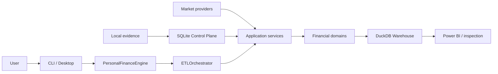

This local boundary is a product decision, not merely a deployment default. It shapes storage, backup, locking, recovery, and provider design throughout the codebase.

## Presentation does not own execution

CLI and Desktop surfaces enter through `PersonalFinanceEngine`.

The façade exposes configuration history, validation, synchronous/asynchronous execution, and coordinated snapshot/restore without exposing UI code to financial internals.

```python
# src/personal_finance_etl/application/facade.py
def run_pipeline_sync(
    self,
    config_path: str = "config.toml",
    rules_path: str = "",
    status_queue: ILogger | None = None,
) -> None:
    if self.container is not None and hasattr(self.container, "create_orchestrator"):
        orchestrator = self.container.create_orchestrator(
            config_path=config_path,
            rules_path=rules_path,
            status_queue=status_queue,
        )
    else:
        cfg = Settings.from_toml(config_path) if config_path else Settings()
        rules = FinancialRules.from_toml(rules_path) if rules_path else None
        orchestrator = ETLOrchestrator(cfg, status_queue, rules)
    orchestrator.run()
```

The façade is deliberately application-facing rather than storage-facing. A presentation surface asks to run, validate, snapshot, or restore. It does not directly coordinate Control Plane repositories or DuckDB transactions.

## Bootstrap assembles the runtime

`ServiceContainer` is the composition root.

It knows concrete configuration and infrastructure types because that is the responsibility of a composition root.

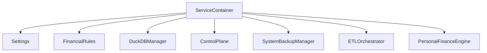

The container does not run financial algorithms and does not own pipeline sequencing. It constructs the objects that do.

## The orchestrator is deliberately small

The end-to-end `run()` method has one job: coordinate lifecycle and phase execution.

```python
# src/personal_finance_etl/application/pipeline/orchestrator.py
def run(self) -> None:
    start_time = time.perf_counter()
    lifecycle = RunLifecycleCoordinator(
        self.cfg, self.status_queue, self.db_manager, self.rules
    )

    try:
        cp, run_id, _ = lifecycle.initialize()
        self.executor.execute_phases(cp, run_id)
        lifecycle.commit()
    except Exception as e:
        lifecycle.handle_failure(e)
        raise e
    finally:
        lifecycle.teardown()
```

That decomposition is one of the central architectural moves in the runtime:

- `ETLOrchestrator` owns use-case coordination;
- `PipelineExecutor` owns the five phase sequence;
- `RunLifecycleCoordinator` owns run state, transactions, commit truth, failure recording, and teardown.

The result is not fewer moving parts. It is fewer mixed responsibilities.

## A run begins with operational truth

Before financial work starts, the lifecycle coordinator opens both persistence systems and creates a run in the Control Plane.

The sequence is deliberate:

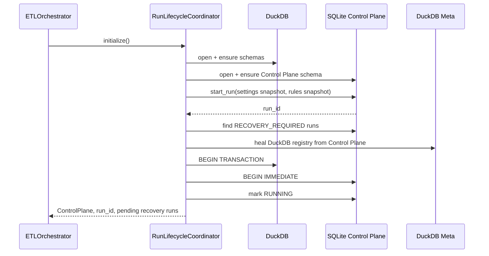

This order makes the run itself part of the evidence.

If the process fails later, the system can still reason about what it attempted because run identity and configuration provenance already exist.

## Configuration and financial policy are snapshotted separately

The Control Plane stores canonical snapshots of runtime settings and financial rules.

This matters because replay questions have at least two dimensions:

1. was the runtime environment the same?
2. was the financial policy the same?

A path change and a Tax-rule change are not equivalent sources of variation.

The architecture keeps them separable all the way into simulation provenance and run history.

## Phase 1 asks what evidence changed

`PipelineExecutor` starts by validating configuration and the publication registry, then discovers configured evidence.

The discovered set includes statement files plus configured assets such as:

- the latest SQLite source backup;
- ISIN mapping;
- benchmark mapping;
- opening balances;
- benchmark master;
- macro parameters;
- currency mapping;
- column master.

The Control Plane then compares discovery against historical artifact state.

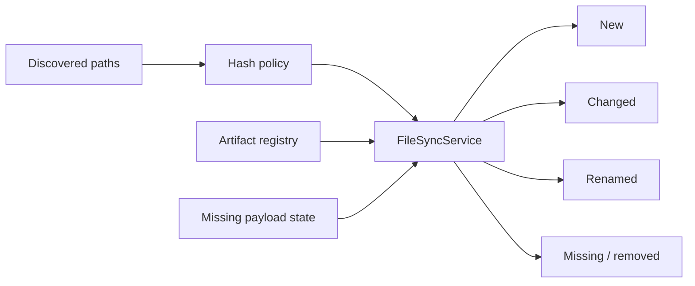

The important distinction is that path comparison is not enough. Artifact identity, content hash, payload presence, category, and prior status participate in the decision.

## Extraction reads from the Raw Store, not from arbitrary live paths

Once an artifact is actionable, the ingestion coordinator reads bytes from the Control Plane payload store.

```python
# src/personal_finance_etl/application/ingestion/coordinator.py
def _get_bytes(self, filepath: str) -> bytes:
    """Fetch bytes from Raw Store. Raise FileNotFoundError if missing."""
    raw_bytes = self.cp.artifacts.get_file_bytes(filepath)
    if raw_bytes is None:
        raise FileNotFoundError(f"Binary payload not found in Raw Store for: {filepath}")
    return raw_bytes
```

This is a subtle but important architecture choice.

Discovery observes the filesystem. Extraction consumes captured evidence.

That reduces the chance that a file changes between discovery and transformation without the operational record knowing about it.

## Extraction is typed and completeness-aware

The ingestion layer does more than parse files.

It constructs `ExtractionResult` and related typed contracts, records external provider requests, and runs a schema gate across active lazy streams before transformation proceeds.

The extraction gate uses `collect_schema()` and a small materialization to surface malformed source structure early rather than allowing invalid state to fail deep inside finance engines.

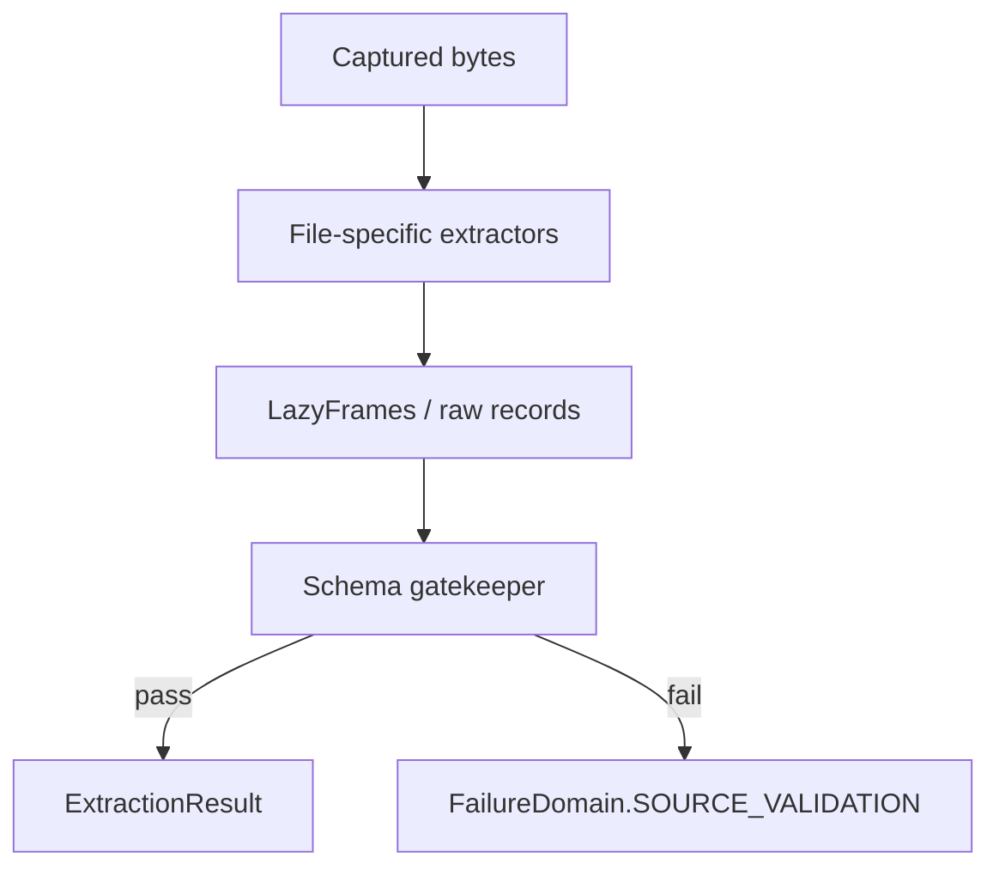

## Phase 2 synchronizes persistent Bronze

Bronze is not merely a staging schema rebuilt every run.

It is the analytical persistence boundary for synchronized raw evidence.

`BronzeLayer.load()` applies the registered Bronze contract model, upserts or full-replaces according to contract semantics, and then marks Control Plane artifacts synchronized.

Rename migrations can update Bronze identity without treating a path move as new economic evidence.

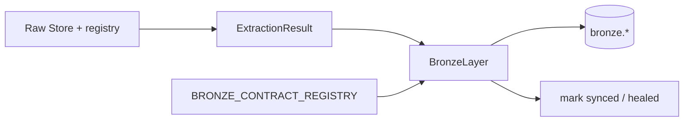

After synchronization, the executor logs a run-level sync summary: actionable, synced, healed, failed, deferred, and final sync status.

That makes Bronze completeness inspectable per run.

## Complete Bronze state becomes the transformation input

The system does not transform only the changed fragments and hope the rest of the analytical state still lines up.

After incremental synchronization, `BronzeLayer.get_full_dataset()` reconstructs the complete input state for downstream transformation.

That gives the architecture a useful split:

```text
incremental evidence synchronization
             +
complete deterministic analytical rebuild
```

The approach fits a personal-finance workload where input history grows gradually but the total dataset remains small enough for full analytical recomputation to be cheap and safer than complex partial dependency invalidation.

## Phase 3 changes vocabulary

The base transformation DAG converts source-oriented shapes into canonical financial tables and dimensions.

`TransformationDAG` coordinates household dimensions, transactions, investment input tables, and the calendar.

The important architectural transition is semantic:

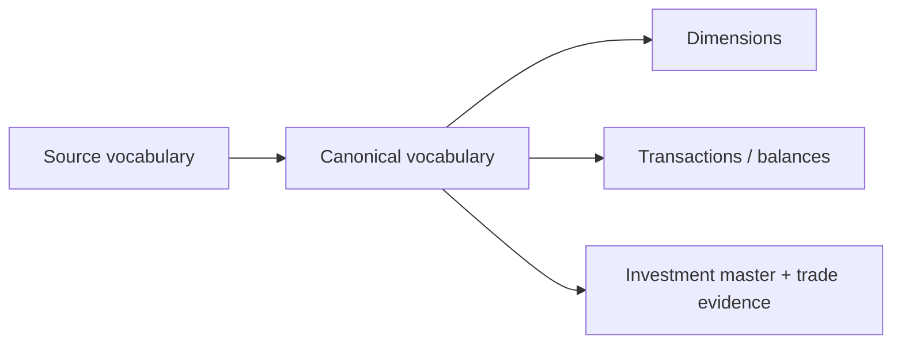

A broker field becomes useful only after the system decides what it means in the canonical model.

This is the first major point where observed evidence becomes financial interpretation.

## Market evidence is enriched after the base DAG

Currency, US market history, and benchmarks have separate application services because their completeness and temporal rules differ from local file transformation.

The architecture keeps provider acquisition in infrastructure and orchestration in application.

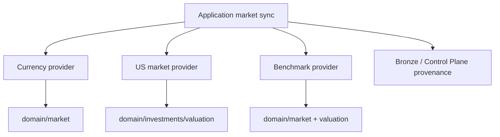

External evidence is not allowed to appear as an untracked side effect. Provider request provenance belongs to the same operational history as file evidence.

## Phase 4 reconstructs economic state

The financial engines consume canonical state and produce reconstructed, reconciled, and analytical datasets.

The investment domain is the largest example.

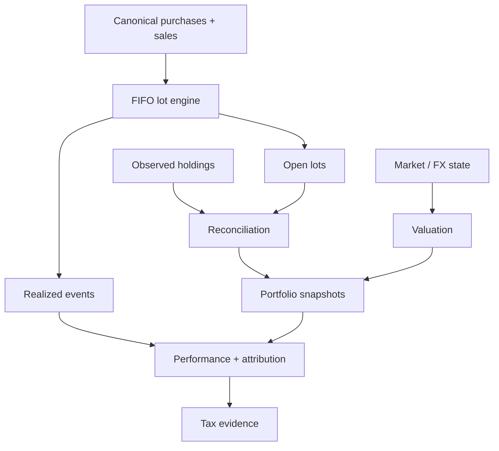

The architecture separates **book state**, **market state**, **realized state**, and **reconciliation evidence** because collapsing them would destroy useful explanations for why a value exists.

## Reconciliation is not an error-correction delete

When reconstructed holdings disagree with observed broker evidence, the system records reconciliation semantics rather than silently mutating history to force equality.

That distinction allows two different discrepancies to remain visible:

- quantity difference;
- cost-basis difference.

They are economically different and can require different synthetic adjustments.

The data model and identity specifications define those grains in detail.

## Tax consumes evidence produced by upstream domains

The Tax domain does not parse broker statement formats directly.

It consumes canonical income evidence and investment events after those events have acquired stable identity and financial meaning.

That architecture prevents Tax rules from duplicating source-specific parsing or FIFO logic.

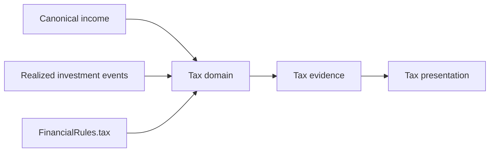

Investment-income exclusions are explicit where needed to avoid double counting income already represented by investment evidence.

## Wealth combines domains late

Wealth is intentionally downstream.

It combines household, investment, and Tax state after those domains have established their own semantics.

This avoids making the wealth model an accidental owner of source parsing, investment reconstruction, or Tax classification.

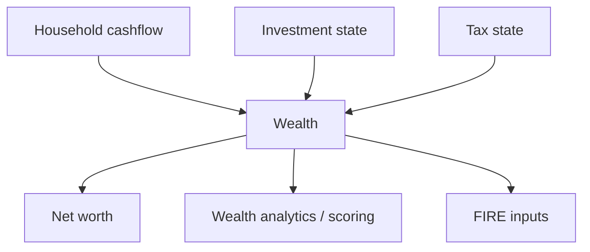

Late composition is one of the main ways the architecture prevents circular financial ownership.

## FIRE has deterministic and stochastic halves

The FIRE domain intentionally distinguishes deterministic forecast construction from stochastic simulation.

The deterministic side prepares FI targets, savings/spend history, inflation context, age, and seeded monthly inputs.

The stochastic side uses a Numba-compiled Monte Carlo kernel for computationally heavy path simulation.

This is an example of the architecture allowing different compute models inside one domain while keeping shared provenance explicit.

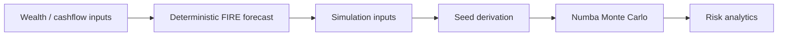

## Lazy execution remains lazy until a justified boundary

Polars `LazyFrame` is used extensively for transformations and presentation calculations.

The architecture does not treat laziness as ideology. It treats materialization as something that must have a reason.

Examples of legitimate boundaries include:

- validation that requires seeing schema/data;
- parallel terminal collection of independent presentation graphs;
- final Silver or Gold publication;
- algorithmic boundaries requiring concrete arrays or Python records.

Gold publication logs the optimized plan before terminal collection:

```python
# src/personal_finance_etl/infrastructure/warehouse/gold.py
if isinstance(df, pl.LazyFrame):
    compact_plan = df.explain().replace("\n", " | ")
    logger.debug(
        "[DAG:OPTIMIZER] Physical Plan for Gold '%s': %s", table_name, compact_plan
    )
    # Materialization Boundary: PUBLICATION_BOUNDARY
    df = df.collect()
```

That turns execution boundaries into inspectable design decisions rather than accidental eager computation.

## Contract completeness closes the financial loop

Before publication, the executor compares produced datasets with `DATA_CONTRACT_REGISTRY`.

```python
registered_contracts = {c.contract_id for c in DATA_CONTRACT_REGISTRY}
for df_key in self.dfs:
    if df_key not in registered_contracts:
        raise RuntimeError(
            f"Engine produced unregistered table '{df_key}'. "
            "All analytical tables must be defined in DATA_CONTRACT_REGISTRY."
        )

missing_contracts = registered_contracts - set(self.dfs)
if missing_contracts:
    raise RuntimeError(f"Engine failed to produce required tables: {missing_contracts}")
```

The registry is therefore not only documentation metadata. It is an execution gate.

A table cannot quietly appear or disappear from the analytical contract without the pipeline noticing.

## Phase 5 publishes rebuilt analytical state

Silver and Gold are recreated from the current successful in-memory analytical state.

Silver publication is ordered by `publication_order` from the registry and recreates the schema before insertion.

Gold does the same for presentation tables.

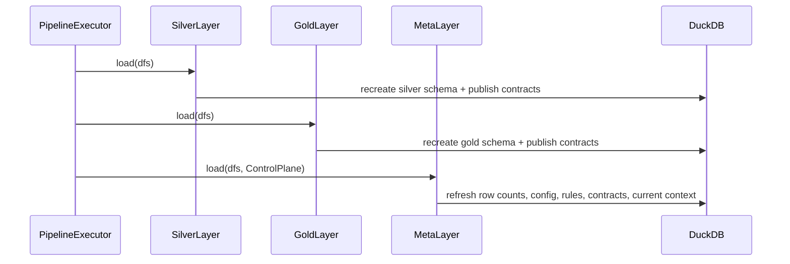

The full-replace strategy is possible because Bronze preserves evidence and the analytical state is deterministic enough to rebuild cheaply.

## Meta is current context, not historical authority

`meta.*` records useful inspection state such as:

- table row counts;
- current settings;
- current financial rules;
- data-contract inventory;
- current file context.

It is intentionally convenient for analytics and diagnostics.

But run history, artifact events, failures, raw payloads, provider requests, and simulation history remain in SQLite.

This avoids two competing histories.

## The runtime has two transaction systems, not one distributed transaction

DuckDB and SQLite each have a local transaction.

The lifecycle coordinator starts both and commits them in a deliberate order.

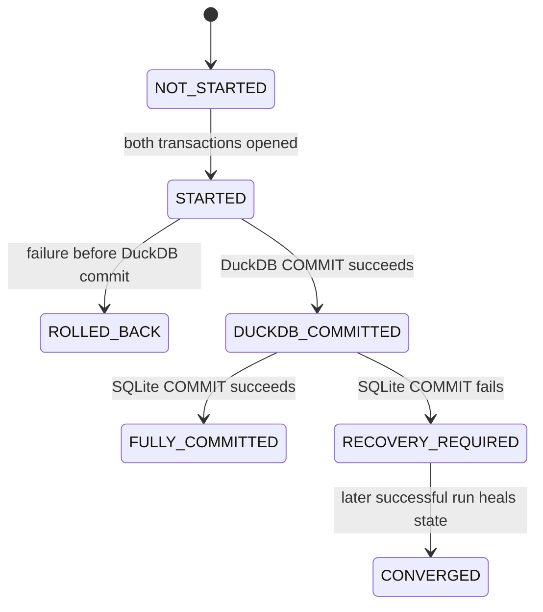

This is not atomic two-phase commit in the distributed-systems sense. There is no transaction coordinator capable of rolling back a committed DuckDB transaction after SQLite fails.

The architecture instead models that uncomfortable truth explicitly.

## DuckDB commits first because the failure asymmetry is understood

The chosen commit order means the dangerous split state is:

```text
DuckDB = committed analytical state
SQLite = not committed operational state
```

That state is detectable and marked `RECOVERY_REQUIRED`.

If SQLite committed first and DuckDB then failed, the operational authority could claim events and success metadata for analytical state that never became durable. The chosen order keeps recovery centered on reconciling operational metadata to analytical reality.

The trade-off is documented rather than hidden.

## Stale runs preserve uncertainty

A process can die without running normal failure handling.

When the Control Plane opens, schema initialization triggers stale-run recovery logic. Interrupted runs are not silently relabeled as success.

The operational record retains uncertainty so a later run can reason about convergence.

This is another recurring architectural principle:

> when the system cannot prove a stronger claim, store the weaker truthful claim.

## Failure is classified as data

`FailureDomain` gives failures a machine-readable taxonomy:

```text
CONFIGURATION
SOURCE_DISCOVERY
SOURCE_VALIDATION
EXTERNAL_PROVIDER
BRONZE_SYNC
TRANSFORMATION
FINANCIAL_INVARIANT
PUBLICATION
DUCKDB_COMMIT
SQLITE_COMMIT
RECOVERY
SNAPSHOT
RESTORE
WORKER
UNKNOWN
```

The classifier uses error type/message patterns and stage names to assign a domain deterministically.

That supports operational analysis without making the user parse free-form tracebacks to understand where a run failed.

## Worker failure is a process-boundary problem

Asynchronous execution runs the pipeline in a separate process and streams typed status messages back to presentation.

A worker crash must therefore become a parent-visible application outcome, not disappear as a child-process traceback.

That requirement is why worker coordination and status contracts live at the application/process boundary rather than inside the Desktop UI.

## Recovery has two different strategies

The architecture separates **reconstruction** from **restoration**.

### Reconstruction / convergence

Use retained evidence and deterministic rebuilding to converge the analytical and operational stores.

This is the default recovery philosophy for run-level failures.

### Snapshot restore

Use a coordinated archive to return both database files to a previously captured state.

This is appropriate for database corruption, destructive operator mistakes, or cases where reconstruction is not the desired recovery path.

The distinction prevents backup from becoming the normal answer to every failed run.

## Snapshots treat both databases as one recovery unit

`SystemBackupManager` coordinates SQLite and DuckDB capture under the same pipeline lock.

It checkpoints DuckDB, uses SQLite's backup API for a consistent SQLite copy, optionally includes DuckDB WAL state, validates the archive, and publishes only after verification.

Restore validates the archive before production files are moved.

That design is described in [Backup and Restore](backup-and-restore.md).

## The Control Plane and Warehouse solve different persistence problems

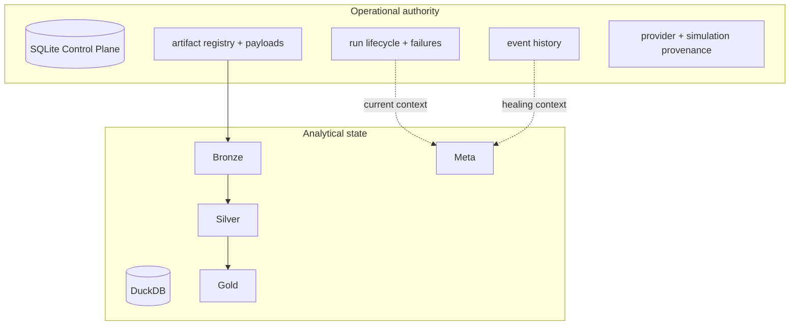

The architecture deliberately resists the temptation to make one engine perform both jobs simply to reduce the number of files on disk.

## The complete runtime in one view

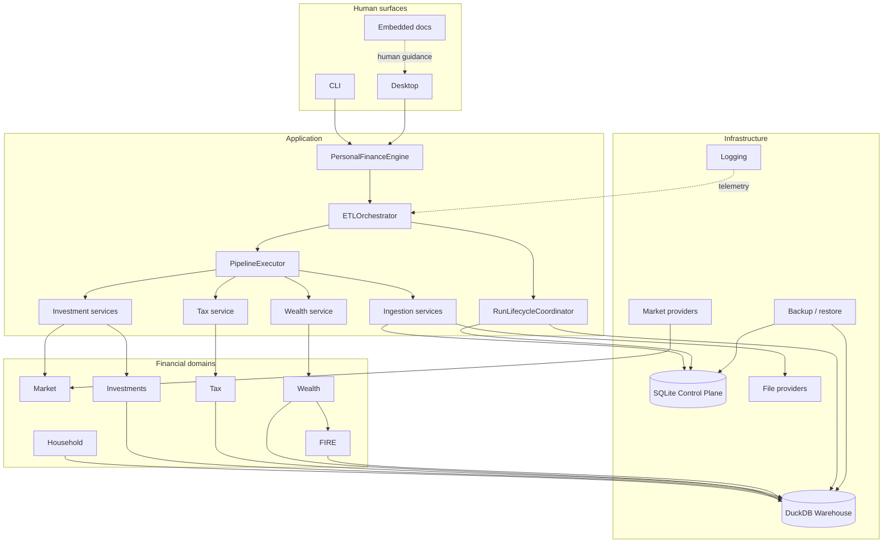

The diagram is large because the runtime is real. The purpose of the architecture is not to make it look small. It is to make each arrow explainable.

## What the architecture guarantees

The implementation is designed to maintain these properties:

1. financial-domain code does not depend on DuckDB or SQLite;
2. presentation does not own financial calculation or persistence;
3. operational run history remains in the Control Plane;
4. analytical publication is registry-governed;
5. persistent Bronze retains synchronized analytical evidence;
6. Silver and Gold can be rebuilt from complete state;
7. economic entities use deterministic identity where stable replay matters;
8. reconciliation remains explicit evidence rather than destructive correction;
9. cross-database split commit is represented as a real state;
10. backup/restore coordinates both database files as one recovery unit;
11. stochastic simulation provenance is distinguishable from deterministic reconstruction;
12. architecture import rules are executable tests.

## What the architecture does not guarantee

It does **not** claim:

- distributed atomic commit across SQLite and DuckDB;
- perfect external provider availability;
- automatic correction of semantically wrong source evidence;
- deterministic equality for intentionally stochastic simulation without matching seed/provenance;
- zero-cost full analytical rebuilds at arbitrary future scale;
- that every source can be generalized before its variation has actually been observed;
- that a snapshot taken outside the coordinated manager is a valid recovery unit.

These are explicit boundaries, not embarrassing footnotes.

## The architecture is stable because the contracts are clearer than the components

The strongest sign of architectural maturity is not that files stop changing.

It is that new work has an obvious place to go.

A new broker source should fit the provider/ingestion boundary. A new financial model should fit a domain. A new cross-boundary outcome should become a contract only if the boundary genuinely needs it. A new presentation should enter through the façade. A new persistence mechanism should remain infrastructure. A new orchestration step should not migrate formulas into application code.

That is the practical payoff of the architecture.

## Continue with dependency legality

Now that the runtime is visible, the next question is why these components are allowed to depend on one another in this particular shape.

Read [Application and Dependency Architecture](application-and-dependency-architecture.md), then follow one run in finer detail through [Data Lifecycle](data-lifecycle.md).

## Related specifications

- [Architecture](README.md)
- [Application and Dependency Architecture](application-and-dependency-architecture.md)
- [Data Lifecycle](data-lifecycle.md)
- [Warehouse Architecture](warehouse-architecture.md)
- [Control Plane Artifact Lifecycle](control-plane-artifact-lifecycle.md)
- [Reliability and Recovery](reliability-and-recovery.md)
- [Backup and Restore](backup-and-restore.md)
- [Data Model](data-model.md)
