# System Architecture

I designed Personal Finance ETL as a local financial-data platform whose operational history, canonical financial evidence, and analytical projections have distinct owners. This page traces one run from its entry point through publication, and identifies the contracts that keep the subsystems independent.

**Implementation map:** `backend/pipeline/etl_pipeline.py` coordinates the run; `backend/load/control_plane/` owns history; `backend/load/registry.py` defines physical publication; the transformation and financial engines own their own computations.

## 1. Runtime topology and responsibility boundaries

The desktop and CLI surfaces initiate work; they do not own financial algorithms. `ETLOrchestrator` owns execution ordering, while the Control Plane, loaders, transformations and engines encapsulate their own state. I keep the dependency direction one-way: source evidence feeds canonical financial facts, which feed Quant, Tax and Wealth presentation.

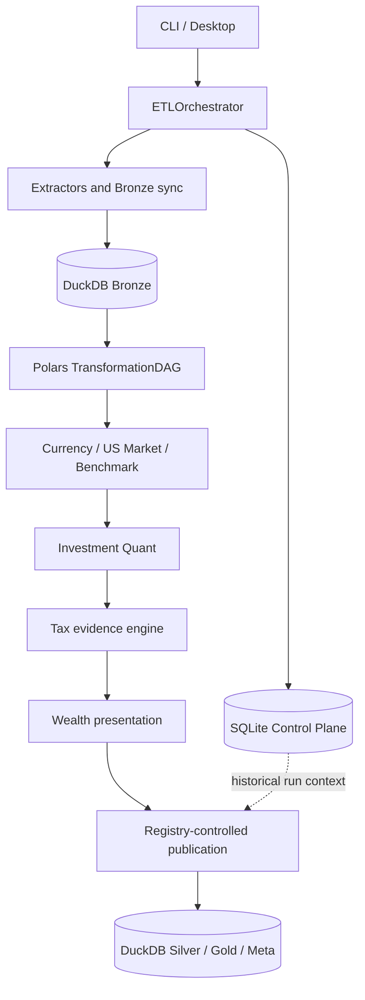

**Implementation:** `src/personal_finance_etl/backend/pipeline/etl_pipeline.py` (lines 47–67).

```python
class ETLOrchestrator:
    def __init__(self, cfg: Settings, status_queue: ILogger, rules: "FinancialRules | None" = None):

        self.cfg = cfg
        self.rules = rules
        self.status_queue = status_queue
        self.db_manager = DuckDBManager(cfg.TARGET_DB_BASE_PATH, cfg.TARGET_DB_NAME)
        self.dfs: dict[str, pl.DataFrame] = {}

    def _extract(
        self,
        cp: ControlPlane,
        actionable_files: dict[str, list[str]] | None = None,
    ) -> ExtractionResult:
        extractor = DataExtractor(self.cfg, self.status_queue, cp)
        return extractor.run(actionable_files)

    def _transform(self, extracted_data: ExtractionResult) -> None:
        transformer = TransformationDAG(self.cfg, self.status_queue, self.rules)
        self.dfs = transformer.run(extracted_data)

```

## 1. Application surfaces stay thin

The application exposes several ways to run or consume the system:

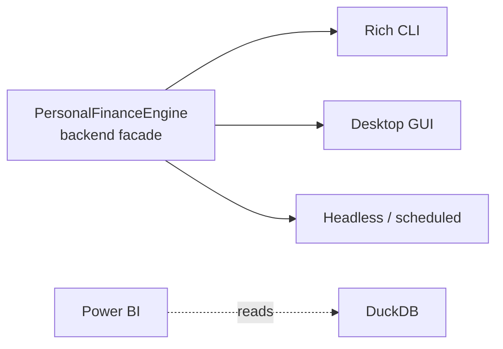

The frontends do not own financial methodology.

They invoke the backend and present state.

This keeps:

```text
CLI logic
GUI logic
automation logic
```

## 2. The orchestration contract

The orchestrator creates the run context and controls the order in which financial evidence becomes publishable. It does not implement FIFO, tax classification, or Monte Carlo calculations. I can therefore change a financial engine without redesigning the lifecycle of file discovery and database publication.

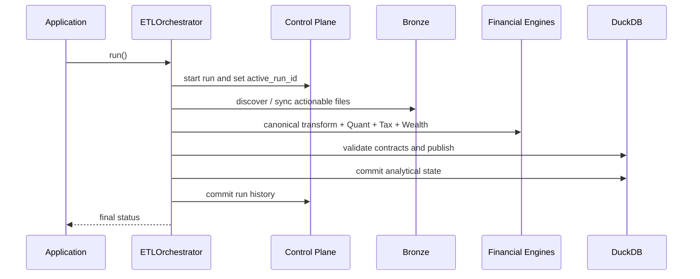

**Implementation:** `src/personal_finance_etl/backend/pipeline/etl_pipeline.py` (lines 150–192).

```python
    def _run_engines(self, cp: "ControlPlane | None", run_id: str) -> None:

        logger.info("Starting Investment Quant Engine...")
        self.status_queue.put(EngineStatus(msg="", data=None, progress=0.6, level=LogLevel.STEP))

        quant_engine = InvestmentQuantEngine(
            df_p=self.dfs["df_f_tf_inv_purchase"],
            df_s=self.dfs["df_f_tf_inv_sale"],
            df_m=self.dfs["df_f_investment_market_data"],
            df_i=self.dfs["df_d_investment_master"],
            df_b=self.dfs["df_f_investment_benchmark_data"],
            df_t=self.dfs["df_d_macro_parameters"],
            df_fx=self.dfs.get("df_f_currency_fx_rates"),
            status_queue=self.status_queue,
            rules=self.rules,
            start_date=None,
            end_date=None,
            run_id=run_id,
        )
        analytics_results = quant_engine.run()
        self.dfs.update(analytics_results)
        lot_df = analytics_results.get("df_f_investment_analytics_lot", pl.DataFrame())
        if (
            not lot_df.is_empty()
            and "Quantity" in lot_df.columns
            and "Closing_Date" in lot_df.columns
        ):
            max_date = lot_df.select(pl.col("Closing_Date").max()).item()
            open_lots = lot_df.filter(
                (pl.col("Closing_Date") == max_date) & (pl.col("Quantity") > 0)
            ).height
        else:
            open_lots = 0

        logger.info(f"  -> Quant Engine mapped {open_lots} open tax lots across portfolio.")

        # Fetch run snapshot identifiers for control-plane run logging.
        rules_snapshot_id = "UNKNOWN"
        settings_snapshot_id = None
        if cp and self.rules:
            metadata = cp.runs.get_run_metadata(run_id)
            settings_snapshot_id = metadata.get("settings_snapshot_id")
            rules_snapshot_id = metadata.get("rules_snapshot_id") or "UNKNOWN"
```

## 2. `ETLOrchestrator` coordinates the run

The orchestrator opens both persistence planes and creates the authoritative run record before analytical work begins:

```python
self.db_manager.open()
self.db_manager.ensure_schemas()

cp = ControlPlane(
    self.cfg.TARGET_DB_BASE_PATH,
    self.cfg.RAW_DOCUMENT_STORE_NAME,
)
cp.open()
cp.ensure_schema()

run_id = cp.runs.start_run(
    cfg_json=self.cfg.model_dump_json(),
    rules_json=self.rules.model_dump_json() if self.rules else None,
)
```

It then starts coordinated local transactions:

```python
self.db_manager.conn.execute("BEGIN TRANSACTION")
cp.begin_transaction()

cp.runs.update_run_status(run_id, "RUNNING")
```

The orchestrator owns **coordination**.

It does not own:

- SQLite repository SQL,
- source-specific extraction,
- financial transformation formulas,
- FIFO state,
- Gold business logic,
- or frontend rendering.

That separation is one of the most important boundaries in the application.

---

## 3. Operational history: the Control Plane

SQLite is the historical operational authority. I separate `ArtifactRepository`, `FileSyncService` and `RunRepository` behind a facade so that a file mutation, its observation event and a run outcome are not conflated. Event history can survive the disappearance of a source file; retained identity is not a promise that all historical bytes remain indefinitely.

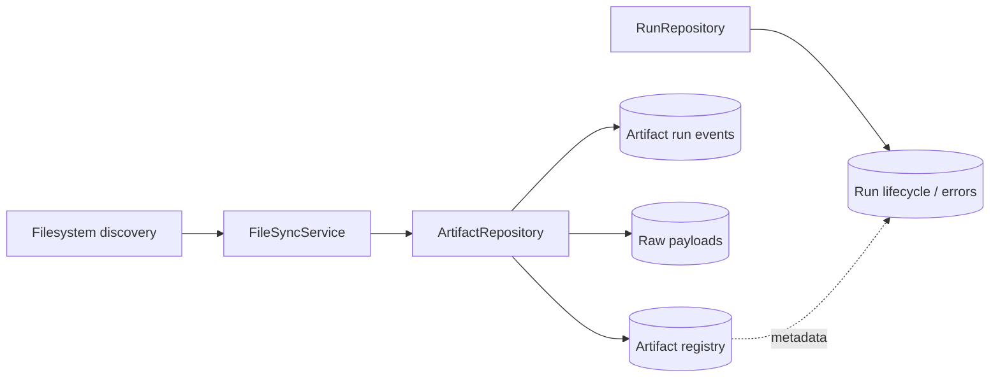

**Implementation:** `src/personal_finance_etl/backend/load/control_plane/orchestrator.py` (lines 14–55).

```python
class ControlPlane:
    """Authoritative lifecycle wrapper for the SQLite ETL control plane."""

    def __init__(self, base_path: str, db_name: str = "Raw_Documents.sqlite"):
        self.base_path = base_path
        self.db = SQLiteManager(base_path, db_name)
        self.artifacts = ArtifactRepository(self.db)
        self.runs = RunRepository(self.db)
        self.file_sync = FileSyncService(self.artifacts)
        self.lock_path = os.path.join(base_path or ".", "pipeline.lock")
        self._lock: Any = FileLock(self.lock_path)
        self._lock_acquired = False
        self._active_run_id: str | None = None

    @property
    def active_run_id(self) -> str | None:
        return self._active_run_id

    @active_run_id.setter
    def active_run_id(self, value: str | None) -> None:
        self._active_run_id = value
        self.artifacts.active_run_id = value
        self.file_sync.active_run_id = value

    def set_active_run_id(self, run_id: str | None) -> None:
        """Set the active run once and propagate it to every event-producing component."""
        self.active_run_id = run_id

    def open(self) -> None:
        if self._lock_acquired and self.db.is_open:
            return
        os.makedirs(self.base_path or ".", exist_ok=True)
        try:
            self._lock.acquire(timeout=0)
            self._lock_acquired = True
        except Timeout:
            raise RuntimeError(
                "Another instance of the production pipeline is currently running."
            ) from None
        try:
            self.db.open()
        except Exception:
```

## 3. The Control Plane is a facade over focused services

The production facade is intentionally small:

```python
class ControlPlane:
    def __init__(self, base_path: str, db_name: str = "Raw_Documents.sqlite"):
        self.db = SQLiteManager(base_path, db_name)
        self.artifacts = ArtifactRepository(self.db)
        self.runs = RunRepository(self.db)
        self.file_sync = FileSyncService(self.artifacts)

    def begin_transaction(self) -> None:
        self.db.begin_transaction()

    def commit(self) -> None:
        self.db.commit()

    def rollback(self) -> None:
        self.db.rollback()
```

The structure is:

```text
ControlPlane
├── SQLiteManager
├── ArtifactRepository
├── RunRepository
└── FileSyncService
```

### `ArtifactRepository`

Owns:

- artifact registry,
- raw payload BLOBs,
- hashes,
- file sizes,
- synchronization state,
- virtual artifacts.

### `RunRepository`

Owns:

- run identity,
- run status,
- application/schema version,
- Settings snapshots,
- FinancialRules snapshots,
- failures,
- tracebacks,
- execution logs.

### `FileSyncService`

Owns:

- comparison between discovered files and registered evidence,
- configurable rehash policy,
- new/changed classification,
- full-replace pruning,
- binary ingestion of actionable artifacts.

## 4. Source evidence, Bronze and transformation

Incremental synchronization avoids re-ingesting unchanged artifacts, but Silver and Gold are rebuilt from the current complete analytical state. This distinction is foundational: the source registry is historical, Bronze is persisted source-shaped state, and Silver/Gold are replaceable projections. The transformation DAG normalizes ledger, calendar, currency and investment transactions before Quant consumes them.

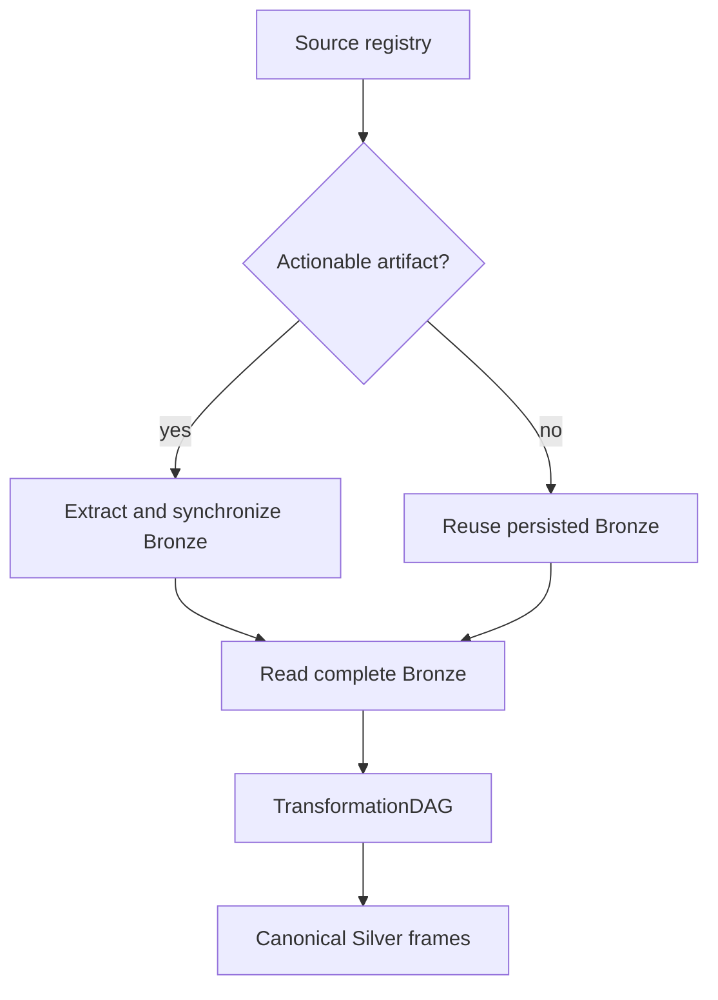

**Implementation:** `src/personal_finance_etl/backend/pipeline/etl_pipeline.py` (lines 56–66).

```python
    def _extract(
        self,
        cp: ControlPlane,
        actionable_files: dict[str, list[str]] | None = None,
    ) -> ExtractionResult:
        extractor = DataExtractor(self.cfg, self.status_queue, cp)
        return extractor.run(actionable_files)

    def _transform(self, extracted_data: ExtractionResult) -> None:
        transformer = TransformationDAG(self.cfg, self.status_queue, self.rules)
        self.dfs = transformer.run(extracted_data)
```

## 8. Canonical transformation is Polars-first

The transformation layer converts source-shaped Bronze into canonical financial contracts.

```python
transformer = TransformationDAG(
    self.cfg,
    self.status_queue,
    self.rules,
)
self.dfs = transformer.run(extracted_data)
```

The transformation plane uses Polars LazyFrames where possible so expressions remain composable before materialization.

The canonical boundary hides source vocabulary from downstream engines.

```text
source-specific field names
        ↓
canonical financial concepts
        ↓
shared analytics
```

Examples include:

- income,
- expense,
- transfer,
- opening balance,
- investment master,
- purchase,
- sale,
- market observation,
- benchmark observation.

---

## 5. Dynamic evidence and geographic normalization

US holdings require reconstructed daily state because dependable broker daily holdings snapshots are unavailable. Currency history and market prices are distinct evidence sources: a missing foreign FX rate is not equivalent to INR identity conversion, and reconstructed holdings are not broker-certified observations. The dynamic pipelines prepare evidence; the Quant Engine retains FIFO ownership.

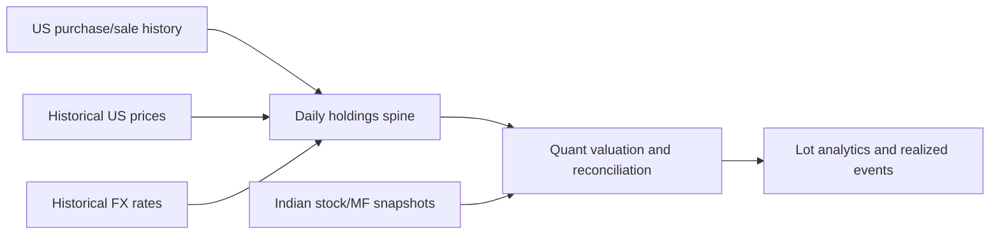

**Implementation:** `src/personal_finance_etl/backend/pipeline/etl_pipeline.py` (lines 68–101).

```python
    def _process_benchmark(self, cp: ControlPlane, bronze: BronzeLayer) -> None:
        pipeline = BenchmarkPipeline(cp, bronze, self.status_queue)
        self.dfs["df_f_investment_benchmark_data"] = pipeline.process(
            df_market=self.dfs.get("df_f_investment_market_data"),
            df_purchase=self.dfs.get("df_f_tf_inv_purchase"),
            df_master=self.dfs["df_d_benchmark_master"],
        )

    def _process_currency(self, cp: ControlPlane, bronze: BronzeLayer) -> None:
        pipeline = CurrencyPipeline(cp, bronze, self.status_queue, max_workers=8)

        # Start Date: Earliest date in Calendar
        cal_pd = self.dfs["df_d_calendar"]
        if cal_pd.is_empty():
            global_start_date = date.today()
        else:
            sd = cal_pd.select(pl.min("Date")).item()
            global_start_date = sd if sd is not None else date.today()

        # End Date: Max date of Indian Market Data
        df_market = self.dfs.get("df_f_investment_market_data")
        global_end_date = date.today()
        if df_market is not None and not df_market.is_empty():
            ed = df_market.select(pl.col("Date").drop_nulls().max()).item()
            if ed is not None:
                global_end_date = ed

        self.dfs["df_f_currency_fx_rates"] = pipeline.run(
            df_currency=self.dfs["df_d_currency"],
            global_start_date=global_start_date,
            global_end_date=global_end_date,
        )

    def _process_us_market_data(self, cp: ControlPlane, bronze: BronzeLayer) -> None:
```

## 9. Stateful investment analytics use a different compute model

Not every workload belongs in a vectorized dataframe expression.

FIFO tax-lot accounting is stateful.

Per-instrument analytics therefore use instrument identity as a natural isolation boundary.

```text
Canonical investment contracts
        ↓
partition by ISIN
        ↓
FIFO / tax / broker / benchmark state
        ↓
lot analytics
        ↓
hierarchical portfolio analytics
```

This is an example of a broader design rule:

> **Use the compute model that matches the problem rather than forcing one abstraction across the entire system.**

Polars handles dataframe transformations.

Stateful Python objects handle FIFO.

NumPy/Numba handle simulation.

---

## 6. Financial engines and producer ownership

Investment Quant reconstructs acquisition lots, realized disposals and reconciliation events. Tax combines household ledger evidence with Quant realized events, excludes ledger investment-gain duplicates and retains indicative estimates. Wealth presentation constructs cashflow, portfolio, net-worth and stochastic planning outputs. None of the Gold builders should invent a second FIFO or final statutory tax computation.

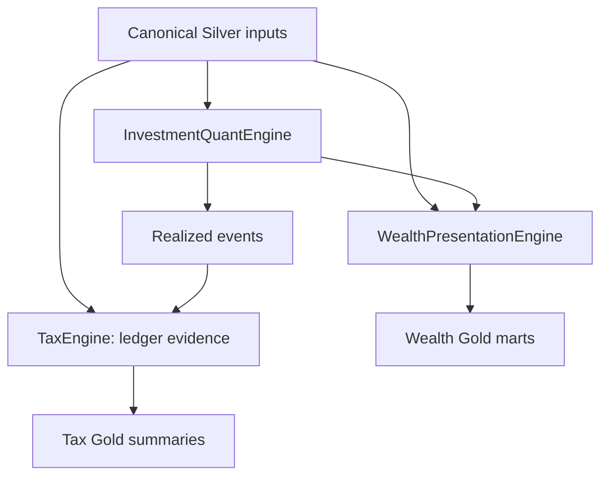

**Implementation:** `src/personal_finance_etl/backend/engines/tax/tax_engine.py` (lines 10–42).

```python
class TaxEngine:
    """Orchestrate evidence normalization and presentation-only tax aggregates."""

    def __init__(
        self,
        df_income: pl.DataFrame,
        df_realized_events: pl.DataFrame,
        df_subcategory: pl.DataFrame,
        rules: FinancialRules | None,
        df_macro_parameters: pl.DataFrame | None = None,
    ) -> None:
        self.df_income = df_income
        self.df_realized_events = df_realized_events
        self.df_subcategory = df_subcategory
        self.rules = rules
        self.df_macro_parameters = df_macro_parameters

    def run(self) -> dict[str, pl.DataFrame]:
        if self.rules is None:
            raise ValueError("FinancialRules must be provided to execute the Tax Engine.")

        lf_tax_events = BaseEventsBuilder(
            df_income=self.df_income,
            df_realized_events=self.df_realized_events,
            df_subcategory=self.df_subcategory,
            rules=self.rules,
            df_macro_parameters=self.df_macro_parameters,
        ).build()

        exclusions = self.rules.assumptions.tax.investment_exclusions
        investment_exclusion_uids = sorted(
            set(exclusions.stcg_sub_cat_ids) | set(exclusions.ltcg_sub_cat_ids)
        )
```

## 10. Presentation analytics return lazy graphs

The wealth/presentation engine builds independent LazyFrame outputs.

The orchestrator collects them together:

```python
keys = list(presentation_lazy.keys())
lazy_frames = [presentation_lazy[key] for key in keys]

results = pl.collect_all(
    lazy_frames,
    engine="streaming",
)

for key, result in zip(keys, results, strict=True):
    self.dfs[key] = result
```

This lets independent analytical graphs execute together while preserving a clear builder boundary.

The production-hardening cycle also removed presentation computations that no longer supported a serving decision.

That reduced both conceptual and runtime cost.

---

## 7. Publication contracts and physical authority

The registry declares each output's contract ID, layer, physical table, domain, grain, producer and publication order. I use the registry to connect logical dataframe identities to physical Silver/Gold tables. A valid result requires both the expected shape and the correct producer; a dataframe merely having the right column names is not a sufficient ownership contract.

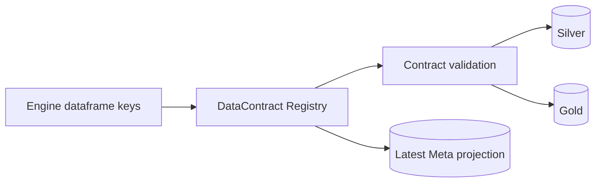

**Implementation:** `src/personal_finance_etl/backend/load/registry.py` (lines 1–28).

```python
from dataclasses import dataclass


@dataclass
class DataContract:
    contract_id: str
    layer: str
    physical_table: str
    domain: str
    grain: str
    producer: str
    publication_order: int


@dataclass
class BronzeDataContract:
    """Defines the relationship between raw extraction attributes, control plane sync categories, and physical DuckDB tables."""

    extraction_attribute: str
    sync_category: str
    physical_table: str
    is_full_replace: bool


BRONZE_CONTRACT_REGISTRY: list[BronzeDataContract] = [
    BronzeDataContract("zcategory", "sqlite_source", "bronze.r_SQLite_ZCategory", True),
    BronzeDataContract("assetgroup", "sqlite_source", "bronze.r_SQLite_AssetGroup", True),
    BronzeDataContract("assets", "sqlite_source", "bronze.r_SQLite_Assets", True),
```

## 11. Publication is contract-driven

Silver and Gold publication use an explicit registry:

```python
@dataclass
class DataContract:
    contract_id: str
    layer: str
    physical_table: str
    domain: str
    grain: str
    producer: str
    publication_order: int
```

The current hardened publication path sorts contracts by declared order:

```python
contracts = sorted(
    (c for c in DATA_CONTRACT_REGISTRY if c.layer == "gold"),
    key=lambda c: c.publication_order,
)
```

Then writes only registered outputs:

```python
for contract in contracts:
    if contract.contract_id in dfs:
        self._write(
            dfs[contract.contract_id],
            contract.physical_table,
        )
```

This replaces inference with explicit analytical identity.

The registry tells the system:

```text
what the dataset is
where it lives
what layer owns it
what one row means
who produces it
when it publishes
```

---

## 8. Transaction coordination and failure semantics

SQLite savepoints make scoped artifact mutations atomic within the Control Plane transaction. DuckDB publication is committed separately from SQLite run history. This is coordinated local recovery, not a distributed ACID transaction. The pipeline must distinguish a failed analytical publication from a completed publication whose final SQLite bookkeeping fails.

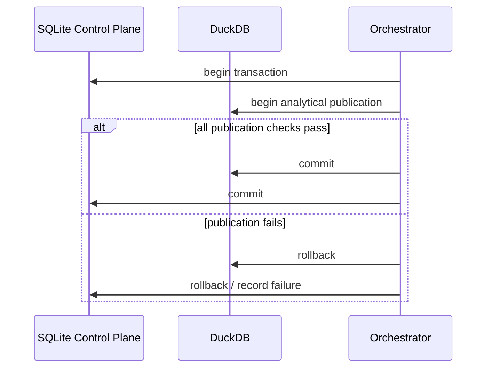

**Implementation:** `src/personal_finance_etl/backend/load/control_plane/connection.py` (lines 71–85).

```python
    def atomic(self) -> Generator[None]:
        """Atomic scope that works both standalone and nested in a pipeline transaction."""
        savepoint = f"cp_scope_{uuid.uuid4().hex}"
        self.conn.execute(f"SAVEPOINT {savepoint}")
        try:
            yield
            self.conn.execute(f"RELEASE SAVEPOINT {savepoint}")
        except Exception:
            try:
                self.conn.execute(f"ROLLBACK TO SAVEPOINT {savepoint}")
            finally:
                self.conn.execute(f"RELEASE SAVEPOINT {savepoint}")
            raise

    @property
```

## 14. Reliability is part of the architecture

Current reliability includes:

```text
single-run production lock
stale-run recovery
structured run failures
run-scoped compressed execution logs
cross-process ISIN worker tracing
PENDING_BRONZE replay
artifact-level Bronze self-healing
coordinated Snapshot + Restore
```

A successful run transitions to `COMMITTING` before persistence is finalized:

```python
cp.runs.update_run_status(run_id, "COMMITTING")

self.db_manager.conn.execute("COMMIT")
cp.commit()

cp.runs.finish_run(run_id, "SUCCESS")
```

Failure triggers rollback of both local persistence planes:

```python
self.db_manager.conn.execute("ROLLBACK")
cp.rollback()
```

Then failure details are persisted:

```python
cp.runs.log_run_failure(
    run_id=run_id,
    failed_isin=None,
    stage="Pipeline",
    error_type=type(exc).__name__,
    error_message=str(exc),

```

## 9. Reproducibility and lifecycle of analytical state

Financial identity is based on canonical defining attributes rather than transient row position or run ID. Full Silver/Gold replacement is compatible with stable logical identity. FIRE simulations are a separate case: the recorded run-specific seed and numerical compatibility envelope matter for replay, while independent runs may intentionally sample different paths.

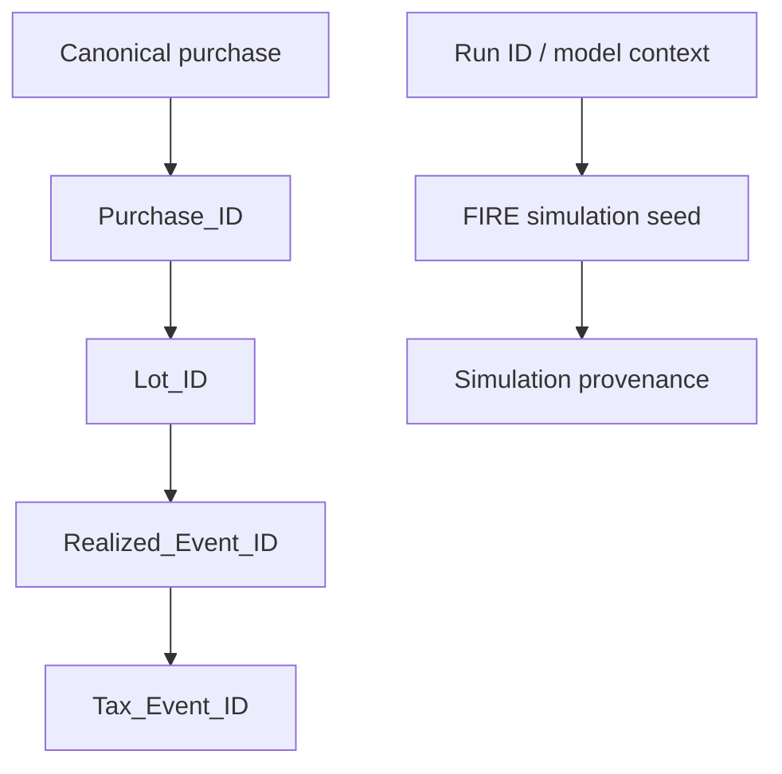

**Implementation:** `src/personal_finance_etl/backend/utils/identity.py` (lines 63–90).

```python
def _ordered_identity_fields(namespace: str, fields: dict[str, Any]) -> list[tuple[str, Any]]:
    """Return identity fields in a contract-defined, caller-order-independent order."""
    keys = set(fields)
    for field_order in _IDENTITY_FIELD_ORDERS.get(namespace, ()):
        if keys == set(field_order):
            return [(key, fields[key]) for key in field_order]

    # Unknown/new contracts remain deterministic rather than inheriting insertion
    # order. Add a namespace contract above if its field order must be semantic.
    return [(key, fields[key]) for key in sorted(fields)]


def generate_deterministic_id(namespace: str, fields: dict[str, Any]) -> str:
    """Generate a stable deterministic ID using Canonical ID Serialization v2.

    Known namespaces retain their established field order and hashes. New or
    changed field sets use sorted keys until an explicit order is registered.
    """
    pairs = [
        [canonicalize_value(key), canonicalize_value(value)]
        for key, value in _ordered_identity_fields(namespace, fields)
    ]
    payload = json.dumps(
        [namespace, "v2", pairs], ensure_ascii=False, separators=(",", ":")
    ).encode("utf-8")
    hash_str = hashlib.sha256(payload).hexdigest()
    return f"{namespace}_{hash_str[:16]}"
```

## 15. Recovery flows from ownership

Because raw evidence survives independently from DuckDB analytical state:

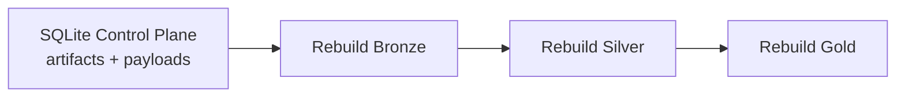

The Meta layer also performs a self-healing check.

If an artifact is `SYNCED` in the Control Plane but its DuckDB state is incomplete, it is returned to `PENDING_BRONZE`.

The current check covers Meta identity, required Bronze-table existence, and artifact-owned `__file_name__` partitions for historical sources.

The Control Plane therefore anchors recovery.

---

## 10. Documentation as an application surface

The documentation manifest drives the in-app/CLI documentation viewer. I keep `/docs` as the canonical implementation specification, the Wiki as a conceptual teaching surface, the root README as a showcase and code as implementation authority. This prevents each consumer from maintaining a separate hardcoded list of documents.

## 16. Documentation is an application subsystem

The same architecture philosophy extends to documentation.

```text
docs/*.md
   ↓
manifest.json
   ↓
DocsCatalog
   ↓
DocsRenderer
   ↓
CLI + Desktop
```

The application does not maintain a hard-coded list of guide files.

Documentation navigation is data-driven and packaged with the application.

That means the technical knowledge base is part of the product surface rather than a separate repository afterthought.

---

## 11. Architectural trade-offs and extension boundaries

The design deliberately favors local execution, deterministic analytical rebuilding and deep provenance over distributed infrastructure. A developer extending the system should introduce a source contract, canonical transformation, engine producer and registry entry at the appropriate boundaries, not add ad hoc SQL or bypass the Control Plane. Cross-database commit coordination, source availability and numerical replay remain explicit limitations.

## Dependency direction

The major dependency direction is:

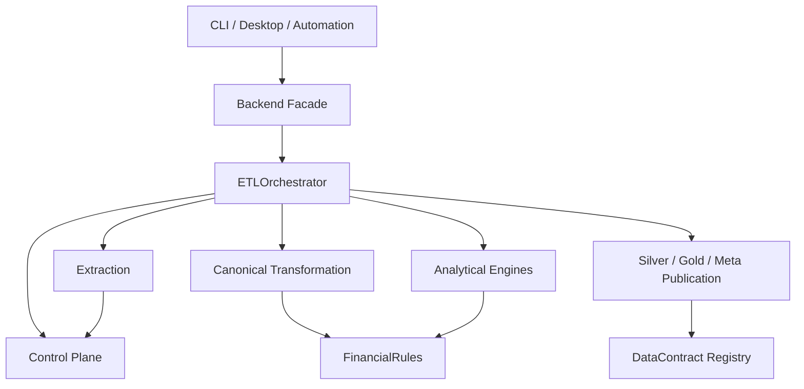

Stable downstream finance should depend on canonical concepts, not source formats.

That is the architectural test I use when deciding where new behaviour belongs.

---
## What this architecture optimizes for

### Correctness

Financial state can be rebuilt from durable evidence and complete Bronze state.

### Traceability

Runs, failures, configuration snapshots and source synchronization have explicit ownership.

### Performance

Unchanged source history is not reparsed, while Polars and per-instrument parallelism handle downstream computation.

### Maintainability

Repositories, engines, loaders and frontends have different responsibilities.

### Extensibility

New sources and assets can converge into stable canonical contracts.

### Local-first operation

The entire stack remains viable on a local workstation without requiring cloud infrastructure to coordinate the workload.

---

## Related specifications

- [Data lifecycle](data-lifecycle.md)
- [Warehouse architecture](warehouse-architecture.md)
- [Financial data model](data-model.md)
- [Artifact lifecycle](control-plane-artifact-lifecycle.md)
- [Identity and replay](deterministic-identity-and-replay.md)
- [Recovery](reliability-and-recovery.md)
