# System Architecture

Personal Finance ETL is a local-first financial data platform whose architecture grew beyond a conventional ETL pipeline. It ingests heterogeneous financial evidence, preserves operational provenance, normalizes canonical facts, reconstructs investment state, executes deterministic and stochastic financial models, and publishes a contract-governed DuckDB warehouse for analytics.

The architecture is deliberately layered because the system answers several different questions at once:

- What evidence entered the system?
- Has that evidence changed since the previous run?
- What are the canonical financial facts?
- What state must be reconstructed rather than directly observed?
- Which engine owns each derived financial meaning?
- What is safe to publish to BI?
- What happened operationally if a run fails?
- Can the persistence pair be recovered without guessing which database was newer?

A single “ETL box” cannot answer those questions honestly. This document maps the major components, dependency boundaries, execution topology, and ownership rules that make the system coherent.

## 1. System context

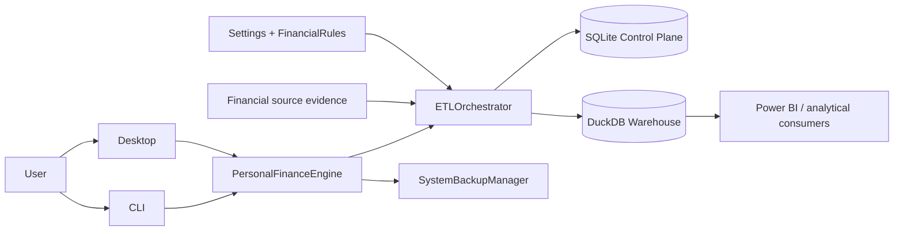

`PersonalFinanceEngine` in `backend/api/engine.py` is the backend façade exposed to application surfaces. It validates configuration, launches the pipeline asynchronously, and coordinates snapshot/restore operations. The frontend therefore does not need to know how FIFO, Bronze synchronization, or database recovery works.

The façade launches the ETL in a separate process:

```python
process = multiprocessing.Process(
    target=process_wrapper,
    args=(status_queue, config_path, rules_path),
    daemon=True,
)
process.start()
```

A monitoring thread converts process messages into `EngineStatus` events for the UI. Heavy analytical execution is therefore isolated from the interface process while still streaming progress and failure information back to the caller.

## 2. Package topology

```text
src/personal_finance_etl/
├── backend/
│   ├── api/                  # application-facing façade
│   ├── config/               # runtime settings + financial rules
│   ├── extract/              # physical source adapters
│   ├── pipeline/             # orchestration + specialized pipelines
│   ├── transform/            # canonical transformations
│   ├── engines/
│   │   ├── analytics/        # investment Quant / FIFO
│   │   ├── tax/              # tax evidence normalization
│   │   └── presentation/     # wealth, cashflow, FIRE, BI presentation
│   ├── load/
│   │   ├── control_plane/    # SQLite operational authority
│   │   └── schema/           # physical DDL contracts
│   ├── types/                # shared typed models
│   └── utils/                # identity, replay, logging, helpers
└── frontend/
    ├── cli/
    ├── desktop/
    └── commons/docs/
```

The directory layout mostly follows dependency responsibility rather than financial subject. Finance-specific meaning becomes concentrated in transformation and engine layers, while persistence, identity, and orchestration remain reusable infrastructure.

## 3. Top-level component model

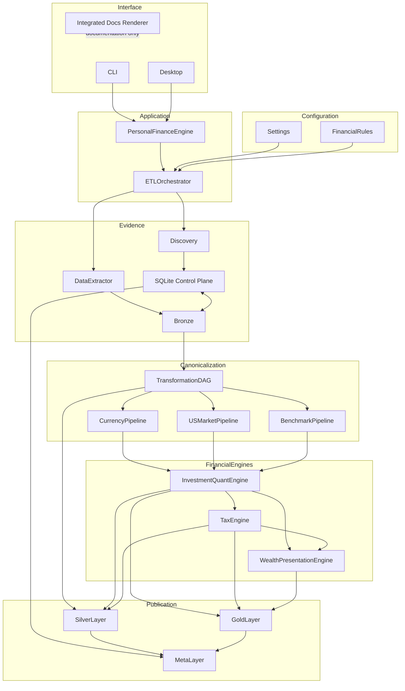

## 4. Application façade

`PersonalFinanceEngine` intentionally exposes a narrow set of operations:

- recent configuration/rules history;
- configuration validation;
- asynchronous pipeline execution;
- coordinated database snapshot;
- coordinated database restore.

It does **not** expose individual transformation functions or financial engines. This prevents UI code from becoming a second orchestrator with subtly different execution order.

Snapshot and restore also live behind the same façade:

```python
backup_mgr = SystemBackupManager(
    cfg.TARGET_DB_BASE_PATH,
    sqlite_db_name=cfg.RAW_DOCUMENT_STORE_NAME,
    duckdb_name=cfg.TARGET_DB_NAME,
)
return backup_mgr.create_snapshot()
```

The architectural implication is important: the application treats the SQLite Control Plane and DuckDB warehouse as one recoverable system even though they remain separate database engines.

## 5. Orchestration authority

`ETLOrchestrator` in `backend/pipeline/etl_pipeline.py` is the execution authority. It owns ordering between persistence and financial subsystems.

Its high-level phases are:

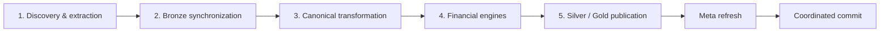

The apparent five phases contain important internal dependencies. Currency, US market reconstruction, and benchmark processing occur after the base transformation DAG but before Quant. Tax executes after Quant because it consumes realized investment events. Wealth presentation executes after Tax so tax outputs are available to downstream presentation logic.

## 6. Engine ordering is a financial contract

The order is not arbitrary orchestration plumbing:

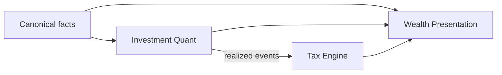

The source makes the Quant → Tax dependency explicit:

```python
# Tax Engine — runs AFTER Quant (needs df_f_investment_realized_events produced by FIFO)
# and BEFORE Presentation so that tax outputs land in self.dfs and are available to
# WealthPresentationEngine for any current or future tax-aware presentation tables.
tax_engine = TaxEngine(
    df_income=self.dfs["df_f_income_transactions"],
    df_realized_events=self.dfs["df_f_investment_realized_events"],
    ...
)
```

This establishes domain ownership:

- Quant owns realized investment economics.
- Tax consumes realized events and normalizes tax-relevant evidence.
- Presentation consumes canonical/Quant/Tax outputs for BI-facing analytics.

Tax does not quietly rebuild FIFO because that would create two competing definitions of realized gain.

## 7. Configuration boundary

### `Settings`

`backend/config/settings.py` defines runtime and physical configuration: source locations, target paths, database names, discovery controls, mapping assets, and hashing behavior.

### `FinancialRules`

`backend/config/financial_rules.py` defines financial interpretation and model parameters: categories, investment semantics, tax exclusions, macro assumptions, portfolio rules, FIRE configuration, Monte Carlo parameters, regime models, shocks, glide paths, and withdrawal behavior.

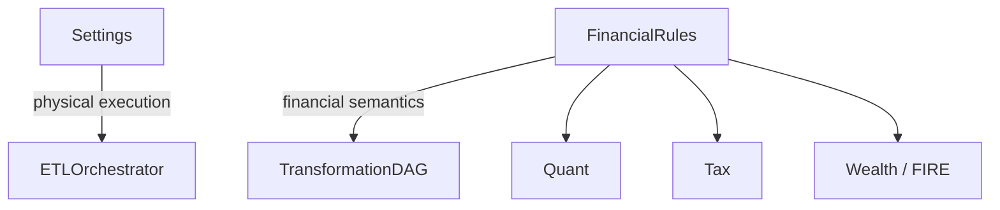

This boundary prevents a path/configuration object from becoming a dumping ground for financial policy.

## 8. Evidence acquisition architecture

Physical extraction is adapter-based under `backend/extract/`:

- SQLite extraction;
- CSV extraction;
- Excel extraction;
- currency acquisition;
- benchmark acquisition;
- US market acquisition;
- statement location/categorization.

`DataExtractor` coordinates actionable files supplied by the Control Plane. Discovery and extraction are therefore separate concerns:

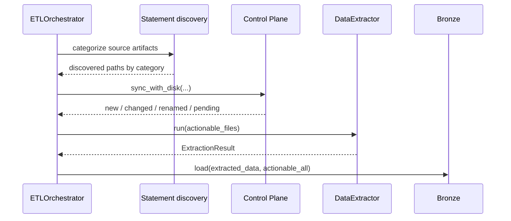

The pipeline does not need to re-extract every artifact merely because Silver/Gold are rebuilt. Incremental acquisition and full analytical reconstruction are deliberately decoupled.

## 9. Control Plane boundary

The SQLite Control Plane is created before analytical processing:

```python
cp = ControlPlane(self.cfg.TARGET_DB_BASE_PATH, self.cfg.RAW_DOCUMENT_STORE_NAME)
cp.open()
cp.ensure_schema()
run_id = cp.runs.start_run(
    cfg_json=self.cfg.model_dump_json(),
    rules_json=self.rules.model_dump_json() if self.rules else None,
)
```

It owns historical operational state including run lifecycle, failures, settings/rules snapshots, artifact registry/payloads, artifact-run events, and simulation runs.

DuckDB Meta mirrors current analytical context. It is not the historical authority.

## 10. Persistent Bronze versus rebuilt analytics

Bronze contracts encode whether a source is full-replace or incremental. Examples of full-replace sources include SQLite master tables and mapping/configuration assets. Transaction/market history sources are generally incremental.

After Bronze synchronization, the pipeline reads the **complete Bronze dataset** and rebuilds canonical analytics:

```python
bronze.load(extracted_data, actionable_all)
full_dataset = bronze.get_full_dataset(extracted_data.mappings)
self._transform(full_dataset)
```

This yields an important architectural property:

> Incremental ingestion does not require incremental analytical mutation.

Silver and Gold can be deterministically reconstructed from the current persistent Bronze state.

## 11. Core Polars transformation DAG

`TransformationDAG` builds canonical household and investment facts as Polars LazyFrames, then executes independent nodes together:

```python
results = pl.collect_all(list(dag_nodes.values()), engine="streaming")
```

Its base nodes include category dimensions, asset dimensions, currency, benchmark master, macro parameters, household facts, investment market data, purchase/sale facts, and investment master.

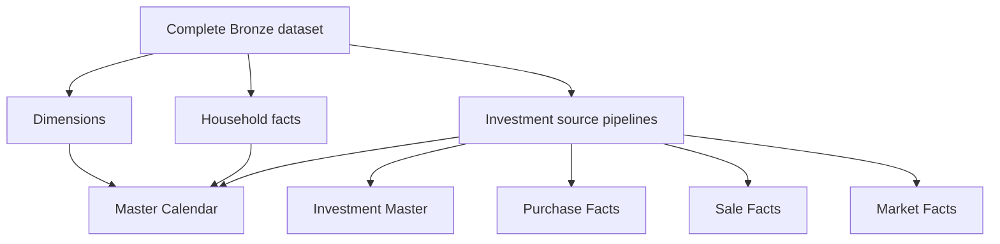

Asset-specific adapters (`MutualFundPipeline`, `StockPipeline`, `USStockPipeline`) normalize source differences before the shared investment transforms create canonical outputs.

## 12. Specialized enrichment pipelines

Three pipelines run after the base DAG:

### Currency

`CurrencyPipeline` builds canonical historical FX rates over the relevant global date range.

### US market reconstruction

`USMarketPipeline` reconstructs historical US holdings/market state from transactions, historical prices, instrument master data, and FX evidence. This is derived state, not broker-certified daily holdings evidence.

### Benchmark

`BenchmarkPipeline` aligns benchmark observations with the investment universe for Quant comparison.

These enrichments feed Quant rather than bypassing canonical processing.

## 13. Investment Quant architecture

`InvestmentQuantEngine` receives canonical purchases, sales, market data, instrument master, benchmark data, macro parameters, FX, rules, and the run ID.

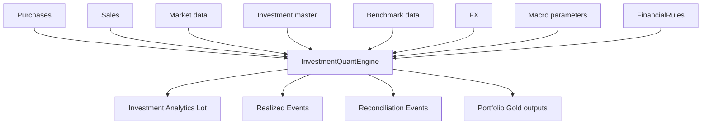

The engine's internal `FIFOPortfolio` owns canonical lot reconstruction and realized disposal events. Reconciliation is explicit financial provenance rather than a silent mutation of inconvenient state.

Detailed financial semantics belong in the Finance specifications.

## 14. Tax architecture

`TaxEngine` consumes household income evidence and Quant realized events. It publishes canonical `f_Tax_Events` plus three Gold outputs:

- `Tax_Year_Summary`;
- `Tax_Income_Breakdown`;
- `Tax_Reconciliation`.

The engine is evidence-first and produces indicative tax estimates. It is not a complete statutory tax-liability calculator.

## 15. Wealth and FIRE architecture

`WealthPresentationEngine` composes core builders and presentation modules around canonical/Quant/Tax inputs. Its output is a set of LazyFrames collected concurrently by the orchestrator.

```python
keys = list(presentation_lazy.keys())
lazy_frames = [presentation_lazy[k] for k in keys]
results = pl.collect_all(lazy_frames, engine="streaming")
```

The engine includes inflation, ledger, net-worth, spending, income-stream, budget, investment-presentation, cashflow, wealth-risk, and FIRE logic.

The root stochastic seed is the run ID:

```python
wealth_engine = WealthPresentationEngine(rules=self.rules, root_seed=run_id)
```

Simulation provenance is subsequently recorded in the Control Plane.

## 16. Contract registry

The analytical registry is not optional metadata. It controls publication order and expected outputs.

Current inventory:

| Layer | Registered contracts |
|---|---:|
| Bronze | 20 |
| Silver | 24 |
| Gold | 22 |
| Silver + Gold | 46 |
| Total physical contract registry | 66 |

`DataContract` records:

```python
@dataclass
class DataContract:
    contract_id: str
    layer: str
    physical_table: str
    domain: str
    grain: str
    producer: str
    publication_order: int
```

The registry therefore connects logical engine outputs to physical warehouse publication.

## 17. Publication topology

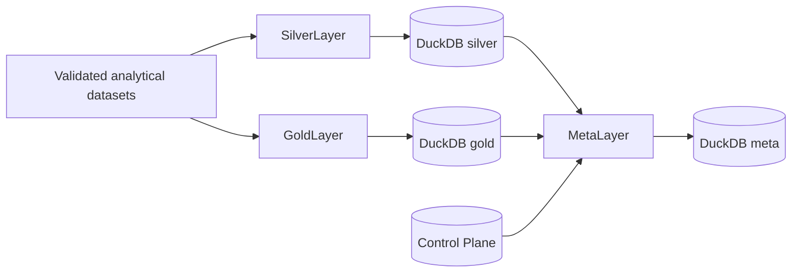

Silver and Gold rebuild their analytical schemas. They are current publications, not append-only historical ledgers.

## 18. Transaction boundary

The run begins transactions in both databases:

```python
self.db_manager.conn.execute("BEGIN TRANSACTION")
cp.begin_transaction()
```

The successful commit path is intentionally ordered:

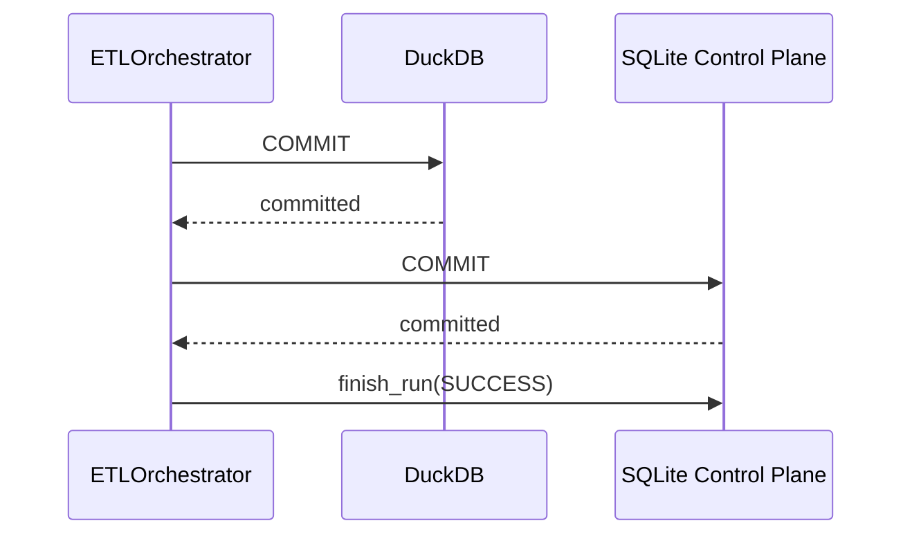

If SQLite commit fails after DuckDB commits, the databases can temporarily diverge. The code explicitly relies on idempotency and Bronze self-healing on the next run. This is coordinated recovery, not distributed ACID.

## 19. Failure topology

Before commit, failures attempt rollback in both stores and record operational failure details:

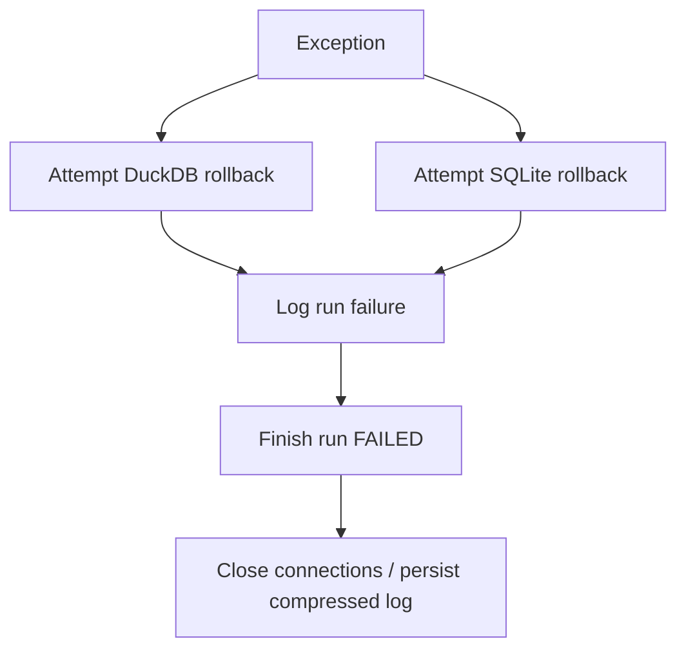

Investment workload failures can preserve the failed ISIN and stage. Other exceptions are recorded as pipeline failures with type, message, and traceback.

The finalizer persists a compressed execution log into the Control Plane where possible.

## 20. Recovery and backup boundary

`SystemBackupManager` coordinates snapshots and restores for the SQLite/DuckDB pair. It uses the application lock, checkpoints DuckDB, uses SQLite's backup API, validates archives/databases, and performs rollback-aware pair replacement during restore.

The detailed protocol belongs in `backup-and-restore.md`; the important system-level rule is that the two databases are **separate transaction engines but one application recovery unit**.

## 21. Frontend and documentation integration

CLI and desktop interfaces are adapters over the backend façade. Documentation rendering is centralized under `frontend/commons/docs/`, allowing the same documentation catalog to be surfaced inside application interfaces rather than maintaining a second hard-coded guide list.

That is why the documentation manifest is updated only after the new catalog is complete: navigation is part of the application surface, not an afterthought stapled to Markdown.

## 22. Architectural guarantees

The implementation supports the following defensible guarantees:

1. Analytical publication is contract-governed.
2. Bronze persists synchronized source state across runs.
3. Silver and Gold rebuild from current complete Bronze state.
4. The Control Plane preserves historical run/artifact provenance.
5. Canonical financial identities are deterministic under their serialization contracts.
6. Quant owns canonical FIFO realization and reconciliation.
7. Tax consumes realized evidence rather than independently reconstructing investment gains.
8. Historical US price/FX joins are causal rather than future-looking.
9. Simulation context records seeds, snapshots, and fingerprints.
10. Backup/restore treats the persistence pair as one recoverable application unit.

## 23. Explicit non-guarantees

The architecture does **not** claim:

- distributed ACID across SQLite and DuckDB;
- broker certification of reconstructed US historical holdings;
- statutory final tax liability;
- eternal binary retention for every historical artifact event;
- environment-independent bit-for-bit Monte Carlo replay forever;
- incremental Silver/Gold mutation;
- comprehensive conventional automated test coverage for every runtime invariant.

These boundaries are features of honest architecture documentation, not disclaimers to hide in tiny print.

## 24. Architectural character

The most important design characteristic is not the number of engines. It is **ownership discipline**:

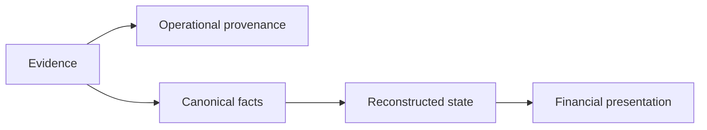

A source observation remains evidence. A reconstruction remains a reconstruction. A presentation table remains presentation. The system becomes sophisticated precisely because it avoids flattening all four into one giant “finance dataframe” and hoping future Shan can remember what each column meant.

## Related specifications

- [Data Lifecycle](data-lifecycle.md)
- [Warehouse Architecture](warehouse-architecture.md)
- [Data Model](data-model.md)
- [Control Plane Artifact Lifecycle](control-plane-artifact-lifecycle.md)
- [Deterministic Identity and Replay](deterministic-identity-and-replay.md)
- [Reliability and Recovery](reliability-and-recovery.md)
- [Backup and Restore](backup-and-restore.md)
- [Design Decisions](design-decisions.md)
