# Warehouse Architecture

Personal Finance ETL uses **SQLite and DuckDB together**, but they are not interchangeable stores. SQLite owns historical operational provenance. DuckDB owns analytical persistence and publication. Inside DuckDB, Bronze, Silver, Gold, and Meta have different persistence and authority semantics.

The architecture is easiest to understand by refusing the tempting shortcut of calling everything “the database.” There are two database engines and five logical persistence responsibilities. That distinction is the difference between a recoverable system and a folder containing files with impressive extensions.

## 1. Persistence topology

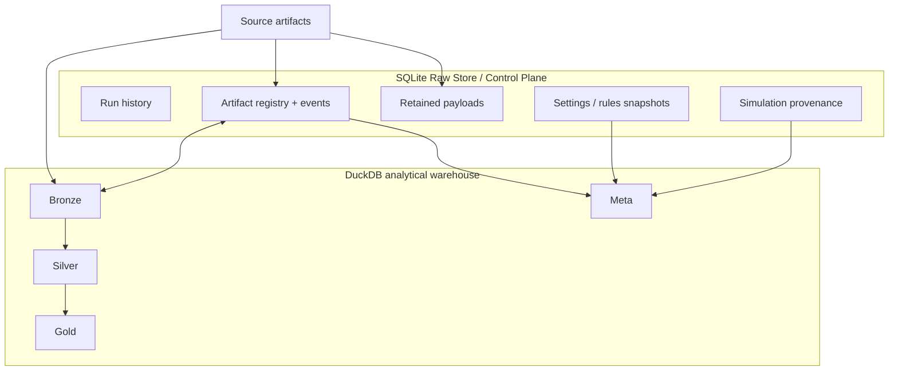

## 2. Ownership matrix

| Store / layer | Persistence style | Primary authority | Rebuilt? |
|---|---|---|---|
| SQLite Control Plane | historical operational | runs, artifacts, events, payload/provenance, snapshots, simulations | no |
| DuckDB Bronze | persistent source representation | synchronized extracted evidence | selectively synchronized |
| DuckDB Silver | current canonical analytical | dimensions, canonical facts, Quant/Tax facts | yes, full schema publication |
| DuckDB Gold | current presentation analytical | BI-facing financial analytics | yes, full schema publication |
| DuckDB Meta | current analytical context | registry projection, settings/rules, row counts, latest simulation | refreshed |

The word **authority** is intentional. For example, `meta.m_File_Registry` is useful for analytics, but the historical artifact authority is SQLite's Control Plane.

## 3. DuckDB manager

`backend/load/database.py` wraps the analytical database connection and schema initialization. `DuckDBManager.ensure_schemas()` creates the logical namespaces required by the warehouse.

The ETL opens DuckDB before the Control Plane because analytical connection setup is needed for subsequent healing and transactional work, but operational run authority begins in SQLite before transformations execute.

## 4. SQLite Control Plane

The Control Plane schema currently contains eight tables:

```text
cp_runs
cp_run_failures
cp_settings_snapshots
cp_rules_snapshots
cp_file_registry
cp_file_payloads
cp_artifact_run_events
cp_simulation_runs
```

At warehouse-architecture level, these can be grouped by responsibility:

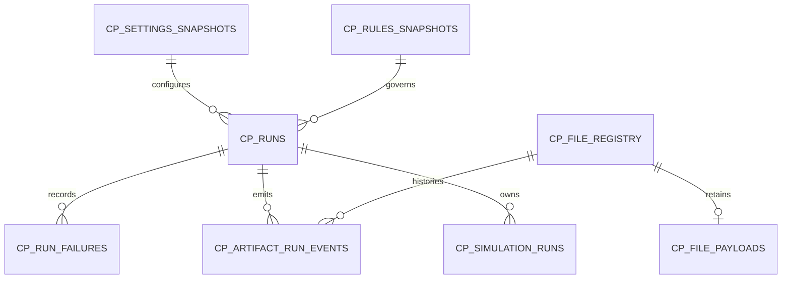

Exact columns, keys, event vocabulary, and retention semantics belong in the Control Plane Reference specification.

## 5. Why SQLite owns operational history

Operational state is transactional, relational, relatively small, and write-oriented around run/artifact events. SQLite is well suited to this workload and gives the application:

- durable run lifecycle;
- artifact identity independent of DuckDB analytical rebuilds;
- retained payload support;
- settings/rules snapshots;
- savepoint-based nested atomic operations;
- structured failure records;
- simulation provenance.

The Control Plane can therefore survive analytical schema replacement without losing the history of how that state was produced.

## 6. Savepoint atomicity

`SQLiteManager.atomic()` uses savepoints for scoped repository operations. This is distinct from the outer ETL transaction.

Conceptually:

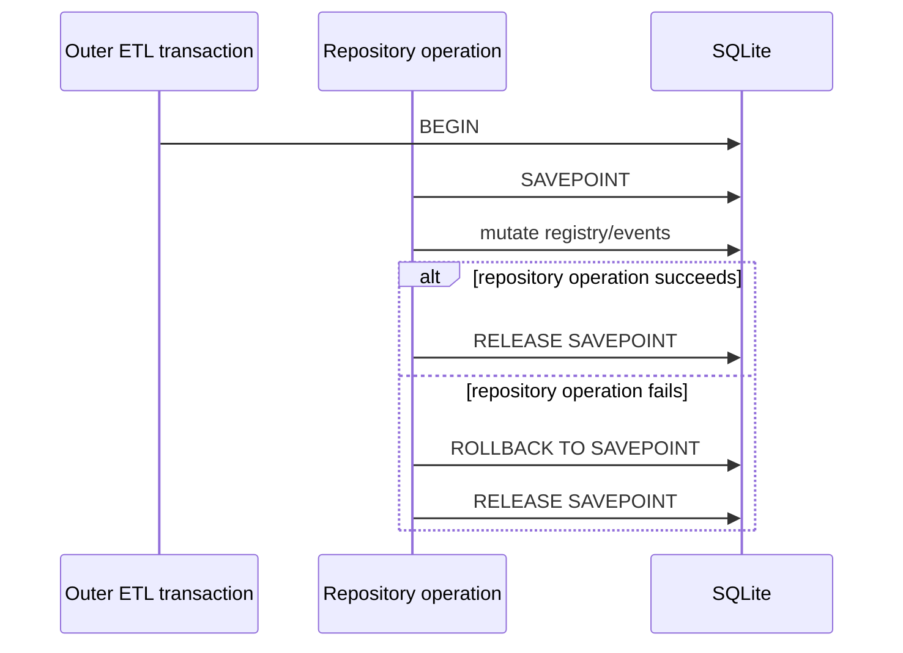

Savepoints protect a repository operation without pretending to create distributed atomicity with DuckDB.

## 7. Bronze: persistent evidence representation

Bronze is the durable analytical representation of extracted source evidence. Its contract registry currently contains 20 entries.

A Bronze contract connects four concepts:

```python
@dataclass
class BronzeDataContract:
    extraction_attribute: str
    sync_category: str
    physical_table: str
    is_full_replace: bool
```

That is more useful than a simple table-name list because the warehouse needs to know how an extraction output maps to Control Plane synchronization semantics.

## 8. Bronze contract families

### Full-replace

Current full-replace contracts include source/master/mapping datasets such as:

- SQLite category/asset/currency/transaction source tables;
- MF ISIN mapping;
- benchmark mapping;
- opening balances;
- benchmark master;
- macro parameters;
- column master;
- currency mapping.

### Incremental

Current incremental contracts include:

- MF market data;
- US stock transactions;
- currency FX history;
- MF transactions;
- Indian stock market data;
- stock transactions;
- benchmark history;
- US stock prices.

The exact physical contracts are documented in Reference.

## 9. Bronze synchronization model

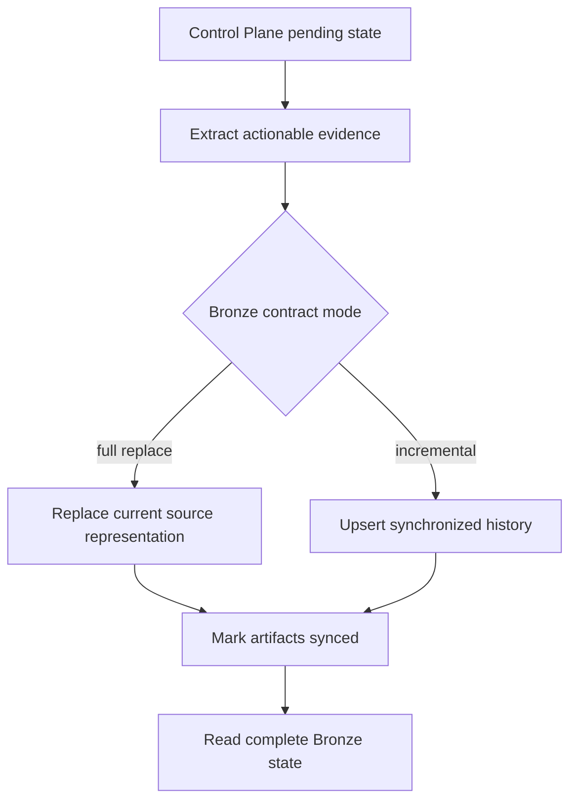

Bronze therefore bridges operational artifact state and analytical reconstruction.

## 10. Bronze identity migration

Renames are propagated into Bronze provenance:

```python
if renames:
    bronze.migrate_identity(renames)
    meta_layer.migrate_identity(renames)
```

This keeps path-level changes from unnecessarily fragmenting analytical lineage.

## 11. Silver: canonical analytical publication

Silver currently contains 24 registered contracts across Common, Wealth, Investments, and Taxes.

Its responsibilities include:

- canonical dimensions;
- canonical household facts;
- canonical investment market/trade facts;
- Quant lot/realized/reconciliation facts;
- canonical tax events.

Silver is where heterogeneous evidence becomes a stable analytical model.

## 12. Silver publication strategy

`SilverLayer.load()` rebuilds the Silver schema and publishes registered Silver contracts in `publication_order`.

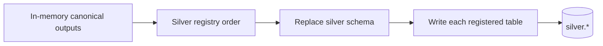

This makes Silver a **current complete publication**, not a mutation log.

The trade-off is deliberate: recomputation costs time, but it avoids maintaining correction semantics for every possible upstream source change.

## 13. Current Silver domains

| Domain | Representative contracts |
|---|---|
| Common | `d_Calendar`, `d_Currency`, `f_Currency_FX_Rates` |
| Wealth | income/expense/asset dimensions and transaction/opening-balance facts |
| Investments | investment master, macro parameters, market, purchase, sale, benchmark, lot, realized, reconciliation |
| Taxes | `f_Tax_Events` |

Reference owns exact schemas and grains; Architecture owns why these facts sit in Silver.

## 14. Gold: presentation publication

Gold currently contains 22 registered contracts. It presents financial meaning for BI rather than introducing a second canonical transaction model.

Its domains include:

- tax summaries/reconciliation;
- monthly core fact;
- wealth/asset breakdown;
- income/expense/cashflow analytics;
- budget variance;
- FIRE analytics;
- investment aggregations by ISIN, subtype, class, instrument type, sector, industry, portfolio, geography, country, and currency.

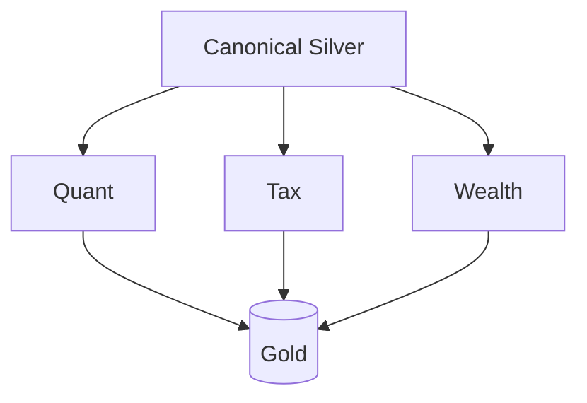

Gold is optimized for consumption. It should not be mistaken for the evidence layer simply because its tables are the ones most likely to appear in a dashboard.

## 15. Meta: current analytical context

DuckDB Meta currently publishes:

```text
m_File_Registry
m_Table_Row_Counts
m_Financial_Rules
m_Settings
m_Data_Contracts
m_Latest_Simulation
```

These tables make the analytical database inspectable and self-describing without duplicating the full operational history.

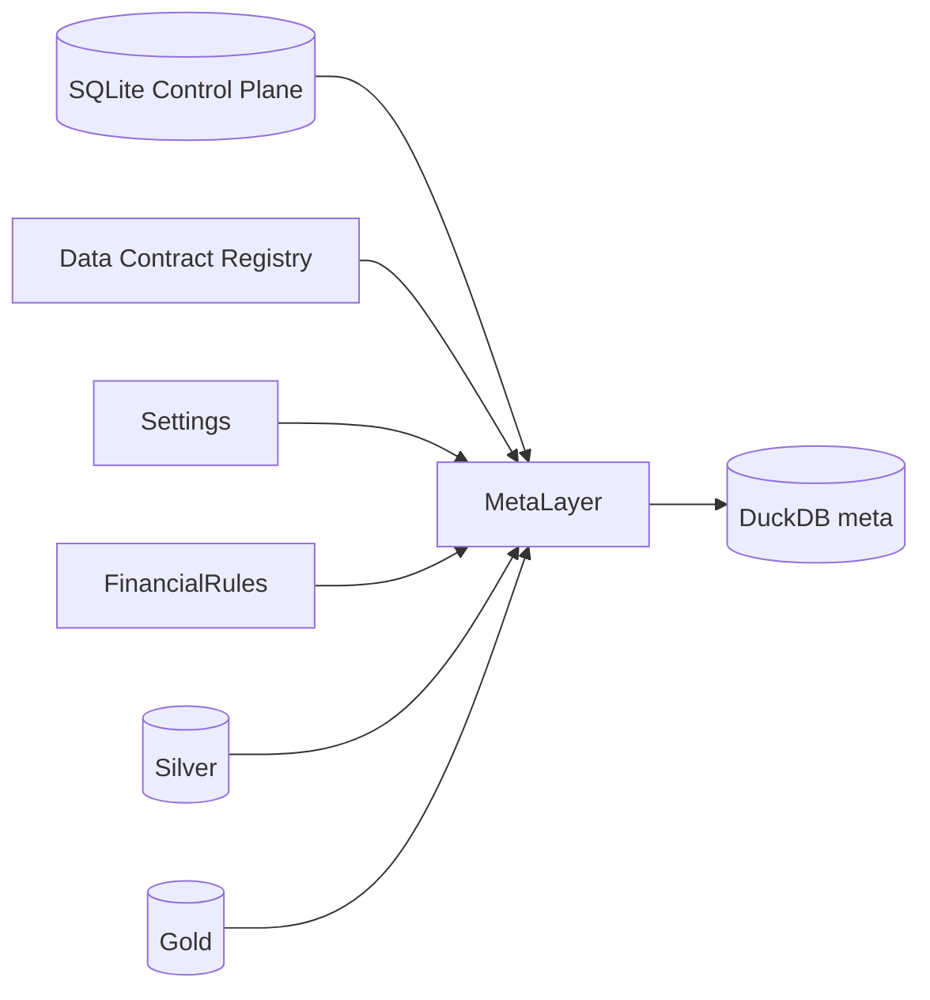

## 16. Meta is a projection, not authority

The most important Meta rule is negative:

> `meta.m_File_Registry` does not become the historical artifact authority merely because it is convenient to query from DuckDB.

The Control Plane remains authoritative. `MetaLayer.heal_duckdb_registry()` exists precisely because the projection can diverge from operational truth after an interrupted cross-database commit.

## 17. Contract registry as warehouse control plane

`DATA_CONTRACT_REGISTRY` defines:

- logical contract ID;
- layer;
- physical table;
- domain;
- grain;
- producer;
- publication order.

Example:

```python
DataContract(
    "df_f_investment_realized_events",
    "silver",
    "silver.f_Investment_Realized_Events",
    "Investments",
    "RealizedEvent",
    "InvestmentQuantEngine",
    205,
)
```

This connects an in-memory engine output to physical publication and domain ownership.

## 18. Registry inventory

| Registry | Count |
|---|---:|
| Bronze | 20 |
| Silver | 24 |
| Gold | 22 |
| Total | 66 |

Counts are implementation facts from `backend/load/registry.py`, not documentation constants to be manually maintained forever. Reference generation should always verify them against source.

## 19. Publication completeness invariant

The ETL enforces that the in-memory analytical dictionary equals the registered analytical contract set before writing Silver/Gold.

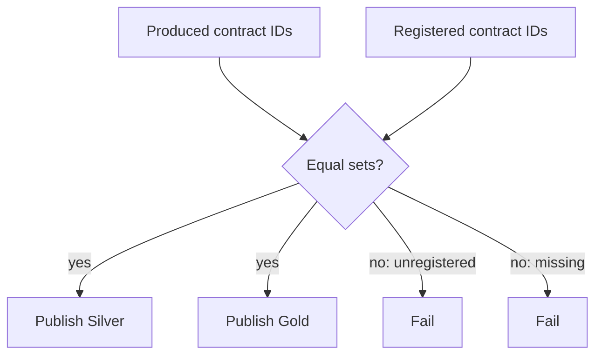

This prevents schema drift from being silently normalized into “whatever the engine returned today.”

## 20. Transaction architecture

Both stores begin transactions for the logical run:

```python
self.db_manager.conn.execute("BEGIN TRANSACTION")
cp.begin_transaction()
```

But the commit sequence is not atomic across engines:

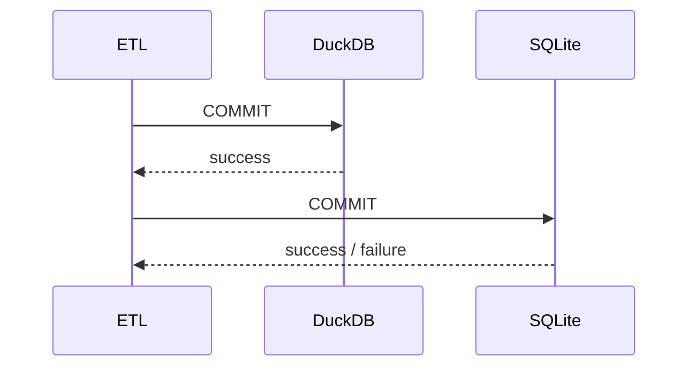

If DuckDB commit fails, the run fails before SQLite commit. If DuckDB commits and SQLite commit fails, the next run relies on idempotency and Bronze self-healing.

That is a recovery protocol, not two-phase commit.

## 21. Why commit DuckDB first?

The implementation's recovery model treats analytical publication as recoverable from persistent evidence and operational authority. A post-DuckDB SQLite failure is explicitly recognized and handled through next-run convergence.

The docs should describe the behavior, not invent a stronger guarantee than the code provides.

## 22. Analytical rebuild semantics

The warehouse separates two kinds of persistence:

```text
Bronze
  persistent synchronized evidence

Silver / Gold
  replaceable derived publications
```

This means source history survives analytical rebuilds, while derived schemas can evolve without accumulating mutation history.

## 23. Failure and rollback

Before successful DuckDB commit, pipeline failure attempts rollback on both stores. Because commit itself is sequential, rollback cannot undo a DuckDB commit that already succeeded before SQLite commit failure.

This boundary is why healing exists and why documentation must avoid the phrase “fully atomic across both databases.”

## 24. Snapshot architecture

`SystemBackupManager` treats the SQLite and DuckDB files as a coordinated recovery pair.

Snapshot creation includes:

1. application lock acquisition;
2. DuckDB checkpoint;
3. SQLite backup API;
4. DuckDB database inclusion;
5. DuckDB WAL inclusion if present;
6. temporary ZIP creation;
7. CRC verification;
8. atomic `os.replace()` publication.

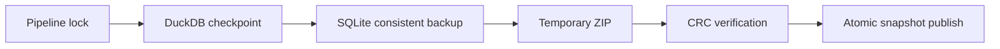

## 25. Restore architecture

Restore validates archive shape and database contents before replacing live files. It rejects unexpected/nested/path-traversal/symlink/duplicate members and CRC corruption.

Existing databases are renamed to recovery backups before the validated pair is installed. If installation fails, the previous pair is restored.

The system therefore treats recovery as a state transition with rollback, not “unzip and pray.”

## 26. File-lock boundary

Backup and restore use the same conceptual pipeline lock as ETL-sensitive operations. If the lock cannot be acquired, the operation refuses to proceed rather than racing an active pipeline.

This is a local application, but local does not mean concurrency bugs receive diplomatic immunity.

## 27. Data durability by layer

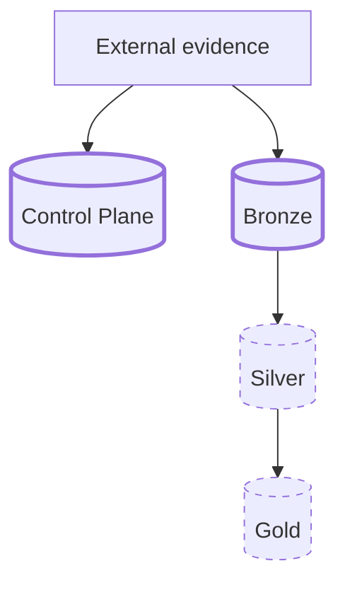

Operational history and Bronze evidence are designed to survive analytical replacement. Silver/Gold can be rebuilt from upstream state.

## 28. Layer-specific failure semantics

| Failure location | Expected architectural response |
|---|---|
| discovery / extraction | run fails; analytical publication not committed |
| Bronze synchronization | transactional rollback where possible; pending state remains actionable |
| transformation / engine | rollback; failure provenance recorded |
| contract validation | fail before publication commit |
| Silver / Gold load | rollback before commit |
| DuckDB commit | run fails; SQLite not committed |
| SQLite commit after DuckDB | temporary divergence; next-run healing/idempotency |
| snapshot validation | snapshot not published |
| restore validation | live databases untouched |
| restore install failure | recovery backups restored |

## 29. Why not one database?

A single database could simplify the commit story, but it would force operational and analytical workloads into the same engine and lifecycle. The current design accepts a narrow coordination cost to preserve clear responsibilities:

- SQLite for small transactional operational history and payload/snapshot metadata;
- DuckDB for columnar analytical processing and BI consumption.

That trade-off is documented more fully in `design-decisions.md`.

## 30. Warehouse invariants

1. Control Plane historical state is authoritative over DuckDB Meta projections.
2. Bronze is synchronized through registered source contracts.
3. Silver/Gold publication is registry-governed.
4. Analytical outputs must be complete before publication.
5. Silver/Gold are replaceable derived state.
6. Meta reflects current analytical context, not complete operational history.
7. Cross-database consistency is coordinated/recoverable, not distributed-atomic.
8. Snapshot/restore treats the database pair as one application recovery unit.

## 31. Warehouse non-guarantees

The architecture does not guarantee:

- historical versions of every Silver/Gold publication inside DuckDB;
- atomic commit across both database engines;
- that every historical artifact event retains an original binary forever;
- that Meta can independently reconstruct Control Plane history;
- that Gold is a canonical transaction ledger;
- that a renamed file represents new financial evidence.

## Related specifications

- [System Architecture](system-architecture.md)
- [Data Lifecycle](data-lifecycle.md)
- [Data Model](data-model.md)
- [Control Plane Artifact Lifecycle](control-plane-artifact-lifecycle.md)
- [Reliability and Recovery](reliability-and-recovery.md)
- [Backup and Restore](backup-and-restore.md)
- [Bronze Data Contracts](../reference/bronze-data-contracts.md)
- [Silver Data Contracts](../reference/silver-data-contracts.md)
- [Gold Data Contracts](../reference/gold-data-contracts.md)
- [Meta Data Contracts](../reference/meta-data-contracts.md)
- [Control Plane Data Contracts](../reference/control-plane-data-contracts.md)
